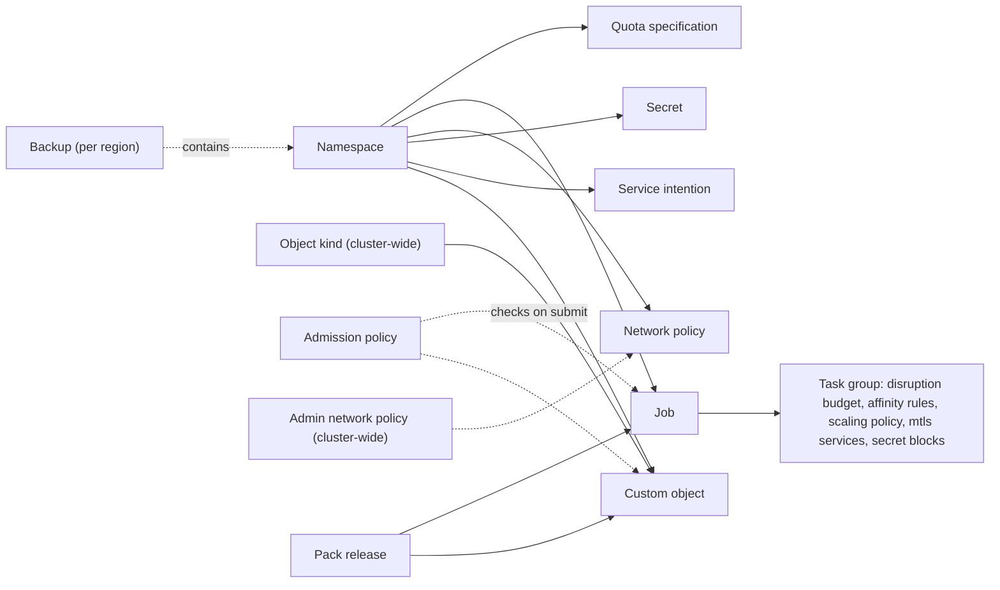

Norca keeps the model of Nomad v1.6.5 — regions, datacenters, node pools, servers and clients, jobs,
task groups, tasks, allocations, evaluations, deployments, namespaces, ACLs, Variables and workload
identities (see the other pages of this section) — and adds the objects below. All of them are stored in
the servers' Raft state, are protected by ACLs, and are visible in the web UI, the HTTP API and the CLI.

| Concept | What it is | Scope | Feature |
| --- | --- | --- | --- |
| Quota specification | Limits and defaults of resources and allocations for the namespaces it is attached to | Global (replicated from the authoritative region), limits per region | [Quotas](/docs/features/quotas) |
| Admission policy | CEL rules (and webhooks) evaluated when a job or object is submitted | Region | [Admission control](/docs/features/admission-control) |
| Scaling policy (typed) | A validated `scaling` block of a task group, evaluated by the built-in autoscaler | Job | [Autoscaler](/docs/features/autoscaler) |
| Disruption budget | How many allocations of a group may be voluntarily disrupted at a time | Task group | [Disruption budget](/docs/features/disruption-budget) |
| Cross-job affinity | Rules to place a group with (`colocate`) or away from (`separate`) groups of other jobs | Task group | [Cross-job affinity](/docs/features/cross-job-affinity) |
| Check role | The role of a service check: startup, readiness or liveness | Service check | [Health check roles](/docs/features/health-check-roles) |
| Network policy, admin network policy | Allowed and denied traffic of allocations, enforced on the nodes | Namespace / cluster | [Network rules](/docs/features/network-rules) |
| Object kind, custom object | A user-defined type with a schema, and its instances, reconciled by controllers | Cluster / namespace | [Operator framework](/docs/features/operator-framework) |
| Service catalog entry | A service instance with its health, datacenter and check roles; also external services | Namespace | [Service discovery](/docs/features/service-discovery) |
| Workload certificate | A short-lived SPIFFE certificate of a task group with mTLS services | Allocation | [Native mTLS](/docs/features/native-mtls) |
| Service intention | Allows or denies connections between services | Namespace, per region | [Intentions](/docs/features/native-mtls/intentions) |
| Secret | A versioned, audited value of the built-in secret store | Namespace, per region | [Secret store](/docs/features/secrets) |
| Seal | The protection of the keyring (for example `shares`); a sealed server cannot decrypt | Server | [Seal](/docs/features/secrets/seal) |
| Backup | An encrypted snapshot of a region's state in an S3-compatible store | Region | [Backup and restore](/docs/features/backup-restore) |
| Pack release | An installed pack with its revision history, applied by the servers | Namespace | [Releases](/docs/features/packages/releases) |
| Multiregion deployment | One job version rolled out region by region | Federation | [Multiregion deployments](/docs/features/multiregion) |
