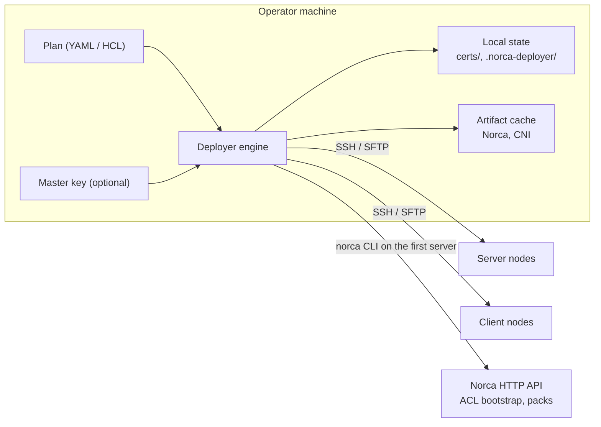

A single-binary installer and lifecycle tool for [Norca](https://github.com/bacanoo-io/norca) clusters. It reads a declarative deployment plan (YAML or HCL), connects to the nodes over SSH (or runs locally) and installs, configures and upgrades the Norca agents idempotently. Nothing has to be preinstalled on the nodes.

## Features

- **Servers and clients** on Linux and Windows nodes, per-node datacenter, multi-region federation (`authoritative_region`, ACL replication).
- **Rolling restarts:** only changed nodes restart. Servers restart one at a time and the deployer waits until each one is healthy, has a leader and sees all Raft peers. Clients restart in batches. A new cluster starts all servers at once.
- **Security:** an internal CA with mTLS certificates (`server.<region>.nomad`, `client.<region>.nomad`), gossip encryption (`AUTO_GENERATE`), ACL bootstrap with the management token stored locally, encrypted with AES-256-GCM when a master key exists. Optional SPIFFE IDs in all certificates and intermediate CAs (for OpenZiti). Secrets in the plan can be inline `!enc:v1:...` values.
- **Artifacts:** the Norca binary and the CNI plugins are downloaded on the deployer machine (SHA-256 verified and cached) or taken from local files, then copied to the nodes. The nodes need no internet access.
- **Debian packages:** APT repositories (deb822 with `Signed-By` keyring, pin priority, repository auth) and local `.deb` files copied from the deployer machine, with version pinning and `apt-mark hold`.
- **Bash scripts** in the phases `pre_install`, `post_packages` and `post_install`. A script runs again only when the script or its environment changed.
- **Network exposure:** by default the agent listens only on each node's cluster address (and on loopback for the local CLI). Firewall rules on Linux nodes (ufw, firewalld or iptables) limit the API, the cluster ports and the allocation ports to given CIDRs; `default_deny` turns ufw on without locking out SSH.
- **Tuning:** sysctl, kernel modules and log rotation.
- **Node labels and resources:** meta labels and node class (with cluster-wide `client_defaults`), node pools, host networks, reserved resources, drain on shutdown, the dynamic port range (kept in step with the firewall), and `extra_hcl` for other agent settings.
- **Node lifecycle:** new nodes are installed by adding them to the plan; `inventory.decommission` drains or removes nodes from Raft and uninstalls them. A list of installed nodes stops an apply when a node was only deleted from the plan.
- **Bootstrap secrets and policies:** after the cluster is up, secrets of the built-in secret store and Variables (plain, encrypted, from files, or generated once: passwords, NATS NKeys) and ACL policies bound to jobs.
- **Packs:** creates pack registries and installs packs with the server-side `deploy-pack`. A pack is deployed again only when its settings changed.
- **SSH host keys:** trust on first use (`tofu`), `strict` or `off`.

## Build

Requires Go 1.26 or newer.

```sh
go build -o bin/norca-deployer ./cmd/norca-deployer
```

The deployer runs on Linux, macOS and Windows (amd64 and arm64) and needs no cgo. For a build for another system, turn cgo off:

```sh
CGO_ENABLED=0 GOOS=linux GOARCH=amd64 go build -o bin/norca-deployer-linux-amd64 ./cmd/norca-deployer
```

`connection.mode: local` (installing on the machine the deployer runs on) needs a Linux host with systemd.

## Quick start

```sh
# 1. Create a sample plan (or start from one of the examples)
norca-deployer init -c cluster-deploy.yaml

# 2. Optional: create a master key to encrypt secrets and the ACL token
norca-deployer secret create-key
norca-deployer secret encrypt 'my-ssh-password'   # prints !enc:v1:aes-gcm:...

# 3. Check the plan and see what will happen
norca-deployer validate -c cluster-deploy.yaml
norca-deployer plan -c cluster-deploy.yaml

# 4. Install or update the cluster (safe to run again)
norca-deployer apply -c cluster-deploy.yaml
```

## Commands

| Command | Description |
| --- | --- |
| `init [--force]` | Write a sample plan; `--force` overwrites an existing file |
| `validate` | Check the syntax and the logical constraints of the plan |
| `plan` | Show what `apply` would do, without changing anything (dry run) |
| `apply [--force-restart]` | Provision the nodes and roll the changes out; `--force-restart` restarts every agent (rolling) even when nothing changed |
| `secret create-key` | Create a 256-bit master key (`.norca-deployer.key`); never overwrites an existing key |
| `secret encrypt <text>` | Encrypt a value for the plan (`!enc:v1:aes-gcm:...`) |
| `pki issue-intermediate --name <name>` | Issue an intermediate CA signed by the cluster CA, e.g. for OpenZiti |
| `version` | Print the version |

Global flags: `-c, --config` (plan file, `.yaml`/`.yml` or `.hcl`; default `cluster-deploy.yaml`), `--secret-key`, `--secret-key-file`. The master key can also be given in `NORCA_DEPLOYER_SECRET_KEY`.

## Examples

Complete plans with a comment on every setting are in the [examples](/docs/deployer/examples/) section, in YAML and HCL.

## Local state

`apply` keeps its state next to the plan. Keep these files private and do not commit them:

| Path | Content |
| --- | --- |
| `certs/` | The cluster CA, the client pool and operator certificates |
| `.norca-deployer/gossip.key` | Gossip encryption key |
| `.norca-deployer/management-token` | ACL management token (encrypted when a master key exists) |
| `.norca-deployer/nodes-<region>.json` | Installed nodes (role, node definition, release) |
| `.norca-deployer/generated/`, `nkeys/` | Generated passwords and NATS NKeys |
| `.norca-deployer/known_hosts` | Trusted SSH host keys |
| `.norca-deployer/cache/` | Downloaded Norca and CNI artifacts |
| `.norca-deployer.key` | Master encryption key (created by `secret create-key` in the current directory) |

On the nodes the deployer keeps its markers under `/var/lib/norca-deployer/`.

## Testing

```sh
go test ./...
```

The end-to-end test runs against a real Debian node over SSH (needs `openssh-server`, `sudo` and internet access for the APT part):

```sh
NORCA_E2E_SSH=127.0.0.1:2222 NORCA_E2E_USER=deploy NORCA_E2E_PASSWORD=... \
  go test -tags e2e ./pkg/e2e/
```

## Documentation


  
  
  
  
  
  
  
  
  
  
  
  
  
  


## Architecture in one picture



- **Plan:** one file per region. YAML and HCL use the same keys.
- **Engine:** validates the plan, prepares every node in parallel, restarts what changed in a safe order and finishes with ACL bootstrap and packs.
- **Transport:** native Go SSH and SFTP. On Linux, `become` runs commands through `sudo`; on Windows, commands run as PowerShell.
- **Local state:** the CA, the gossip key, the ACL management token, trusted host keys and downloaded artifacts live next to the plan file.
