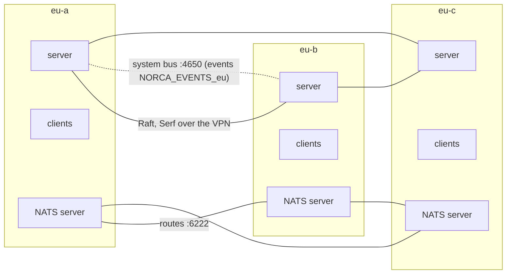

A region can span several datacenters: availability zones of a cloud region, or buildings of a campus. The servers form one Raft cluster across them, the clients of every datacenter run jobs, and the system bus of the servers keeps the event stream of the region on every server. The example also runs a NATS cluster with one server per datacenter for the applications. Example: [multi-datacenter.yaml](/docs/deployer/examples/multi-datacenter).



## Datacenters or regions

| | Datacenters of one region | Regions |
| --- | --- | --- |
| Distance | Low latency (a few ms round trip) | Any (other cities, clouds) |
| Servers | One Raft cluster over all datacenters | One Raft cluster per region |
| Jobs | One job places over the datacenters (`datacenters = [...]`, `spread`) | A job per region, or a multiregion job |
| Failure of a site | The region keeps running while a majority of the servers is up | Only that region stops |
| NATS | One cluster, routes between the datacenters | One cluster per region, gateways (supercluster) |

Raft needs a majority of the servers to answer quickly; across long distances use [regions](/docs/deployer/multi-region).

## Servers and clients

- **One server per datacenter** (three datacenters, three servers): the Raft quorum is 2 of 3, so the region survives the loss of a whole datacenter. With two datacenters, a datacenter loss can take the majority with it; use a third site (even a small one with only a server) as a tie-breaker.
- Every node names its datacenter (`datacenter: eu-b`). `metadata.datacenter` is the default for nodes without one.
- `cluster_address` is the node's address on the network between the datacenters (usually a VPN); `network.interface_prefix: wg` makes the agents listen on and advertise the VPN interface. All servers join each other over it.
- `raft_multiplier` above 1 relaxes the Raft timing when the datacenters are farther apart than a LAN.
- **`heartbeat_grace`** on the servers (`server_settings.extra_hcl: heartbeat_grace = "60s"`): when a datacenter is lost with its server, the clients that talked to that server wait for the RPC timeout (about 30s) before they heartbeat to another one. Without a grace longer than that, these healthy nodes are marked down and their allocations replaced; a NATS server replaced this way starts with an empty store. The price is that a really failed node is noticed later.
- Common client settings go into `client_defaults`; per-node labels such as the rack into the node's `client_settings.meta` ([node labels](/docs/deployer/node-labels-and-pools)).

## Firewall

`cluster_cidrs` must cover the cluster network of every datacenter (e.g. the VPN `10.10.0.0/16`): RPC and Serf between the servers, the clients to the servers, and the allocation ports between the datacenters. Static ports of workloads that are reached across datacenters go into `extra_ports`, for NATS the client port 4222 and the route port 6222 ([networking](/docs/deployer/networking-and-tuning#firewall)).

## Placing jobs over the datacenters

```hcl
job "web" {
  datacenters = ["eu-a", "eu-b", "eu-c"]

  group "web" {
    count = 6

    # Even spread over the datacenters.
    spread {
      attribute = "${node.datacenter}"
    }
  }
}
```

For stateful services with one instance per datacenter, Norca's `separate` block keeps the instances apart by a node attribute:

```hcl
separate {
  scope    = "${node.datacenter}"
  required = true      # false: a preference
}
```

## NATS across the datacenters

The `nats` pack of the Norca pack registry runs one NATS server per datacenter:

| Pack value | Meaning |
| --- | --- |
| `datacenters: [eu-a, eu-b, eu-c]`, `count: 3` | Three servers |
| `separate_scope: "${node.datacenter}"`, `separate_required: true` | One per datacenter (and `distinct_hosts`: one per node) |
| `jetstream_enabled: true` | Streams and KV buckets; with 3 replicas they keep a majority without one datacenter |
| `jetstream_unique_tag: dc` | Every server is tagged `dc:<datacenter>`; the replicas of every stream go to different datacenters (also with more servers than datacenters) |
| `cluster_compression: s2_auto` | Routes compressed by their round trip time: more between datacenters, little inside one |
| `auth_mode: userpass`, `users` | Users in accounts; their passwords are secrets `nats/users/<user>` |

The servers find each other through the native service catalog (`<job>-cluster`) and connect with routes on port 6222. Clients connect to any server on port 4222; the service `nats` lists them.

The deployer prepares everything the pack reads:

```yaml
secrets:
  bootstrap:
    - path: nats/users/app
      items: {password: "!generate:nats-app"}       # generated once, kept locally
```

The passwords of the users are in `.norca-deployer/generated/<name>` on the operator machine, for the applications that connect.

## The event stream

The servers embed NATS with JetStream: their system bus. The leader publishes the event stream of the region (jobs, deployments, evaluations, allocations, nodes, services, scaling, ...) on it:

- **Subjects:** `nomad.<region>.<namespace>.<topic>`, e.g. `nomad.eu.default.Allocation` (`_` for events without a namespace, such as `nomad.eu._.Node`).
- **Stream:** `NORCA_EVENTS_<region>` with one replica per server (up to three), so the event history survives the loss of a datacenter. Delivery is at least once, with a stable message id for deduplication; a new leader continues after the newest event of the stream.
- **Limits:** 72 hours and 1 GiB by default, oldest events dropped first, S2 compressed (the `bus` block of the servers; set it with `extra_hcl`).
- **Ports:** the routes between the servers use `network.ports.bus_cluster` (4650), consumers connect to `network.ports.bus` (4649); with `apply_firewall_rules` both are opened to `cluster_cidrs`.
- **Access:** a consumer needs an ACL token whose policy has a `bus` rule, for example [events-reader.hcl](/docs/deployer/examples/cluster).

```sh
nats --server tls://10.10.1.11:4649 --tlsca .norca-deployer/certs/ca.pem --user "$TOKEN" \
  sub 'nomad.eu.>'
norca operator bus status               # streams, routes and JetStream state of a server
```

## When a datacenter fails

| Component | Behavior with eu-b down |
| --- | --- |
| Norca servers | Two of three remain: leader election and scheduling continue. If the lost server was the leader, the new one waits up to 5 minutes (failover heartbeat TTL) before it marks the nodes of eu-b down |
| Clients in eu-a, eu-c | Those connected to the lost server switch to another one; `heartbeat_grace` keeps them from being marked down meanwhile |
| Jobs | Allocations of eu-b are rescheduled to eu-a and eu-c (within the limits of `datacenters`, `spread` and `separate`) |
| NATS | Two servers remain; JetStream streams with 3 replicas keep their majority |
| Event stream | Two of three replicas remain; the leader (or a new one) keeps publishing |

`separate_required: true` keeps the third NATS server pending while eu-b is down, instead of putting two NATS servers into one datacenter; it is placed again when eu-b comes back.

## Operations

- **Rollouts:** servers restart one at a time, so every datacenter keeps its quorum share; `upgrade.max_parallel_clients` limits the clients restarted together across all datacenters.
- **Adding a datacenter:** add its nodes with their `datacenter`, extend `cluster_cidrs` if needed, and add it to the `datacenters` of the jobs and packs. Keep the number of servers odd (3 or 5).
- **Removing nodes:** move them to `inventory.decommission` ([adding and removing nodes](/docs/deployer/adding-and-removing-nodes)).
