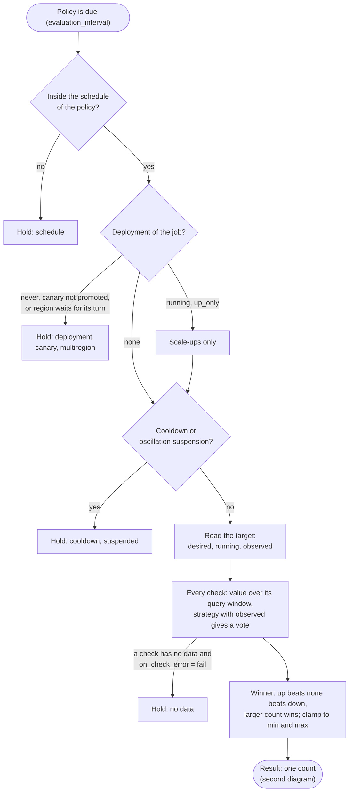
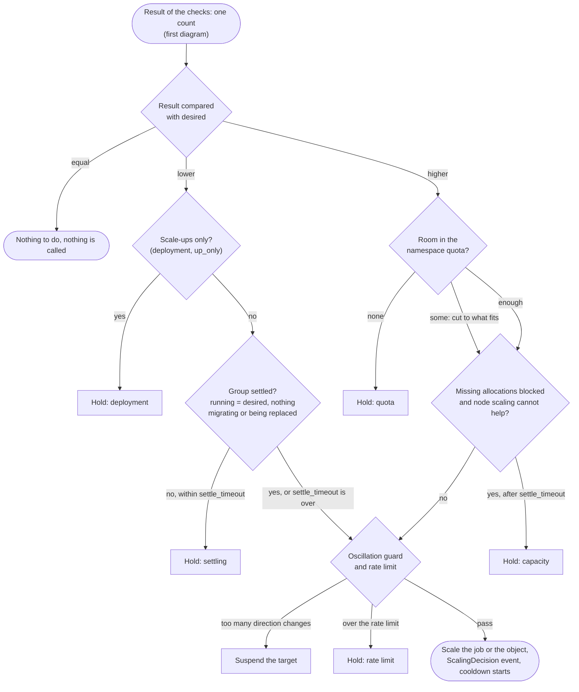

**Status:** In progress · 2026-11-12 (the decision model and the fixes of the built scalers are implemented; the application metrics, the operator-reported metrics and the `backlog` strategy are planned) · Feature pages: [built-in autoscaler](/docs/features/autoscaler), [node scaling](/docs/features/node-scaling) · Related: [development plan](/docs/design/development-plan#target-architecture), [cluster scaling](/docs/design/cluster-scaling-plan)

A task group or a custom object scales on **what the application is doing**, not only on its CPU and memory: requests in flight, the backlog of a queue, the lag of a consumer, or a state that only the operator of the application knows. No external metrics system is needed: the values travel on the usage report the clients already send, and the decision is made by the autoscaler that already runs on the leader, with all of its safeguards.

| Way | Who measures | What it is for | Status |
| --- | --- | --- | --- |
| **Task metrics** | The client, from each allocation (a loopback endpoint, later a file) | Load per instance: in-flight requests, sessions, a local queue | Planned |
| **Operator-reported metrics** | An operator (controller) through the API | State outside the allocations or across them: a shared queue, replication lag, the view of a database; works at zero allocations | Planned |

Whatever the source, a check names a metric, a strategy turns its value into a count, and the existing pipeline applies the minimum and maximum, the cooldowns, the oscillation guard, the deployment gate, the quota ceiling and the rate limit before it writes the count. **The decision is always the policy's:** an operator reports, it does not decide the count.

**The fixes of the built scalers came first.** The decision path of the built scaler had defects that showed whenever a group was not fully running (allocations starting, waiting for capacity, migrating). Scaling on application metrics, from zero in particular, would have met them on every step.

## Table of contents

- [Scope](#scope)
- [Data path](#data-path)
- [Metric sources](#metric-sources)
- [Operator-driven scaling](#operator-driven-scaling)
- [Scaling math](#scaling-math)
- [Decision model](#decision-model)
- [The decision flow of a policy](#the-decision-flow-of-a-policy)
- [The task group scaler and the node scaler](#the-task-group-scaler-and-the-node-scaler)
- [Regions](#regions)
- [Visibility](#visibility)
- [Security](#security)
- [Configuration](#configuration)
- [Phases](#phases)
- [Decisions](#decisions)
- [Later, by need](#later-by-need)

## Scope

Horizontal scaling of task groups and custom objects by the built-in autoscaler of the leader. Node scaling (`NodeGroup`) uses the same engine and has its own plan, the [cluster scaling plan](/docs/design/cluster-scaling-plan); it appears here where the two scalers depend on each other.

What the plan builds on, all of it available:

- **The policy engine on the leader:** the policy syntax of the jobspec, the strategies `target-value`, `threshold`, `fixed-value` and `pass-through`, several checks per policy, cooldowns read from the scaling events, the oscillation guard, the deployment gate, the quota ceiling, the rate limit and the dry run.
- **The usage pipeline:** the clients measure every task group (samples every second, windows of 10 seconds) and send a usage report over the [system bus](/docs/features/system-bus); every server stores it in its [metrics store](/docs/configuration/metrics_store), and the leader keeps a short window in memory.
- **Custom object targets:** a policy can write the scale of a custom object, and its controller derives the count from it.
- **The plugin-based scaling:** policies of the external engine, external APM and strategy plugins, the Prometheus APM plugin. **It stays and keeps working when it is configured;** every change of this plan is an addition next to it, and no Norca feature depends on it.

## Data path

```text
 ALLOCATION                   CLIENT NODE                        EVERY SERVER              LEADER
 ----------                   -----------                        ------------              ------
 cgroup stats ────────────┐
 loopback /metrics (new) ─┼─► usage per task group ─► usage report ─► system bus ─► metrics store
 metrics file (later) ────┘   (average and maximum,    (RPC as the      stream       (norca.group.*)
                              application values: new)  fallback)          │
                                                                           └────────► window in memory ─┐
 OPERATOR (new)                                                                                          │
 report ─► any server ─► published on the same stream ──────────────────────────────────────────────────┤
                                                                                                         ▼
                                      sources: group usage │ application values │ reported values │ cluster gauges
                                                                                                         │
                                      check ─► strategy ─► winner ─► deployment gate ─► min/max ─► quota ceiling
                                      ─► cooldown, oscillation guard ─► rate limit ─► scale the job or the object
```

The new parts reuse the path. Task metrics ride in the same report, and reported values are published on the same stream by the server that receives them, so every server stores them and the leader gets them like any other usage. **Nothing about metrics is written to Raft;** the only Raft writes are the scaling actions and their events.

## Metric sources

### Task group resource usage (available)

| Check metric | Store series | Value |
| --- | --- | --- |
| `nomad.cpu` | `norca.group.cpu` | CPU used, % of the allocated CPU |
| `nomad.memory` | `norca.group.memory` | Memory used, % of the allocated memory |
| `nomad.cpu_mhz` | `norca.group.cpu_mhz` | CPU used, MHz |
| `nomad.memory_mb` | `norca.group.memory_mb` | Memory used, MiB |

A query can name another group with the suffix `/<group>/<job>@<namespace>`. All of these stay as they are.

**Planned, next to them:** a check can name every group series of the store without the `norca.` prefix (`group.cpu`, `group.cpu_throttled`, `group.oom_kills`, `group.allocs_running`, `group.allocs_queued` and the others). The application values are `app.<name>` and `reported.<name>` for the policy's own group.

### Cluster gauges (available)

The source `norca` reads the capacity gauges of the cluster by datacenter, pool and class. Node scaling uses them; a task group policy can read them too, for example to hold a scale-up when the pool is full.

### Task metrics from a loopback endpoint (planned)

The group declares which values it exposes, and the client reads only those.

```hcl
group "api" {
  network {
    mode = "bridge"
    port "http" { to = 8080 }
  }

  metrics {
    port     = "http"          # a port label of the group
    path     = "/metrics"      # default
    format   = "prometheus"    # or "json"
    interval = "10s"           # default: the report interval
    include  = ["http_requests_in_flight", "checkout_queue"]
  }
}
```

- **Allowlist only.** At most 16 names per group; a name is `[a-z0-9_]{1,64}`. Lines of other names are skipped.
- **Types.** A gauge is taken as it is. A counter becomes its increase per second between two reads; a decrease is a restart and gives no value for that read. Histograms and summaries are ignored. Several series of one name are summed.
- **Where the client connects.** The allocation's own address and port; never the address of another allocation.
- **Limits.** A timeout of 2 seconds, a body of at most 64 KiB, one read per allocation per interval, no redirects. **A failed read gives no value, not zero.**
- **Aggregation.** Like the resource usage: the average and the maximum over the samples of the window.
- **Formats.** Prometheus text, or a flat JSON object of numbers: `{"checkout_queue": 180, "http_requests_in_flight": 42}`.

### External sources (available, optional)

The Prometheus APM plugin, the external plugin binaries and the external engine keep working when they are configured. The built-in sources always work without them. A built-in check may use an external strategy plugin with any of the new metrics, because the source and the strategy are independent.

## Operator-driven scaling

An operator, a controller built with the [controller SDK](/docs/features/operator-framework), often knows what the allocations cannot report alone: the length of a shared queue, the lag of a consumer group, the replication delay of a database, the number of tenants on a shard.

**There is one supported way to bring this state into scaling: the operator reports it as metrics, and a scaling policy decides.** Every safeguard applies, it works at zero allocations, and the decision is visible in one place.

Not supported as patterns:

- **The operator decides the count and scales directly.** Such a change skips the quota ceiling, the deployment gate, the oscillation guard and the rate limit, and splits the decision between the operator and the policies.
- **The operator reports the count it wants** and a `pass-through` check hands it on: the same split in disguise.

An operator that has to do steps around a count change (a database replica that joins, a shard that rebalances) gets the count from a policy on its custom object and does the steps itself. The count is still the policy's decision.

### Reported metrics (planned)

An API call, also in the controller SDK, reports values for a target: a task group, or a custom object.

```json
{
  "Namespace": "prod",
  "Target": { "Job": "orders", "Group": "worker" },
  "Values": { "queue_depth": 1240, "consumer_lag_seconds": 14.2 }
}
```

- **Path.** The server that receives the report checks the token, the target and the limits, then publishes the values on the telemetry stream, which only servers can write. From there they go the same way as the client reports. No forwarding to the leader is needed, and a leader change loses nothing.
- **Meaning.** A value is a gauge: the state at the time of the report. It is valid for its time to live (three evaluation intervals by default). **A check whose metric has no valid value fails like any check without data,** and `on_check_error` decides: no scaling, or the other checks decide.
- **Names.** `reported.<name>` in checks, separate from the `app.` names, so the origin of a value is never in doubt. The same name rule and the same limit of 16 names per target as for task metrics.
- **Access.** A new namespace capability, `submit-metrics`. **A reporter must not be able to scale,** so the capability for scaling is not reused. At most one report per target per second is accepted.

No new check syntax is needed:

```hcl
group "worker" {
  count = 0

  scaling {
    min = 0
    max = 50

    policy {
      cooldown             = "5m"
      cooldown_on_scale_up = "15s"

      check "backlog" {
        metric = "reported.queue_depth"
        strategy "backlog" {
          target = 100            # items one worker can carry
        }
      }
    }
  }
}
```

The operator reports `queue_depth` every 10 seconds from the queue's own API; the group scales from 0 to `ceil(1240 / 100) = 13`, and back to 0 when the queue is empty.

### Other writers of a count (available)

The scale APIs stay as they are, for people and for the plugin-based scaling. A count changed by hand on the target of an enabled built-in policy is **allowed, not refused:** refusing would break emergency use. The reply carries a warning, the status of the policy shows it, and the policy decides again after its cooldown.

## Scaling math

### Values per instance: `target-value` (available)

For a value that more instances spread (in-flight requests, sessions, CPU): `new = ceil(count × value / target)`, with no change inside the threshold band.

Example: 4 instances at 75 in-flight requests on average, target 50: `ceil(4 × 75 / 50) = 6`. With 6 instances the average falls to 50 and the count stays.

### Shared backlog: the `backlog` strategy (planned)

For a value that every instance sees whole (the length of a shared queue, the lag of a consumer group), `target-value` overshoots: at count 2 and a queue of 1000 with target 100 it asks for 20, then at count 20 and a queue of 900 for 180. The `backlog` strategy divides the backlog itself:

```text
new = ceil(value / target)            (for any count, including 0)
direction: up   if new > desired
           down if new < desired and value / (desired × target) < 1 − threshold
```

It is a strategy of its own, not an option of `target-value`: the formula and the direction rule differ. With `min = 0` the group empties when the backlog is 0 and wakes up on the first item.

### Several checks (available)

Every check votes: **up beats none, none beats down**, and among the same direction the larger count wins. A scale-down therefore happens only when every check wants it. An application check and a CPU safety check side by side are the normal pattern.

### Order of the safeguards (available)

1. **Schedule.** Outside the window of the policy it is not evaluated.
2. **Deployment gate.** During a deployment `never` skips the evaluation, `up_only` lets only scale-ups through, and nothing happens while a canary waits for promotion.
3. **Cooldown and oscillation suspension.** The cooldown counts from the last change of the count, whoever made it.
4. **Checks and strategies.** A check without data follows `on_check_error`.
5. **Winner**, kept inside the minimum and the maximum, compared with the desired count; the settle rule holds scale-downs.
6. **Quota ceiling.** A scale-up is cut to what the namespace quota still allows.
7. **Rate limit**, for the whole cluster.
8. **The scaling action,** with the identity of the autoscaler, and its event.

Every step that stops an evaluation is recorded in the [status of the policy](#visibility).

## Decision model

*Implemented.*

The evaluator used to have one number for a target, the running allocations, and used it as the population the measured value belongs to, as what was already asked for, and as the base of the direction. **These are equal only when the group is at rest.** A target now has three numbers:

| Number | Meaning | From |
| --- | --- | --- |
| `desired` | What was asked for | The `count` of the group; for an object target the value of its scale |
| `running` | What runs now | The running allocations that are not canaries |
| `observed` | The population the value was measured on | The average number of running allocations over the query window of the check, from the task states of the allocations |

The rules:

1. **The value is restated for the desired count, and the strategy runs with `desired`.** A value per instance that was measured on `observed` instances is what `desired` instances would show for the same load: `value × observed / desired`. With it `target-value` gives `ceil(observed × value / target)`: the average total load divided by the target, whatever happened to the population inside the window. The strategy interface is unchanged, so built-in strategies and external strategy plugins get the same exact values.
2. **A change is needed when the result differs from `desired`,** and the direction is the sign of that difference. **Nothing is called when nothing changes.**
3. **Settle rule: no scale-down while the group is not settled.** Not settled means that fewer allocations run than were asked for, or that allocations of the group are migrating or being replaced (a drain, a lost node). The hold lasts at most `settle_timeout` (10 minutes by default).
4. **A scale-up while not settled is allowed** when the result is above `desired`: the formula already counts on the allocations that are on their way, so a larger result means that the load needs more than what was asked for.

Why a rule biased against scaling down: a late scale-down costs some capacity for minutes; a wrong one during a recovery costs an outage. Why no hold on scale-ups: with `observed` the formula is right while allocations are on their way, and waiting for nodes to join would turn a capacity problem into a latency problem.

**Example, a drain during steady load.** 6 instances at 50 in-flight requests each, target 50. One node is drained, 2 allocations stop, the other 4 carry 75 each. 30 seconds later a check with a window of one minute sees an average value of 60 on an average of 5 running: `ceil(5 × 60 / 50) = 6`, equal to `desired`. Nothing is done, and the two replacements start in peace. Before, the same check multiplied the 60 with the 4 that ran at that instant, got 5, and lowered the count of the group from 6 to 5 in the middle of the drain.

Three more changes belong to the model:

- **A scale to the unchanged count is free.** It succeeds without registering the job again, creates no evaluation and starts no cooldown.
- **A new job version keeps the scaled counts** of groups with an enabled policy; `norca job run -reset-counts` takes the counts of the job file.
- **Scaling is not a new version of the job.** A scale sets the count on the stored job and keeps its version, so it neither starts a deployment nor cancels a running one. What a scale-up adds during a deployment is placed outside that deployment: it is not waited for by it, and a failed deployment does not hold it. With that, `scale_during_deployment` is `up_only` by default for policies of the built-in engine; the external engine and a scale by hand keep `never`.

## The decision flow of a policy

One evaluation of a built-in policy, in two parts. Every end of the flow, a hold, "nothing to do" or a scaling action, is written into the status of the policy.

**Part 1: gates and measuring.** The three gates stop an evaluation before anything is measured; then the checks turn the measured values into one result.



**Part 2: decision and action.** The two directions are treated differently on purpose: a lower result waits until the group is settled, a higher result is only limited by what can be had (quota, capacity).



## The task group scaler and the node scaler

```text
 load rises
   │
   ▼
 application check (every evaluation interval) ──► the count of the group is raised
   │
   ▼
 scheduler: places what fits ──► the rest waits as blocked work (per datacenter and pool)
   │
   ▼
 node scaling: picks the node group ──► its size is raised
   │
   ▼
 the operator creates machines ──► they join (minutes on a cloud)
   │
   ▼
 the blocked allocations are placed ──► more run ──► the load per instance falls ──► the check settles

 load falls
   │
   ▼
 application check ──► the count is lowered ──► allocations stop ──► the nodes are less used
   │
   ▼
 node scaling lowers one group by one ──► the operator drains a node
   │
   ▼
 the allocations of the node migrate ──► fewer run meanwhile
```

**The task group scaler reacts in seconds, the node scaler in minutes.** Every problem this plan fixed came from one side acting on a state the other side had not finished changing. The fixes, all implemented and described on the [node scaling](/docs/features/node-scaling) pages:

- **Decision model** (above): the task group scaler counts on the allocations that are on their way, and does not scale down during a drain or the loss of a datacenter.
- **Capacity link.** When `settle_timeout` ends and the missing allocations of the group are work that node scaling cannot help (no group, a group or pool at its maximum, too large for a node), the task group scaler stops raising the count and shows the hold `capacity`. It never lowers the count to "what runs" by itself; that stays with the checks.
- **Health filter.** A node group gets no new work while its operator reports that no machine can be made for it, and a group most of whose nodes are down gets work only when no healthy group can take it.
- **Spread first.** Where new nodes go follows the datacenter spread and the affinities of the job before the expander of the pool decides.
- **Balance in the scale-down.** The node that goes is one of the group furthest above its share of the pool, so a datacenter that returned empty is not the one that is lowered.
- **Datacenter patterns.** A job with `datacenters = ["*"]` can grow a node group in a datacenter that has no node yet.
- **Capacity per node group,** the pool maximum during the loss of a datacenter, an optional **reserve for the loss of a datacenter**, and the **repair** of a node that stays down while its instance runs.

One count and one average cover all datacenters of a group. **Where the datacenters must scale apart, the pattern is one group per datacenter, each with its own policy.**

## Regions

- **Regions stay independent;** no check reads another region.
- *Planned:* the `multiregion` block may set the scaling bounds per region, like the count.
- *Planned:* for a backlog shared by several regions, the SDK reports each region its share. There is no takeover of the share of a silent region; that would need reads across regions.
- There is no scaling in a region that waits for its turn in a multiregion rollout: the scheduler places nothing there. The hold is shown.

## Visibility

**Status of a policy (available).** The leader keeps the last evaluation of every built-in policy in memory: its time, the value and the vote of every check, the three numbers of the target, the result, and why nothing was done. It is read with [`norca scaling policy info`](/docs/commands/scaling/policy-info) and the [API](/docs/api/scaling-policies), with the permissions of the policy. After a leader change it is empty until the first evaluation.

| Hold reason | Meaning |
| --- | --- |
| `schedule` | Outside the window of the policy |
| `deployment`, `canary`, `multiregion` | A deployment runs; canaries wait for promotion; the region waits for its turn |
| `cooldown`, `suspended` | Cooldown after a change of the count; oscillation suspension |
| `settling` | A scale-down is held: allocations are starting, blocked, migrating or being replaced |
| `no data` | A check has no valid value (`on_check_error` decides) |
| `quota`, `capacity` | Capped by the namespace quota; node scaling cannot help the work |
| `rate limit` | Dropped by the limit of the cluster, tried again at the next interval |

**Events.** `ScalingDecision`, `ScalingQuotaCapped`, and `ScalingHeld` with the reason: once when a hold has lasted `hold_warn`, and once when it ends. *Planned:* an event when a check loses its data, so that a stopped operator is noticed.

**Series.** *Planned:* the application and the reported values are stored like the other series of a group and read with the history API of the metrics store.

## Security

- The client connects only to the allocation's own address and declared port, follows no redirect, and applies size and time limits; the allowlist bounds what is parsed.
- A client report is accepted only from the node that runs the allocations, so **a node cannot feed values for groups it does not run.**
- Reported values need the `submit-metrics` capability on the namespace of the target, which does not allow scaling; the stream they travel on is writable by servers only.
- Every scaling action is made with the identity of the autoscaler and recorded as a scaling event.

## Configuration

Available, in the [`autoscaler` block](/docs/configuration/autoscaler): `settle_timeout`, `hold_warn`, and for node scaling `balance`, `max_nodes_counts` and `reserve_datacenter_loss` per pool. `norca job run` has `-reset-counts`.

Planned:

| Setting | Where | Meaning |
| --- | --- | --- |
| `metrics` block | task group | The endpoint and the names of the task metrics |
| `backlog` | strategy of a check | The strategy for shared backlogs |
| `group.*`, `app.<name>`, `reported.<name>` | metric of a check | The new metric names |
| `reported_ttl_max` | `autoscaler` block | Upper bound of the time to live of a reported value |
| `app_metrics`, `app_scrape_timeout` | client configuration | Switch and timeout of reading the task metrics |
| `scaling { min max }` | region of a `multiregion` block | Scaling bounds per region |

## Phases

| Step | Content | Status |
| --- | --- | --- |
| 1 | A scale to the unchanged count is free | Implemented |
| 2 | Decision model: `desired`, `running`, `observed`, the settle rule | Implemented |
| 3 | Counts kept on a new job version; status of a policy, `ScalingHeld`, the warning for a count changed by hand; scaling keeps the job version; `up_only` by default for the built-in engine | Implemented |
| 4 | Node scaling: datacenter patterns, capacity per node group, health filter, spread first, balance, pool maximum during a loss, repair of nodes that are down | Implemented |
| 4b | Reserve for the loss of a datacenter, optional | Implemented |
| 5 | Capacity link | Implemented |
| 6 | Lab case for the whole | Implemented (the lab case covers the status, the holds, counts kept and a scale by hand; load steps on a real metric are not in it) |
| 7 | Task metrics: the `metrics` block with Prometheus text and flat JSON, the `group.*` and `app.*` names, store series | Planned |
| 8 | Operator-reported metrics: API, SDK, time to live, `submit-metrics`, the event of a check without data | Planned |
| 9 | The `backlog` strategy; reports on custom objects; bounds per region and shares in the SDK | Planned |

## Decisions

1. **Operator-driven scaling has one way:** the operator reports metrics and a policy decides.
2. **The plugin-based scaling stays** and must keep working when it is configured.
3. **The fixes of the built scalers come before the application metrics.**
4. **A target has `desired`, `running` and `observed`;** no scale-down while the group is not settled, for at most `settle_timeout`.
5. **A scale to the unchanged count is free** and starts no cooldown.
6. **A new job version keeps the scaled counts** of groups with an enabled policy; `-reset-counts` overrides.
7. **A count changed by hand on the target of a policy is allowed,** with a warning and a mark in the status.
8. **The task group scaler holds when node scaling cannot help the work.**
9. **Names:** the `group.*` names are added next to the existing ones, nothing is removed; `app.<name>` and `reported.<name>` are the short forms for the policy's own group.
10. **Task metrics:** Prometheus text and flat JSON in the first step.
11. **Reports need their own capability,** `submit-metrics`.
12. **`backlog` is a strategy of its own.**
13. **Limits:** 16 application and 16 reported names per target, one report per target per second.
14. **No external metrics system is ever required;** external outputs are additions only.

## Later, by need

| Item | Why later |
| --- | --- |
| Pre-warm: a scheduled `fixed-value` policy gives its coming allocations to node scaling before its window | No defect; the windows of a node group cover it by hand |
| A datacenter label on the group usage | More series and a change of the report; one group per datacenter works today |
| Task metrics from a file, for tasks without an HTTP server | The loopback endpoint covers most tasks |
| Sidecar and network values per allocation | Not until asked; the sidecar has no statistics endpoint today |
| A count per datacenter inside one group; reading the metrics of another region | Not planned: against the region-local design |
