**Status:** Plan · 2026-11-04 · Related documents: [development plan](/docs/design/nomad-fork-development-plan) (phase 4 of the built-in autoscaler, postponed until now), [built-in autoscaler](/docs/features/autoscaler), [operator framework](/docs/features/operator-framework) (the objects and the controller this plan is built on), [load balancer providers](/docs/features/operator-framework/loadbalancer-providers) (the pattern this plan follows), [topology-aware routing](/docs/features/service-discovery/topology) (the datacenter model), [native mTLS](/docs/features/native-mtls), [disruption budgets](/docs/features/disruption-budget), [adding and removing nodes](/docs/deployer/adding-and-removing-nodes)

The built-in autoscaler scales the task groups of jobs. This plan lets it scale the **number of client nodes** too: it asks a platform (a cloud, a hosting provider, a pool of machines) for more nodes when the cluster has no room for the work, and gives nodes back when there is too much room. The work is split in two. The **decision** (how many nodes a group should have) is made in the servers, by the built-in autoscaler, from the internal metrics. The **actuation** (create the instances, follow the nodes joining, drain and delete them) is done by an **operator**, a controller of the operator framework that runs as a job, and the platforms are handled by **provider applications** that register themselves, as the load balancer providers do. Nothing here changes how jobs or the external autoscaler work.

## Table of contents

- [Summary and decisions](#summary-and-decisions)
- [Goals and non-goals](#goals-and-non-goals)
- [Starting point](#starting-point)
- [Concepts: region, datacenter, node pool, node group](#concepts-region-datacenter-node-pool-node-group)
- [Architecture: decision and actuation](#architecture-decision-and-actuation)
- [Configuration](#configuration)
- [Decisions of the scaler](#decisions-of-the-scaler)
- [Metrics](#metrics)
- [The provider contract](#the-provider-contract)
- [The life of a node](#the-life-of-a-node)
- [Scale down and drain](#scale-down-and-drain)
- [Where the operator and the providers run](#where-the-operator-and-the-providers-run)
- [Example: an edge pool with Traefik, and mTLS](#example-an-edge-pool-with-traefik-and-mtls)
- [Example: game servers, a fixed base and steps](#example-game-servers-a-fixed-base-and-steps)
- [Engines: the external autoscaler and the built-in one](#engines-the-external-autoscaler-and-the-built-in-one)
- [Security, observability, failures](#security-observability-failures)
- [Licensing and provenance](#licensing-and-provenance)
- [Phases and acceptance](#phases-and-acceptance)
- [Open questions](#open-questions)

## Summary and decisions

| | Decision |
| --- | --- |
| Whether | Decided 2026-10-24: not for now, postponed. Reopened 2026-11-04. |
| Providers | Decided 2026-10-25: Hetzner Cloud, Scaleway, AWS and GCP (the same four as the load balancer providers), as separate applications; the core has no cloud code. |
| Topology | Decided 2026-10-28: region > datacenter only; one datacenter is one availability zone. |
| Engines | Decided 2026-11-04: the `engine` option stays. With an external autoscaler and its plugins, they are used; without one, the built-in autoscaler uses the providers. |
| Provider model | Decided 2026-11-04: like the load balancer providers: external applications that register an object and a heartbeat, called over HTTP. |
| Metrics | Decided 2026-11-04: the decisions are built on the internal metrics (the [metrics store](/docs/configuration/metrics_store)), not on an external APM. |
| Decision and actuation | Decided 2026-11-04: the **decision** is made in the core (the built-in autoscaler in the leader) and written to the **scale subresource** of the node group object; the **actuation** is an **operator app** (`norca-nodescaler`, a controller of the operator framework running as a job), as `norca-loadbalancer` is. The core contains no provider client. |
| Objects | Decided 2026-11-04: `NodeGroup` and `NodeProvider` are **object kinds** of the operator framework, cluster-scoped and local to the region. There is no new state table, API or ACL model. |
| Scaling unit | Decided 2026-11-04: the **node group**: the nodes of one node pool in one datacenter of one region (optionally of one node class), backed by one group of the platform. It is a management concept; the scheduler does not know it. |
| Triggers | Decided 2026-11-04: two, with different scopes: *work that cannot be placed* is a decision over the groups that work can use; the *allocated share* (with the optional **headroom**) is a decision of one group. Both from the first phase of the decision logic. |
| Expander | Decided 2026-11-04: selectable (`spread`, `fill`, `priority`, `weighted`), `spread` by default, set in the autoscaler settings of the server, per region and per pool. |
| Pool rules | Decided 2026-11-04: no separate pool object; the maximum and step of a pool are autoscaler settings of the server. |
| Bootstrap | Decided 2026-11-04: the static parts of the bundle for a new machine (the agent configuration template, the CA, the addresses) come from the **deployer**; this plan builds on the deployer. |
| Node certificates | Decided 2026-11-04: the **operator signs** the certificates of the nodes it creates, with a **name-constrained intermediate CA** that the deployer issues for each region. The servers and the agent need no change; see [node identity](#node-identity-and-certificates). |
| Where it runs | Decided 2026-11-04: the operator and the providers run **outside the pools they scale**; see [the rules](#where-the-operator-and-the-providers-run). The same rules hold for every operator, the load balancer operator included. |

## Goals and non-goals

**Goals**

- Add nodes when work cannot be placed or a group is nearly full, and remove nodes that are not needed, without a person in the loop.
- The unit is a datacenter of a node pool, so the spread over availability zones is a property of the scaler, not an accident.
- A removed node is always emptied first (drained, or found empty); no node with unfinished work is deleted.
- Providers are applications outside the core, one per platform, written against a small HTTP contract; credentials stay with them.
- The decisions use what the servers already measure.
- The core stays free of platform code: the actuation is an operator.

**Non-goals**

- Scaling the **servers** (Raft members). Only client nodes are scaled.
- Scaling across regions. A region is one Raft cluster; each region has its own decisions, operator and providers.
- Vertical sizing of tasks (a separate topic).
- Provider-specific features beyond "n nodes of this kind in this zone" (volumes, load balancers, spot pricing) in the first phases.
- Hot standby or stopped (warm) instances: free capacity is kept with `min` and the headroom for now.
- Replacing the deployer: it installs and configures nodes by hand; the scaler asks for nodes that come up by themselves (see [the life of a node](#the-life-of-a-node)).

## Starting point

What exists and what the plan builds on.

| Part | State |
| --- | --- |
| Built-in autoscaler | Runs in the leader. Its logic is ported from the Nomad Autoscaler v0.6.0 (MPL 2.0): policy checks, the strategies (`target-value`, `threshold`, `pass-through`, `fixed-value`), schedules, the policy parser, the plugin SDK. It scales **task groups only**: the cluster keys and node-selector strategies were dropped from the port, and two files say so (`sdk/target.go`, `processor.go`: "cluster scaling is not part of the built-in autoscaler yet"). |
| Engines | A policy has an `engine`: `builtin`, or `external`, which keeps the behavior of Nomad v1.6.5 (an external autoscaler agent reads the policies through the API). External APM and strategy plugins can be loaded into the built-in autoscaler; external **target** plugins cannot. |
| Operator framework | Object kinds with a schema, defaults and CEL rules; objects with `spec`, `status`, conditions and an event log; finalizers and owners; `managed_by`; a **scale subresource** (`spec.replicas`, `Scaled` events) that the autoscaler can target (`custom-object` target) and whose cooldown is derived from the `Scaled` events; the Go controller SDK (informer, work queue, backoff, leader election, metrics); operator packs. |
| Cluster metrics | The servers sample, per datacenter and node pool (labels `dc`, `pool`): `norca.cluster.cpu_allocated`, `cpu_used`, `memory_allocated`, `memory_used`, `disk_allocated` and `nodes_ready`, in percent of the capacity left after the reserved resources (the count for `nodes_ready`). They are stored and served by the [metrics API](/docs/api/metrics-store), **but the autoscaler does not read them yet**; it only reads the task group usage (`nomad.cpu`, `nomad.memory`, ...). |
| Signals of missing room | A failed placement carries per datacenter the number of nodes available (`NodesAvailable`), the nodes filtered by class and by constraint, and the exhausted dimension (`cpu`, `memory`, quota). A blocked evaluation waits until room appears. |
| Nodes | A node has exactly one region, datacenter and node pool, and at most one node class, set in the agent configuration; it also has meta. |
| Node pools | A pool belongs to a region **and is replicated from the authoritative region** to the others (name, description, meta, scheduler configuration). Two pools are built in: `default` (nodes that name no pool) and `all` (every node of the cluster; a job with `node_pool = "all"` may use any pool). |
| Drain | `DrainSpec` (deadline, ignore system jobs), eligibility, the drainer, and [disruption budgets](/docs/features/disruption-budget) that limit how many allocations of a job may be stopped at once. |
| Provider pattern | The load balancer providers: a cluster-scoped class object written by the provider with a heartbeat, an HTTP contract, a token read from a Variable, capabilities checked by the operator, `UnknownClass` / `ProviderUnavailable` states, a CA option for a private CA, the lab cases that test it. |
| Joining nodes | The deployer installs nodes over SSH with a PKI and the gossip key, and records them. A node that comes up by itself needs the same ingredients delivered another way. |
| Reusable code (MPL 2.0) | In the Nomad Autoscaler v0.6.0: `sdk/helper/scaleutils` (node selection: `empty`, `least_busy`; the drain handling) and the node queries of its Nomad APM. Usable with their headers kept; the cloud targets (`aws-asg`, `azure-vmss`, `gce-mig`) are not wanted, providers take their place. |

## Concepts: region, datacenter, node pool, node group

A **node** has exactly one region, one datacenter and one node pool (and at most one node class). The datacenter and the pool are two **independent** dimensions: a pool may span several datacenters, and a datacenter may hold several pools.

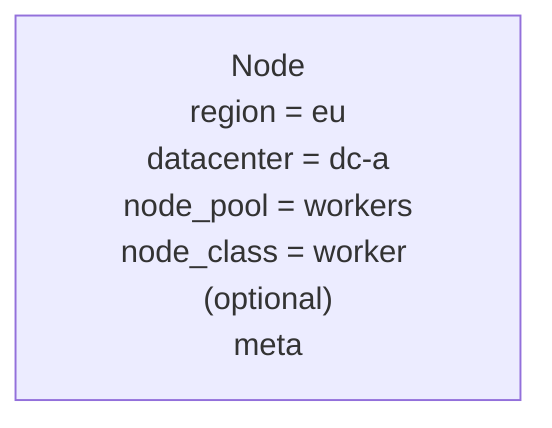

### The matrix

Inside a region, the nodes form a matrix of pools and datacenters. A **node group** is one cell of that matrix, tied to one group of the platform.

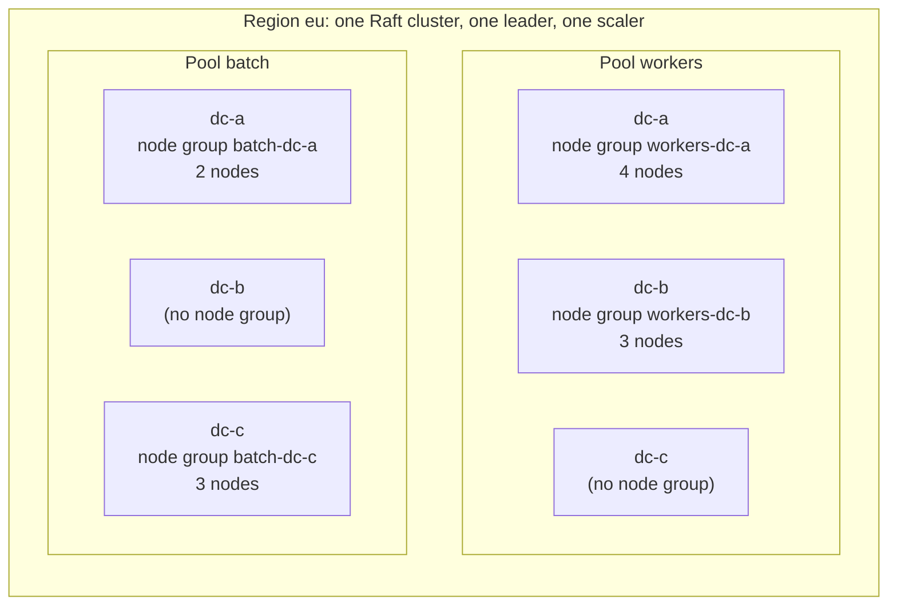

A node group is a **filter plus management data**, not a new entity of the scheduler:

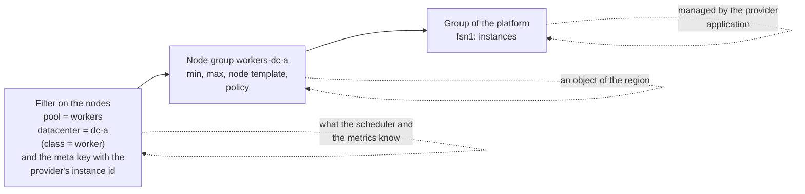

| Rule | Consequence |
| --- | --- |
| One node group has one provider group, and a provider group belongs to one node group. | A provider group lives in one zone, so a node group belongs to one datacenter. |
| A node group has one machine kind. | Several machine kinds in a datacenter are several node groups with different `node_class`. |
| A node belongs to one node group or to none. | Nodes added by hand belong to none; the scaler never touches them. Only nodes that carry the provider's instance id in their meta can be removed. |
| A node group may be missing for a pool and datacenter. | That datacenter of the pool is simply not scaled. |
| The node's pool membership comes from its own configuration. | The node group does not assign nodes to a pool; it only describes where new nodes of that pool are asked for. |
| A node group has a **network range** for its nodes. | The firewall of the servers (`cluster_cidrs`, `api_cidrs` in the deployer plan) and the template of the provider must agree with it; see [the life of a node](#the-life-of-a-node). |

### What is replicated and what is not

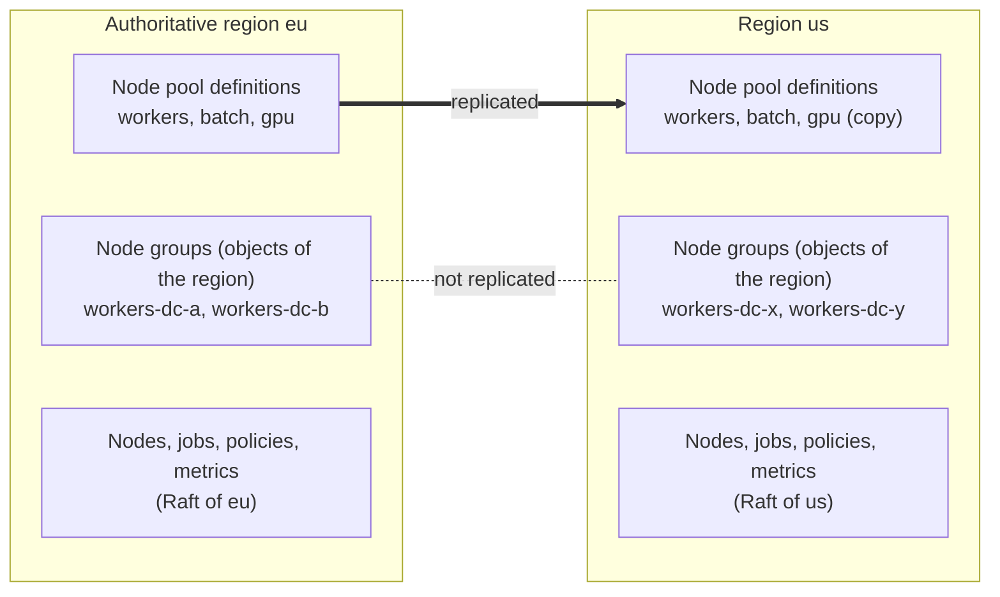

The pool is a shared concept ("workers" means the same everywhere); the node group is regional (other platform, other zones, other limits). This is why the scaling setting cannot be a field of the node pool: replicating it would carry the groups of one region into the others. Objects of the operator framework are stored in the state of their own region and are not replicated, which is what a node group needs.

### Jobs, groups and the `all` pool

A job selects its nodes by `region`, `datacenters`, `node_pool` and constraints. The **node groups it can use** are the intersection.

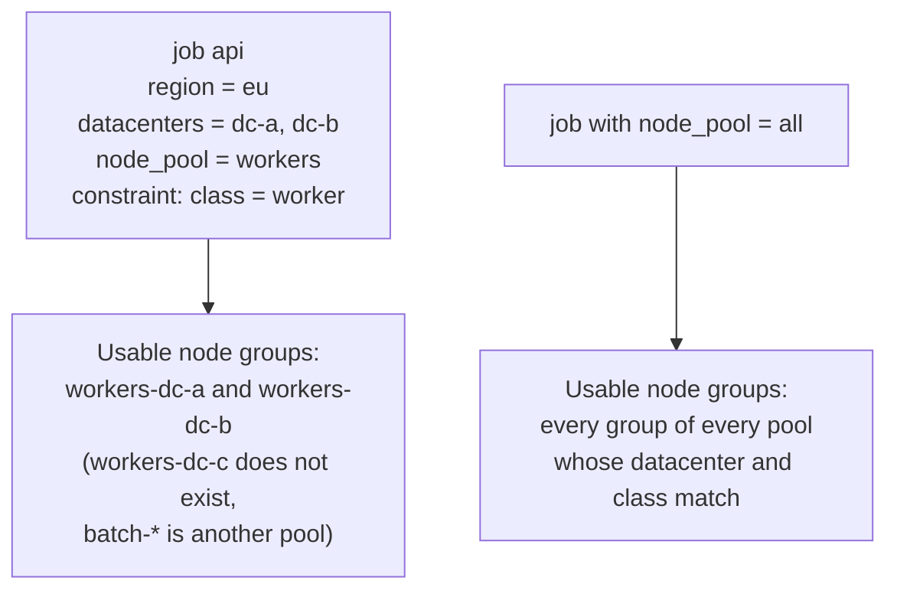

For work that cannot be placed, the scaler first works out the usable groups from the job (and for `all`, from every pool), and chooses among **those** only.

### Overview

| Concept | What it is | How many | Where it lives | Replicated | Scaled |
| --- | --- | --- | --- | --- | --- |
| **Region** | A Raft cluster with one leader | several | – | – | no; every region has its own scaler |
| **Datacenter** | An availability zone, within a region | several per region | attribute of the node | – | one axis of the node group |
| **Node pool** | A capacity partition (a definition) | several per region | state of the region | **yes**, from the authoritative region | not directly |
| **Node class** | A finer filter on the node | several | attribute of the node | – | optional axis |
| **Node group** | Pool × datacenter [× class] with one provider group | several per region | `NodeGroup` object | **no** | **yes**: the scaling unit |
| **Provider** | An external application, one platform | several | the `NodeProvider` object | – | – |

## Architecture: decision and actuation

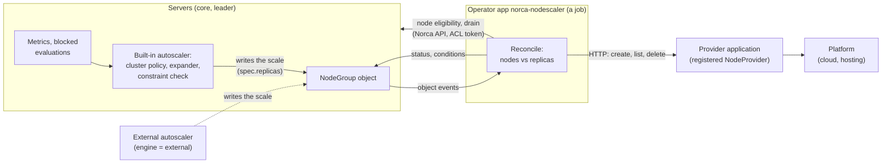

| | Decision | Actuation |
| --- | --- | --- |
| Where | The core: the built-in autoscaler in the leader | The operator `norca-nodescaler`, a job |
| Needs | Blocked evaluations, the cluster metrics, the constraints of the work | The `NodeProvider` objects, the Norca API for nodes and jobs |
| Writes | The **scale** (`spec.replicas`) of a NodeGroup, with a `Scaled` event | The `status` and conditions of the NodeGroup, the instances of the provider, node eligibility and drain |
| State | None of its own: the cooldown is derived from the `Scaled` events, so it survives a leader change | The objects and the instances of the provider; reconciled, so a restart loses nothing |

What this gives:

- **One interface.** The scale is written by the built-in autoscaler, by an external autoscaler (`engine = "external"`), by a person (`norca object scale`) or a GitOps tool (the `managed_by` of the spec is not enforced for the scale); the operator reconciles whatever the count is.
- **A core without platform code.** The HTTP client for providers, the join tracking and the deletions are in the operator, which can be released and fixed on its own.
- **The tools of the framework**: schema and CEL validation, dry runs, ACL rules of the kind, columns in the web UI, events, conditions, finalizers, and the controller SDK (informer, work queue, backoff, leader election).

## Configuration

A **node group** is an object of the cluster-scoped kind `norca.io/NodeGroup`, managed with `norca object apply|get|list|delete` and shown in the web UI. The kind has a `scale` block (`spec.replicas` and `status.replicas`) and the operator pack installs the kinds, the operator job and its ACL policy together.

```hcl
kind = "norca.io/NodeGroup"
name = "workers-dc-a"                      # a capacity group of this region

spec {
  enabled = true
  enforce = false                          # false: only events ("would add 2 nodes"), true: act
  engine  = "builtin"                      # "external": the external autoscaler agent owns the policy

  pool       = "workers"                   # the node pool
  datacenter = "dc-a"                      # the zone
  node_class = "worker"                    # optional: only nodes of this class belong to the group

  replicas = 3                             # the desired number of nodes (the scale): written by the autoscaler, or by hand
  min      = 1
  max      = 20
  max_node_age = "60d"                     # replace nodes older than this (before their certificate expires)
  priority = 0                             # only for expander = "priority": lower is tried first
  weight   = 1                             # only for expander = "weighted"
  headroom_nodes = 0                       # keep free capacity worth this many nodes of the group ahead of demand
  # headroom_percent = 10                  # alternative: a share of the group; the larger of the two applies

  spill = false                            # true: work that cannot be placed here may grow groups of other pools

  provider = "hetzner-eu"                  # a NodeProvider registered by a provider application
  group    = "fsn1"                        # the provider's name of the zone or group
  network  = "10.10.1.0/24"                # the range of the nodes (must be inside the firewall ranges)

  node {                                   # what a new node looks like
    meta       = { tier = "general" }
    attributes = { "unique.storage" = "ssd" }   # what the node will have, for checking constraints ahead of time
    parameters = { size = "cx32", image = "norca-worker-3" }   # for the provider
  }

  policy {
    evaluation_interval = "30s"
    cooldown            = "5m"

    check "allocated" {                    # ahead of time, on the allocated share of this group
      source = "norca"
      query  = "cluster.cpu_allocated"
      strategy "target-value" { target = 70 }   # proportional; "threshold" is a fixed step, see below
    }

    scale_down {
      unneeded_for      = "10m"
      delay_after_add   = "10m"
      utilization_below = 40               # percent allocated, of the group without the candidate
      selector          = "least_busy"     # least_busy | empty (empty: never drain a node with running work)
      drain_deadline    = "15m"
    }
  }
}
```

What the object holds and who writes it:

| Field | Written by | Content |
| --- | --- | --- |
| `spec` (except `replicas`) | A person or a GitOps tool | The description of the group above. |
| `spec.replicas` | The autoscaler (the scale), an external autoscaler, or a person | The desired number of nodes of the group. |
| `status.replicas`, `status.joining`, `status.failed` | The operator | Nodes of the group that are ready, requested and not joined yet, and failed. |
| `status.conditions` | The operator | `ProviderAvailable`, `OperatorReady`, `ScaleDownBlocked`, `Synced`, each with a reason. |
| Event log | The autoscaler and the operator | `Scaled` with the trigger and the reason; instances created and deleted; join deadline; drain results. |

CEL rules of the kind: `min <= max`; `min <= replicas <= max`; the network is a valid CIDR; `provider` is set when `engine` is `builtin`. The other checks need more than one object and are made by the operator and shown as conditions: the network range is not shared with another group and lies within the firewall ranges, the pool and the datacenter exist (the pool definition may arrive later by replication), and one `engine` for all groups of a pool.

The settings that concern the groups of a pool together, or the whole region, are **autoscaler settings of the server**, not an object:

```hcl
autoscaler {
  node_scaling {
    expander = "spread"                  # the default of the region: spread | fill | priority | weighted
    pool "edge" {
      expander  = "priority"             # overrides the region
      max_nodes = 12                     # the sum over the groups of the pool
      max_step  = 3                      # nodes per decision
    }
  }
}
```

The autoscaler turns each enabled `NodeGroup` into the typed scaling policy it already evaluates (`Type = "cluster"`, target `{pool, datacenter}`) and writes the result as the scale of the object, so the checks, the strategies, the cooldown, the rate limit and the oscillation guard are the ones task groups use.

## Decisions of the scaler

The decisions are made in the core; what is written is a number, `spec.replicas`. There are **two triggers with two scopes**:

| Trigger | Question | Scope |
| --- | --- | --- |
| **Work that cannot be placed** | Which group should grow? | The **groups the work can use** (see [the concepts](#jobs-groups-and-the-all-pool)); one of them is chosen. |
| **Allocated share** | Is this group nearly full? | **One node group**, its own datacenter: the `dc` + `pool` metric is exactly its allocated share. |

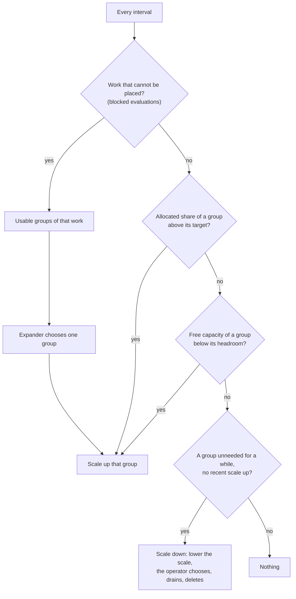

**Scale up.**

1. *Trigger.* Blocked demand: the failed placements and blocked evaluations name the exhausted dimension and the datacenters, classes and pool that were possible. Ahead of time: the `allocated` check of one group against its target, and the **headroom** (`headroom_nodes` / `headroom_percent`): when the free capacity of the group falls below the headroom, nodes are added to restore it, before any work is blocked. A node takes minutes to start, so the headroom is what lets new work be placed at once.
2. *Size, by the reason the work was blocked.*
   - *Resources* (`cpu`, `memory`): the unplaced demand divided by the size of one node of the group (the provider reports the capacity of the machine kind), rounded up.
   - *Constraints that need a node of their own* (`distinct_hosts`, a static port already taken on every node): **one node per unplaced allocation**, however small the allocation is. A proxy like Traefik with static ports 80 and 443 is blocked this way, and dividing resources would ask for too little.
   - *Ahead of time*, the **strategy** of the check decides the size: `target-value` is proportional (4 nodes at 85% with a target of 70 gives 5 nodes), `threshold` is a **fixed step** (above `upper_bound`, add `delta` nodes). Use `threshold` when load arrives in waves and a fixed number of nodes is known to be needed next (see the [game server example](#example-game-servers-a-fixed-base-and-steps)); `target-value` when load grows smoothly.
   - Then limit by `max_step`, the maximum of the group and of the pool, and the rate limit of the autoscaler.
3. *Group.* The ahead-of-time triggers act on **their own group**; no choice is needed. For work that cannot be placed, the **expander** chooses among the usable groups: `spread` (the group with the fewest nodes, the default: the same intent as `spread` on `${node.datacenter}`), `fill` (the fullest group below its maximum), `priority` (by the `priority` of the groups), `weighted` (by their `weight`). A group whose provider refused the last request (quota, no capacity in the zone; the operator reports it in the conditions) is skipped for a back-off time, and the next one is tried. The expander is selectable per region and per pool in the autoscaler settings.
4. *Do not double count.* Nodes that were asked for and have not joined yet (`status.joining`) count as capacity, so a second decision does not ask for them again.
5. *Bind the request to the work.* The `Scaled` event of a decision names the blocked evaluations it was made for. A node that is still joining counts as capacity only for those evaluations, not for work of another datacenter or pool, so it is not used to hide a shortage elsewhere. When the node is ready, the evaluations are re-run.

**Where work may go: the guards.** Nodes are only ever asked for in a datacenter the blocked work can use, because the scheduler would never place the work anywhere else. Three guards keep it that way:

| Guard | Rule |
| --- | --- |
| **Check on join** | A node that registers with a datacenter, pool or class different from its node group (a wrong bootstrap template) is **not counted** as capacity. The operator raises an event and deletes the instance after the join deadline. Otherwise the group would look full of capacity that the work cannot use. |
| **Request bound to the work** | See step 5 above. |
| **No spill by default** | If the group of the work's datacenter cannot grow (maximum reached, quota, provider failure), the work **waits** as a blocked evaluation and an event says why (`workers-dc-b at max`, `provider refused: quota`). The scaler does not pick a group in another datacenter just because the first is full. For a job with `node_pool = "all"` this means the groups of the other pools are not used either. A node group may allow it explicitly with `spill = true`: the groups of other pools that the work can use (same datacenter, matching class) are then candidates. |

**Moving work to another datacenter without forcing it.** The scaler never moves work between datacenters, and it does not need to: the job says where it may run. A datacenter that is full is left by the job's own rules:

- list several datacenters in the job (`datacenters = ["dc-a", "dc-b"]`). The list is a set, not an order, so put the preference in an `affinity` (or a `spread`) on `${node.datacenter}`. The scheduler then fills dc-a and places the rest in dc-b by itself; no node is forced and nothing is rescheduled.
- the usable groups of such a job are both datacenters, so the expander can grow either. With `expander = "priority"` and `priority = 0` on `workers-dc-a`, `priority = 1` on `workers-dc-b`, the scaler adds nodes in dc-a first and falls to dc-b only when dc-a is at its maximum or refused.
- a job fixed to one datacenter stays blocked until the person changes the job (`datacenters`) or the group is raised. That is a decision of the owner of the job, and the plan keeps it so.

**Placement rules that need a node of their own.** Some jobs say that parts of them must not run together. They block when no node satisfies them, and they decide *where* a new node must be, not only how many.

| Rule | What it means for the scaler |
| --- | --- |
| `distinct_hosts` (on the job or on a group) | Every allocation it covers needs a node of its own. On the **job** it covers all groups of the job, so the number of nodes is that of all its allocations together, not per group. Sized as *one node per unplaced allocation* (see above). |
| `distinct_property` (for example on `${node.datacenter}` or a meta key) | The missing node must have **another value** of the property than the nodes that already hold an allocation (up to the allowed count per value). The expander may choose only a group whose new node would have such a value. If the allocation is blocked because dc-a already has one, the node must go to a group of another datacenter, whatever the expander would otherwise prefer. |
| `spread`, `affinity`, `job_anti_affinity` (soft) | Never block, so never trigger scaling by themselves: the work is placed on the nodes that exist, only less evenly. The spread over datacenters is kept by the expander and the headroom. |

*Checking a new node ahead of time.* Before a group is chosen, the scaler checks the constraints of the blocked work against the node the group would add. Known without the node: its datacenter, pool, class, the group's `meta` and the `attributes` the node template declares (these are what the provider's image is expected to report). A constraint on anything else (kernel, CPU, drivers) cannot be checked: it **does not trigger scaling**, and an event says `unverifiable constraint` with the constraint, so the work waits instead of nodes being bought on a guess. A group whose node would fail a constraint is not a usable group for that work.

*Do not scale down into the same block.* A node is not a scale-down candidate when it holds an allocation under `distinct_hosts` or `distinct_property` and the nodes that remain would not let that allocation be placed again (fewer usable nodes than allocations, or no node with another property value). Otherwise the drained allocation would block, the scaler would add the node back, and the cycle would repeat.

**Scale down.**

1. *Condition (the core).* No blocked work; the allocated share of the group, **without one node of the group's size**, stays below `utilization_below` plus a margin; the free capacity without that node still covers the headroom; this holds for `unneeded_for`; and `delay_after_add` has passed since the last scale up of the group. The decision lowers `spec.replicas` by one.
2. *Candidates (the operator).* Only nodes that carry the provider's id in their meta (a node added by hand is never removed), in a group above its minimum, not protected (meta `norca.scale.protect = "true"`), and chosen by `selector` (the logic of the Nomad Autoscaler, adapted): `empty` or `least_busy`. With `selector = "empty"` only a node with **no running allocation** is a candidate and **nothing is drained**: the node is made ineligible, checked once more, and removed if it is still empty (if work arrived in between, it is made eligible again). This is for work that must not be interrupted (game matches, long sessions). `least_busy` takes the node with the least work and drains it; it is for work that can be rescheduled.
3. *Veto.* The operator re-checks the condition for the real candidate, and the [placement rules](#decisions-of-the-scaler) above. When no node qualifies, it sets `ScaleDownBlocked` with the reason and does not delete anything; the autoscaler sees it and sets `spec.replicas` back to `status.replicas`.
4. *Keep the spread.* Among groups of a pool, the one with the most nodes above its share is preferred; the `min` of a group keeps at least that many nodes in every datacenter.
5. *Execute* as described [below](#scale-down-and-drain). One node at a time per pool by default.

**Anti-flapping.** Cooldown after any action, a longer one after a scale up before a scale down, the oscillation guard and the rate limit the autoscaler has, and a cap on nodes added or removed per hour per pool.

## Metrics

| Metric | State | Use |
| --- | --- | --- |
| `norca.cluster.cpu_allocated`, `memory_allocated`, `disk_allocated` (`dc`, `pool`) | Exists | The ahead-of-time trigger and the scale-down condition of a group. The autoscaler gets a built-in source `norca` for them, like `nomad.cpu` for task groups. |
| `norca.cluster.cpu_used`, `memory_used` (`dc`, `pool`) | Exists | Shown next to the allocated share (the over-commit); not a trigger by default, as the usage of a node says little about whether work fits. |
| `norca.cluster.nodes_ready` (`dc`, `pool`) | Exists | Counts the nodes of a group. |
| `norca.cluster.blocked_cpu_mhz`, `blocked_memory_mb`, `blocked_evals`, `blocked_allocs_exclusive` (`dc`, `pool`) | **New** (core) | The demand that cannot be placed, from the blocked evaluations of the leader; the scale-up trigger. The last one counts allocations blocked by constraints that need a node of their own. |
| `norca.nodescaler.requested`, `joining`, `failed` (`dc`, `pool`) | **New** (operator) | The nodes asked for and not joined yet, and the failures, exported by the operator with the metrics of the controller SDK; the same numbers are in the `status` of the object, which is what the double counting rule reads. |

The **headroom** is computed from the allocated shares: the free capacity of a group is the unallocated part of its nodes, and `headroom_nodes = n` means free capacity worth `n` nodes of the group's machine kind (the capacity reported by the provider). Ineligible nodes are not part of the allocatable capacity. *To be checked in the existing sampler, which may still count them.*

The new metrics of the core are sampled by the leader from its state, into the same store and with the same retention, so the decisions can be inspected after the fact. An *allocated* share, not the usage, drives the scaler (the way the Kubernetes cluster autoscaler looks at requests): it is what the scheduler cannot place against.

## The provider contract

A provider is an application outside the core that handles one platform. Like a load balancer provider, it writes a cluster-scoped **`NodeProvider`** object when it starts and keeps a heartbeat in its status. The **operator** reads the registrations, checks that the provider is available (a heartbeat not older than a limit, as `-class-ttl` of the load balancer operator), that the group of a node group exists and that the request is inside the declared limits, and calls it:

```
GET    {endpoint}/v1/groups/{group}                         the instances and the capacity of one node
POST   {endpoint}/v1/groups/{group}/instances               create instances
DELETE {endpoint}/v1/groups/{group}/instances/{id}          delete one instance
```

`POST` is idempotent by a `request_id` the operator gives, so a repeated request after a failure or a restart does not create more nodes:

```json
{
  "request_id": "eu/workers-dc-a/00184",
  "count": 2,
  "parameters": { "size": "cx32", "image": "norca-worker-3" },
  "labels": {
    "norca.region": "eu", "norca.pool": "workers", "norca.datacenter": "dc-a",
    "norca.class": "worker", "norca.node_group": "workers-dc-a"
  },
  "bootstrap": { "...": "see the life of a node" }
}
```

`GET` returns, per instance, its `id`, `state` (`creating`, `running`, `deleting`, `failed`), the reason of a failure (`quota`, `no_capacity`, `invalid`, `error`), its addresses and labels, and the `capacity` of the machine kind (CPU in MHz, memory in MB), which is how a request is sized. A provider that cannot create an instance says so with a reason, and does not retry for ever.

The `NodeProvider` object has the endpoint (https; a private CA with an option like `-class-ca-file`), the name of the Variable that holds the token, the **capabilities** (the groups it offers, the parameters it accepts) and the published parameters. Credentials of the platform (an API token) stay with the provider application and never enter an object. The ACL of the kind decides who may register a provider, as for load balancers. A node group whose provider is not registered, or whose heartbeat is old, gets the condition `ProviderAvailable = False` (`UnknownProvider`, `ProviderUnavailable`).

## The life of a node

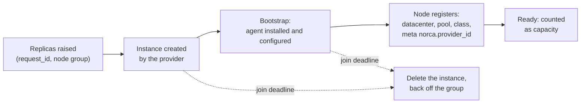

- **Identity.** The provider labels the instance with the region, pool, datacenter, class, node group and the request; the node, when it registers, carries `datacenter`, `node_pool`, `node_class` and a meta key with the **provider's instance id**. That key is how a node is matched with its instance, and the only nodes the operator may remove.
- **Join deadline** (default 15 minutes). An instance that exists but whose node has not registered by then is deleted, and the group is backed off. Instances with the labels of this operator and no node, after the deadline, are orphans and are deleted; a node whose instance is gone is reported.
- **Two identities.** A node needs its **own identity** to join, and its tasks get **workload identities** afterwards; the scaler only has to deliver the first (see [the mTLS section](#mtls-two-layers)).
- **Bootstrap.** A new machine needs what the deployer installs on a node: the agent binary, the TLS material (the CA and a client certificate), the gossip key, the addresses of the servers, and the agent configuration with datacenter, pool, class and meta. This plan builds on the **deployer**: it supplies the static parts (the agent configuration template, the CA, the server addresses, the intermediate CA of the region), so the PKI and the configuration stay in one place. The **operator** fills in the parts that belong to one node (its certificate and key, datacenter, pool, class, meta) and renders a **bootstrap bundle** (cloud-init or the platform's user data), which it hands to the provider, and only to it. See [node identity](#node-identity-and-certificates).
- **Network.** The node must reach the RPC and Serf ports of the servers, and the servers' firewall must let it in. A node group has a network range for its nodes; the ranges are part of `cluster_cidrs` and `api_cidrs`, and the template of the provider puts the instance into that network. A range that the firewall does not cover is a condition of the node group.
- **Renewal of the node certificate.** The deployer issues node certificates for 3 years and renews one during `apply` when less than 30 days are left. **A node the operator created is never visited by the deployer**, so it needs its own way; see [node identity](#node-identity-and-certificates).
- **Public address and DNS.** An edge node needs a public address (the provider's template sets the host network on the public interface). A load balancer that follows the catalog needs nothing more; **DNS records** for a round-robin edge are not handled by this plan.
- **Counting.** A requested node counts as capacity while it joins (so it is not requested twice) and as `failed` when it does not.

### Node identity and certificates

A node joins with a client certificate of the cluster PKI (`client.<region>.norca`). The deployer cannot issue it at run time (it is a command line tool and holds the key of the cluster CA), and the servers should not (that would put a PKI into the core). The operator does it with a **limited intermediate CA**:

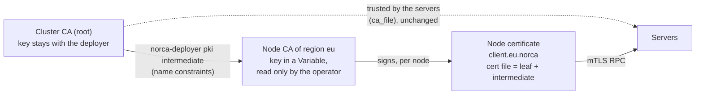

- **Limits of the intermediate** (set by the deployer): a path length of zero (it signs leaves only); permitted DNS names `client.<region>.norca` and `localhost`; permitted IP range `127.0.0.1/32`; permitted URI domain `<trust domain>` (the SPIFFE ID of the node); extended key usage server and client authentication. These are the names a node certificate carries today (`ClientIdentity` of the deployer), so nothing the node needs is lost.
- **What a stolen key can and cannot do.** It can mint certificates for nodes of its region, which is the privilege of joining as a client. It **cannot** mint a server certificate (`server.<region>.norca`), a certificate of another region, or a foreign name, IP or SPIFFE domain: verification fails with *not authorized to sign for this name*. A server and the Raft connections still require `server.<region>.norca`, so a node certificate never gives a seat in the Raft cluster. A rotation of the key (a new intermediate) is a `pki intermediate --force` and a new bundle for the next nodes.
- **Every issue is recorded** in the event log of the `NodeGroup` (node, serial, expiry), and the key is read with the Variable policy of the operator only.

**What was checked in the code and in a test (2026-11-04).**

| Question | Result |
| --- | --- |
| Does the RPC TLS accept a leaf signed by an intermediate? | **Yes.** The servers use `RequireAndVerifyClientCert` with the CA file as the pool, and Go verifies the chain the client sends. The client reads its certificate with `tls.LoadX509KeyPair`, so a **cert file that holds the leaf followed by the intermediate** is sent whole. Without the intermediate in the file, verification fails (*unknown authority*): the bundle must write both. The custom verification of the wrapper (`WrapTLSClient`) adds the peer's intermediates too. |
| Do the names fit the constraints? | **Yes.** The server checks `server.<region>.norca` only for server and Raft connections (`validateRaftTLS`); a client is verified by the chain. In a test with the exact names of `ClientIdentity` (the wildcard `*.client.<region>.norca`, `localhost`, `127.0.0.1`, one SPIFFE URI), the certificate verifies for client and server use, with and without the SPIFFE ID; `server.eu.norca`, `client.us.norca`, a foreign IP, a foreign SPIFFE domain and `evilclient.eu.norca` are all rejected. |
| Can the agent take a renewed certificate without a restart? | **Yes.** On SIGHUP the agent compares the checksum of the CA, certificate and key files and, if it changed, loads the pair into the shared key loader (`Agent.Reload`); existing connections stay and new ones use the new certificate. Renewal is: write the files, send SIGHUP (a systemd `ExecReload`). The HTTP listeners are reloaded too (`ShouldReload` returns `http = true`). |

**Two steps, one mechanism.**

1. **First version: the operator generates the pair and delivers it in the bundle.** The operator creates the key and the certificate of a new node, writes the leaf and the intermediate into the cert file of the bundle, and passes the bundle to the provider. The key travels through the provider and the user data of the machine, so the bundle is handed only to the provider and the validity of the certificate is short. A node is **replaced before its certificate expires**: the group's `max_node_age` makes the operator add a node and drain the old one (this also renews the image).
2. **Hardening: the key never travels.** A small helper on the node (`norca-join`) makes the key, sends a signing request and a **one-time token** (the only secret left in the user data) to a signing endpoint of the operator, receives the certificate (and the gossip key), and renews it later with the current certificate before it expires, followed by SIGHUP. Nodes then have no age limit. The same intermediate and the same issuing code are used, so step 1 is not thrown away.

## Scale down and drain

The operator does this when the scale is lowered (or the count of nodes is above `spec.replicas`):

1. Choose the candidate as above.
2. Mark the node **ineligible** (no new allocations).
3. **Drain** it with the built-in drainer, with the deadline of the policy; [disruption budgets](/docs/features/disruption-budget) apply, and system jobs follow the usual `ignore_system_jobs` rule. With `selector = "empty"` there is nothing to drain: the operator checks that the node is still empty.
4. When the drain is **complete** (or the node is confirmed empty), ask the provider to delete the instance, then wait for the node to go down and be garbage collected.
5. Record the result in the event log of the object, with the node, the node group and the reason.

If the drain does not finish by its deadline, or fails, the operator **does not delete the instance**: it makes the node eligible again, backs the candidate off and raises an event. This is the acceptance criterion of the development plan: no node is removed with an unfinished drain.

**Deleting a node group.** A finalizer of the object keeps it until its nodes are dealt with: the operator drains and deletes the nodes it created (or, if the person asks for it, leaves them and drops only the object). Nodes added by hand are not touched.

**Edge nodes.** A node that runs an ingress proxy must leave the traffic first. The order during the drain is: the service is deregistered from the native catalog (a load balancer that follows the catalog drops the target at once); the task's `shutdown_delay` lets running requests finish; then the task stops. A disruption budget on the proxy job keeps enough instances up, and the `min` of the node groups keeps at least one edge node in every datacenter.

## Where the operator and the providers run

The operator creates and deletes the nodes that jobs run on. If it ran on one of them, deleting that node would remove the operator in the middle of its work, and a group scaled to zero could never be scaled up again. A provider has the same dependency: it must be reachable at the moment nodes are needed. The rules:

| # | Rule |
| --- | --- |
| 1 | **Run outside the pools the operator scales.** The job of the operator and of the providers go to a pool that has no `NodeGroup`, or are kept off scaled nodes with a constraint on the meta key the operator sets: `${meta.norca.provider_id}` `is_not_set`. A node without the provider id is never removed by the operator, so an operator on such a node cannot delete itself. |
| 2 | **That pool has its own capacity.** It is not a node group of the operator; its nodes are added by hand or by the deployer. It holds at least as many nodes as the instances of the operator and the providers need. |
| 3 | **Two instances on different nodes.** `count = 2` with `distinct_hosts` (and a `spread` on the datacenter, if the pool has several), so that a node lost does not stop the actuation; the controller SDK elects the leader. |
| 4 | **One operator per region.** Node groups belong to a region, so the operator runs in it (its `-region`), and so does every provider that serves it. |
| 5 | **The operator is not scaled itself,** and its job has no `scaling` block and a priority above ordinary jobs, so that it is not the first thing to be preempted. |
| 6 | **The least privilege.** The operator gets a policy bound to its job: the object capabilities for `NodeGroup` and `NodeProvider`, node read and write (eligibility and drain), read of jobs and allocations, and read of the Variables that hold the tokens of the providers and the key of the node CA; nothing else. |
| 7 | **A provider outside the failure domain it serves.** It does not run on nodes of the group it creates, and it is reachable from the operator at the address it registered. |

These are checked, not only advised: the operator reports `OperatorReady = False` with the reason `RunsOnScaledNode` when its own node carries a provider id, and a node group whose provider's allocation runs on one of its nodes gets the condition `ProviderOnScaledNode`.

The same rules hold for **every operator and provider** of the operator framework, and they are written in the [controller guide](/docs/features/operator-framework/controllers#where-to-run-a-controller). For the load balancer operator and its providers the rule is the same: run them in a pool that is not scaled, because a node group that removes the node of the operator or of a provider also removes the load balancers it keeps.

## Example: an edge pool with Traefik, and mTLS

The [`traefik` pack](/docs/features/packages) runs the job `traefik` as a `service` (`count` instances, one per node by `distinct_hosts`) or as a `system` job (one on every node of the `node_pool` and `datacenters`), with static ports on the node (80, 443), and registers a service `<job>-<entrypoint>` per entrypoint for an external load balancer. Traefik's `nomad` provider reads the whole catalog, so the [topology page](/docs/features/service-discovery/topology) advises one Traefik per datacenter. That fits the node group exactly:

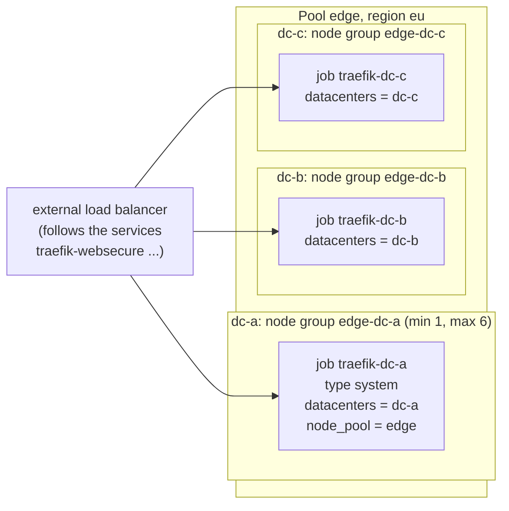

| Traefik job | What scaling a node group means |
| --- | --- |
| `system` | The number of nodes **is** the number of Traefik instances: a new node gets a Traefik, so the node group scales the ingress capacity. The `min` of the group keeps an edge in every datacenter. |
| `service` with `count` N | Nodes and instances are different numbers. Raising the count with no free edge node blocks the new instance (`distinct_hosts`, port 443 taken on every node), and the scaler adds a node: **one per blocked instance** (see [sizing](#decisions-of-the-scaler)). |

### What happens when traffic grows

```mermaid
sequenceDiagram
  participant P as Policy of the traefik job
  participant S as Scheduler
  participant A as Autoscaler (leader)
  participant O as Operator
  participant V as Provider
  participant N as New node
  participant L as Load balancer
  P->>S: count 4 -> 5
  S->>S: the 5th instance is blocked (distinct_hosts, port 443)
  A->>A: blocked allocation, reason: node of its own
  A->>A: usable groups: edge-dc-a/b/c; expander picks edge-dc-b
  A->>O: scale of edge-dc-b: replicas +1 (Scaled event)
  O->>V: POST instance (request_id, node group edge-dc-b)
  V->>N: instance with the bootstrap bundle
  N->>S: registers (node certificate), datacenter dc-b, pool edge
  O->>O: status: joining -> ready
  S->>N: places the Traefik instance
  N->>N: workload certificate from the leader (if the job uses mTLS)
  N->>L: service traefik-websecure is registered in the catalog
  L->>N: target added, traffic flows
```

### mTLS: two layers

Norca has two identities, and scaling touches them differently.

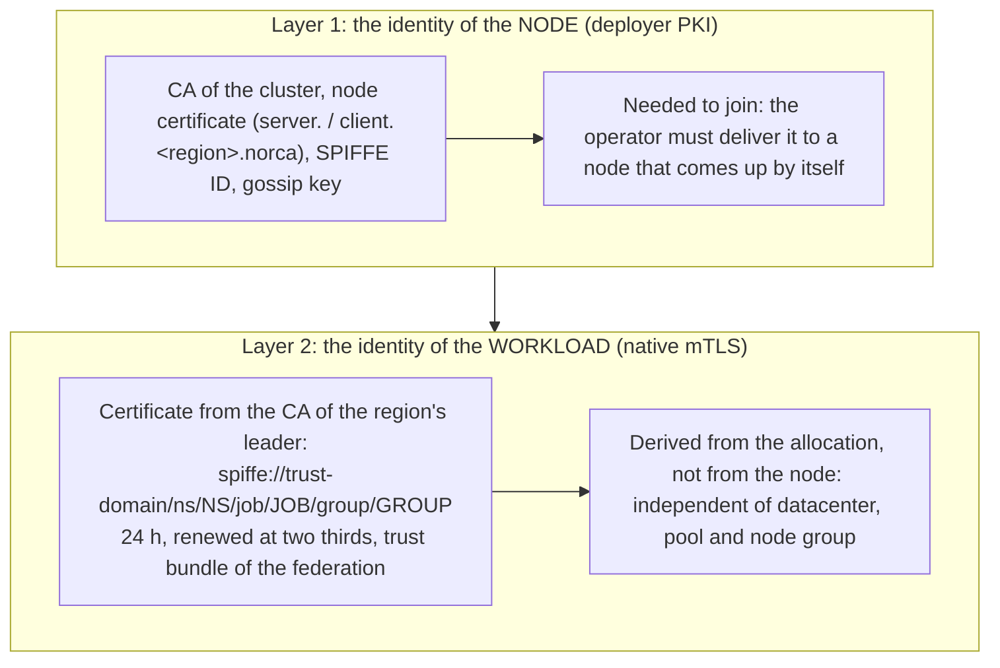

- **Layer 2 asks nothing of the scaler.** The client sends a signing request with the workload identity of the task, and the servers derive the SPIFFE ID and the names from the allocation. A task on a new node gets its certificate exactly as on any other node, and the trust bundle (including the CAs of the other regions) and a CA rotation reach it the same way. Service intentions are objects of the region and do not depend on the datacenter. The only condition is that the node reaches the RPC ports of the servers (the firewall range of the node group).
- **Layer 1 is the part the scaler has to deliver.** A joining node needs the CA, a client certificate, the gossip key and the server addresses ([bootstrap](#the-life-of-a-node)), and its certificate must be renewed or the node replaced ([node identity](#node-identity-and-certificates)).
- **Traefik and mTLS to the backends.** The `traefik` pack does not use mTLS to its backends today. With the means Norca has, Traefik can have an `mtls` block in app mode: it gets `secrets/mtls/{cert,key,bundle}.pem` and the SPIFFE ID of its job and group, uses them as the client certificate and the trust roots of its servers transport, and a service intention allows `traefik` to reach the backend. Every Traefik that starts on a new edge node receives its certificate automatically and keeps the same SPIFFE ID, so the intentions are the same whatever the number of nodes. The renewal is done by the client; Traefik has to reload the files. This is a change of the pack, not of the scaler.
- **Across regions** the traffic goes through the Envoy `mtls-gateway` job (SNI passthrough), which is a job on some pool's nodes. If the gateway shares the edge pool with Traefik, its capacity follows the scaling of that pool; a pool or a node group of its own keeps the two apart.

## Example: game servers, a fixed base and steps

A game hosting operator keeps a base of servers ready so that arriving players always find a free one, and knows how many more are needed when the base is used up: *when utilization reaches a level, y more nodes are needed.* Every game server is an allocation of a fixed size; a match must not be interrupted.

```hcl
kind = "norca.io/NodeGroup"
name = "game-dc-a"

spec {
  pool       = "game"
  datacenter = "dc-a"
  provider   = "hetzner-eu"
  group      = "fsn1"

  min            = 10                    # the base that is always kept
  max            = 60
  headroom_nodes = 3                     # at least 3 nodes' worth of free capacity at any time

  policy {
    cooldown = "5m"

    check "fill" {
      source = "norca"
      query  = "cluster.cpu_allocated"
      strategy "threshold" {
        upper_bound = 75                 # from this allocated share ...
        delta       = 5                  # ... add 5 nodes (a fixed step)
      }
    }

    scale_down {
      selector     = "empty"             # only nodes with no running match; no drain of live matches
      unneeded_for = "30m"
    }
  }
}
```

| What the operator of the game knows | Setting |
| --- | --- |
| "I always keep x servers" | `min` (the base) and `headroom_nodes` (free capacity ahead of demand) |
| "At this level I will need y more" | the `threshold` strategy: `upper_bound` and `delta` |
| "If they run out" | work that cannot be placed is blocked; the scaler adds nodes by the missing demand without waiting for the threshold |
| "A match must not be cut" | `selector = "empty"`: a node is removed only after its matches have ended |

The *allocated share* approximates the use of the servers when every game server has the same size. When the sizes differ or the real unit is *free match slots*, the metric can be supplied by the game's own application with an external APM source, which the built-in autoscaler can already load.

## Engines: the external autoscaler and the built-in one

The `engine` option stays and keeps its meaning:

| | External | Built-in |
| --- | --- | --- |
| Who decides | The external autoscaler agent with its target plugins (for example the cloud instance group plugins of the Nomad Autoscaler), as in Nomad v1.6.5 | The autoscaler in the leader, which writes the scale of the node group; the operator and the node providers do the rest |
| Policy | Read by the agent through the API; Norca only stores and serves it | Evaluated in the leader |
| Needs | The agent and its plugins | A registered `NodeProvider` and the operator |

The **policy decides**, not an automatic detection: `engine = "external"` leaves the node group to the agent (Norca does not act on it, and the operator does not run for it), `engine = "builtin"` uses the operator and the providers, and the groups of one pool have one engine, so two systems never scale the same pool. Loading external *target* plugins into the built-in autoscaler is not planned; the external engine covers that need.

## Security, observability, failures

**ACL.** The kinds have the object rules of the operator framework (`read`, `write`, `write-status`, `write-events`, `manage-finalizers`); a provider needs only the write of its own `NodeProvider`. The operator has the policy of [rule 6](#where-the-operator-and-the-providers-run), and the token it sends to a provider is a Variable it reads. The bootstrap secrets are short-lived and never in the object. The workload mTLS needs no rule of its own.

**Observability.**

- Events on the `Scaling` topic for every decision (pool, node group, old and new count, trigger, reason) and the `Scaled` events of the object; the events of the operator in the event log of the object; the cooldown is restored from the `Scaled` events after a leader change.
- `norca object get norca.io/NodeGroup/<name>`: the nodes, the nodes joining, min and max, the conditions, the last decisions, the provider state; the same in the web UI through the columns of the kind.
- The metrics above, and later a page in the web UI.

**Failures.**

| Failure | Behavior |
| --- | --- |
| Provider unavailable (heartbeat) | The operator does not act on its groups; the condition `ProviderAvailable = False`, `ProviderUnavailable` as for load balancers. Nodes keep running. |
| Operator unavailable | `spec.replicas` changes but nothing is done; the autoscaler sees that `status.replicas` does not follow, raises an event and stops adding to the number. Nodes keep running; when the operator is back it reconciles. |
| A group refuses (quota, no capacity) | The group is backed off, the next group of the expander is tried; if none, the demand stays and an event says why. |
| Leader change | The autoscaler restores the cooldown from the `Scaled` events. The operator is not affected: it reconciles the objects and lists the instances of each group, and its idempotent requests are repeated safely. |
| Operator restart | The same: the state is in the objects and at the provider. |
| Node does not join | The join deadline deletes the instance and backs the group off. |
| Drain stuck | No deletion; the node becomes eligible again. |
| Scale down with no candidate | `ScaleDownBlocked`; the scale goes back to the count of nodes. |
| Constraint that cannot be checked ahead of time | No scaling; an event `unverifiable constraint` names it. The work waits. |
| Runaway scaling | Pool maximum, nodes per hour, `enforce = false` (events only), `enabled = false` (a switch). |

## Licensing and provenance

- The design is Norca's own. Its models are the **Kubernetes cluster autoscaler** (Apache 2.0): node groups, scale-up for work that cannot be scheduled, expanders, scale-down checks; and the **load balancer providers** and the operator framework of this project.
- Code from the Nomad Autoscaler v0.6.0 (MPL 2.0), such as the node selectors and the drain handling in `sdk/helper/scaleutils`, may be adapted in separate files with its headers kept and a note of the changes, as the existing autoscaler code is.
- Nothing is taken from HashiCorp's Enterprise products or from BSL releases; the feature is not described as a version of any HashiCorp feature.
- Platform SDKs belong to the provider applications, not to the Norca binary or to the operator; the licenses of the ones to be used (the AWS, Google, Scaleway and Hetzner Go SDKs) are checked against the allowed list when a provider is built.

## Phases and acceptance

| Phase | Content | Acceptance |
| --- | --- | --- |
| 0 | The built-in source `norca` (the cluster gauges as policy metrics), and the blocked-demand metrics, with the reason of the block. A **read-only advice mode**: the autoscaler only raises events ("would add 2 nodes to dc-a"). | Metrics are readable by a check; advice events match the blocked work in a lab test, including a blocked proxy with a static port (one node per instance) and a `distinct_property` on the datacenter (the node is advised in the other datacenter). No provider and no operator needed. |
| 1 | The kinds `NodeGroup` (with the `scale` block and the CEL rules) and `NodeProvider`; the cluster policy derived from the objects, the expander settings of the server, the headroom, `threshold` and `target-value`; the decision writes the scale. Dry run (`enforce = false`). | Invalid objects are rejected; a pool with two groups shows the expected scale decisions with `enforce = false`; the objects are not replicated between regions; the cooldown survives a leader change. |
| 2 | The operator `norca-nodescaler` (controller SDK) with the mock provider: the `NodeProvider` registry, the HTTP contract, the scale-up path, join tracking, the join deadline, orphan cleanup, the conditions, the checks of [where it runs](#where-the-operator-and-the-providers-run), the operator pack; the issue of node certificates with the node CA (the first version of [node identity](#node-identity-and-certificates)) and `max_node_age`. | Blocked work makes the scaler raise the scale and the operator request nodes in the right group; a request repeated after a restart creates no extra node; a node that never joins is cleaned up; the operator refuses to run on a scaled node; a node with a certificate of the operator joins the servers in a test (leaf and intermediate in the cert file), and a certificate for a server name, another region or a foreign name is refused. |
| 3 | Scale down in the operator: candidate selection (the adapted `scaleutils`, `least_busy` and `empty`), protections, the veto and `ScaleDownBlocked`, drain with the edge order, delete, the finalizer, the failure paths. | No instance is deleted with an unfinished drain; a stuck drain makes the node eligible again; a job with `distinct_hosts` on all its nodes does not make the scaler remove and add the same node again; with `empty`, a node that received work is never deleted and a match is never cut; the `min` of a group keeps an edge in every datacenter; a load balancer following the catalog drops the target before the proxy stops. |
| 4 | The first real provider (Hetzner Cloud), then Scaleway, AWS and GCP; in the deployer, the name-constrained intermediate CA (`pki intermediate` with the constraints) and the static bundle parts; the hardening of node identity (`norca-join`, the token and the signing endpoint, renewal with SIGHUP). | The lab case with the real provider (below); a node renews its certificate without a restart and keeps its connections. |
| 5 | Web UI page, scheduled windows, spot and preemption handling, DNS records of an edge, an `mtls` block for the Traefik pack. | – |

**The lab.** The lab already has what a cloud needs for a test: VMs that labrunner starts and stops. A **lab provider** (a provider application whose "instances" are the pre-provisioned lab VMs, started and stopped through labrunner and joined with the deployer) lets a case run on three VMs without a cloud account: blocked work raises the scale, the operator starts a VM in the right datacenter, the node joins and the work is placed, the load goes away, and the node is drained and powered off. The operator job runs on a fixed VM outside the scaled pool, as the rules require. A second case uses an edge pool with a proxy that has static ports. The mock provider covers the contract in unit and integration tests, and the SDK's `fake` and `envtest` cover the operator.

## Open questions

1. **Validity and node age.** How long a certificate issued by the operator lives, and so the `max_node_age` that replaces a node before it expires. A short validity (for example 90 days, nodes replaced after 60) limits what a stolen bundle is worth, but every node is rolled that often, which game servers with long sessions feel; a long validity (the deployer's 3 years) rolls nodes only for image updates. Until the hardening step makes the key stay on the node, shorter is safer.
2. **The gossip key.** It is a shared secret that the bundle carries in the first version; the hardening step delivers it after the token check instead. Should it be rotated with the node CA, and how?
3. **The code for issuing.** The operator needs the issuing code of the deployer (`pkg/pki`: identity, names, signing): import the package of the deployer, or move it to a small shared module.
4. **The demand binding.** Where the blocked evaluations a decision was made for are kept: in the `Scaled` event (proposed), or in a field of the object.
5. **The scale-down veto.** The autoscaler sets `spec.replicas` back after `ScaleDownBlocked`: is it enough, or does the operator need a way to answer a decision?
6. **The name and place of the operator.** `norca-nodescaler`, a repository of its own like `norca-loadbalancer`, or part of the provider repository.
7. **Who ships the kinds.** The operator pack installs the kinds, or the core registers `NodeGroup` and `NodeProvider` itself so that the autoscaler can rely on them.
