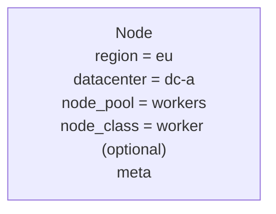
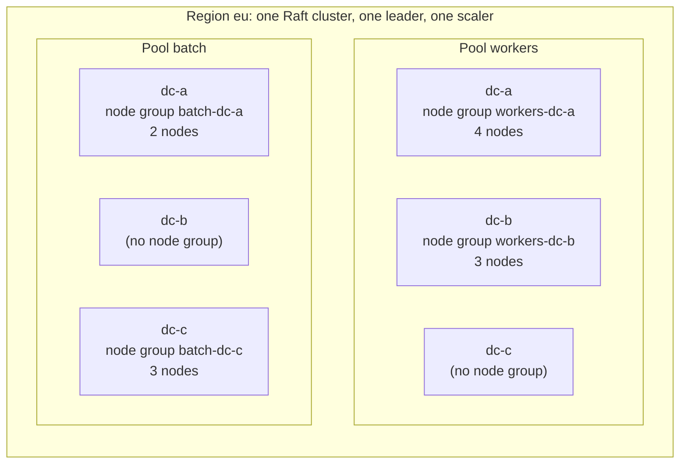
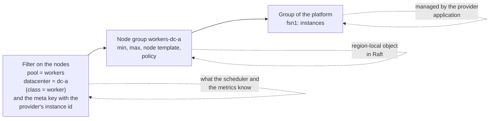
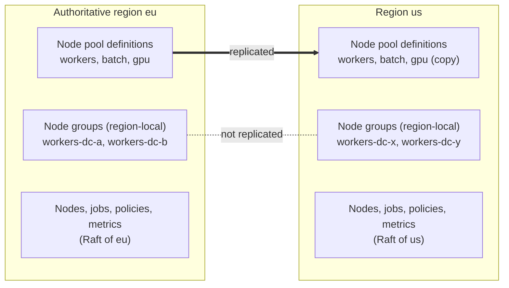
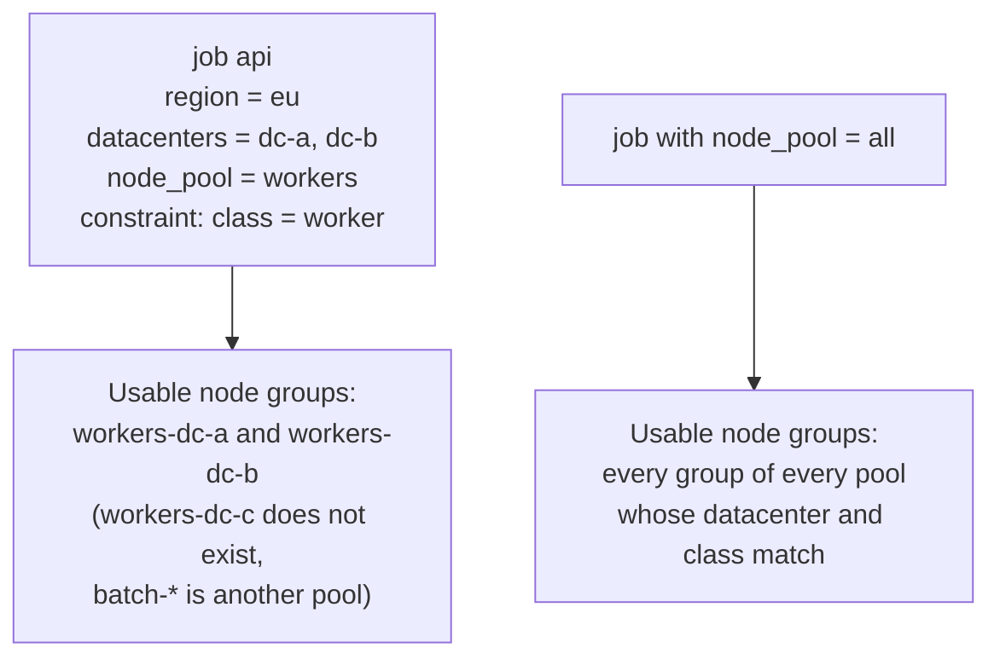
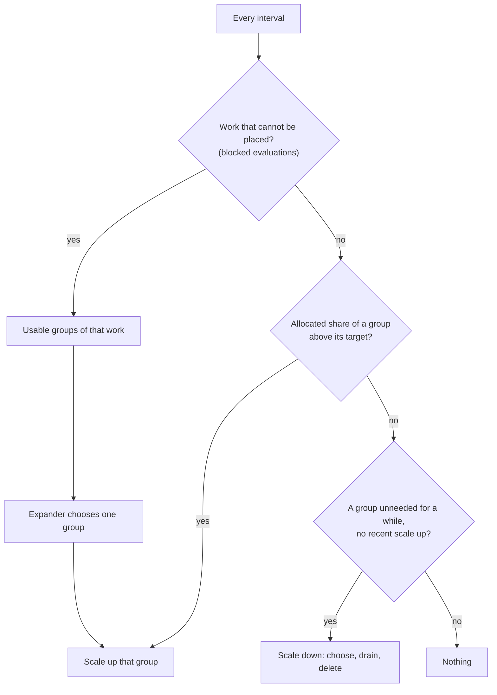
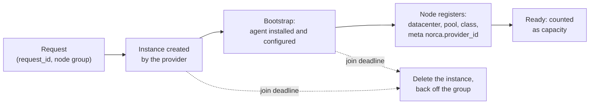
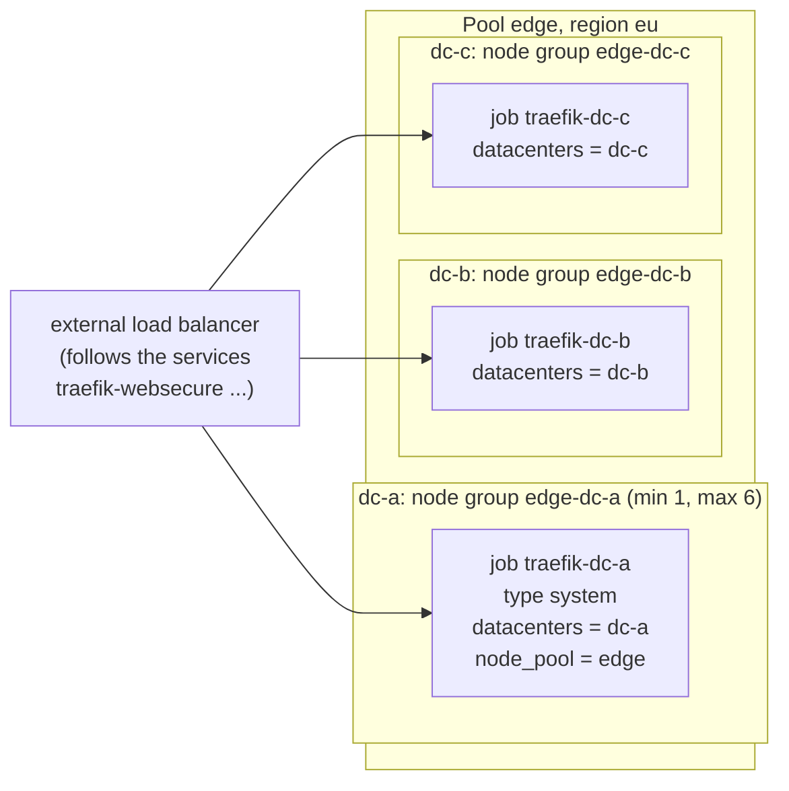
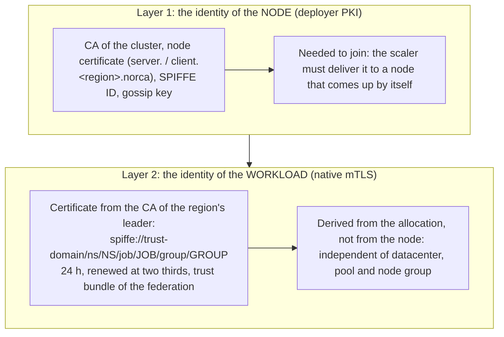

**Status:** Plan · 2026-11-04 · Related documents: [development plan](/docs/design/nomad-fork-development-plan) (phase 4 of the built-in autoscaler, postponed until now), [built-in autoscaler](/docs/features/autoscaler), [load balancer providers](/docs/features/operator-framework/loadbalancer-providers) (the pattern this plan follows), [topology-aware routing](/docs/features/service-discovery/topology) (the datacenter model), [native mTLS](/docs/features/native-mtls), [disruption budgets](/docs/features/disruption-budget), [adding and removing nodes](/docs/deployer/adding-and-removing-nodes)

The built-in autoscaler scales the task groups of jobs. This plan lets it scale the **number of client nodes** too: it asks a platform (a cloud, a hosting provider, a pool of machines) for more nodes when the cluster has no room for the work, and gives nodes back when there is too much room. The platform side is done by **provider applications** that register themselves, as the load balancer providers do; the decisions rest on the **internal metrics** of the servers. Nothing here changes how jobs or the external autoscaler work.

## Table of contents

- [Summary and decisions](#summary-and-decisions)
- [Goals and non-goals](#goals-and-non-goals)
- [Starting point](#starting-point)
- [Concepts: region, datacenter, node pool, node group](#concepts-region-datacenter-node-pool-node-group)
- [Configuration](#configuration)
- [Decisions of the scaler](#decisions-of-the-scaler)
- [Metrics](#metrics)
- [The provider contract](#the-provider-contract)
- [The life of a node](#the-life-of-a-node)
- [Scale down and drain](#scale-down-and-drain)
- [Example: an edge pool with Traefik, and mTLS](#example-an-edge-pool-with-traefik-and-mtls)
- [Engines: the external autoscaler and the built-in one](#engines-the-external-autoscaler-and-the-built-in-one)
- [Security, observability, failures](#security-observability-failures)
- [Licensing and provenance](#licensing-and-provenance)
- [Phases and acceptance](#phases-and-acceptance)
- [Open questions](#open-questions)

## Summary and decisions

| | Decision |
| --- | --- |
| Whether | Decided 2026-10-24: not for now, postponed. Reopened 2026-11-04. |
| Providers | Decided 2026-10-25: Hetzner Cloud, Scaleway, AWS and GCP (the same four as the load balancer providers), as separate applications; the core has no cloud code. |
| Topology | Decided 2026-10-28: region > datacenter only; one datacenter is one availability zone. |
| Engines | Decided 2026-11-04: the `engine` option stays. With an external autoscaler and its plugins, they are used; without one, the built-in autoscaler uses the providers. |
| Provider model | Decided 2026-11-04: like the load balancer providers: external applications that register an object and a heartbeat, called over HTTP. |
| Metrics | Decided 2026-11-04: the decisions are built on the internal metrics (the [metrics store](/docs/configuration/metrics_store)), not on an external APM. |
| Scaling unit | **Proposed:** the **node group**: the nodes of one node pool in one datacenter of one region (optionally of one node class), backed by one group of the platform. It is a management concept; the scheduler does not know it. |
| Where it lives | **Proposed:** `node_group` is a **region-local** object. Node pools are replicated between regions; the groups of the platform are not the same in every region. |
| Triggers | **Proposed:** two, with different scopes: *work that cannot be placed* is a decision over the groups that work can use; the *allocated share* is a decision of one group. |
| Naming | **Proposed:** `node group` (the term of the cluster autoscalers and the clouds) for the unit, and `NodeProvider` for the registration of a provider application, so that it does not clash with the `node_class` of a node. |

## Goals and non-goals

**Goals**

- Add nodes when work cannot be placed or a group is nearly full, and remove nodes that are not needed, without a person in the loop.
- The unit is a datacenter of a node pool, so the spread over availability zones is a property of the scaler, not an accident.
- A removed node is always drained first; no node with unfinished work is deleted.
- Providers are applications outside the core, one per platform, written against a small HTTP contract; credentials stay with them.
- The decisions use what the servers already measure.

**Non-goals**

- Scaling the **servers** (Raft members). Only client nodes are scaled.
- Scaling across regions. A region is one Raft cluster; each region has its own scaler, leader and providers.
- Vertical sizing of tasks (a separate topic).
- Provider-specific features beyond "n nodes of this kind in this zone" (volumes, load balancers, spot pricing) in the first phases.
- Replacing the deployer: it installs and configures nodes by hand; the scaler asks for nodes that come up by themselves (see [the life of a node](#the-life-of-a-node)).

## Starting point

What exists and what the plan builds on.

| Part | State |
| --- | --- |
| Built-in autoscaler | Runs in the leader. Its logic is ported from the Nomad Autoscaler v0.6.0 (MPL 2.0): policy checks, the strategies, schedules, the policy parser, the plugin SDK. It scales **task groups only**: the cluster keys and node-selector strategies were dropped from the port, and two files say so (`sdk/target.go`, `processor.go`: "cluster scaling is not part of the built-in autoscaler yet"). |
| Engines | A policy has an `engine`: `builtin`, or `external`, which keeps the behavior of Nomad v1.6.5 (an external autoscaler agent reads the policies through the API). External APM and strategy plugins can be loaded into the built-in autoscaler; external **target** plugins cannot. |
| Cluster metrics | The servers sample, per datacenter and node pool (labels `dc`, `pool`): `norca.cluster.cpu_allocated`, `cpu_used`, `memory_allocated`, `memory_used`, `disk_allocated` and `nodes_ready`, in percent of the capacity left after the reserved resources (the count for `nodes_ready`). They are stored and served by the [metrics API](/docs/api/metrics-store), **but the autoscaler does not read them yet**; it only reads the task group usage (`nomad.cpu`, `nomad.memory`, ...). |
| Signals of missing room | A failed placement carries per datacenter the number of nodes available (`NodesAvailable`), the nodes filtered by class and by constraint, and the exhausted dimension (`cpu`, `memory`, quota). A blocked evaluation waits until room appears. |
| Nodes | A node has exactly one region, datacenter and node pool, and at most one node class, set in the agent configuration; it also has meta. |
| Node pools | A pool belongs to a region **and is replicated from the authoritative region** to the others (name, description, meta, scheduler configuration). Two pools are built in: `default` (nodes that name no pool) and `all` (every node of the cluster; a job with `node_pool = "all"` may use any pool). |
| Drain | `DrainSpec` (deadline, ignore system jobs), eligibility, the drainer, and [disruption budgets](/docs/features/disruption-budget) that limit how many allocations of a job may be stopped at once. |
| Provider pattern | The load balancer providers: a cluster-scoped class object written by the provider with a heartbeat, an HTTP contract, a token read from a Variable, capabilities checked by the operator, `UnknownClass` / `ProviderUnavailable` states, the lab cases that test it. |
| Joining nodes | The deployer installs nodes over SSH with a PKI and the gossip key, and records them. A node that comes up by itself needs the same ingredients delivered another way. |
| Reusable code (MPL 2.0) | In the Nomad Autoscaler v0.6.0: `sdk/helper/scaleutils` (node selection: `empty`, `least_busy`; the drain handling) and the node queries of its Nomad APM. Usable with their headers kept; the cloud targets (`aws-asg`, `azure-vmss`, `gce-mig`) are not wanted, providers take their place. |

## Concepts: region, datacenter, node pool, node group

A **node** has exactly one region, one datacenter and one node pool (and at most one node class). The datacenter and the pool are two **independent** dimensions: a pool may span several datacenters, and a datacenter may hold several pools.



### The matrix

Inside a region, the nodes form a matrix of pools and datacenters. A **node group** is one cell of that matrix, tied to one group of the platform.



A node group is a **filter plus management data**, not a new entity of the scheduler:



| Rule | Consequence |
| --- | --- |
| One node group has one provider group, and a provider group belongs to one node group. | A provider group lives in one zone, so a node group belongs to one datacenter. |
| A node belongs to one node group or to none. | Nodes added by hand belong to none; the scaler never touches them. Only nodes that carry the provider's instance id in their meta can be removed. |
| A node group may be missing for a pool and datacenter. | That datacenter of the pool is simply not scaled. |
| The node's pool membership comes from its own configuration. | The node group does not assign nodes to a pool; it only describes where new nodes of that pool are asked for. |
| A node group has a **network range** for its nodes. | The firewall of the servers (`cluster_cidrs`, `api_cidrs` in the deployer plan) and the template of the provider must agree with it; see [the life of a node](#the-life-of-a-node). |

### What is replicated and what is not



The pool is a shared concept ("workers" means the same everywhere); the node group is regional (other platform, other zones, other limits). This is why the scaling setting cannot be a field of the node pool: replicating it would carry the groups of one region into the others.

### Jobs, groups and the `all` pool

A job selects its nodes by `region`, `datacenters`, `node_pool` and constraints. The **node groups it can use** are the intersection.



For work that cannot be placed, the scaler first works out the usable groups from the job (and for `all`, from every pool), and chooses among **those** only.

### Overview

| Concept | What it is | How many | Where it lives | Replicated | Scaled |
| --- | --- | --- | --- | --- | --- |
| **Region** | A Raft cluster with one leader | several | – | – | no; every region has its own scaler |
| **Datacenter** | An availability zone, within a region | several per region | attribute of the node | – | one axis of the node group |
| **Node pool** | A capacity partition (a definition) | several per region | state of the region | **yes**, from the authoritative region | not directly |
| **Node class** | A finer filter on the node | several | attribute of the node | – | optional axis |
| **Node group** | Pool × datacenter [× class] with one provider group | several per region | region-local object | **no** | **yes**: the scaling unit |
| **Provider** | An external application, one platform | several | the `NodeProvider` registration | – | – |

## Configuration

A **node group** is a region-local object stored in Raft and managed with `norca node group apply|status|delete`. An optional **pool rule** holds what concerns the groups of one pool together.

```hcl
node_group "workers-dc-a" {              # a capacity group of this region
  enabled = true
  enforce = false                        # false: only events ("would add 2 nodes"), true: act
  engine  = "builtin"                    # "external": the external autoscaler agent owns the policy

  pool       = "workers"                 # the node pool
  datacenter = "dc-a"                    # the zone
  node_class = "worker"                  # optional: only nodes of this class belong to the group

  spill    = false                       # true: work that cannot be placed here may grow groups of other pools

  provider = "hetzner-eu"                # a NodeProvider registered by a provider application
  group    = "fsn1"                      # the provider's name of the zone or group
  network  = "10.10.1.0/24"              # the range of the nodes (must be inside the firewall ranges)

  min = 1
  max = 20

  node {                                 # what a new node looks like
    meta       = { tier = "general" }
    parameters = { size = "cx32", image = "norca-worker-3" }   # for the provider
  }

  policy {
    evaluation_interval = "30s"
    cooldown            = "5m"

    check "allocated" {                  # ahead of time, on the allocated share of this group
      source = "norca"
      query  = "cluster.cpu_allocated"
      strategy "target-value" { target = 70 }
    }

    scale_down {
      unneeded_for      = "10m"
      delay_after_add   = "10m"
      utilization_below = 40             # percent allocated, of the group without the candidate
      selector          = "least_busy"   # least_busy | empty
      drain_deadline    = "15m"
    }
  }
}

node_pool_scaling "workers" {            # optional: rules over the groups of the pool
  max_nodes = 40                         # the sum over the groups
  scale_up {
    on_blocked = true                    # work that cannot be placed
    max_step   = 5                       # nodes per decision
    expander   = "spread"                # which group: spread | fill | priority | weighted
  }
}
```

Validation: the pool and the datacenter exist (the pool definition may arrive later by replication; the object waits and reports it); `min <= max`; the network range is a valid CIDR and not shared with another group; one `engine` for all groups of a pool; a `provider` for `builtin`; the sum of the maxima is not below the `max_nodes` of the pool rule. The setting is turned into the typed scaling policy the autoscaler already evaluates (`Type = "cluster"`, target `{pool, datacenter}`), so the checks, the strategies, the cooldown, the rate limit and the oscillation guard are the ones task groups use.

## Decisions of the scaler

There are **two triggers with two scopes**:

| Trigger | Question | Scope |
| --- | --- | --- |
| **Work that cannot be placed** | Which group should grow? | The **groups the work can use** (see [the concepts](#jobs-groups-and-the-all-pool)); one of them is chosen. |
| **Allocated share** | Is this group nearly full? | **One node group**, its own datacenter: the `dc` + `pool` metric is exactly its allocated share. |



**Scale up.**

1. *Trigger.* Blocked demand: the failed placements and blocked evaluations name the exhausted dimension and the datacenters, classes and pool that were possible. Ahead of time: the `allocated` check of one group against its target.
2. *Size, by the reason the work was blocked.*
   - *Resources* (`cpu`, `memory`): the unplaced demand divided by the size of one node of the group (the provider reports the capacity of the machine kind), rounded up.
   - *Constraints that need a node of their own* (`distinct_hosts`, a static port already taken on every node): **one node per unplaced allocation**, however small the allocation is. A proxy like Traefik with static ports 80 and 443 is blocked this way, and dividing resources would ask for too little.
   - Then limit by `max_step`, the maximum of the group and of the pool, and the rate limit of the autoscaler.
3. *Group.* From the usable groups, the **expander** chooses: `spread` (the group with the fewest nodes, the default: the same intent as `spread` on `${node.datacenter}`), `fill` (the fullest group below its maximum), `priority` (an ordered list), `weighted`. A group whose provider refused the last request (quota, no capacity in the zone) is skipped for a back-off time, and the next one is tried.
4. *Do not double count.* Nodes that were requested and have not joined yet count as capacity, so a second decision does not ask for them again.
5. *Bind the request to the work.* Every request records the blocked evaluations it was made for. A node that is still joining counts as capacity only for those evaluations, not for work of another datacenter or pool, so it is not used to hide a shortage elsewhere. When the node is ready, the evaluations are re-run.

**Where work may go: the guards.** Nodes are only ever requested in a datacenter the blocked work can use, because the scheduler would never place the work anywhere else. Three guards keep it that way:

| Guard | Rule |
| --- | --- |
| **Check on join** | A node that registers with a datacenter, pool or class different from its node group (a wrong bootstrap template) is **not counted** as capacity. The scaler raises an event and deletes the instance after the join deadline. Otherwise the group would look full of capacity that the work cannot use. |
| **Request bound to the work** | See step 5 above. |
| **No spill by default** | If the group of the work's datacenter cannot grow (maximum reached, quota, provider failure), the work **waits** as a blocked evaluation and an event says why (`workers-dc-b at max`, `provider refused: quota`). The scaler does not pick a group in another datacenter just because the first is full. For a job with `node_pool = "all"` this means the groups of the other pools are not used either. A node group may allow it explicitly with `spill = true`: the groups of other pools that the work can use (same datacenter, matching class) are then candidates. |

**Moving work to another datacenter without forcing it.** The scaler never moves work between datacenters, and it does not need to: the job says where it may run. A datacenter that is full is left by the job's own rules:

- list several datacenters in the job (`datacenters = ["dc-a", "dc-b"]`). The list is a set, not an order, so put the preference in an `affinity` (or a `spread`) on `${node.datacenter}`. The scheduler then fills dc-a and places the rest in dc-b by itself; no node is forced and nothing is rescheduled.
- the usable groups of such a job are both datacenters, so the expander can grow either. With `expander = "priority"` and the order `workers-dc-a`, `workers-dc-b`, the scaler adds nodes in dc-a first and falls to dc-b only when dc-a is at its maximum or refused.
- a job fixed to one datacenter stays blocked until the person changes the job (`datacenters`) or the group is raised. That is a decision of the owner of the job, and the plan keeps it so.

**Scale down.**

1. *Condition.* No blocked work; the allocated share of the group, **without the candidate node**, stays below `utilization_below` plus a margin; this holds for `unneeded_for`; and `delay_after_add` has passed since the last scale up of the group.
2. *Candidates.* Only nodes that carry the provider's id in their meta (a node added by hand is never removed), in a group above its minimum, not protected (meta `norca.scale.protect = "true"`), and chosen by `selector` (`empty` first, then `least_busy`: the logic of the Nomad Autoscaler, adapted).
3. *Keep the spread.* Among groups of a pool, the one with the most nodes above its share is preferred; the minimum of a group keeps at least that many nodes in every datacenter.
4. *Execute* as described [below](#scale-down-and-drain). One node at a time per pool by default.

**Anti-flapping.** Cooldown after any action, a longer one after a scale up before a scale down, the oscillation guard and the rate limit the autoscaler has, and a cap on nodes added or removed per hour per pool.

## Metrics

| Metric | State | Use |
| --- | --- | --- |
| `norca.cluster.cpu_allocated`, `memory_allocated`, `disk_allocated` (`dc`, `pool`) | Exists | The ahead-of-time trigger and the scale-down condition of a group. The autoscaler gets a built-in source `norca` for them, like `nomad.cpu` for task groups. |
| `norca.cluster.cpu_used`, `memory_used` (`dc`, `pool`) | Exists | Shown next to the allocated share (the over-commit); not a trigger by default, as the usage of a node says little about whether work fits. |
| `norca.cluster.nodes_ready` (`dc`, `pool`) | Exists | Counts the nodes of a group. |
| `norca.cluster.blocked_cpu_mhz`, `blocked_memory_mb`, `blocked_evals`, `blocked_allocs_exclusive` (`dc`, `pool`) | **New** | The demand that cannot be placed, from the blocked evaluations of the leader; the scale-up trigger. The last one counts allocations blocked by constraints that need a node of their own. |
| `norca.nodescaler.requested`, `joining`, `failed` (`dc`, `pool`) | **New** | The nodes asked for and not joined yet, and the failures; what the double counting rule and the status command use. |

The new metrics are sampled by the leader from its state, into the same store and with the same retention, so the decisions can be inspected after the fact. An *allocated* share, not the usage, drives the scaler (the way the Kubernetes cluster autoscaler looks at requests): it is what the scheduler cannot place against.

## The provider contract

A provider is an application outside the core that handles one platform. Like a load balancer provider, it writes a cluster-scoped **`NodeProvider`** object when it starts and keeps a heartbeat in its status. The scaler reads the registrations, checks that the provider is available (a heartbeat not older than a limit, as `-class-ttl` of the load balancer operator), that the group of a node group exists and that the request is inside the declared limits, and calls it:

```
GET    {endpoint}/v1/groups/{group}                         the instances and the capacity of one node
POST   {endpoint}/v1/groups/{group}/instances               create instances
DELETE {endpoint}/v1/groups/{group}/instances/{id}          delete one instance
```

`POST` is idempotent by a `request_id` the scaler gives, so a repeated request after a failure or a leader change does not create more nodes:

```json
{
  "request_id": "eu/workers-dc-a/00184",
  "count": 2,
  "parameters": { "size": "cx32", "image": "norca-worker-3" },
  "labels": {
    "norca.region": "eu", "norca.pool": "workers", "norca.datacenter": "dc-a",
    "norca.class": "worker", "norca.node_group": "workers-dc-a"
  },
  "bootstrap": { "...": "see the life of a node" }
}
```

`GET` returns, per instance, its `id`, `state` (`creating`, `running`, `deleting`, `failed`), the reason of a failure (`quota`, `no_capacity`, `invalid`, `error`), its addresses and labels, and the `capacity` of the machine kind (CPU in MHz, memory in MB), which is how the scaler sizes a request. A provider that cannot create an instance says so with a reason, and does not retry for ever.

The `NodeProvider` object has the endpoint (https; a private CA with an option like `-class-ca-file`), the name of the Variable that holds the token, the **capabilities** (the groups it offers, the parameters it accepts) and the published parameters. Credentials of the platform (an API token) stay with the provider application and never enter an object. The ACL of the kind decides who may register a provider, as for load balancers.

## The life of a node



- **Identity.** The provider labels the instance with the region, pool, datacenter, class, node group and the request; the node, when it registers, carries `datacenter`, `node_pool`, `node_class` and a meta key with the **provider's instance id**. That key is how a node is matched with its instance, and the only nodes the scaler may remove.
- **Join deadline** (default 15 minutes). An instance that exists but whose node has not registered by then is deleted, and the group is backed off. Instances with the labels of this scaler and no node, after the deadline, are orphans and are deleted; a node whose instance is gone is reported.
- **Two identities.** A node needs its **own identity** to join, and its tasks get **workload identities** afterwards; the scaler only has to deliver the first (see [the mTLS section](#mtls-two-layers)).
- **Bootstrap.** A new machine needs what the deployer installs on a node: the agent binary, the TLS material (the CA and a client certificate), the gossip key, the addresses of the servers, and the agent configuration with datacenter, pool, class and meta. This plan proposes that the provider hands the machine a **bootstrap bundle** (cloud-init or the platform's user data) rendered from a template with those values, and that the deployer gains a command to render it (`norca-deployer render-node`), so the PKI and the configuration stay in one place. The bundle carries short-lived secrets and is passed only to the provider. *How the joining credentials are issued is an open question.*
- **Network.** The node must reach the RPC and Serf ports of the servers, and the servers' firewall must let it in. A node group has a network range for its nodes; the ranges are part of `cluster_cidrs` and `api_cidrs`, and the template of the provider puts the instance into that network. A range that the firewall does not cover is a validation warning of the node group.
- **Renewal of the node certificate.** The deployer renews a node certificate during `apply` (a certificate with less than 30 days left is replaced). **A node the scaler created is never visited by the deployer**, so nothing renews its certificate. Either such nodes are **short-lived** (the scaler replaces them well before the certificate expires: the lifetime of the node certificate is then a limit on the age of a scaled node), or the servers **renew the node certificate** at run time, as they do for workloads. *Open question.*
- **Public address and DNS.** An edge node needs a public address (the provider's sablon sets the host network on the public interface). A load balancer that follows the catalog needs nothing more; **DNS records** for a round-robin edge are not handled by this plan (see the [open questions](#open-questions)).
- **Counting.** A requested node counts as capacity while it joins (so it is not requested twice) and as `failed` when it does not.

## Scale down and drain

1. Choose the candidate as above.
2. Mark the node **ineligible** (no new allocations).
3. **Drain** it with the built-in drainer, with the deadline of the policy; [disruption budgets](/docs/features/disruption-budget) apply, and system jobs follow the usual `ignore_system_jobs` rule.
4. When the drain is **complete**, ask the provider to delete the instance, then wait for the node to go down and be garbage collected.
5. Record the decision (the `Scaling` event topic and the scaling history), with the node, the node group and the reason.

If the drain does not finish by its deadline, or fails, the scaler **does not delete the instance**: it makes the node eligible again, backs the candidate off and raises an event. This is the acceptance criterion of the development plan: no node is removed with an unfinished drain.

**Edge nodes.** A node that runs an ingress proxy must leave the traffic first. The order during the drain is: the service is deregistered from the native catalog (a load balancer that follows the catalog drops the target at once); the task's `shutdown_delay` lets running requests finish; then the task stops. A disruption budget on the proxy job keeps enough instances up, and the `min` of the node groups keeps at least one edge node in every datacenter.

## Example: an edge pool with Traefik, and mTLS

The [`traefik` pack](/docs/features/packages) runs the job `traefik` as a `service` (`count` instances, one per node by `distinct_hosts`) or as a `system` job (one on every node of the `node_pool` and `datacenters`), with static ports on the node (80, 443), and registers a service `<job>-<entrypoint>` per entrypoint for an external load balancer. Traefik's `nomad` provider reads the whole catalog, so the [topology page](/docs/features/service-discovery/topology) advises one Traefik per datacenter. That fits the node group exactly:



| Traefik job | What scaling a node group means |
| --- | --- |
| `system` | The number of nodes **is** the number of Traefik instances: a new node gets a Traefik, so the node group scales the ingress capacity. The `min` of the group keeps an edge in every datacenter. |
| `service` with `count` N | Nodes and instances are different numbers. Raising the count with no free edge node blocks the new instance (`distinct_hosts`, port 443 taken on every node), and the scaler adds a node: **one per blocked instance** (see [sizing](#decisions-of-the-scaler)). |

### What happens when traffic grows

```mermaid
sequenceDiagram
  participant P as Policy of the traefik job
  participant S as Scheduler
  participant A as Scaler (leader)
  participant V as Provider
  participant N as New node
  participant L as Load balancer
  P->>S: count 4 -> 5
  S->>S: the 5th instance is blocked (distinct_hosts, port 443)
  A->>A: blocked allocation, reason: node of its own
  A->>A: usable groups: edge-dc-a/b/c; expander picks edge-dc-b
  A->>V: POST instance (request_id, node group edge-dc-b)
  V->>N: instance with the bootstrap bundle
  N->>S: registers (node certificate), datacenter dc-b, pool edge
  S->>N: places the Traefik instance
  N->>N: workload certificate from the leader (if the job uses mTLS)
  N->>L: service traefik-websecure is registered in the catalog
  L->>N: target added, traffic flows
```

### mTLS: two layers {#mtls-two-layers}

Norca has two identities, and scaling touches them differently.



- **Layer 2 asks nothing of the scaler.** The client sends a signing request with the workload identity of the task, and the servers derive the SPIFFE ID and the names from the allocation. A task on a new node gets its certificate exactly as on any other node, and the trust bundle (including the CAs of the other regions) and a CA rotation reach it the same way. Service intentions are objects of the region and do not depend on the datacenter. The only condition is that the node reaches the RPC ports of the servers (the firewall range of the node group).
- **Layer 1 is the real question.** A joining node needs the CA, a client certificate, the gossip key and the server addresses ([bootstrap](#the-life-of-a-node)), and its certificate must be renewed ([open question](#open-questions)).
- **Traefik and mTLS to the backends.** The `traefik` pack does not use mTLS to its backends today. With the means Norca has, Traefik can have an `mtls` block in app mode: it gets `secrets/mtls/{cert,key,bundle}.pem` and the SPIFFE ID of its job and group, uses them as the client certificate and the trust roots of its servers transport, and a service intention allows `traefik` to reach the backend. Every Traefik that starts on a new edge node receives its certificate automatically and keeps the same SPIFFE ID, so the intentions are the same whatever the number of nodes. The renewal is done by the client; Traefik has to reload the files. This is a change of the pack, not of the scaler.
- **Across regions** the traffic goes through the Envoy `mtls-gateway` job (SNI passthrough), which is a job on some pool's nodes. If the gateway shares the edge pool with Traefik, its capacity follows the scaling of that pool; a pool or a node group of its own keeps the two apart.

## Engines: the external autoscaler and the built-in one

The `engine` option stays and keeps its meaning:

| | External | Built-in |
| --- | --- | --- |
| Who decides | The external autoscaler agent with its target plugins (for example the cloud instance group plugins of the Nomad Autoscaler), as in Nomad v1.6.5 | The autoscaler in the leader, with the node providers |
| Policy | Read by the agent through the API; Norca only stores and serves it | Evaluated in the leader |
| Needs | The agent and its plugins | A registered `NodeProvider` |

The **policy decides**, not an automatic detection: `engine = "external"` leaves the node group to the agent (Norca does not act on it), `engine = "builtin"` uses the providers, and the groups of one pool have one engine, so two systems never scale the same pool. Loading external *target* plugins into the built-in autoscaler is not planned; the external engine covers that need.

## Security, observability, failures

**ACL.** Writing a node group is a capability on node pools (`write-node-group`, read for the status), the registration of a `NodeProvider` is an object rule on that kind (a provider needs only its own registration), and the token the scaler sends to a provider is a Variable it reads. The bootstrap secrets are short-lived and never in the setting. The workload mTLS needs no rule of its own.

**Observability.**

- Events on the `Scaling` topic for every decision (pool, node group, old and new count, trigger, reason) and for provider failures; the decisions in the scaling history, from which the cooldown is restored after a leader change.
- `norca node group status <name>`: the nodes, the nodes joining, min and max, the last decisions, the provider state.
- The metrics above, and later a page in the web UI.

**Failures.**

| Failure | Behavior |
| --- | --- |
| Provider unavailable (heartbeat) | The scaler does not act on its groups; an event, `ProviderUnavailable` as for load balancers. Nodes keep running. |
| A group refuses (quota, no capacity) | The group is backed off, the next group of the expander is tried; if none, the demand stays and an event says why. |
| Leader change | Requests are recorded in Raft with their `request_id`; the new leader lists the instances of each group and reconciles, and idempotent requests are repeated safely. |
| Node does not join | The join deadline deletes the instance and backs the group off. |
| Drain stuck | No deletion; the node becomes eligible again. |
| Runaway scaling | Pool maximum, nodes per hour, `enforce = false` (events only), `enabled = false` (a switch). |

## Licensing and provenance

- The design is Norca's own. Its models are the **Kubernetes cluster autoscaler** (Apache 2.0): node groups, scale-up for work that cannot be scheduled, expanders, scale-down checks; and the **load balancer providers** of this project.
- Code from the Nomad Autoscaler v0.6.0 (MPL 2.0), such as the node selectors and the drain handling in `sdk/helper/scaleutils`, may be adapted in separate files with its headers kept and a note of the changes, as the existing autoscaler code is.
- Nothing is taken from HashiCorp's Enterprise products or from BSL releases; the feature is not described as a version of any HashiCorp feature.
- Platform SDKs belong to the provider applications, not to the Norca binary; the licenses of the ones to be used (the AWS, Google, Scaleway and Hetzner Go SDKs) are checked against the allowed list when a provider is built.

## Phases and acceptance

| Phase | Content | Acceptance |
| --- | --- | --- |
| 0 | The built-in source `norca` (the cluster gauges as policy metrics), and the blocked-demand metrics, with the reason of the block. A **read-only advice mode**: the scaler only raises events ("would add 2 nodes to dc-a"). | Metrics are readable by a check; advice events match the blocked work in a lab test, including a blocked proxy with a static port (one node per instance). No provider needed. |
| 1 | The region-local `node_group` object and the optional `node_pool_scaling`, validation (the network range against the firewall ranges), the typed policy, CLI `apply`/`status`/`delete`, events, dry run. | Invalid settings are rejected; a pool with two groups shows the expected decisions in dry run; the setting is not replicated between regions. |
| 2 | The `NodeProvider` registry, the HTTP contract, a mock provider, the scale-up path, join tracking, the join deadline, orphan cleanup. | Blocked work makes the scaler request nodes in the right group; a request repeated after a leader change creates no extra node; a node that never joins is cleaned up. |
| 3 | Scale down: candidate selection (the adapted `scaleutils`), protections, drain with the edge order, delete, the failure paths. | No instance is deleted with an unfinished drain; a stuck drain makes the node eligible again; the minimum of a group keeps an edge in every datacenter; a load balancer following the catalog drops the target before the proxy stops. |
| 4 | The first real provider (Hetzner Cloud), then Scaleway, AWS and GCP; the bootstrap bundle and `render-node` in the deployer; the renewal of the node certificate. | The lab case with the real provider (below). |
| 5 | Web UI page, scheduled windows, spot and preemption handling, DNS records of an edge, an `mtls` block for the Traefik pack. | – |

**The lab.** The lab already has what a cloud needs for a test: VMs that labrunner starts and stops. A **lab provider** (a provider application whose "instances" are the pre-provisioned lab VMs, started and stopped through labrunner and joined with the deployer) lets a case run on three VMs without a cloud account: blocked work starts a VM in the right datacenter, the node joins and the work is placed, the load goes away, and the node is drained and powered off. A second case uses an edge pool with a proxy that has static ports. The mock provider covers the contract in unit and integration tests.

## Open questions

1. **Naming.** `node group` and `NodeProvider` are proposed; `cell` was used in the first draft, and `NodeClass` clashes with the `node_class` of a node.
2. **One group, one machine kind?** A node group has one provider group and one template; several machine kinds in a datacenter mean several node groups with different `node_class`. Is that enough?
3. **Default expander.** `spread` (proposed), or `fill`.
4. **Allocated share in the first phase.** Both triggers (proposed), or only blocked work as the simpler start, with the `min` of a group as the buffer.
5. **The pool rule.** Is the optional `node_pool_scaling` (the pool maximum and the expander) worth an object, or do these belong to the autoscaler settings of the server?
6. **Bootstrap.** The bundle rendered by the deployer and handed to the provider (proposed), or the provider produces its own, or the provider calls the deployer over SSH.
7. **Joining credentials.** How a machine that comes up by itself gets its TLS client certificate: a bundle signed in advance, a one-time token exchanged for a certificate, or a certificate issued by the servers at registration (as the native mTLS issues workload certificates).
8. **Renewal of the node certificate** of a scaled node: short-lived nodes replaced by the scaler (proposed for the first version), or renewal by the servers at run time.
9. **DNS of an edge.** A load balancer that follows the catalog works with no extra step; round-robin DNS records for new edge nodes have no owner yet (the provider contract, or a separate component).
10. **Scale-down simulation.** Resource headroom only (proposed for the first version), or a check that the allocations of the candidate fit elsewhere with their constraints.
11. **Spill.** `spill = false` (proposed default) keeps work waiting when its datacenter's group is full. Is a per-group switch enough, or is a per-job way to allow another datacenter needed (the job already can, with several `datacenters`)?
12. **Spot and preemptible machines** (a platform removes a node on its own): treat as a node loss, or let the provider tell the scaler in advance so it drains first.
