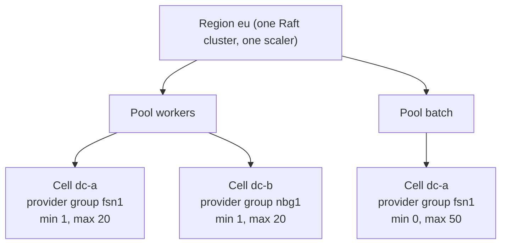
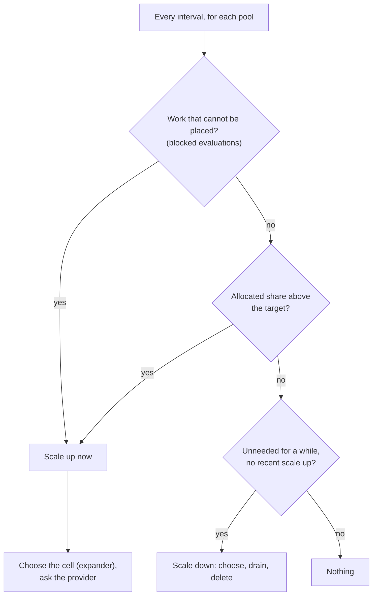
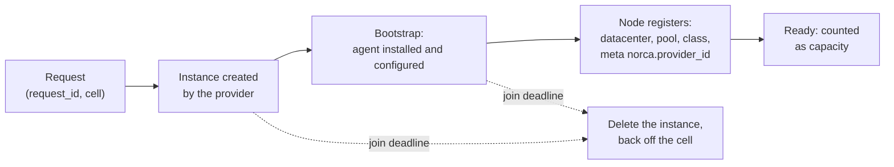

**Status:** Plan · 2026-11-04 · Related documents: [development plan](/docs/design/nomad-fork-development-plan) (phase 4 of the built-in autoscaler, postponed until now), [built-in autoscaler](/docs/features/autoscaler), [load balancer providers](/docs/features/operator-framework/loadbalancer-providers) (the pattern this plan follows), [topology-aware routing](/docs/features/service-discovery/topology) (the datacenter model), [disruption budgets](/docs/features/disruption-budget), [adding and removing nodes](/docs/deployer/adding-and-removing-nodes)

The built-in autoscaler scales the task groups of jobs. This plan lets it scale the **number of client nodes** too: it asks a platform (a cloud, a hosting provider, a pool of machines) for more nodes when the cluster has no room for the work, and gives nodes back when there is too much room. The platform side is done by **provider applications** that register themselves, as the load balancer providers do; the decisions rest on the **internal metrics** of the servers. Nothing here changes how jobs or the external autoscaler work.

## Table of contents

- [Summary and decisions](#summary-and-decisions)
- [Goals and non-goals](#goals-and-non-goals)
- [Starting point](#starting-point)
- [Scope: where a new node goes](#scope-where-a-new-node-goes)
- [Configuration](#configuration)
- [Decisions of the scaler](#decisions-of-the-scaler)
- [Metrics](#metrics)
- [The provider contract](#the-provider-contract)
- [The life of a node](#the-life-of-a-node)
- [Scale down and drain](#scale-down-and-drain)
- [Engines: the external autoscaler and the built-in one](#engines-the-external-autoscaler-and-the-built-in-one)
- [Security, observability, failures](#security-observability-failures)
- [Licensing and provenance](#licensing-and-provenance)
- [Phases and acceptance](#phases-and-acceptance)
- [Open questions](#open-questions)

## Summary and decisions

| | Decision |
| --- | --- |
| Whether | Decided 2026-10-24: not for now, postponed. Reopened 2026-11-04. |
| Providers | Decided 2026-10-25: Hetzner Cloud, Scaleway, AWS and GCP (the same four as the load balancer providers), as separate applications; the core has no cloud code. |
| Topology | Decided 2026-10-28: region > datacenter only; one datacenter is one availability zone. |
| Engines | Decided 2026-11-04: the `engine` option stays. With an external autoscaler and its plugins, they are used; without one, the built-in autoscaler uses the providers. |
| Provider model | Decided 2026-11-04: like the load balancer providers: external applications that register a class object and a heartbeat, called over HTTP. |
| Metrics | Decided 2026-11-04: the decisions are built on the internal metrics (the [metrics store](/docs/configuration/metrics_store)), not on an external APM. |
| Scope | **Proposed:** a capacity *cell* is one node pool in one datacenter of one region (see [below](#scope-where-a-new-node-goes)). The decision is made per pool, the placement per cell. |
| Where the setting lives | **Proposed:** a region-local object, not a field of the node pool (node pools are replicated between regions; the cloud groups are not the same in every region). |
| Triggers | **Proposed:** both: nodes are added at once for work that cannot be placed, and ahead of time when the allocated share of a pool is high. |

## Goals and non-goals

**Goals**

- Add nodes when work cannot be placed or the pool is nearly full, and remove nodes that are not needed, without a person in the loop.
- The unit is a datacenter of a node pool, so the spread over availability zones is a property of the scaler, not an accident.
- A removed node is always drained first; no node with unfinished work is deleted.
- Providers are applications outside the core, one per platform, written against a small HTTP contract; credentials stay with them.
- The decisions use what the servers already measure.

**Non-goals**

- Scaling the **servers** (Raft members). Only client nodes are scaled.
- Scaling across regions. A region is one Raft cluster; each region has its own scaler, leader and providers.
- Vertical sizing of tasks (a separate topic).
- Provider-specific features beyond "n nodes of this kind in this zone" (volumes, load balancers, spot pricing) in the first phases.
- Replacing the deployer: it installs and configures nodes by hand; the scaler asks for nodes that come up by themselves (see [the life of a node](#the-life-of-a-node)).

## Starting point

What exists and what the plan builds on.

| Part | State |
| --- | --- |
| Built-in autoscaler | Runs in the leader. Its logic is ported from the Nomad Autoscaler v0.6.0 (MPL 2.0): policy checks, the strategies, schedules, the policy parser, the plugin SDK. It scales **task groups only**: the cluster keys and node-selector strategies were dropped from the port, and two files say so (`sdk/target.go`, `processor.go`: "cluster scaling is not part of the built-in autoscaler yet"). |
| Engines | A policy has an `engine`: `builtin`, or `external`, which keeps the behavior of Nomad v1.6.5 (an external autoscaler agent reads the policies through the API). External APM and strategy plugins can be loaded into the built-in autoscaler; external **target** plugins cannot. |
| Cluster metrics | The servers sample, per datacenter and node pool (labels `dc`, `pool`): `norca.cluster.cpu_allocated`, `cpu_used`, `memory_allocated`, `memory_used`, `disk_allocated` and `nodes_ready`, in percent of the capacity left after the reserved resources (the count for `nodes_ready`). They are stored and served by the [metrics API](/docs/api/metrics-store), **but the autoscaler does not read them yet**; it only reads the task group usage (`nomad.cpu`, `nomad.memory`, ...). |
| Signals of missing room | A failed placement carries per datacenter the number of nodes available (`NodesAvailable`), the nodes filtered by class and by constraint, and the exhausted dimension (`cpu`, `memory`, quota). A blocked evaluation waits until room appears. |
| Nodes | A node has a datacenter, a node pool, a node class and meta (set in the agent configuration). Node pools are per region **and are replicated from the authoritative region** to the others. |
| Drain | `DrainSpec` (deadline, ignore system jobs), eligibility, the drainer, and [disruption budgets](/docs/features/disruption-budget) that limit how many allocations of a job may be stopped at once. |
| Provider pattern | The load balancer providers: a cluster-scoped class object written by the provider with a heartbeat, an HTTP contract, a token read from a Variable, capabilities checked by the operator, `UnknownClass` / `ProviderUnavailable` states, the lab cases that test it. |
| Joining nodes | The deployer installs nodes over SSH with a PKI and the gossip key, and records them. A node that comes up by itself needs the same ingredients delivered another way. |
| Reusable code (MPL 2.0) | In the Nomad Autoscaler v0.6.0: `sdk/helper/scaleutils` (node selection: `empty`, `least_busy`; the drain handling) and the node queries of its Nomad APM. Usable with their headers kept; the cloud targets (`aws-asg`, `azure-vmss`, `gce-mig`) are not wanted, providers take their place. |

## Scope: where a new node goes

The question is which level a request for a node is made at. Each level has a different meaning in Norca:

| Level | What it is | Role in this plan |
| --- | --- | --- |
| **Region** | The Raft cluster. A new node joins the servers of one region. | A scaler and its providers belong to exactly one region. No cross-region scaling. |
| **Datacenter** | An availability zone (decision 2026-10-28). | The **placement unit**: the zone or location of the platform. |
| **Node pool** | A capacity partition of a region; jobs choose it; it may span datacenters. | The **decision unit**: "this pool has too little room". |
| **Node class** | A finer grouping used in constraints. | Optional: different machine kinds inside one cell. |

A **cell** is `(region, pool, datacenter)`, with an optional node class. These are exactly the labels of the cluster metrics (`dc`, `pool`; the region is the store the metric is in). A provider *group* (an instance group, a placement group, a location) belongs to one cell.



Rules that follow:

1. A cell has one provider group, and a group belongs to one cell.
2. The decision to grow or shrink is made for the **pool** (the sum over its cells); which cell is chosen is the **placement** ([below](#decisions-of-the-scaler)).
3. A job that lists datacenters or constrains the class can only use some cells, so the cell is chosen from the cells the unplaced work can actually use.
4. A pool may have cells in some datacenters only; a datacenter without a cell is simply not scaled.

## Configuration

The scaling of a pool is a **region-local object**, `node_pool_scaling`, stored in Raft and managed with `norca node pool scaling apply|status|delete`. It is not a field of `NodePool`: node pools are replicated from the authoritative region, and the cloud groups, datacenters and limits differ from region to region, so replicating the setting would be wrong.

```hcl
node_pool_scaling "workers" {            # a node pool of this region
  enabled = true
  enforce = false                        # false: only events ("would add 2 nodes"), true: act
  engine  = "builtin"                    # "external": the external autoscaler agent owns the policy

  provider = "hetzner-eu"                # NodeClass registered by a provider application

  cell "dc-a" {                          # a datacenter of the pool
    group = "fsn1"                       # the provider's name of the zone or group
    min   = 1
    max   = 20
  }
  cell "dc-b" {
    group = "nbg1"
    min   = 1
    max   = 20
  }

  node {                                 # what a new node looks like
    node_class = "worker"
    meta       = { tier = "general" }
    parameters = { size = "cx32", image = "norca-worker-3" }   # for the provider
  }

  policy {
    evaluation_interval = "30s"
    cooldown            = "5m"

    scale_up {
      on_blocked = true                  # work that cannot be placed
      max_step   = 5                     # nodes per decision
      expander   = "spread"              # which cell: spread | fill | priority | weighted
    }

    check "allocated" {                  # ahead of time, on the allocated share
      source = "norca"
      query  = "cluster.cpu_allocated"
      strategy "target-value" { target = 70 }
    }

    scale_down {
      unneeded_for      = "10m"
      delay_after_add   = "10m"
      utilization_below = 40             # percent allocated, of the pool without the candidate
      selector          = "least_busy"   # least_busy | empty
      drain_deadline    = "15m"
    }
  }
}
```

Validation: the pool exists; the datacenters of the cells are known; `min <= max`; the sum of the maxima is the maximum of the pool; one `engine` per pool; a `provider` for `builtin`. The setting is turned into the typed scaling policy the autoscaler already evaluates (`Type = "cluster"`, target `{pool, cell}`), so the checks, the strategies, the cooldown, the rate limit and the oscillation guard are the ones task groups use.

## Decisions of the scaler



**Scale up.**

1. *Trigger.* Blocked demand: the failed placements and blocked evaluations of the pool name the dimension that is exhausted and the datacenters and classes that were possible. Ahead of time: the `allocated` check against its target.
2. *Size.* The unplaced demand is divided by the size of one node of the cell (the provider reports the capacity of the machine kind), rounded up, and limited by `max_step`, the maximum of the cell and of the pool, and the rate limit of the autoscaler. An allocated-share trigger asks for the number of nodes the target strategy calls for.
3. *Cell.* From the cells that the unplaced work can use (its datacenters and class), the **expander** chooses: `spread` (the cell with the fewest nodes, default: the same intent as `spread` on `${node.datacenter}`), `fill` (the fullest cell below its maximum), `priority` (an ordered list), `weighted`. A cell whose provider refused the last request (quota, no capacity in the zone) is skipped for a back-off time, and the next cell is tried.
4. *Do not double count.* Nodes that were requested and have not joined yet count as capacity, so a second decision does not ask for them again.

**Scale down.**

1. *Condition.* No blocked work; the allocated share of the pool, **without the candidate node**, stays below `utilization_below` plus a margin; this holds for `unneeded_for`; and `delay_after_add` has passed since the last scale up of the pool.
2. *Candidates.* Only nodes that carry the provider's id in their meta (a node added by hand is never removed), in a cell above its minimum, not protected (meta `norca.scale.protect = "true"`), and eligible for the selection of `selector` (`empty` first, then `least_busy`: the logic of the Nomad Autoscaler, adapted).
3. *Keep the spread.* The cell with the most nodes above its share is preferred, and the last node of a datacenter that jobs are pinned to is kept.
4. *Execute* as described [below](#scale-down-and-drain). One node at a time per pool by default.

**Anti-flapping.** Cooldown after any action, a longer one after a scale up before a scale down, the oscillation guard and the rate limit the autoscaler has, and a cap on nodes added or removed per hour per pool.

## Metrics

| Metric | State | Use |
| --- | --- | --- |
| `norca.cluster.cpu_allocated`, `memory_allocated`, `disk_allocated` (`dc`, `pool`) | Exists | The ahead-of-time trigger and the scale-down condition. The autoscaler gets a built-in source `norca` for them, like `nomad.cpu` for groups. |
| `norca.cluster.cpu_used`, `memory_used` (`dc`, `pool`) | Exists | Shown next to the allocated share (the over-commit); not a trigger by default, as the usage of a node says little about whether work fits. |
| `norca.cluster.nodes_ready` (`dc`, `pool`) | Exists | Counts the nodes of a cell. |
| `norca.cluster.blocked_cpu_mhz`, `blocked_memory_mb`, `blocked_evals` (`dc`, `pool`) | **New** | The demand that cannot be placed, from the blocked evaluations of the leader; the scale-up trigger. |
| `norca.nodescaler.requested`, `joining`, `failed` (`dc`, `pool`) | **New** | The nodes asked for and not joined yet, and the failures; what the double counting rule and the status command use. |

The new metrics are sampled by the leader from its state, into the same store and with the same retention, so the decisions can be inspected after the fact. An *allocated* share, not the usage, drives the scaler (the way the Kubernetes cluster autoscaler looks at requests): it is what the scheduler cannot place against.

## The provider contract

A provider is an application outside the core that handles one **node class** (a platform). Like a load balancer provider, it writes a cluster-scoped **`NodeClass`** object when it starts and keeps a heartbeat in its status. The scaler reads the registrations, checks that the provider is available (a heartbeat not older than a limit, as `-class-ttl` of the load balancer operator), that a cell's group exists and that the request is inside the declared limits, and calls it:

```
GET    {endpoint}/v1/groups/{group}                         the instances and the capacity of one node
POST   {endpoint}/v1/groups/{group}/instances               create instances
DELETE {endpoint}/v1/groups/{group}/instances/{id}          delete one instance
```

`POST` is idempotent by a `request_id` the scaler gives, so a repeated request after a failure or a leader change does not create more nodes:

```json
{
  "request_id": "eu/workers/dc-a/00184",
  "count": 2,
  "parameters": { "size": "cx32", "image": "norca-worker-3" },
  "labels": {
    "norca.region": "eu", "norca.pool": "workers", "norca.datacenter": "dc-a",
    "norca.class": "worker"
  },
  "bootstrap": { "...": "see the life of a node" }
}
```

`GET` returns, per instance, its `id`, `state` (`creating`, `running`, `deleting`, `failed`), the reason of a failure (`quota`, `no_capacity`, `invalid`, `error`), its address and labels, and the `capacity` of the machine kind (CPU in MHz, memory in MB), which is how the scaler sizes a request. A provider that cannot create an instance says so with a reason, and does not retry for ever.

The `NodeClass` object has the endpoint (https; a private CA with an option like `-class-ca-file`), the name of the Variable that holds the token, the **capabilities** (the groups it offers, the parameters it accepts) and the published parameters. Credentials of the platform (an API token) stay with the provider application and never enter an object. The ACL of the kind decides who may register a class, as for load balancers.

## The life of a node



- **Identity.** The provider labels the instance with the region, pool, datacenter, class and the request; the node, when it registers, carries `datacenter`, `node_pool`, `node_class` and a meta key with the **provider's instance id**. That key is how a node is matched with its instance, and the only nodes the scaler may remove.
- **Join deadline** (default 15 minutes). An instance that exists but whose node has not registered by then is deleted, and the cell is backed off. Instances with the labels of this scaler and no node, after the deadline, are orphans and are deleted; a node whose instance is gone is reported.
- **Bootstrap.** A new machine needs what the deployer installs on a node: the agent binary, the TLS material (the CA and a client certificate), the gossip key, the addresses of the servers, and the agent configuration with datacenter, pool, class and meta. This plan proposes that the provider hands the machine a **bootstrap bundle** (cloud-init or the platform's user data) rendered from a template with those values, and that the deployer gains a command to render it (`norca-deployer render-node`), so the PKI and the configuration stay in one place. The bundle carries short-lived secrets and is passed only to the provider. *How the joining credentials are issued is an open question.*
- **Counting.** A requested node counts as capacity while it joins (so it is not requested twice) and as `failed` when it does not.

## Scale down and drain

1. Choose the candidate as above.
2. Mark the node **ineligible** (no new allocations).
3. **Drain** it with the built-in drainer, with the deadline of the policy; [disruption budgets](/docs/features/disruption-budget) apply, and system jobs follow the usual `ignore_system_jobs` rule.
4. When the drain is **complete**, ask the provider to delete the instance, then wait for the node to go down and be garbage collected.
5. Record the decision (the `Scaling` event topic and the scaling history), with the node, the cell and the reason.

If the drain does not finish by its deadline, or fails, the scaler **does not delete the instance**: it makes the node eligible again, backs the candidate off and raises an event. This is the acceptance criterion of the development plan: no node is removed with an unfinished drain.

## Engines: the external autoscaler and the built-in one

The `engine` option stays and keeps its meaning:

| | External | Built-in |
| --- | --- | --- |
| Who decides | The external autoscaler agent with its target plugins (for example the cloud instance group plugins of the Nomad Autoscaler), as in Nomad v1.6.5 | The autoscaler in the leader, with the node providers |
| Policy | Read by the agent through the API; Norca only stores and serves it | Evaluated in the leader |
| Needs | The agent and its plugins | A registered `NodeClass` |

The **policy decides**, not an automatic detection: `engine = "external"` leaves the pool to the agent (Norca does not act on it), `engine = "builtin"` uses the providers, and one pool has one engine, so two systems never scale the same pool. Loading external *target* plugins into the built-in autoscaler is not planned; the external engine covers that need.

## Security, observability, failures

**ACL.** Writing the scaling of a pool is a capability on node pools (`write-node-pool-scaling`, read for the status), the registration of a `NodeClass` is an object rule on that kind (a provider needs only its own registration), and the token the scaler sends to a provider is a Variable it reads. The bootstrap secrets are short-lived and never in the setting.

**Observability.**

- Events on the `Scaling` topic for every decision (pool, cell, old and new count, trigger, reason) and for provider failures; the decisions in the scaling history, from which the cooldown is restored after a leader change.
- `norca node pool scaling status <pool>`: per cell the nodes, the nodes joining, min and max, the last decisions, the provider state.
- The metrics above, and later a page in the web UI.

**Failures.**

| Failure | Behavior |
| --- | --- |
| Provider unavailable (heartbeat) | The scaler does not act on its cells; an event, `ProviderUnavailable` as for load balancers. Nodes keep running. |
| A cell refuses (quota, no capacity) | The cell is backed off, the next cell of the expander is tried; if none, the demand stays and an event says why. |
| Leader change | Requests are recorded in Raft with their `request_id`; the new leader lists the instances of each group and reconciles, and idempotent requests are repeated safely. |
| Node does not join | The join deadline deletes the instance and backs the cell off. |
| Drain stuck | No deletion; the node becomes eligible again. |
| Runaway scaling | Pool maximum, nodes per hour, `enforce = false` (events only), `enabled = false` (a switch). |

## Licensing and provenance

- The design is Norca's own. Its models are the **Kubernetes cluster autoscaler** (Apache 2.0): node groups, scale-up for work that cannot be scheduled, expanders, scale-down checks; and the **load balancer providers** of this project.
- Code from the Nomad Autoscaler v0.6.0 (MPL 2.0), such as the node selectors and the drain handling in `sdk/helper/scaleutils`, may be adapted in separate files with its headers kept and a note of the changes, as the existing autoscaler code is.
- Nothing is taken from HashiCorp's Enterprise products or from BSL releases; the feature is not described as a version of any HashiCorp feature.
- Platform SDKs belong to the provider applications, not to the Norca binary; the licenses of the ones to be used (the AWS, Google, Scaleway and Hetzner Go SDKs) are checked against the allowed list when a provider is built.

## Phases and acceptance

| Phase | Content | Acceptance |
| --- | --- | --- |
| 0 | The built-in source `norca` (the cluster gauges as policy metrics), and the blocked-demand metrics. A **read-only advice mode**: the scaler only raises events ("would add 2 nodes to dc-a"). | Metrics are readable by a check; advice events match the blocked work in a lab test. No provider needed. |
| 1 | The region-local `node_pool_scaling` object, validation, the typed policy, the cell model, CLI `apply`/`status`/`delete`, events, dry run. | Invalid settings are rejected; a pool with two cells shows the expected decisions in dry run; the setting is not replicated between regions. |
| 2 | The `NodeClass` registry, the HTTP contract, a mock provider, the scale-up path, join tracking, the join deadline, orphan cleanup. | Blocked work makes the scaler request nodes in the right cell; a request repeated after a leader change creates no extra node; a node that never joins is cleaned up. |
| 3 | Scale down: candidate selection (the adapted `scaleutils`), protections, drain, delete, the failure paths. | No instance is deleted with an unfinished drain; a stuck drain makes the node eligible again; the last node of a pinned datacenter stays. |
| 4 | The first real provider (Hetzner Cloud), then Scaleway, AWS and GCP; the bootstrap bundle and `render-node` in the deployer. | The lab case with the real provider (below). |
| 5 | Web UI page, scheduled windows, spot and preemption handling, per-class cells. | – |

**The lab.** The lab already has what a cloud needs for a test: VMs that labrunner starts and stops. A **lab provider** (a provider application whose "instances" are the pre-provisioned lab VMs, started and stopped through labrunner and joined with the deployer) lets a case run on three VMs without a cloud account: blocked work starts a VM in the right datacenter, the node joins and the work is placed, the load goes away, and the node is drained and powered off. The mock provider covers the contract in unit and integration tests.

## Open questions

1. **Scope.** Is a cell always one provider group in one datacenter, or may a cell hold several machine kinds (node classes)? The proposal is one group per cell and node class as an optional refinement in phase 5.
2. **Default expander.** `spread` (proposed), or `fill`.
3. **Triggers.** Both blocked demand and the allocated share (proposed), or only the first, as the simpler start.
4. **Where the setting lives.** A separate region-local object (proposed), or an extension of the node pool spec with the replication of that field switched off.
5. **Bootstrap.** The bundle rendered by the deployer and handed to the provider (proposed), or the provider produces its own, or the provider calls the deployer over SSH.
6. **Joining credentials.** How a machine that comes up by itself gets its TLS client certificate: a bundle signed in advance, a one-time token exchanged for a certificate, or a certificate issued by the servers at registration (as the native mTLS issues workload certificates).
7. **Scale-down simulation.** Resource headroom only (proposed for the first version), or a check that the allocations of the candidate fit elsewhere with their constraints.
8. **Spot and preemptible machines** (a platform removes a node on its own): treat as a node loss, or let the provider tell the scaler in advance so it drains first.
