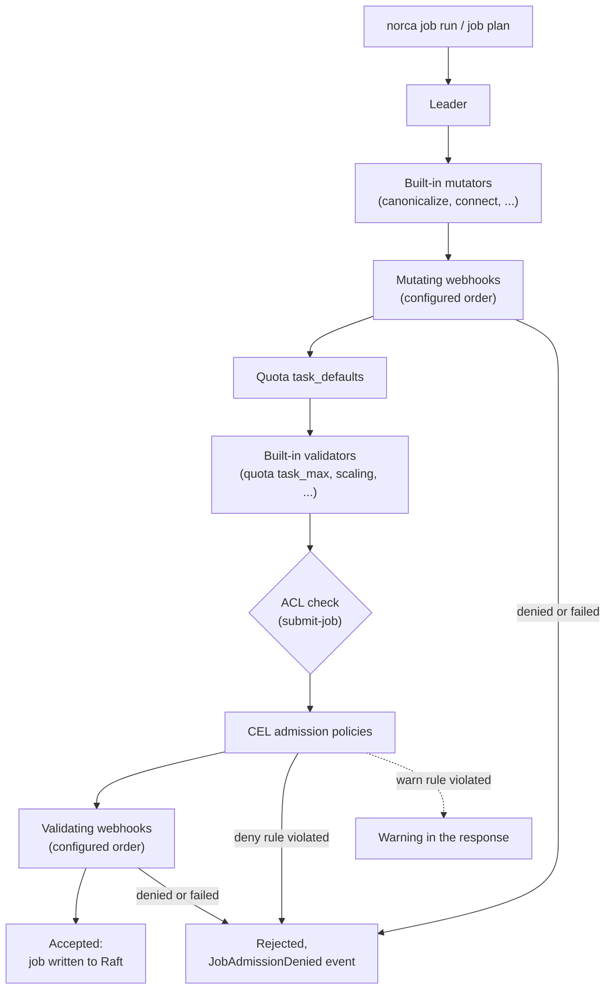

## What and why

Every job submitted to Nomad v1.6.5 passes through a fixed chain of built-in
mutators and validators in the server code. A company rule such as "no
privileged containers in production" or "every job needs an owner label" can
only be enforced by changing that code or by a gate in front of the API.

Norca makes the chain configurable in two ways:

- **Admission policies** are cluster objects stored in Raft. Each holds rules
  written as [CEL](https://cel.dev/) expressions over the submitted job (or a
  Variables write, or a pack release). A violated rule rejects the submission
  (`action = "deny"`) or only adds a warning (`action = "warn"`). Policies are
  managed with `norca admission-policy` and need no external service.
- **Admission webhooks** are HTTP services configured in the server
  configuration. A validating webhook accepts or rejects a job; a mutating
  webhook can also change it with a JSON Patch. The request and response
  documents follow the structure of an admission review.

Both run for `norca job run` and for `norca job plan`, so a user sees a
rejection, a warning or a modification already when planning.

The idea comes from Kubernetes (ValidatingAdmissionPolicy with CEL rules, and
validating and mutating admission webhooks). The design and implementation are
Norca's own: the controllers plug into the admission chain of the Nomad v1.6.5
job endpoint, policies are Raft objects with their own ACL rule and event
topic, and webhooks can only be configured by the operator of the servers.

## How it works



- **Order.** Job registration and planning are forwarded to the leader, which
  runs the built-in mutators, the mutating webhooks, the quota `task_defaults`,
  and the built-in validators. After the submitter is authorized, the CEL
  admission policies and then the validating webhooks see the final job.
  Mutators run before validators, so validators see the job as it will be
  stored.
- **Policies.** A policy applies to the namespaces of its `match` block (glob
  patterns allowed, all namespaces if empty). Every rule is a CEL expression
  that must evaluate to `true`; a rule that fails to evaluate (for example
  because it reads a missing field without `has()`) counts as violated, so a
  broken `deny` rule fails closed. The expressions are compiled when the policy
  is applied, and a policy that does not compile is not stored. A rule may cost
  at most a bounded amount of CEL work, and all policies of one submission must
  finish within 2 seconds.
- **CEL variables.** `job` is the job in its API JSON form (`job.ID`,
  `job.TaskGroups`, `t.Driver`, `t.Config`, ...). `request` holds `resource`
  (`job`), `operation` (`register` or `plan`), `namespace`, `user` (the
  submitter: `accessor_id`, `name`, `type`, `roles`, `policies`) and `secrets`
  (every secret the job references, see
  [secret delivery](/docs/features/secrets/delivery)). The CEL standard library
  is extended with the string, set and list extensions.
- **Webhooks.** A webhook is called once per submission, without retries, with
  the job (without its Vault and Consul tokens) and the submitter. A mutating
  webhook may return an RFC 6902 JSON Patch; the patched job is brought back to
  its canonical form, and a patch must not change the job ID, namespace or
  region. If a webhook cannot be called, times out or answers incorrectly, its
  `failure_policy` decides: `fail` rejects the submission, `ignore` admits it
  with a warning. Mutating webhooks are not called for a submitter that may not
  submit jobs to the namespace.
- **Variables.** Policies and validating webhooks that select the `variable`
  resource also run for Variables writes and deletes, after the writer is
  authorized and before the Raft write. With `schema_from = "crd-schema"` a
  policy also validates `crd/<group>/<kind>/<name>` Variables against a JSON
  Schema stored in `crd-schema/<group>/<kind>` (see the
  [operator framework](/docs/features/operator-framework)).
- **Releases.** Policies that select the `release` resource run when a pack
  release is installed, upgraded or rolled back, with the variable `release`;
  their `trusted_keys` require a signed pack (see
  [signatures in protected namespaces](/docs/features/packages/releases#signatures-in-protected-namespaces)).
- **Denials.** A rejection publishes a `JobAdmissionDenied` (or
  `VariableAdmissionDenied`) event on the `AdmissionPolicy` topic of the
  [event stream](/docs/features/event-stream): namespace, job, operation, the
  submitter, the controller (`policy` or `webhook`), its name and the message.
  `-policy-override` of `norca job run` does not bypass admission policies.

## Example

A CEL policy for the `apps` namespace of the [deployment examples](/docs/getting-started/examples)
(`example/policies/admission-apps.hcl`):

```hcl {filename="admission-apps.hcl"}
name        = "apps-baseline"
description = "Baseline rules for the jobs of the apps namespace"
action      = "deny" # or "warn": report the violations without rejecting

match {
  namespaces = ["apps"]
}

rule {
  expression = "!job.TaskGroups.exists(g, g.Tasks.exists(t, t.Driver == 'docker' && has(t.Config.privileged) && t.Config.privileged))"
  message    = "Privileged containers are not allowed in the apps namespace."
}

rule {
  expression = "job.TaskGroups.all(g, g.Count <= 10)"
  message    = "A task group of the apps namespace may have at most 10 instances."
}

# Secret blocks may only reference secrets below the name of their job.
rule {
  expression = "request.secrets.all(s, s.source != 'secret' || s.path.startsWith(job.ID + '/'))"
  message    = "Secret blocks may only read secrets below <job ID>/."
}
```

```shell
norca admission-policy apply admission-apps.hcl
norca admission-policy list
```

```plaintext
Name           Action  Resources  Namespaces  Rules  Description
apps-baseline  deny    job        apps        3      Baseline rules for the jobs of the apps namespace
```

A validating webhook in the server configuration, kept away from the namespace
the webhook service itself runs in:

```hcl {filename="norca.hcl"}
server {
  admission {
    webhook "image-policy" {
      url                = "https://admission.internal:8443/validate"
      mode               = "validate"
      timeout            = "5s"
      failure_policy     = "fail"
      namespaces         = ["prod", "staging"]
      exclude_namespaces = ["admission-system"]
      ca_file            = "/etc/norca.d/admission-ca.pem"
    }
  }
}
```

The webhook receives a `POST` with an `AdmissionReview` document and answers
with the same `uid`:



```json
{
  "api_version": "admission.norca.io/v1",
  "kind": "AdmissionReview",
  "request": {
    "uid": "3f1c1c8e-6f0a-4d0e-9a51-0d5f8a3b2c11",
    "resource": "job",
    "operation": "register",
    "dry_run": false,
    "namespace": "prod",
    "user": {
      "accessor_id": "b1d0c3c4-...",
      "name": "ci",
      "type": "client",
      "policies": ["deploy-prod"]
    },
    "job": { "ID": "web", "Namespace": "prod", "TaskGroups": [] }
  }
}
```


```json
{
  "api_version": "admission.norca.io/v1",
  "kind": "AdmissionReview",
  "response": {
    "uid": "3f1c1c8e-6f0a-4d0e-9a51-0d5f8a3b2c11",
    "allowed": true,
    "warnings": ["image tag 'latest' is discouraged"],
    "patch": [
      { "op": "add", "path": "/Meta", "value": { "owner": "team-a" } }
    ]
  }
}
```



The `patch` is applied only for mutating webhooks; a validating webhook that
returns one gets a warning. The response must have status `200` and be at most
16 MiB; redirects are not followed.

## Configuration reference

Admission policy (full reference: [admission policy specification](/docs/other-specifications/admission-policy)):

| Key | Type | Default | Description |
| --- | --- | --- | --- |
| `name` | string | required | Unique name (letters, digits, `-`, `_`, at most 128). |
| `description` | string | `""` | At most 256 characters. |
| `action` | string | `"deny"` | `deny` or `warn`. |
| `match.namespaces` | list | all | Namespaces (glob patterns). |
| `match.resources` | list | `["job"]` | `job`, `variable`, `release`. |
| `match.variable_paths` | list | all | Variable paths (glob patterns), with the `variable` resource. |
| `schema_from` | string | `""` | `crd-schema` to validate CRD-style Variables. |
| `trusted_keys` | list | `[]` | PEM public keys that must have signed a released pack. |
| `rule.expression`, `rule.message` | string | required, `""` | A CEL rule (up to 64 rules, 8192 characters each). |

Webhooks, `server { admission { webhook "<name>" { ... } } }` (full reference:
[`admission` block](/docs/configuration/admission)):

| Key | Type | Default | Description |
| --- | --- | --- | --- |
| `url` | string | required | `http` or `https` URL the review is posted to. |
| `mode` | string | `"validate"` | `validate` or `mutate`. |
| `timeout` | duration | `"5s"` | Timeout of a call. |
| `failure_policy` | string | `"fail"` | `fail` or `ignore`. |
| `namespaces`, `exclude_namespaces` | list | all, none | Namespace filters (glob patterns). |
| `resources`, `variable_paths`, `include_variable_items` | list, list, bool | `["job"]`, all, `false` | Variables writes sent to a validating webhook. |
| `ca_file`, `cert_file`, `key_file`, `tls_server_name` | string | `""` | TLS settings, client certificate for mTLS. |

## CLI and API

| Task | CLI | HTTP API |
| --- | --- | --- |
| Create or update a policy | [`norca admission-policy apply`](/docs/commands/admission-policy/apply) | [`POST /v1/admission-policies`](/docs/api/admission-policies#create-or-update-admission-policy) |
| List policies | [`norca admission-policy list`](/docs/commands/admission-policy/list) | [`GET /v1/admission-policies`](/docs/api/admission-policies#list-admission-policies) |
| Show a policy | [`norca admission-policy inspect`](/docs/commands/admission-policy/inspect) | [`GET /v1/admission-policy/:name`](/docs/api/admission-policies#read-admission-policy) |
| Delete a policy | [`norca admission-policy delete`](/docs/commands/admission-policy/delete) | [`DELETE /v1/admission-policy/:name`](/docs/api/admission-policies#delete-admission-policy) |
| Follow changes and denials | | [`GET /v1/event/stream?topic=AdmissionPolicy`](/docs/api/events#norca-extensions) |

ACL: `admission { policy = "read" }` reads policies and subscribes to the
`AdmissionPolicy` topic, `admission { policy = "write" }` manages them. It is an
operator-level rule, not scoped to a namespace. Webhooks cannot be managed
through the API, so that a token cannot register a webhook that would see every
job.

Telemetry: `nomad.nomad.admission.denied`, `nomad.nomad.admission.webhook.calls`,
`.errors` and `.latency` (see [telemetry](/docs/features/autoscaler/reference/telemetry#admission-control-metrics)).

## Limits and status

- Available: CEL policies for jobs, Variables writes and pack releases,
  `deny` and `warn` actions, validating and mutating webhooks for jobs,
  validating webhooks for Variables writes, JSON Schema validation of
  CRD-style Variables, denial events.
- There is no mutating CEL; modifications are made by mutating webhooks only.
  Mutating webhooks do not apply to Variables writes.
- Admission policies are stored per region; apply them in every region of a
  federation. Webhooks are read when a server starts; configure them on every
  server and restart the servers to change them.
- A slow webhook slows down job submission (the chain runs on the leader for
  every `job run` and `job plan`), not the other operations of the cluster.
- If a webhook service runs as a Norca job, exclude its own namespace with
  `exclude_namespaces`, or its redeployment can be blocked by itself.
- Policy writes need every server of the region on a Norca version that
  supports admission policies.

## Design

[Kubernetes features: 2. Dynamic admission control](/docs/design/kubernetes-features-spec#2-dynamic-admission-control)
and the [common principles](/docs/design/kubernetes-features-spec#common-principles).
