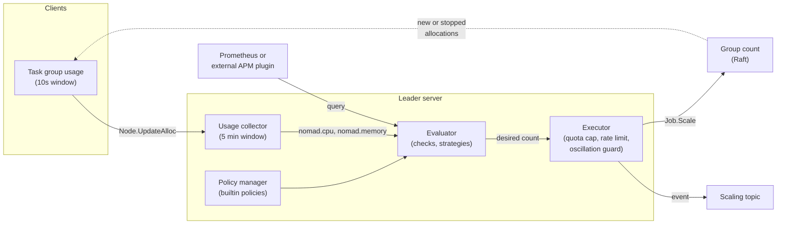

## What and why

In Nomad v1.6.5 scaling is split between two systems: the servers store the
`scaling` block of a task group and execute scaling requests, while a separately
deployed autoscaler agent reads the policies, queries metrics, decides and calls
the scaling API. The policy itself is an opaque document that the servers never
look at, so a mistyped strategy or a bad query is accepted by `job run` and only
shows up later in the autoscaler's log. The external agent also needs its own
deployment, high availability, ACL token and monitoring.

Norca moves the evaluation into the servers. The **built-in autoscaler** is a
subsystem of the leader server, like the deployment watcher or the drainer: it
starts when a server becomes leader and stops when it loses leadership. It
evaluates the scaling policies of task groups with the strategies of the
autoscaler (`target-value`, `threshold`, `fixed-value`, `pass-through`), reads
metrics from the CPU and memory usage that clients push to the servers, from
Prometheus, or from external APM plugins, and changes the `count` of the group
through the same internal path as `norca job scale`.

The `scaling` block becomes a **typed policy**: the servers parse it, fill in
defaults and validate it when the job is planned or submitted, so `norca job
plan` already reports an unknown strategy, a missing `target` or a too short
`evaluation_interval`. The autoscaler knows about deployments and namespace
quotas, protects the cluster with a rate limit and an oscillation guard, and
publishes every decision on the `Scaling` topic of the event stream.

The built-in autoscaler is **off by default**. Policies are assigned to an
*engine*: `builtin` policies are evaluated by the servers, `external` policies
are left to an external autoscaler agent, so both can run side by side during a
migration.

## How it works



1. **Policies.** The policy manager watches the scaling policies in the state
   store. A policy is evaluated by the built-in autoscaler if its engine is
   `builtin` (set in the `scaling` block, or inherited from the server's
   `default_engine`), it is enabled, and it belongs to a task group. Task level
   scaling policies (`scaling "cpu"`, `scaling "mem"`) are not evaluated.
2. **Metrics.** Clients aggregate the CPU and memory usage of their allocations
   per task group and send it with their regular `Node.UpdateAlloc` calls; the
   servers switch this on through the heartbeat response, so no client setting
   is needed. The leader keeps the data only in memory, in a fixed ring of time
   buckets per task group. The built-in metrics `nomad.cpu`, `nomad.memory`,
   `nomad.cpu_mhz` and `nomad.memory_mb` are served from it without any RPC to
   the clients. Application metrics come from a Prometheus APM or an external
   APM plugin configured in the server's `autoscaler` block.
3. **Evaluation.** Every policy is evaluated at its `evaluation_interval` by a
   bounded pool of workers. An evaluation is skipped when the job is stopped or
   missing, the policy is outside its `schedule`, a deployment of the job is
   active (unless `scale_during_deployment = "up_only"` allows scaling up), or
   the group is in its cooldown or suspended. Otherwise every check queries its
   metric and runs its strategy; when checks disagree, the action that keeps the
   most capacity wins (see [checks](/docs/features/autoscaler/reference/concepts/policy-eval/checks)).
4. **Coordination.** A scale up is capped at what still fits into the
   [namespace quota](/docs/features/quotas): the autoscaler scales to the quota
   ceiling instead of the desired count and publishes a `ScalingQuotaCapped`
   event. A cluster-wide token bucket limits the number of scaling actions, and
   a group that changes direction three times within 10 minutes is suspended for
   15 minutes and gets an error scaling event.
5. **Execution.** The decision goes through the internal `Job.Scale` path, which
   records a scaling event (visible with `norca job scaling-events`) and creates
   an evaluation for the scheduler. After a leader change the new leader starts
   with an empty usage collector, restores cooldowns and suspensions from the
   scaling events, and reports "insufficient data" for the built-in metrics
   until one full metrics window has been collected.

The built-in autoscaler only runs when every server of the region runs a Norca
version that supports it ([version gate](/docs/introduction/compatibility#version-gate-of-the-norca-features)).

## Example

Enable the built-in autoscaler on the servers and make it the default engine:

```hcl {filename="norca.hcl"}
server {
  enabled = true

  autoscaler {
    enabled        = true
    default_engine = "builtin"
  }
}
```

Scale a task group between 3 and 6 instances, keeping the average CPU usage near
70% of the reserved CPU (this is the policy of the `test-app` pack of the
[deployment examples](/docs/getting-started/examples)):

```hcl
group "web" {
  count = 3

  scaling {
    enabled = true
    engine  = "builtin"
    min     = 3
    max     = 6

    policy {
      evaluation_interval     = "30s"
      cooldown                = "2m"
      scale_during_deployment = "up_only"

      check "cpu" {
        metric   = "nomad.cpu"
        strategy = "target-value"
        target   = 70
      }
    }
  }

  # ...
}
```

Observe the policy and the decisions:

```shell
norca scaling policy list -namespace apps
norca scaling policy info -namespace apps <policy ID>
norca job scaling-events -namespace apps test-app
curl -s -N "$NOMAD_ADDR/v1/event/stream?topic=Scaling&namespace=apps"
```

A policy that the servers cannot evaluate is rejected at submission:

```plaintext
$ norca job plan web.nomad.hcl
Error during plan: ... task group "web": scaling policy invalid: check[cpu]: strategy "target-value": missing required field `target`
```

## Configuration reference

Server configuration, `server { autoscaler { ... } }` (full reference:
[`autoscaler` block](/docs/configuration/autoscaler)):

| Key | Type | Default | Description |
| --- | --- | --- | --- |
| `enabled` | bool | `false` | Runs the built-in autoscaler on the leader. |
| `default_engine` | string | `"external"` | Engine of policies that do not set `engine`: `builtin` or `external`. |
| `min_eval_interval` | duration | `"10s"` | Lower bound of a policy's `evaluation_interval`. |
| `min_cooldown` | duration | `"10s"` | Lower bound of `cooldown` and `cooldown_on_scale_up`. |
| `default_evaluation_interval` | duration | `"10s"` | Interval of policies that do not set one. |
| `default_cooldown` | duration | `"5m"` | Cooldown of policies that do not set one. |
| `eval_workers` | int | `10` | Policy evaluations that may run in parallel. |
| `rate_limit`, `rate_limit_burst` | float, int | `10`, `50` | Token bucket on scaling actions (per second, burst). |
| `metrics_window`, `client_metrics_interval` | duration | `"5m"`, `"10s"` | Usage window kept by the leader and the client aggregation interval. |
| `plugin_dir` | string | `""` | Directory of external APM and strategy plugin binaries. |
| `apm "<name>"`, `strategy "<name>"` | block | none | Named APM and strategy instances. |

Job specification, `group -> scaling` (full reference:
[`scaling` block](/docs/job-specification/scaling) and
[scaling policies](/docs/features/autoscaler/reference/policy)):

| Key | Type | Default | Description |
| --- | --- | --- | --- |
| `engine` | string | server `default_engine` | `builtin` or `external`. |
| `min`, `max`, `enabled` | int, int, bool | count, required, `true` | Bounds of the group count and the switch of the policy. |
| `policy.evaluation_interval`, `policy.cooldown`, `policy.cooldown_on_scale_up` | duration | server defaults | Timing of the evaluation. |
| `policy.on_check_error` | string | `"ignore"` | `fail` or `ignore` errors of checks. |
| `policy.scale_during_deployment` | string | `"never"` | `never` or `up_only`. |
| `policy.check "<name>"` | block | required | Metric (`metric`, or `source` and `query`) and strategy of a check. |

## CLI and API

| Task | CLI | HTTP API |
| --- | --- | --- |
| List policies | [`norca scaling policy list`](/docs/commands/scaling/policy-list) | [`GET /v1/scaling/policies`](/docs/api/scaling-policies#list-scaling-policies) (Norca adds `engine=builtin\|external`) |
| Read a policy | [`norca scaling policy info`](/docs/commands/scaling/policy-info) | [`GET /v1/scaling/policy/:id`](/docs/api/scaling-policies#read-scaling-policy) |
| Scaling history of a job | [`norca job scaling-events`](/docs/commands/job/scaling-events) | `GET /v1/job/:job_id/scale` |
| Scale manually | [`norca job scale`](/docs/commands/job/scale) | `POST /v1/job/:job_id/scale` |
| Follow decisions | | [`GET /v1/event/stream?topic=Scaling`](/docs/api/events#norca-extensions) |

Telemetry of the autoscaler is described in
[autoscaler telemetry](/docs/features/autoscaler/reference/telemetry).

## Limits and status

- Available: the leader subsystem, the four built-in strategies, the built-in
  `nomad` metrics pushed by clients, the Prometheus APM, external APM and
  strategy plugins, typed and validated policies, deployment and quota
  awareness, the `Scaling` event topic, scaling of
  [custom objects](/docs/features/autoscaler/reference/plugins/target/nomad#custom-object-target)
  through their scale subresource.
- Only horizontal scaling of task groups (`type = "horizontal"`). Task level
  (vertical) policies are stored but not evaluated, and a task policy with
  `engine = "builtin"` is rejected.
- Node pool (cluster) scaling with cloud providers is postponed; there are no
  target plugins such as cloud instance groups, and external target plugins are
  not loaded.
- The Datadog, InfluxDB and Instana APMs are not built in; they can only be
  used as external plugins.
- The usage data is not replicated: after a leader change the built-in metrics
  need one full `metrics_window` before policies that use them scale again.
- The `external` engine keeps the Nomad v1.6.5 behavior: an external autoscaler
  agent can list only its own policies with `GET /v1/scaling/policies?engine=external`.

## Design

[Development plan: built-in autoscaler](/docs/design/nomad-fork-development-plan#target-architecture),
with the [jobspec and data model](/docs/design/nomad-fork-development-plan#jobspec-and-data-model),
[metrics](/docs/design/nomad-fork-development-plan#metrics),
[coordination](/docs/design/nomad-fork-development-plan#coordination-with-other-subsystems)
and [migration](/docs/design/nomad-fork-development-plan#compatibility-and-migration)
sections.
