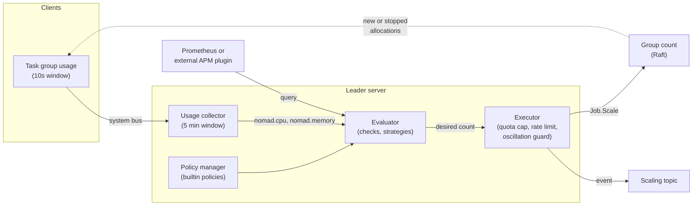
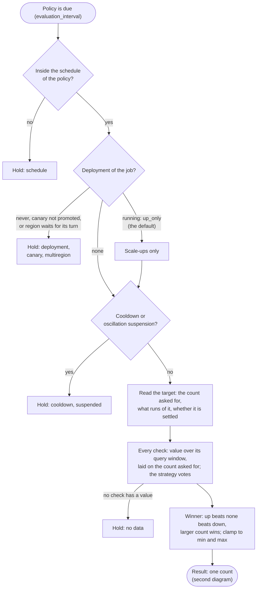
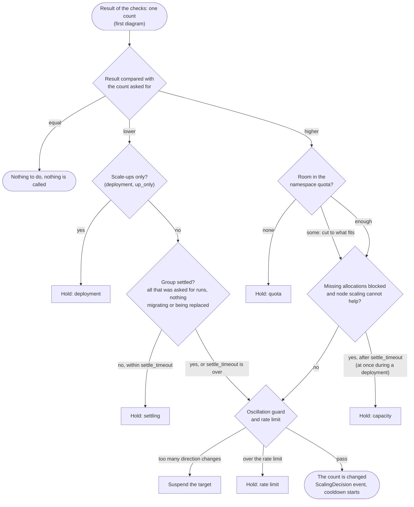

## What and why

In Nomad v1.6.5 scaling is split between two systems: the servers store the
`scaling` block of a task group and execute scaling requests, while a separately
deployed autoscaler agent reads the policies, queries metrics, decides and calls
the scaling API. The policy itself is an opaque document that the servers never
look at, so a mistyped strategy or a bad query is accepted by `job run` and only
shows up later in the autoscaler's log. The external agent also needs its own
deployment, high availability, ACL token and monitoring.

Norca moves the evaluation into the servers. The **built-in autoscaler** is a
subsystem of the leader server, like the deployment watcher or the drainer: it
starts when a server becomes leader and stops when it loses leadership. It
evaluates the scaling policies of task groups with the strategies of the
autoscaler (`target-value`, `threshold`, `fixed-value`, `pass-through`), reads
metrics from the CPU and memory usage that clients push to the servers, from
Prometheus, or from external APM plugins, and changes the `count` of the group
through the same internal path as `norca job scale`.

The `scaling` block becomes a **typed policy**: the servers parse it, fill in
defaults and validate it when the job is planned or submitted, so `norca job
plan` already reports an unknown strategy, a missing `target` or a too short
`evaluation_interval`. The autoscaler knows about deployments and namespace
quotas, protects the cluster with a rate limit and an oscillation guard, and
publishes every decision on the `Scaling` topic of the event stream.

The built-in autoscaler is **off by default**. Policies are assigned to an
*engine*: `builtin` policies are evaluated by the servers, `external` policies
are left to an external autoscaler agent, so both can run side by side during a
migration.

## How it works



1. **Policies.** The policy manager watches the scaling policies in the state
   store. A policy is evaluated by the built-in autoscaler if its engine is
   `builtin` (set in the `scaling` block, or inherited from the server's
   `default_engine`), it is enabled, and it belongs to a task group. Task level
   scaling policies (`scaling "cpu"`, `scaling "mem"`) are not evaluated.
2. **Metrics.** Clients aggregate the CPU and memory usage of their allocations
   per task group and publish it on the
   [system bus](/docs/features/system-bus#task-group-usage); the servers switch
   this on through the heartbeat response when they run the bus, so no client
   setting is needed. The leader keeps the data only in memory, in a fixed ring of time
   buckets per task group. The built-in metrics `nomad.cpu`, `nomad.memory`,
   `nomad.cpu_mhz` and `nomad.memory_mb` are served from it without any RPC to
   the clients. Application metrics come from a Prometheus APM or an external
   APM plugin configured in the server's `autoscaler` block.
3. **Evaluation.** Every policy is evaluated at its `evaluation_interval` by a
   bounded pool of workers. An evaluation is skipped when the job is stopped or
   missing, the policy is outside its `schedule`, or the group is in its
   cooldown or suspended. While a deployment of the job is active the group is
   scaled up and not down (`scale_during_deployment`, `up_only` by default). Otherwise every check queries its
   metric and runs its strategy; when checks disagree, the action that keeps the
   most capacity wins (see [checks](/docs/features/autoscaler/reference/concepts/policy-eval/checks)).
4. **Coordination.** A scale up is capped at what still fits into the
   [namespace quota](/docs/features/quotas): the autoscaler scales to the quota
   ceiling instead of the desired count and publishes a `ScalingQuotaCapped`
   event. A cluster-wide token bucket limits the number of scaling actions, and
   a group that changes direction three times within 10 minutes is suspended for
   15 minutes and gets an error scaling event.
5. **Execution.** The decision goes through the internal `Job.Scale` path, which
   records a scaling event (visible with `norca job scaling-events`) and creates
   an evaluation for the scheduler. After a leader change the new leader starts
   with an empty usage collector, restores cooldowns and suspensions from the
   scaling events, and reports "insufficient data" for the built-in metrics
   until one full metrics window has been collected.

**The built-in autoscaler only runs when every server of the region runs a Norca
version that supports it** ([version gate](/docs/introduction/compatibility#version-gate-of-the-norca-features)).

## How a policy decides

A task group has a count that was asked for and a number of allocations that
run. **The two differ while allocations start, wait for capacity, migrate from
a draining node or are being replaced after a node was lost**, and a decision
taken against what happens to run at that moment asks again for what is
already on its way, or takes it back. So a policy decides against the count
that was asked for:

- **The value is laid on the count that was asked for.** A value per instance,
  measured on the instances that ran, is restated as what the asked-for count
  would show for the same load (value x measured / asked for), and the
  strategy runs with the asked-for count. For the usage the clients report
  (`nomad.cpu` and the others), "measured" is the average number of running
  allocations over the query window, so a drain inside the window does not
  bend the result; for other sources it is what runs now. Totals (a `sum`
  query, the usage of another group, a `pass-through` value) are used as they
  are.
- **A change is made when the result differs from the count that was asked
  for**, never to ask for the same count again.
- **A group that is not settled is not scaled down.** What it shows is its load
  on fewer instances than it will have, and the capacity is coming (back). The
  hold lasts at most [`settle_timeout`](/docs/configuration/autoscaler#autoscaler-parameters)
  (10 minutes by default). Scale ups are not held: the result already counts
  on the allocations that are on their way.
- **A scale up is not made into a wall.** When allocations of the group have
  waited for capacity for `settle_timeout` and [node scaling](/docs/features/node-scaling)
  says no node is coming for them, the policy is held with the reason
  `capacity`.

Example: six instances carry 50 in-flight requests each, the target is 50. A
node is drained and two allocations stop; the four that stay carry 75 each.
Thirty seconds later the one-minute average of the value is 60, measured on 5
instances on average: 5 x 60 / 50 = 6, the count the group has. Nothing is
done, and the two replacements start in peace.

The gates before anything is measured, and how the checks give one result:



What is done with the result. The two directions are treated differently on
purpose: a lower result waits until the group is settled, a higher one is only
limited by what can be had.



Every way out of an evaluation is in the
[status of the policy](/docs/api/scaling-policies#read-the-status-of-a-scaling-policy),
which `norca scaling policy info` prints: the count asked for and what runs,
what each check read and voted for, the result, and why nothing was done. A hold
that lasts [`hold_warn`](/docs/configuration/autoscaler#autoscaler-parameters)
raises a `ScalingHeld` event.

### Scaling and the versions of a job

**Scaling a group is not a new version of the job.** A change of the count, by
a policy, by `norca job scale` or through the API, is made on the version
that runs:

- The allocations that run are left as they are, and the ones that are added
  are placed without a deployment. The version stays the stable one it was,
  with its job file, and scaling does not use up the versions Norca keeps of a
  job. The changes of the count are in the scaling events of the group
  ([`norca job scaling-events`](/docs/commands/job/scaling-events)).
- **A deployment that runs goes on.** The allocations a scale up adds become
  part of it, and it waits for them too.

So a load that grows during a rollout is answered: by default **a policy of
the built-in engine scales its group up during a deployment, and not down**
(`scale_during_deployment = "up_only"`). Nothing is scaled while canaries
wait for promotion, or while the region waits for its turn in a multiregion
rollout. Set `scale_during_deployment = "never"` to hold the count for the
length of every deployment.

> [!NOTE]
> The allocations added during a deployment are part of it: if they can not be
> placed until its `progress_deadline`, the deployment fails, and is reverted
> with `auto_revert`. During a deployment a group whose waiting allocations
> [node scaling can not help](/docs/configuration/autoscaler#events) is
> therefore not scaled up further at once (the reason `capacity`), without
> waiting for `settle_timeout`.

A scale by hand and a policy of the external engine are held during a
deployment unless the policy says `up_only`.

### A new version of the job

**Registering a job again does not undo its scaling.** The count of a task group
that an enabled scaling policy scales, of any engine, is kept when a new
version of the job is registered (brought within the bounds of the new
policy); `norca job plan` shows it so. `norca job run -reset-counts` takes the
count of the job file. A group without an enabled policy in both versions takes
the count of the job file, as it always did.

### A count changed by hand

`norca job scale` on a group that an enabled policy of the built-in engine
scales is carried out, with a warning: the change starts the cooldown of the
policy, and after it the policy decides the count again. Disable the policy or
change its bounds to keep a count.

## Example

Enable the built-in autoscaler on the servers and make it the default engine:

```hcl {filename="norca.hcl"}
server {
  enabled = true

  autoscaler {
    enabled        = true
    default_engine = "builtin"
  }
}
```

Scale a task group between 3 and 6 instances, keeping the average CPU usage near
70% of the reserved CPU (this is the policy of the `test-app` pack of the
[deployment examples](/docs/getting-started/examples)):

```hcl
group "web" {
  count = 3

  scaling {
    enabled = true
    engine  = "builtin"
    min     = 3
    max     = 6

    policy {
      evaluation_interval     = "30s"
      cooldown                = "2m"
      scale_during_deployment = "up_only"

      check "cpu" {
        metric   = "nomad.cpu"
        strategy = "target-value"
        target   = 70
      }
    }
  }

  # ...
}
```

Observe the policy and the decisions:

```shell
norca scaling policy list -namespace apps
norca scaling policy info -namespace apps <policy ID>
norca job scaling-events -namespace apps test-app
curl -s -N "$NORCA_ADDR/v1/event/stream?topic=Scaling&namespace=apps"
```

A policy that the servers cannot evaluate is rejected at submission:

```plaintext
$ norca job plan web.norca.hcl
Error during plan: ... task group "web": scaling policy invalid: check[cpu]: strategy "target-value": missing required field `target`
```

## Configuration reference

Server configuration, `server { autoscaler { ... } }` (full reference:
[`autoscaler` block](/docs/configuration/autoscaler)):

| Key | Type | Default | Description |
| --- | --- | --- | --- |
| `enabled` | bool | `false` | Runs the built-in autoscaler on the leader. |
| `default_engine` | string | `"external"` | Engine of policies that do not set `engine`: `builtin` or `external`. |
| `min_eval_interval` | duration | `"10s"` | Lower bound of a policy's `evaluation_interval`. |
| `min_cooldown` | duration | `"10s"` | Lower bound of `cooldown` and `cooldown_on_scale_up`. |
| `default_evaluation_interval` | duration | `"10s"` | Interval of policies that do not set one. |
| `default_cooldown` | duration | `"5m"` | Cooldown of policies that do not set one. |
| `eval_workers` | int | `10` | Policy evaluations that may run in parallel. |
| `rate_limit`, `rate_limit_burst` | float, int | `10`, `50` | Token bucket on scaling actions (per second, burst). |
| `metrics_window`, `client_metrics_interval` | duration | `"5m"`, `"10s"` | Usage window kept by the leader and the client aggregation interval. |
| `plugin_dir` | string | `""` | Directory of external APM and strategy plugin binaries. |
| `apm "<name>"`, `strategy "<name>"` | block | none | Named APM and strategy instances. |

Job specification, `group -> scaling` (full reference:
[`scaling` block](/docs/job-specification/scaling) and
[scaling policies](/docs/features/autoscaler/reference/policy)):

| Key | Type | Default | Description |
| --- | --- | --- | --- |
| `engine` | string | server `default_engine` | `builtin` or `external`. |
| `min`, `max`, `enabled` | int, int, bool | count, required, `true` | Bounds of the group count and the switch of the policy. |
| `policy.evaluation_interval`, `policy.cooldown`, `policy.cooldown_on_scale_up` | duration | server defaults | Timing of the evaluation. |
| `policy.on_check_error` | string | `"ignore"` | `fail` or `ignore` errors of checks. |
| `policy.scale_during_deployment` | string | `"up_only"` for the built-in engine | `never` or `up_only`. |
| `policy.check "<name>"` | block | required | Metric (`metric`, or `source` and `query`) and strategy of a check. |

## CLI and API

| Task | CLI | HTTP API |
| --- | --- | --- |
| List policies | [`norca scaling policy list`](/docs/commands/scaling/policy-list) | [`GET /v1/scaling/policies`](/docs/api/scaling-policies#list-scaling-policies) (Norca adds `engine=builtin\|external`) |
| Read a policy | [`norca scaling policy info`](/docs/commands/scaling/policy-info) | [`GET /v1/scaling/policy/:id`](/docs/api/scaling-policies#read-scaling-policy) |
| Why a policy did or did not scale | `norca scaling policy info` (Last Evaluation) | [`GET /v1/scaling/policy/:id/status`](/docs/api/scaling-policies#read-the-status-of-a-scaling-policy) |
| Scaling history of a job | [`norca job scaling-events`](/docs/commands/job/scaling-events) | `GET /v1/job/:job_id/scale` |
| Scale manually | [`norca job scale`](/docs/commands/job/scale) | `POST /v1/job/:job_id/scale` |
| Follow decisions | | [`GET /v1/event/stream?topic=Scaling`](/docs/api/events#norca-extensions) |

Telemetry of the autoscaler is described in
[autoscaler telemetry](/docs/features/autoscaler/reference/telemetry).

## Limits and status

- Available: the leader subsystem, the four built-in strategies, the built-in
  `nomad` metrics pushed by clients, the Prometheus APM, external APM and
  strategy plugins, typed and validated policies, deployment and quota
  awareness, the `Scaling` event topic, scaling of
  [custom objects](/docs/features/autoscaler/reference/plugins/target/nomad#custom-object-target)
  through their scale subresource.
- Only horizontal scaling of task groups (`type = "horizontal"`). Task level
  (vertical) policies are stored but not evaluated, and a task policy with
  `engine = "builtin"` is rejected.
- The number of nodes is scaled by [node scaling](/docs/features/node-scaling),
  not by a policy target: the autoscaler decides the scale of the node groups
  (`norca.io/NodeGroup` objects) and the operator `norca-nodescaler` creates
  and deletes the machines through a provider application. There is no
  provider for a cloud yet (the mock and a docker provider for tests). Target
  plugins such as cloud instance groups do not exist, and external target
  plugins are not loaded.
- The Datadog, InfluxDB and Instana APMs are not built in; they can only be
  used as external plugins.
- **The usage data is not replicated**: after a leader change the built-in metrics
  need one full `metrics_window` before policies that use them scale again.
- The `external` engine keeps the Nomad v1.6.5 behavior: an external autoscaler
  agent can list only its own policies with `GET /v1/scaling/policies?engine=external`.

## Design

[Development plan: built-in autoscaler](/docs/design/development-plan#target-architecture),
with the [jobspec and data model](/docs/design/development-plan#jobspec-and-data-model),
[metrics](/docs/design/development-plan#metrics),
[coordination](/docs/design/development-plan#coordination-with-other-subsystems)
and [migration](/docs/design/development-plan#compatibility-and-migration)
sections.
