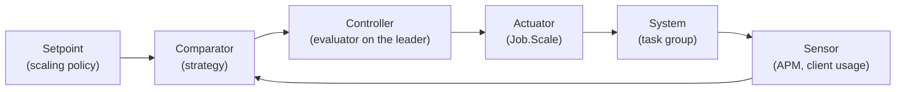

This section covers concepts of the built-in autoscaler and explains the
technical details of how it functions.

The autoscaler is modeled around the concept of a closed-loop control system.
These types of systems are often at the core of self-regulating mechanisms
because they are able to adjust some value based on the current state of the
system and some user provided configuration. An example of a closed-loop control
system is a thermostat, where you set the desired temperature and the appliance
will regulate the output of cold and hot air to make sure the room stays at the
value set.

In closed-loop systems there are a few key components:

* **Setpoint** is the desired output as defined by the user.
* **Comparator** computes the difference between the setpoint and current
  state of the system.
* **Controller** connects all the components together and defines what
  needs to be done to bring the system closer to the desired state.
* **Actuator** applies the changes defined by the controller.
* **System** is the entity being controlled.
* **Output** is the current value of the system.
* **Sensor** reads the system output and translates it to a value that can be
  used by the controller.

The built-in autoscaler follows this architecture inside the leader server and
delegates some of the components to [plugins](/docs/features/autoscaler/reference/concepts/plugins/):

* The scaling **policy** is how users define their desired outcome and control
  the autoscaler.
* The **target** is what users want to scale: the count of a task group, or the
  scale of a custom object.
* **Strategy plugins** receive the current count of the target and the metrics
  of the system to compute what actions need to be taken.
* **APM plugins** read application performance metrics, from the usage reported
  by the clients or from external sources such as Prometheus.
* The **executor** applies the decision through the internal `Job.Scale` path;
  unlike the external autoscaler, there are no target plugins.
