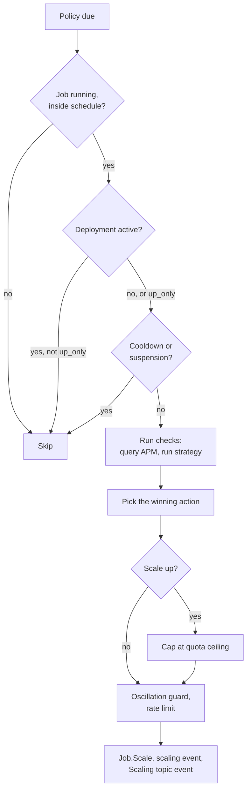

When a server becomes the leader and the built-in autoscaler is enabled, the
autoscaler loads all scaling policies of the `builtin` engine from the state
store and watches them for changes with blocking queries. Each policy is
scheduled for evaluation at its [`evaluation_interval`][policy_eval_interval];
a bounded pool of workers (the server's `eval_workers`) evaluates the policies
that are due.

An evaluation executes a series of steps:

If a scaling action is performed, the task group enters the
[`cooldown`][policy_cooldown] of the policy (or `cooldown_on_scale_up` after a
scale up) and is not evaluated again until it ends. Cooldowns and oscillation
suspensions are derived from the scaling events of the job as well, so they
survive a leader change.

[policy_cooldown]: /docs/features/autoscaler/reference/policy#policy-options
[policy_eval_interval]: /docs/features/autoscaler/reference/policy#policy-options
