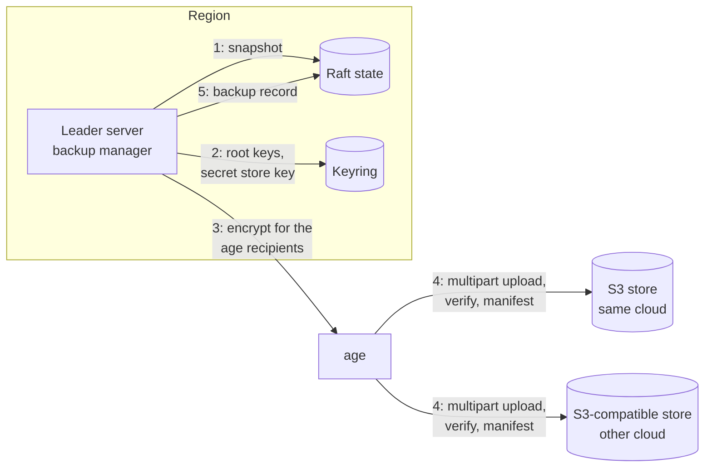
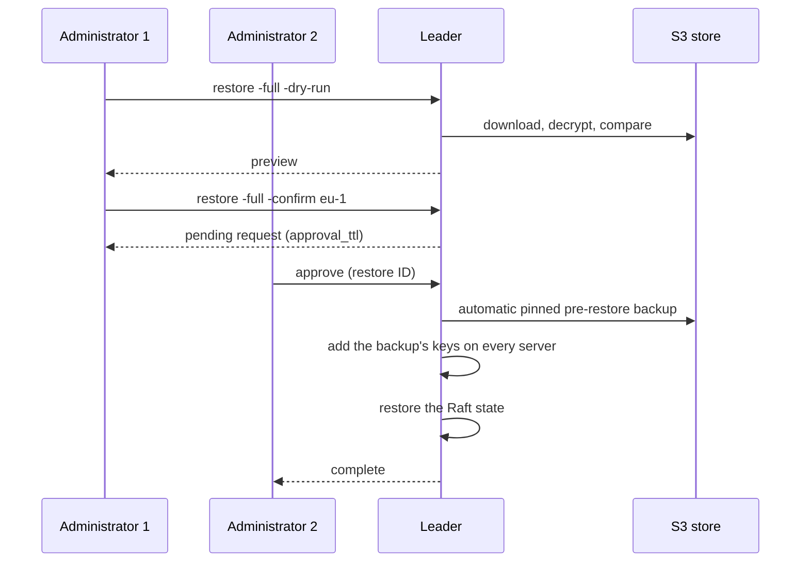
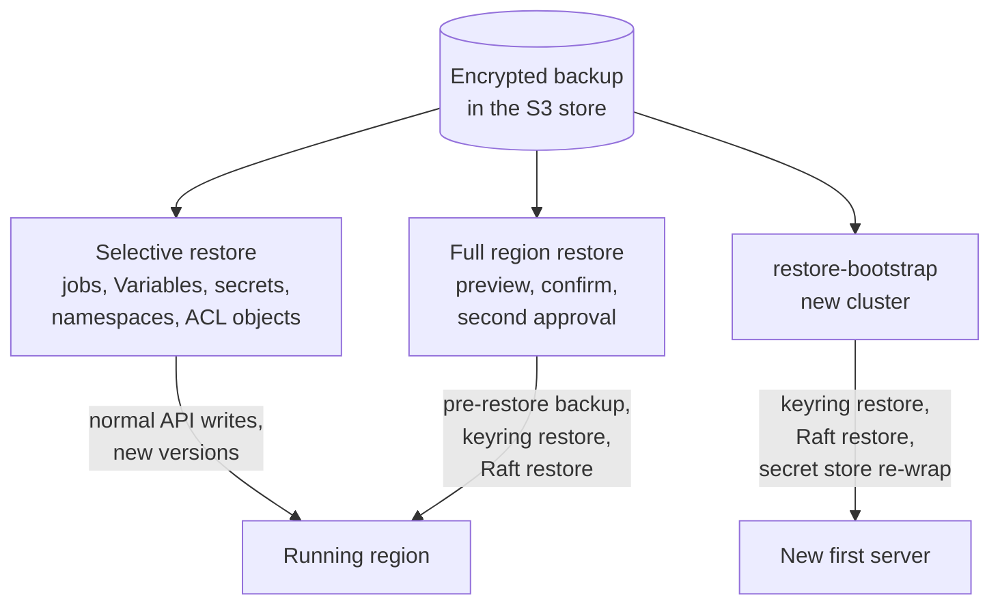

## What and why

The state of a Norca region (jobs and their versions, allocations,
deployments, namespaces, ACL objects, Variables, quotas, admission and network
policies, secrets) lives in the Raft log of its servers. Nomad v1.6.5 can save
a snapshot of it by hand (`operator snapshot save`), but has no scheduled
backup, and a snapshot alone is not enough to rebuild a cluster: the keys that
encrypt Variables and sign workload identities are kept on the disk of every
server, outside Raft.

Norca backs up every region on a schedule, from its leader, into one or more
S3-compatible stores: AWS S3, or a store with the S3 API such as RustFS (the
`rustfs` pack of the [Norca pack registry](/docs/features/packages/registry)).
A backup holds the Raft snapshot, the keyring and the key of the built-in
secret store. Every object is encrypted with
[age](https://github.com/FiloSottile/age) public keys before it leaves the
server; the private keys stay with the administrators.

Backups can be listed, browsed and compared with the current state, in the CLI
and the [web UI](/docs/features/web-ui). Restores come in three strengths:

- **selective**: single jobs (any version kept in a backup), Variables
  entries, secrets, namespaces, ACL policies and roles, written back with the
  normal API;
- **full region restore**: the whole state of a region returns to the time of
  a backup, after a preview and the approval of a second administrator;
- **new cluster**: an empty server is filled from a backup with
  `restore-bootstrap`, for disaster recovery or a move to another cloud.

## How it works

### Taking a backup

The backup manager runs on the leader of each region and starts and stops with
leadership, so exactly one server backs up a region at a time. The records of
the backups are kept in Raft, so a new leader continues the schedule without
repeating or skipping a slot.



1. The leader takes a Raft snapshot, in the format of
   [`operator snapshot save`](/docs/commands/operator/snapshot/save).
2. With [`include_keyring`](/docs/configuration/backup#include_keyring) (the
   default) it adds the root keys of the keyring and the key of the built-in
   secret store.
3. Each object is streamed through age encryption for the
   [`recipients`](/docs/configuration/backup#encryption-parameters) of the
   destination. The servers only know the public keys.
4. The objects are uploaded to every destination in parallel with multipart
   uploads, so the memory used does not depend on the size of the snapshot.
   Each upload is verified (its size, and with `verify_checksum` its SHA-256),
   then the manifest is written last: without a manifest, an object set is not
   a backup.
5. The record of the backup (ID, Raft index, destinations, object counts) is
   written to Raft, and the retention deletes expired backups.

A backup is `complete` when it was verified on every destination, `partial`
when on at least one, and `failed` otherwise. All servers of the region must
run a Norca version that supports backups.

### Storage format

Every destination holds the backups of a region under its prefix
(`norca/${region}` by default), one folder per backup:

```plaintext
norca/eu-1/
  2026/10/24/
    20261024T140000Z-1834567/      backup ID: start time (UTC) and Raft index
      manifest.json                unencrypted description, counts only
      state.snap.age               Raft snapshot, age-encrypted
      keyring.age                  root keys, age-encrypted
      secret-store-key.age         key of the built-in secret store, age-encrypted
  latest.json                      pointer to the newest backup
```

The manifest records the region, the Norca and compatibility versions, the
Raft index and term, the leader, the size and SHA-256 checksum of every
object, the encryption mode and a fingerprint of the recipients, object counts
(jobs, namespaces, Variables, ...), labels and pinning. It holds no names and
no content, so backups can be listed without decrypting them, and a store that
lost its Raft records can still be read.

### Retention and pinning

The [`retention`](/docs/configuration/backup#retention-parameters) block keeps
the newest backup of each of the last 24 hours, 14 days, 8 weeks and 12 months
by default, and never fewer than `min_keep` backups. A pinned backup is never
deleted; backups can be pinned and labeled when they are taken or later. The
automatic backup taken before a full restore is always pinned. Each leader
deletes only within the prefix of its own region, and only on destinations
with [`prune`](/docs/configuration/backup#prune) enabled, so a destination the
servers may only write to can expire its objects with lifecycle rules instead.

### Browsing and selective restore

To browse, compare or restore, an administrator sends an age identity with the
request. The server downloads the backup, decrypts it, and loads it into a
separate in-memory state; the running cluster is not touched. The loaded
backup stays in memory for
[`browse_cache_ttl`](/docs/configuration/backup#browse_cache_ttl). The identity
is used for the request only and never stored. Variables are shown with their
key names, and secrets with their metadata, never their values.

A selective restore writes every item with the normal API on behalf of the
caller's token:

| Item | How it is restored |
| --- | --- |
| Job | Registered as a new version, through the admission chain and the quotas. Any version kept in the backup can be chosen, so the backups extend the job's version history. |
| Variables entry | Re-encrypted with the current keys, with a check-and-set write: an existing entry is only overwritten with its current modify index. |
| Secret | The items of one version in the backup are written as a new version of the secret; its history stays. |
| Namespace, ACL policy, ACL role | Upserted. |

### Full region restore



A full restore returns the whole state of a region to the time of a backup.
Every change since is lost, and the clients stop the allocations that are not
in the backup. It is guarded:

- **Preview.** The request is computed against the current state first: which
  objects would be removed, restored or reverted.
- **Confirmation.** The request must name the region (`-confirm <region>`).
- **Two-person approval.** A second administrator, with another management
  token, approves the request; the requester can't. ACLs must be enabled.
  Only one request can wait at a time, and it expires after
  [`approval_ttl`](/docs/configuration/backup#approval_ttl).
- **Undo.** Before anything changes, an automatic, pinned backup of the
  current state is taken. If it fails, nothing is restored.
- **Keys.** The root keys of the backup are added to the keystore of every
  server, next to the existing keys, before the Raft state is restored.

Restoring the authoritative region rolls the global ACL policies and tokens
back in every region; the preview warns about it. After a restore of another
region, ACL replication brings the global objects back to the state of the
authoritative region.

### Building a new cluster from a backup

[`operator backup restore-bootstrap`](/docs/commands/operator/backup/restore-bootstrap)
runs on an administrator's machine against the first server of a new cluster.
It reads the backup from the store with the administrator's S3 credentials,
decrypts it locally, restores the root keys, then the Raft state, and re-wraps
the key of the secret store with the seal of the new server. The other new
servers then join and replicate state and keys from the first one.



A backup can only be restored into its own region (`-allow-region-change`
overrides this for `restore-bootstrap`; the region references of the jobs are
not rewritten), and never by a Norca version older than the one that took it.

### Web UI

The **Backups** page of the [web UI](/docs/features/web-ui) shows, per region:

- the list of backups with the state of the schedule, and **Back up now** with
  labels and pinning;
- the details of a backup, its contents by type, and the comparison with the
  current state or another backup, with the job diff;
- the **job history**: the versions, deployments and allocations of a job
  across the latest backups, with restore and compare actions;
- the **restore wizard** for selective and full restores, and the page of a
  full restore request with its preview, approval and rejection.

The age identity is entered on the page and kept in the memory of the browser
tab only.

## Example

The [single node example](/docs/getting-started/examples/02-single-node)
backs up hourly into a RustFS store deployed with the `rustfs` pack:

```hcl {filename="norca.hcl"}
server {
  backup {
    enabled  = true
    schedule = "0 * * * *" # hourly, cron syntax, UTC

    destination "rustfs" {
      type             = "s3"
      endpoint         = "http://10.0.0.10:9000"
      bucket           = "norca-backup"
      prefix           = "norca/${region}"
      region           = "us-east-1"
      force_path_style = true
      credentials_file = "/etc/norca.d/backup-credentials"
    }

    encryption {
      # The public key printed by: age-keygen -o backup-identity.txt
      recipients = ["age1..."]
    }

    retention {
      keep_hourly  = 24
      keep_daily   = 7
      keep_weekly  = 4
      keep_monthly = 3
    }
  }
}
```

```shell
norca operator backup save -label note=first-backup
norca operator backup list
norca operator backup contents -age-identity ~/backup-identity.txt -type jobs <backup ID>

# Selective restore: preview, then restore the job and the secret as new versions.
norca operator backup restore -age-identity ~/backup-identity.txt -namespace apps \
  -job test-app -secret test-app/db -dry-run <backup ID>
norca operator backup restore -age-identity ~/backup-identity.txt -namespace apps \
  -job test-app -secret test-app/db <backup ID>
```

The [runbook](/docs/operations/backup-restore) covers the store, the keys,
restore tests and disaster recovery.

## Configuration reference

The [`backup` block](/docs/configuration/backup) of the server configuration:

| Key | Type | Default | Description |
| --- | --- | --- | --- |
| `enabled` | bool | `false` | Scheduled backups on the leader |
| `interval` / `schedule` | duration / cron | `"1h"` / `""` | Scheduled times; mutually exclusive |
| `jitter` | duration | `"5m"` | Per-region offset of the scheduled times |
| `timeout` | duration | `"1h"` | Maximum duration of a backup |
| `retry_interval` | duration | `"10m"` | Wait after a failed scheduled backup |
| `part_size`, `upload_concurrency` | size, int | `"16MiB"`, `4` | Multipart upload |
| `include_keyring` | bool | `true` | Back up the keyring and the secret store key |
| `verify_checksum` | bool | `false` | Download and compare SHA-256 after upload |
| `browse_cache_ttl` | duration | `"5m"` | How long a decrypted backup stays loaded |
| `require_approval` | bool | `true` | Two-person approval of full restores; can't be disabled |
| `approval_ttl` | duration | `"1h"` | How long a full restore request waits |
| `destination "<name>"` | block | | S3-compatible store: `endpoint`, `bucket`, `prefix`, `region`, `force_path_style`, credentials, `ca_file`, `sse`, `kms_key`, `encryption`, `prune` |
| `encryption` | block | | `recipients` (age public keys) |
| `retention` | block | | `keep_hourly` 24, `keep_daily` 14, `keep_weekly` 8, `keep_monthly` 12, `min_keep` 3, `keep_failed` 10 |

The [`backup` ACL rule](/docs/other-specifications/acl-policy#backup-rules)
grants `read` (list, inspect, browse, compare, selective restore together with
the normal write permissions) and `write` (manual backup, pin, label, delete,
download URL). Full restores need management tokens.

## CLI and API

| Operation | CLI | HTTP |
| --- | --- | --- |
| List backups and the schedule | [`operator backup list`](/docs/commands/operator/backup/list) | `GET /v1/operator/backups` |
| Take a manual backup | [`operator backup save`](/docs/commands/operator/backup/save) | `POST /v1/operator/backups` |
| Details | [`operator backup inspect`](/docs/commands/operator/backup/inspect) | `GET /v1/operator/backup/:id` |
| Browse | [`operator backup contents`](/docs/commands/operator/backup/contents) | `GET`/`POST /v1/operator/backup/:id/contents` |
| Compare | [`operator backup diff`](/docs/commands/operator/backup/diff) | `GET`/`POST /v1/operator/backup/:id/diff` |
| Download URL | [`operator backup download`](/docs/commands/operator/backup/download) | `GET /v1/operator/backup/:id/download-url` |
| Pin, unpin, label | [`operator backup pin`](/docs/commands/operator/backup/pin) | `POST /v1/operator/backup/:id` |
| Delete | [`operator backup delete`](/docs/commands/operator/backup/delete) | `DELETE /v1/operator/backup/:id` |
| Selective or full restore | [`operator backup restore`](/docs/commands/operator/backup/restore) | `POST /v1/operator/backup/:id/restore` |
| Restore records | [`operator backup restores`](/docs/commands/operator/backup/restores) | `GET /v1/operator/backup/restores`, `GET /v1/operator/backup/restore/:restore_id` |
| Approve, reject a full restore | [`approve`](/docs/commands/operator/backup/approve), [`reject`](/docs/commands/operator/backup/reject) | `POST /v1/operator/backup/restore/:restore_id/approve`, `.../reject` |
| Keyring restore | used by `restore-bootstrap` and full restores | `PUT /v1/operator/keyring/restore` |
| New cluster from a backup | [`operator backup restore-bootstrap`](/docs/commands/operator/backup/restore-bootstrap) | – |

See the [Backups HTTP API](/docs/api/backups) for the parameters.

### Events and metrics

The event stream has a `Backup` topic (events `BackupCompleted`,
`BackupFailed`, `BackupUpdated`, `BackupDeleted`, `BackupRestoreRequested`,
`BackupRestoreApproved`, `BackupRestoreRejected`, `BackupRestoreStarted`,
`BackupRestoreFinished`), readable with the `backup` read permission; see
[Event stream](/docs/features/event-stream). The leader reports the metrics
`nomad.backup.last_success_age_seconds`, `nomad.backup.size_bytes`,
`nomad.backup.duration_seconds` and `nomad.backup.failures_total` (labeled by
destination); see [Monitoring](/docs/operations/monitoring#backups).

## Limits and status

- Available: scheduled backups, manual backups, browsing and comparison,
  selective restore, full region restore with two-person approval, keyring
  restore, `restore-bootstrap`, and the web UI pages.
- `type = "s3"` is the only destination type; Azure Blob Storage and other
  stores without the S3 API need an S3-compatible gateway.
- `age` is the only encryption mode. The `kms` mode of the design (envelope
  encryption with a cloud KMS, so the servers could decrypt for browsing
  without an administrator) is reserved and rejected by the configuration.
- Backups capture one region: restoring several regions gives no common point
  in time across the federation.
- Server configuration, the local state of clients, allocation directories,
  CSI volume contents and the state of Consul or Vault are not backed up.
- Norca never creates the bucket.

## Design

[S3-based scheduled backup and restore – plan](/docs/design/backup-restore-plan).
