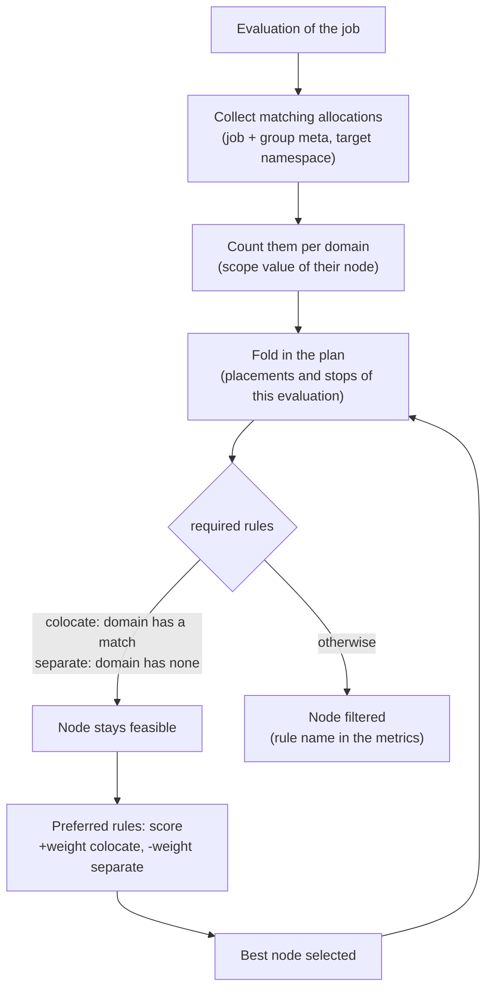

## What and why

The placement rules inherited from Nomad v1.6.5 look either at node attributes
(`constraint`, `affinity`, `spread`) or at the allocations of the **same** job
(`distinct_hosts`, `distinct_property`, the built-in job anti-affinity). None of
them can express a relation to the allocations of **other** jobs: "run the cache
on the node of the API", or "never put two database replicas in the same zone,
whichever job they belong to".

Norca adds two task group blocks for this:

- [`colocate`](/docs/job-specification/colocate) places the group close to the
  allocations a selector matches (affinity).
- [`separate`](/docs/job-specification/separate) places the group away from them
  (anti-affinity).

Allocations are selected by the `meta` of their job and task group, which act as
labels. "Close" is defined by a topology domain (`scope`): the node, the
datacenter, a zone attribute or any node `meta` value. Each rule is either a hard
rule (`required = true`, a feasibility filter) or a weighted preference
(`weight`, a score).

The idea comes from Kubernetes (inter-pod affinity and anti-affinity, with label
selectors and a topology key). The design and implementation are Norca's own and
fit the existing scheduler: selectors use job and group `meta`, domains use node
attribute interpolation, and weights behave like the [`affinity`](/docs/job-specification/affinity)
block.

## How it works

The rules are evaluated by the scheduler for every placement of the task group.
The expensive part, finding the matching allocations, happens once per
evaluation and task group, not once per node:



- **Selection.** A rule matches an allocation if every `selector` key is present
  with the same value in the merged `meta` of the allocation's job and task group
  (group values override job values). Terminal allocations do not count. The
  rule searches the namespace of the job, or the namespace set with `namespace`.
- **Domains.** For every matching allocation, the scheduler reads the `scope`
  property of its node (for example the node ID, the datacenter or
  `${meta.zone}`) and counts the allocations per domain value.
- **Own placements count.** Placements and stops already in the plan of the
  current evaluation are folded into the counts before each placement, so the
  rules also work between the instances of the same group (for example
  `separate` with a selector matching the job itself spreads its own replicas).
- **Required rules** filter nodes. A `colocate` rule keeps only nodes whose
  domain contains a matching allocation; a `separate` rule keeps only nodes whose
  domain contains none. As in Kubernetes, the first allocation of a group that
  its own required `colocate` rule selects may be placed anywhere when nothing
  matches yet.
- **Preferred rules** add a score: the weights of the `colocate` rules with a
  match in the node's domain, minus the weights of the `separate` rules with a
  match, divided by the sum of the absolute weights. The score is normalized like
  the node affinity score and combined with the other scores (bin packing,
  spread, job anti-affinity). A preference never overrides a required rule or a
  resource filter.
- **Explanation.** A node filtered by a required rule is recorded in the
  placement metrics under the rule's name, for example
  `separate {app=cache} by ${meta.zone}`, so `norca job status` and
  `norca job plan` show why a placement failed. The preference score appears as
  `alloc-affinity` in the placement scores of `norca alloc status -verbose`.

The rules apply only at placement time. Running allocations are never moved
because a rule is no longer satisfied, and in-place updates are never turned
into destructive updates by the rules. The rules are not symmetric: if job A
separates from job B, job B can still be placed next to job A unless it has its
own rule.

## Example

A client that prefers the node of a `test-app` instance, from the three-node
example of the repository (`example/03-three-node/probe.nomad.hcl`, shortened):

```hcl {filename="probe.nomad.hcl"}
job "probe" {
  namespace   = "apps"
  datacenters = ["*"]

  meta {
    app = "probe"
  }

  group "probe" {
    network {
      mode = "bridge"
    }

    # Prefer a node that runs an instance of test-app.
    colocate {
      selector {
        app = "test-app"
      }
      scope  = "${node.unique.id}"
      weight = 50
    }

    task "probe" {
      # ...
    }
  }
}
```

Replicas of a database that must never share a zone, and a cache that should
run in the same datacenter as the API:

```hcl
job "db" {
  meta {
    app = "postgres"
  }

  group "replica" {
    count = 3

    # Hard rule: at most one replica per zone (node meta "zone").
    separate {
      selector {
        app = "postgres"
      }
      scope    = "${meta.zone}"
      required = true
    }

    task "postgres" {
      # ...
    }
  }
}

job "cache" {
  group "redis" {
    # Preference: the datacenter of an "api" allocation of the "web" namespace.
    colocate {
      selector {
        app = "api"
      }
      namespace = "web"
      scope     = "${node.datacenter}"
      weight    = 80
    }

    task "redis" {
      # ...
    }
  }
}
```

With `required = true` and fewer zones than replicas, the remaining replicas
cannot be placed: the evaluation is blocked and `norca job status` shows the
rule that filtered the nodes. When the number of instances can exceed the
number of domains (for example under the autoscaler), use a preference instead,
as `example/03-three-node/test-app.hcl` does for `test-app`.

## Configuration reference

The `colocate` and `separate` blocks are placed in a `group` and can be repeated.
Both have the same parameters; see [`colocate`](/docs/job-specification/colocate)
and [`separate`](/docs/job-specification/separate) for the full reference.

| Key | Type | Default | Description |
| --- | --- | --- | --- |
| `selector` | block or map of strings | required | Meta key/value pairs the job and task group meta of an allocation must all contain. Block syntax (`selector { app = "api" }`) or attribute syntax (`selector = { "app.kubernetes.io/name" = "api" }`) for keys that are not HCL identifiers. |
| `namespace` | string | namespace of the job | Namespace in which matching allocations are searched. |
| `scope` | string | `"${node.unique.id}"` | Topology domain: `${node.unique.id}`, `${node.unique.name}`, `${node.datacenter}`, `${node.class}`, `${node.pool}`, `${attr.<name>}` or `${meta.<name>}`. |
| `weight` | int | `50` (preferences) | Preference weight, a non-zero value from -100 to 100. Must not be set on a required rule. |
| `required` | bool | `false` | Turns the rule into a hard feasibility filter. |

Validation and limits:

- At most **8** `colocate` and `separate` rules (combined) per task group.
- `system` and `sysbatch` jobs may only use required rules.
- A rule that refers to another namespace needs the `read-job` capability in
  that namespace when ACLs are enabled; registration warns if the namespace does
  not exist.
- Registration warns when a rule selects more than 1,000 jobs, because the
  scheduling cost grows with the number of matching allocations.
- All servers of the region must run Norca 0.1.0 or later; otherwise jobs with
  these blocks are rejected.

In the JSON job format the blocks are the `Colocate` and `Separate` lists of a
task group, with the fields `Selector`, `Namespace`, `Scope`, `Weight` and
`Required` (see [JSON job specification](/docs/api/json-jobs#task-group)).

## CLI and API

There are no new commands or endpoints: the rules are part of the job.

| Task | Reference |
| --- | --- |
| Submit a job with rules | [`norca job run`](/docs/commands/job/run), [Create Job](/docs/api/jobs#create-job) |
| See rules that filtered nodes | [`norca job plan`](/docs/commands/job/plan), [`norca job status`](/docs/commands/job/status) |
| See the `alloc-affinity` score of a placement | [`norca alloc status -verbose`](/docs/commands/alloc/status) |
| Jobspec reference | [`colocate`](/docs/job-specification/colocate), [`separate`](/docs/job-specification/separate) |

The web UI shows the `colocate` and `separate` rules of a job on its Placement
tab.

## Limits and status

Available in Norca 0.1.0.

- Placement time only: running allocations are not moved, and the rules are not
  symmetric (as in Kubernetes).
- Selectors match exact values of `meta` keys; there are no set-based operators
  (`In`, `NotIn`, `Exists`).
- The cost of a rule is proportional to the number of jobs in the target
  namespace and to the number of matching allocations, not to the number of
  nodes.

## Design

[Kubernetes features specification, item 4](/docs/design/kubernetes-features-spec#4-cross-job-affinity-and-anti-affinity).
