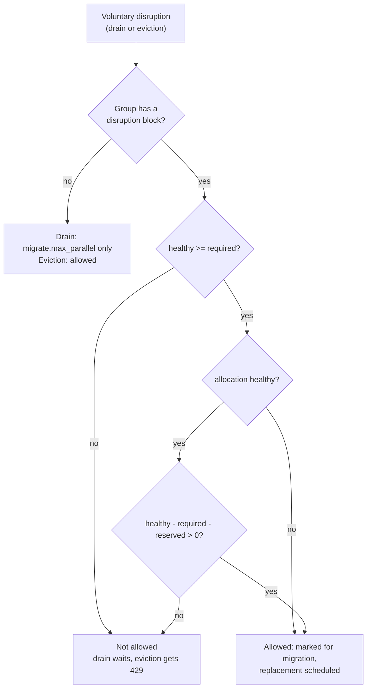

## What and why

Maintenance work takes allocations down on purpose: a node is drained before a
reboot, an operator moves an allocation off a busy node, a tool replaces nodes
one by one. Nomad v1.6.5 limits only node drains, and only relative to the group
count (`migrate.max_parallel`): there is no absolute minimum, no percentage, and
`alloc stop` or external tools cannot ask whether stopping an allocation is safe
right now.

Norca adds a **disruption budget** to the task group: the `disruption` block sets
either how many allocations must stay healthy (`min_healthy`) or how many may be
unavailable at the same time (`max_unavailable`), as a count or as a percentage
of the group count. Node drains respect it, and a new **eviction API**
(`POST /v1/allocation/:alloc_id/evict`, `norca alloc stop -respect-disruption`)
stops an allocation only if the budget allows it, and answers
`429 Too Many Requests` otherwise.

The idea comes from Kubernetes (PodDisruptionBudget and the Eviction API). The
design and implementation are Norca's own: the budget is part of the task group
instead of a separate object with a selector, and one computation is shared by
the drainer, the eviction API and the status endpoint.

## How it works

The budget applies to **voluntary disruptions** only:

| Applies to | Does not apply to |
| --- | --- |
| Node drains (`norca node drain`) before the deadline | Reducing the group `count` (manual or autoscaler) |
| Evictions (`POST /v1/allocation/:alloc_id/evict`, `norca alloc stop -respect-disruption`) | Deployments (governed by the [`update`](/docs/job-specification/update) block) |
| | Involuntary events: node failure, crashes, preemption |
| | Plain `norca alloc stop`, `norca job stop` |
| | Drains with `-force` or after the drain deadline |

For each task group with a `disruption` block the servers compute, from the
current state:

- **Required:** the number of allocations that must stay healthy.
  `min_healthy` gives it directly; `max_unavailable` gives `count` minus the
  value. Percentages are taken of the group `count` and rounded up.
- **Healthy:** allocations that are running, healthy according to the
  deployment or migration health check, and not already marked for migration
  (a pending disruption counts as unavailable).
- **Reserved:** while a deployment of the job is running and still has
  allocations of the group to place, the budget keeps room for its next step
  (`update.max_parallel` minus the allocations it has in flight). Deployments
  are not limited by the budget, so this prevents a drain and the next
  deployment step from going below the budget together.
- **Disruptions allowed:** `healthy - required - reserved`, at least 0.

An allocation that is not healthy can always be disrupted while the group has
at least the required number of healthy allocations; a healthy one only while
disruptions are allowed. When the group is already below the required count,
nothing is disrupted.



**Drains.** The drainer applies the stricter of `migrate.max_parallel` and the
budget, jointly for all nodes being drained at the same time. A drain that the
budget holds back waits until replacements become healthy; at the drain
deadline (or with `-force`) the remaining allocations are stopped regardless of
the budget, as before.

**Evictions.** The budget is checked by the leader when the eviction is applied
to the state store, in the same transaction that marks the allocation for
migration and creates its evaluation. Two concurrent evictions therefore cannot
exceed the budget together. An evicted allocation is stopped and rescheduled
like a migration; the change is published on the event stream with the type
`AllocationEvicted` (topics `Allocation` and `Evaluation`). Evicting an
allocation that is already stopping or migrating does nothing and returns no
evaluation ID. Allocations of groups without a `disruption` block (and of
non-service jobs) can always be evicted.

## Example

```hcl
job "api" {
  group "api" {
    count = 6

    # At least 4 instances stay healthy during drains and evictions.
    disruption {
      min_healthy = 4
    }

    # ...
  }
}
```

The test-app pack of the repository renders `max_unavailable` from a variable;
the three-node example (`example/03-three-node/test-app.hcl`) sets
`disruption_max_unavailable = "1"`, so a drain never takes more than one
instance down:

```shell
norca node drain -enable -deadline 15m -yes <node ID>
norca job status -namespace apps test-app    # never more than one test-app instance down
```

`norca job status` shows the state of the budget:

```plaintext
Disruption Budgets
Task Group  Budget               Healthy  Required  Reserved  Disruptions Allowed
web         max_unavailable = 1  3        2         0         1
```

Evicting an allocation through the budget:

```shell
$ norca alloc stop -respect-disruption -detach 9a98c5aa
Allocation "9a98c5aa" was not stopped: disruption budget exceeded: task group "web" has 2 healthy allocations and requires 2
```

## Configuration reference

The [`disruption`](/docs/job-specification/disruption) block is placed in a
`group` of a `service` job.

| Key | Type | Default | Description |
| --- | --- | --- | --- |
| `min_healthy` | string or number | none | Number of allocations that must stay healthy: a count (`4`) or a percentage of the group count (`"75%"`, rounded up). |
| `max_unavailable` | string or number | none | Number of allocations that may be unavailable at the same time: a count (`1`) or a percentage (`"25%"`, rounded up). |

Exactly one of the two must be set. Counts must not be negative and
percentages must not exceed 100%. Job registration warns when the budget blocks
every voluntary disruption (the required count is at least the group count),
because node drains would then always wait for their deadline. All servers of
the region must run Norca 0.1.0 or later.

In the JSON job format the block is the `Disruption` object of a task group,
with `MinHealthy` and `MaxUnavailable` (strings or numbers).

## CLI and API

| Task | CLI | HTTP API |
| --- | --- | --- |
| Evict an allocation | [`norca alloc stop -respect-disruption`](/docs/commands/alloc/stop) | [`POST /v1/allocation/:alloc_id/evict`](/docs/api/allocations#evict-allocation) |
| Show the budget state | [`norca job status`](/docs/commands/job/status) | [`GET /v1/job/:job_id/disruption`](/docs/api/jobs#read-job-disruption-budget) |
| Drain a node under the budget | [`norca node drain`](/docs/commands/node/drain) | [Drain Node](/docs/api/nodes#drain-node) |

The Go API client has `Allocations().Evict()`, `Jobs().Disruption()` and
`api.IsDisruptionBudgetExceeded(err)` for the 429 response. The web UI shows
the live state of the budget on the Placement tab of a job.

## Limits and status

Available in Norca 0.1.0.

- The budget belongs to one task group; there is no selector across jobs.
- Only `service` jobs can have a `disruption` block.
- The built-in autoscaler does not scale node pools down, so there is no
  node pool scale-down path that uses the budget.

## Design

[Kubernetes features specification, item 5](/docs/design/kubernetes-features-spec#5-disruption-budget).
