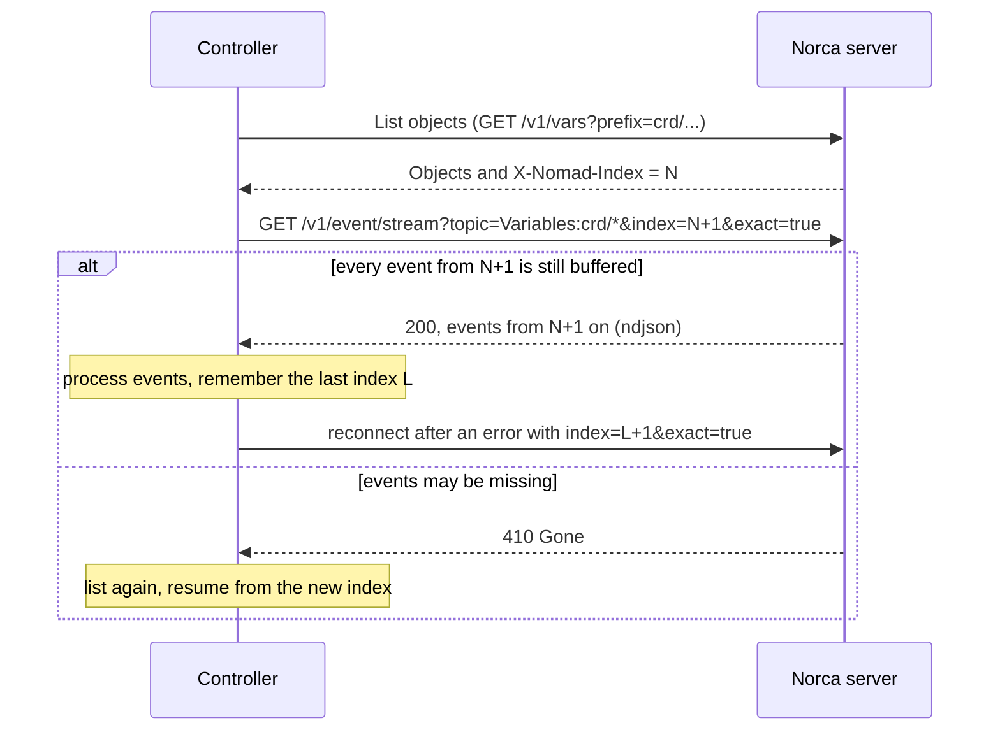

## What and why

The event stream of Nomad v1.6.5 (`/v1/event/stream`) publishes changes of jobs,
allocations, deployments, evaluations, nodes, services and ACL objects. It is a
good base for external controllers, with two gaps: there is no topic for
Variables, so a controller that stores its own objects in Variables has to poll,
and a client that reconnects with an `index` that already dropped out of the
server's event buffer silently continues from a later index, without knowing
that it missed events.

Norca extends the stream:

- a **`Variables` topic** with the metadata of every Variables change (never the
  contents), filtered by the Variables ACL rules;
- a topic for **every Norca object type** (quotas, admission policies, network
  policies, custom objects, scaling decisions, secrets, service intentions,
  backups), each with its own ACL rule;
- **glob keys** for topics whose keys are paths, such as
  `Variables:crd/db-example-com/*`;
- **resumable subscriptions**: with `exact=true` the server either delivers every
  event from the requested index on, or answers `410 Gone`, and the client
  resynchronizes;
- a default event buffer of 1,000 events instead of 100, and subscriptions with
  workload identity tokens.

This makes the list-then-watch pattern of controllers reliable. The idea comes
from Kubernetes (watches that resume from a resource version and answer
`410 Gone` when the version is too old). The design and implementation are
Norca's own and extend the event broker of Nomad v1.6.5: the Raft index plays
the role of the resource version.

## How it works



### Resumable subscriptions

- Without `exact`, the behavior of Nomad v1.6.5 remains: a subscription starts
  at the closest index still in the buffer.
- With `exact=true` the `index` parameter must be positive (otherwise `400`).
  The subscription receives every event with an index at or after `index`. If
  the server cannot guarantee that, because events of the subscribed topics at
  or after `index` were dropped from the buffer or predate the server's state
  (for example after a restart from a snapshot), it answers `410 Gone`. To
  resume after the last processed event, pass its index plus one.
- After a restart the server knows, per topic, the last index at which the
  restored state changed objects of that topic, so a subscription to a topic
  that did not change since can still resume from an older index.
- If the stream fails while it is being read, the connection is closed; the
  client reconnects with `exact=true` from its last index plus one and gets
  either the missing events or `410 Gone`.
- The Go API client offers this as `EventStream().StreamExact`, which returns
  an error wrapping `api.ErrEventIndexGone` on `410`. The
  [controller SDK](/docs/features/operator-framework/controllers) builds its
  list and watch loop on it.

### Variables topic

Every write and delete of a Variable publishes a `VariableUpserted` or
`VariableDeleted` event. The event key is the path of the Variable and the
payload holds only its metadata: namespace, path, create and modify index and
time. The encrypted data and the ID of its key are never included.

Subscribing requires the Variables `list` capability for each requested key in
the requested namespace; a key with `*` is a glob pattern and is granted only if
an ACL rule covers the whole pattern. Every event is also checked against the
rules of its own path, so deny rules on a sub-path apply as they do for the
Variables list API.

### Topics of the Norca features

| Topic | Event types | ACL required |
| --- | --- | --- |
| `Variables` | `VariableUpserted`, `VariableDeleted` | Variables `list` on the keys |
| `Quota` | `QuotaSpecUpserted`, `QuotaSpecDeleted`, `QuotaExhausted`, `QuotaFreed` | `quota:read` |
| `AdmissionPolicy` | `AdmissionPolicyUpserted`, `AdmissionPolicyDeleted`, `JobAdmissionDenied`, `VariableAdmissionDenied` | `admission:read` |
| `Scaling` | `ScalingDecision`, `ScalingQuotaCapped` | `namespace:read-job` or `namespace:list-scaling-policies` |
| `NetworkPolicy` | `NetworkPolicyUpserted`, `NetworkPolicyDeleted`, `AdminNetworkPolicyUpserted`, `AdminNetworkPolicyDeleted` | read of the namespace's network policies; operator read for admin policies |
| `CustomObject` | `ObjectKindUpserted`, `ObjectKindDeleted`, `CustomObjectUpserted`, `CustomObjectStatusUpdated`, `CustomObjectDeleted` | object `read` on the kind |
| `Secret` | `SecretUpserted`, `SecretDeleted` | `list-secrets` on the keys |
| `SecretAccess` | `SecretAccessed` | operator read |
| `ServiceIntention` | `ServiceIntentionUpserted`, `ServiceIntentionDeleted` | `namespace:read-job` |
| `Backup` | `BackupCompleted`, `BackupFailed`, `BackupUpdated`, `BackupDeleted`, `BackupRestoreRequested`, `BackupRestoreApproved`, `BackupRestoreStarted`, `BackupRestoreFinished`, `BackupRestoreRejected` | backup read |

The keys of `Variables` and `Secret` events are paths, and the keys of
`CustomObject` events are `group/Kind` or `group/Kind/name` references; for these
three topics subscription keys may be glob patterns. The payloads of the
features are described on their pages:
[quotas](/docs/features/quotas), [admission control](/docs/features/admission-control),
[autoscaler](/docs/features/autoscaler),
[network rules](/docs/features/network-rules),
[operator framework](/docs/features/operator-framework),
[secrets](/docs/features/secrets),
[native mTLS](/docs/features/native-mtls) and
[backup and restore](/docs/features/backup-restore).

`Scaling`, `JobAdmissionDenied` and `VariableAdmissionDenied` events are not
written to Raft: they are published by the leader, which runs the autoscaler and
the admission chain, so only subscriptions served by the leader receive them,
and they cannot be resumed after a leader change.

### Tokens

An event stream subscription accepts an ACL token or, like other API calls, a
workload identity, whose permissions come from the ACL policies bound to its
job. A workload identity subscription ends when its allocation stops. As in
Nomad v1.6.5, subscriptions are closed when their token expires or its policies
change so that it loses access.

## Example

Watch the Variables of a custom object type, resuming exactly:

```shell
# List and remember the index of the listing.
curl -s -D - "$NOMAD_ADDR/v1/vars?prefix=crd/db-example-com/PostgresCluster/" \
  -H "X-Nomad-Token: $NOMAD_TOKEN" | grep -i x-nomad-index
# X-Nomad-Index: 1234

# Stream every change after the listing.
curl -s -N -G "$NOMAD_ADDR/v1/event/stream" \
  -H "X-Nomad-Token: $NOMAD_TOKEN" \
  --data-urlencode "topic=Variables:crd/db-example-com/PostgresCluster/*" \
  --data-urlencode "index=1235" \
  --data-urlencode "exact=true"
```

```json
{
  "Index": 1240,
  "Events": [
    {
      "Topic": "Variables",
      "Type": "VariableUpserted",
      "Key": "crd/db-example-com/PostgresCluster/billing",
      "Namespace": "default",
      "FilterKeys": null,
      "Index": 1240,
      "Payload": {
        "Variable": {
          "Namespace": "default",
          "Path": "crd/db-example-com/PostgresCluster/billing",
          "CreateIndex": 1201,
          "CreateTime": 1793080352000000000,
          "ModifyIndex": 1240,
          "ModifyTime": 1793081024000000000
        }
      }
    }
  ]
}
```

Follow the decisions of the built-in autoscaler and the denials of admission
control:

```shell
curl -s -N "$NOMAD_ADDR/v1/event/stream?topic=Scaling&topic=AdmissionPolicy&namespace=*" \
  -H "X-Nomad-Token: $NOMAD_TOKEN"
```

## Configuration reference

| Key | Type | Default | Description |
| --- | --- | --- | --- |
| [`server.event_buffer_size`](/docs/configuration/server) | int | `1000` (Nomad v1.6.5: `100`) | Events kept in memory; the window from which subscriptions can resume. |
| [`server.enable_event_broker`](/docs/configuration/server) | bool | `true` | Generates events on this server. |

Query parameters of [`GET /v1/event/stream`](/docs/api/events): `topic`
(`Topic:key`, repeatable; glob keys for `Variables`, `Secret` and
`CustomObject`), `namespace`, `index`, and the Norca `exact` (`bool`, default
`false`).

## CLI and API

| Task | CLI | HTTP API |
| --- | --- | --- |
| Stream events | [`norca operator api`](/docs/commands/operator/api) | [`GET /v1/event/stream`](/docs/api/events#norca-extensions) |
| Go client | | `api.EventStream().Stream`, `StreamExact` |

## Limits and status

- Available: the `Variables` topic, the topics of the Norca object types, glob
  keys, `exact=true` with `410 Gone`, workload identity subscriptions, the larger
  default buffer.
- The buffer is in memory and per server: a subscription can only resume from
  events that are still in the buffer of the server serving it, so choose
  `event_buffer_size` for the time a controller may be disconnected.
- Leader-published events (`Scaling` and the admission denials) are not
  delivered by followers and are lost on a leader change.
- The memory needed per event depends on its payload; job and allocation events
  are much larger than Variables events.

## Design

[Kubernetes features: 3. Event stream extension](/docs/design/kubernetes-features-spec#3-event-stream-extension)
and the [common principles](/docs/design/kubernetes-features-spec#common-principles).
