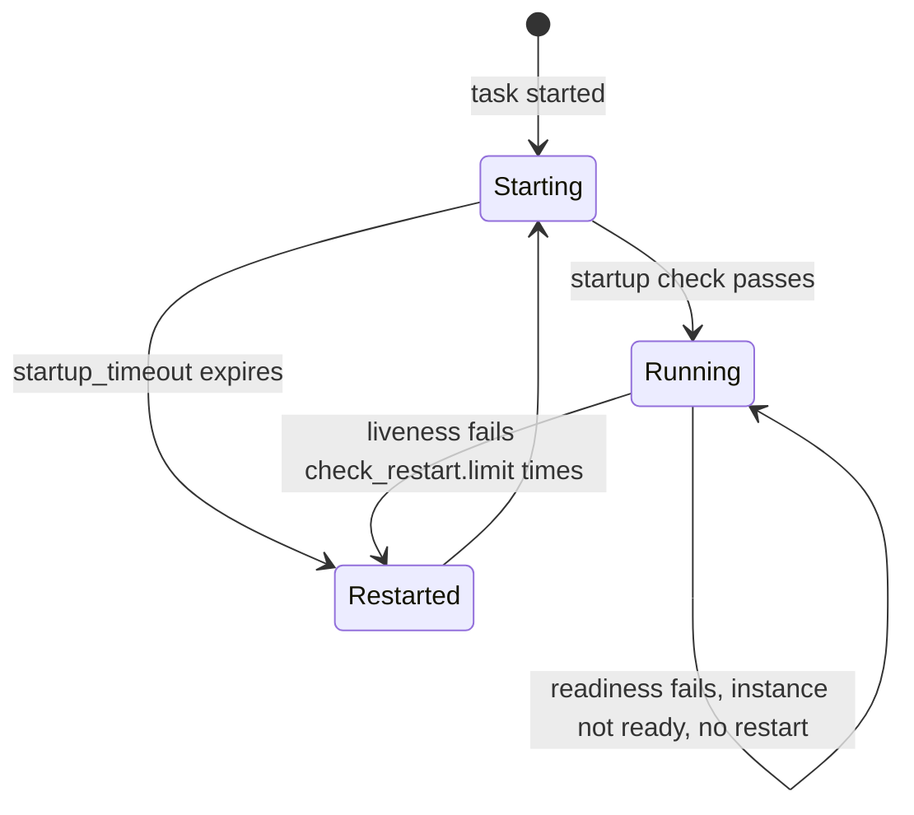

## What and why

In Nomad v1.6.5 a service check plays several roles at once, and its role has to
be inferred from a combination of settings: its status makes the instance
healthy or unhealthy in the catalog, `check_restart` turns it into a restart
trigger, and `on_update` decides whether it counts for deployments. Two common
needs cannot be expressed well:

- A slow-starting application needs a `check_restart.grace` as long as its
  worst-case startup time, which also delays the detection of failures later on.
- A check cannot be "decides whether the instance gets traffic, but never
  restarts it" and another "restarts a hung task, but does not take it out of
  traffic" at the same time.

Norca adds an optional `role` to service checks:

- **startup** - has the task finished starting? Until it passes, the other
  checks of the task do not restart it and the instance is not ready. If it does
  not pass within `startup_timeout`, the task is restarted.
- **readiness** - can the instance receive traffic? It decides whether the
  instance is ready in the native service catalog and counts for deployment
  health. Its failure never restarts the task.
- **liveness** - does the task need a restart? Its failure restarts the task.
  It does not affect the catalog nor deployments.

A check without a role behaves exactly as in Nomad v1.6.5.

The idea comes from Kubernetes (startup, readiness and liveness probes). The
design and implementation are Norca's own: the roles are a field of the
existing `check` block and work with the native service provider, with Consul
services, with `check_restart` and with deployment health.

## How it works



| Role | Executed | Catalog (native) | Deployment health | Restarts the task |
| --- | --- | --- | --- | --- |
| none | as in Nomad v1.6.5 | yes | yes, per `on_update` | with `check_restart` |
| `startup` | from the start of the task | not ready until it passes | yes | after `startup_timeout` |
| `readiness` | after the startup check passed | sets `Ready` | yes | never |
| `liveness` | after the startup check passed | no effect | no | yes, `check_restart { limit = 3 }` by default |

- **Startup gate.** The startup check runs from the start of the task. For
  checks executed by the Norca client (all checks of `provider = "nomad"`
  services, and liveness checks of Consul services), the readiness and liveness
  checks of the same task are not executed until the startup check has passed;
  their results stay pending. A restarted task closes the gate again. The
  services defined at group level form their own workload, with at most one
  startup check of their own.
- **Readiness.** For the native provider, the client computes a `Ready` flag for
  each service registration from its startup and readiness checks (an instance
  without such checks is always ready) and a `Health` from its startup,
  readiness and role-less checks. Liveness checks do not affect either. The
  [native catalog](/docs/features/service-discovery/catalog) can leave out
  instances that are not ready.
- **Liveness.** A liveness check without a `check_restart` block gets
  `limit = 3` and `grace = 0`, because the startup check provides the grace
  period. A liveness check of a Consul service is not registered in Consul; the
  Norca client executes it, so it does not change the health of the service in
  Consul, and it must be of type `http` or `tcp`.
- **Deployments.** Startup and readiness checks count for the health of a
  deployment (`update { health_check = "checks" }`), liveness checks do not.
- **Restarts.** Restarts caused by a startup timeout or a liveness failure are
  task restarts like those of `check_restart`, counted by the
  [`restart`](/docs/job-specification/restart) policy of the group.

## Example

Checks in the style of the `test-app` pack of the [deployment examples](/docs/getting-started/examples):

```hcl
service {
  name     = "api"
  port     = "http"
  provider = "nomad"

  check {
    name            = "started"
    role            = "startup"
    type            = "http"
    path            = "/healthz"
    interval        = "5s"
    timeout         = "2s"
    startup_timeout = "10m"
  }

  check {
    name     = "ready"
    role     = "readiness"
    type     = "http"
    path     = "/ready"
    interval = "10s"
    timeout  = "2s"
  }

  check {
    name     = "alive"
    role     = "liveness"
    type     = "http"
    path     = "/healthz"
    interval = "15s"
    timeout  = "3s"

    check_restart {
      limit = 3
    }
  }
}
```

An application that needs up to 10 minutes to start is not restarted during
that time, a readiness failure takes the instance out of traffic without a
restart, and once started a hung process is restarted after three failed
liveness checks (about 45 seconds) instead of after a long grace period.

## Configuration reference

The parameters are part of the [`check` block](/docs/job-specification/check#norca-extensions):

| Key | Type | Default | Description |
| --- | --- | --- | --- |
| `role` | string | `""` | `startup`, `readiness`, `liveness`, or empty for the behavior of Nomad v1.6.5. |
| `startup_timeout` | duration | `"5m"` | Only for `role = "startup"`: how long the check may take to pass before the task is restarted. |

Validation at job submission:

- At most one startup check per task, and one among the group level services.
- `startup_timeout` only on startup checks, not negative.
- No `check_restart` on readiness checks (they never restart) or on startup
  checks (use `startup_timeout`).
- `on_update = "ignore"` together with `check_restart` is allowed on liveness
  checks, since they never count for deployments. A startup or readiness check
  with `on_update = "ignore"` gets a warning, because it then does not count for
  deployment health.

## CLI and API

| Task | CLI | HTTP API |
| --- | --- | --- |
| Check results of an allocation | [`norca alloc checks`](/docs/commands/alloc/checks) | `GET /v1/client/allocation/:alloc_id/checks` (each result has a `Role`) |
| Readiness of service instances | [`norca service info`](/docs/commands/service/info) | [`GET /v1/service/:name`](/docs/api/services) (`Ready`, `Health`, `Checks` with their `Role`) |

## Limits and status

- Available for checks of the native provider and of Consul services. Readiness
  and startup checks of Consul services are registered in Consul as before;
  only the native catalog has the `Ready` flag.
- The role is not shown in the output of `norca alloc status` and
  `norca alloc checks`; it is available in the API.
- Changing the role of a check changes its ID, so the check is registered
  again.

## Design

[Kubernetes features: 6. Health check roles](/docs/design/kubernetes-features-spec#6-health-check-roles)
and the [common principles](/docs/design/kubernetes-features-spec#common-principles).
