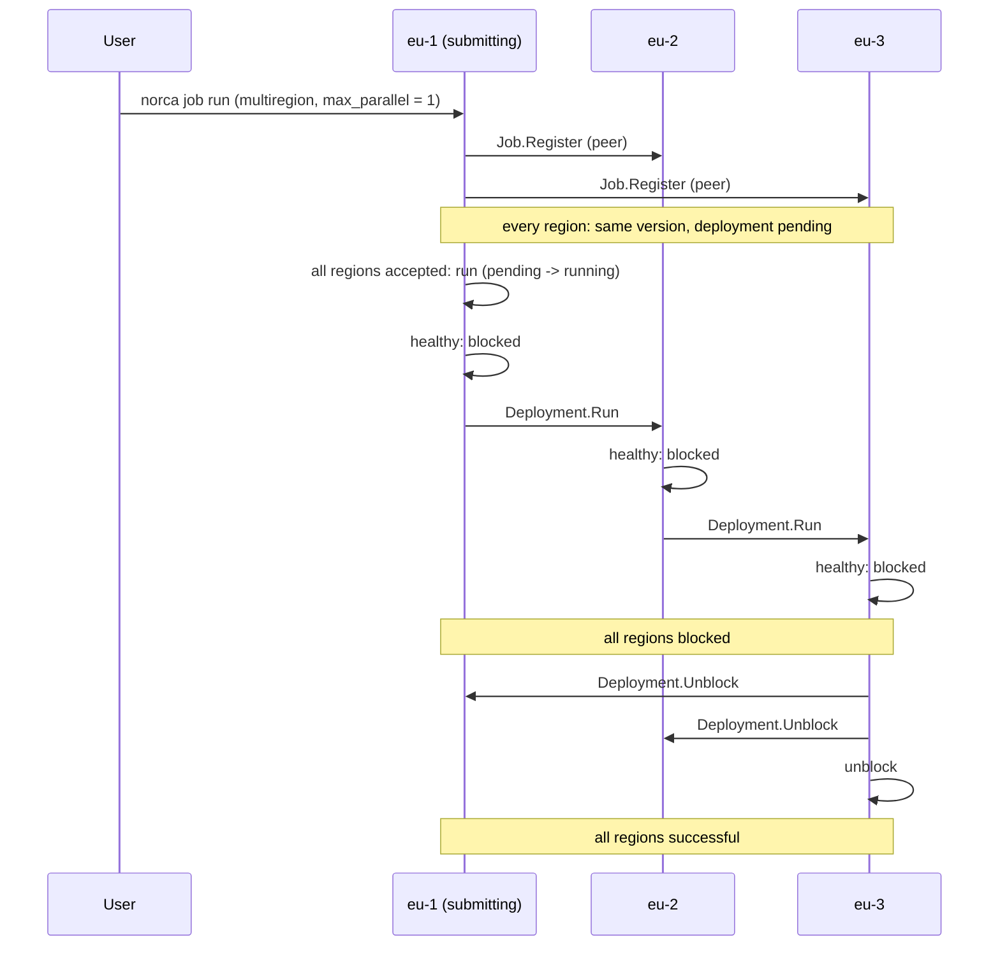
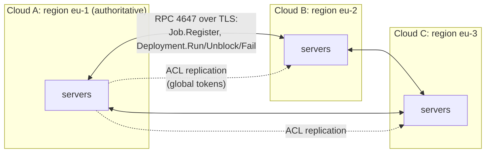

## What and why

A Norca federation runs one region per cloud or site: every region has its own
servers and Raft, so the loss of a cloud stops only its own region. A service
that runs in several regions then needs the same version everywhere, and a
safe way to roll a new version out: one region first, the next when it is
healthy, and a defined reaction when a region fails.

The [`multiregion` block](/docs/job-specification/multiregion) of a job lists
its regions, with per-region overrides of the count, the datacenters, the node
pool and the meta. Norca registers the job in every region with the same
version and coordinates the deployments of the regions: at most
`max_parallel` regions deploy at a time, in the order of the block, and
`on_failure` decides which regions fail when one does.

The coordination runs over Norca's own cross-region RPC, with the same TLS,
authentication and ACL checks as every other request, and its state is the
deployments stored in the Raft of each region. Nomad v1.6.5 had the job
specification and the deployment states, but not the registration and
rollout logic; Norca implements them with its own design.

## How it works

### Registration

1. The job is submitted to any region. A region that the job does not list
   sends the request on to the first listed region, the **submitting region**.
2. The submitting region runs the admission chain, interpolates the job for
   each region (`count` for groups with `count = 0`, `datacenters`,
   `node_pool`, `meta`), checks that every region is known and that all its
   servers run a Norca version that supports multiregion jobs, and computes the
   next version from the versions in all regions.
3. It registers the job in the other regions, in the order of the block, and
   then in its own region. Every region stores the same job version and a
   multiregion deployment that waits in the `pending` state.
4. Regions that a previous version listed but the new one does not are
   stopped.

`norca job revert` registers the reverted version only in the region where it
runs, because the stored job of a region is already interpolated for it. The
next submission of the multiregion job registers a new version in all regions.

### Staged rollout



- A `pending` deployment starts when it is one of the first `max_parallel`
  regions and every region has a deployment for the job version, or when the
  region `max_parallel` places before it is done.
- A deployment that completes its rollout becomes `blocked`, and its watcher
  runs the pending deployment of the region `max_parallel` places after it.
  At most `max_parallel` regions are `running` at a time.
- When the deployments of all regions are blocked (or successful), each blocked
  region is unblocked and becomes `successful`.
- When a deployment fails, its watcher fails the other regions according to
  `on_failure`: the regions after it by default, all of them with `fail_all`,
  none with `fail_local`. Each region follows the `auto_revert` of its own
  `update` block.

Every step is derived from the deployments stored in the regions, so a new
leader continues where the old one stopped, and repeating a step has no
effect. Pending and blocked deployments poll their peer regions with a backoff
(from 1 second up to 30 seconds), so a step that could not be taken during a
network partition is taken when the regions can reach each other again.

### Manual control

When a region can't be reached, the rollout waits. An operator can take any
step by hand, in the region of the deployment:

| Situation | Command |
| --- | --- |
| A deployment waits in `pending` because the region that would start it is unreachable | [`norca deployment run`](/docs/commands/deployment/run) |
| A deployment waits in `blocked` because a peer can't report its result | [`norca deployment unblock`](/docs/commands/deployment/unblock) |
| The rollout must stop | [`norca deployment fail`](/docs/commands/deployment/fail) |
| The job must stop everywhere | [`norca job stop -global`](/docs/commands/job/stop) |

### Global tokens

The registration in the other regions and the cross-region calls of the
deployment watchers carry the ACL token that submitted the job. With ACLs
enabled, a multiregion job must therefore be submitted with a **global** token
(`norca acl token create -global ...`), which the authoritative region
replicates to all regions; a local token is rejected. The token needs
`submit-job` in the job's namespace in every region.

### Communication



The regions talk over the server RPC port (4647) with region-specific server
certificates, typically inside a VPN between the clouds. Nothing in the
rollout uses NATS; the [NATS bridge](/docs/features/nats-bridge) only forwards
the deployment events of each region for observation.

## Example

The [multi-region example](/docs/getting-started/examples/04-multi-region)
deploys the test application to two regions, `eu-1` first. The variables of
the test-app pack:

```hcl {filename="test-app-multiregion.hcl"}
multiregion = [
  { name = "eu-1", count = 3 },
  { name = "eu-2", count = 2 },
]
multiregion_max_parallel = 1
multiregion_on_failure   = "fail_all"

# The group count is 0 (every region uses its own count), so the typed
# scaling policy is left out.
scaling_enabled = false
```

The pack renders them into this part of the job:

```hcl
job "test-app" {
  multiregion {
    strategy {
      max_parallel = 1
      on_failure   = "fail_all"
    }

    region "eu-1" {
      count = 3
    }

    region "eu-2" {
      count = 2
    }
  }

  update {
    max_parallel     = 1
    health_check     = "checks"
    min_healthy_time = "10s"
    healthy_deadline = "5m"
    auto_revert      = true
  }

  group "web" {
    # 0: every region uses the count of its multiregion region.
    count = 0
    # ...
  }
}
```

```shell
norca pack run ../packs/test-app --name=test-app --namespace=apps \
  --regions=eu-1,eu-2 -f test-app-multiregion.hcl

norca deployment list -region eu-1 -namespace apps
norca deployment list -region eu-2 -namespace apps          # pending or blocked until eu-1 is done
norca deployment status -region eu-2 -namespace apps <deployment ID>

# A deployment that waits for its turn while its peer region was unreachable:
norca deployment run -region eu-2 -namespace apps <deployment ID>
```

The same job without the pack: `norca pack render ../packs/test-app -f
test-app-multiregion.hcl` and `norca job run -namespace apps <rendered file>`
from any region.

## Configuration reference

| Key | Type | Default | Description |
| --- | --- | --- | --- |
| `multiregion.strategy.max_parallel` | int | `0` (all regions) | Regions deploying at the same time |
| `multiregion.strategy.on_failure` | string | `""` | `""` (fail the failed region and the ones after it), `"fail_all"`, `"fail_local"` |
| `multiregion.region "<name>"` | block | | A federated region, in rollout order |
| `region.count` | int | | Count of the task groups with `count = 0` |
| `region.datacenters` | array of strings | job datacenters | Datacenters in the region |
| `region.node_pool` | string | job node pool | Node pool in the region |
| `region.meta` | block | | Merged over the job meta |

The full reference is the [`multiregion` block](/docs/job-specification/multiregion)
page. The regions need [federation](/docs/configuration/server_join) and, with
ACLs, an [`authoritative_region`](/docs/configuration/server#authoritative_region).

## CLI and API

| Operation | CLI | HTTP |
| --- | --- | --- |
| Register in all regions | `norca job run` | `POST /v1/jobs` |
| Plan in all regions | `norca job plan` | `POST /v1/job/:job_id/plan` (per region) |
| Status of the regions' deployments | [`norca deployment status`](/docs/commands/deployment/status) | `GET /v1/deployment/:deployment_id` |
| Start a pending deployment | [`norca deployment run`](/docs/commands/deployment/run) | [`POST /v1/deployment/run/:deployment_id`](/docs/api/deployments#run-deployment) |
| Unblock a blocked deployment | [`norca deployment unblock`](/docs/commands/deployment/unblock) | [`POST /v1/deployment/unblock/:deployment_id`](/docs/api/deployments#unblock-deployment) |
| Fail a deployment | [`norca deployment fail`](/docs/commands/deployment/fail) | `POST /v1/deployment/fail/:deployment_id` |
| Stop in all regions | `norca job stop -global` | `DELETE /v1/job/:job_id?global=true` |

The **Deployments** page of the [web UI](/docs/features/web-ui) shows a
multiregion deployment with the state of each region. Pack releases can be
installed in several regions at once (`--regions`); a multiregion job of a
pack is registered by the release of its first region; see
[Releases](/docs/features/packages/releases).

## Limits and status

- Available for `service` jobs that use deployments (an `update` block, not
  periodic or parameterized). Other multiregion jobs are registered in every
  region with the same version, without a coordinated rollout.
- All servers of every listed region must run a Norca version that supports
  multiregion jobs; servers without a Norca version (for example Nomad servers
  during a migration) block the registration.
- If a region can't be reached at submission time, the submission fails;
  submit the job again when the region is reachable.
- The regions keep independent copies of the job; a change made in one region
  (a revert, a scale) is replaced by the next multiregion submission.

## Design

[Multi-cloud connectivity](/docs/design/nomad-fork-development-plan#multi-cloud-connectivity)
and [Multiregion deployment: communication and protocol](/docs/design/nomad-fork-development-plan#multiregion-deployment-communication-and-protocol)
in the development plan. The implementation differs from the sketch there in
one point: all regions start in `pending`, and the first `max_parallel`
regions start once every region has accepted the job version.
