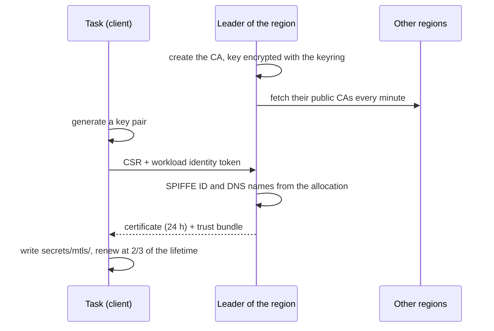
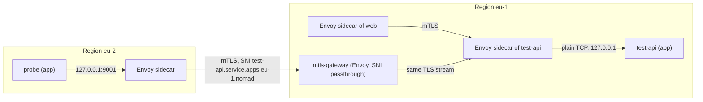

## What and why

A service mesh does two things: it encrypts and mutually authenticates the connections between services,
and it decides who may connect to whom. In Nomad v1.6.5 this requires Consul Connect, and the native
service provider does not support Connect at all. The IP address of a connection does not identify the
sender either, because of address translation between nodes, so network rules alone cannot express
"only `web` may reach `api`".

Norca builds this into the scheduler. Every region runs its own certificate authority. Workloads of a
task group with an `mtls` service receive a short-lived X.509 certificate whose SPIFFE ID names their
namespace, job and group, and whose DNS names name their services. `ServiceIntention` objects allow or
deny connections between services. The certificate can be used by the application itself, by an Envoy
sidecar that Norca injects and configures, or by a gateway that connects regions. No Consul is involved.

## How it works

**Certificate authority.** The leader of each region creates an ECDSA P-256 CA whose certificate carries
the trust domain as URI SAN (`spiffe://<trust-domain>`). The CA certificate and key are stored in Raft,
the key encrypted with the active root key of the keyring, like Variables: it is replicated to every
server, included in every snapshot and [backup](/docs/features/backup-restore), and decryptable after a
full restore. The CA is rotated automatically after two thirds of its lifetime (default 5 years), when
the trust domain changes, or on request (`PUT /v1/mtls/ca/rotate`); a retired CA stays in the trust
bundle until the certificates it signed have expired.

**Federated trust bundle.** Every leader fetches the public CA certificates of the other regions once a
minute and keeps them next to its own, so a certificate of one region is trusted in the others. The
default trust domain is `<authoritative region>.nomad`, shared by the whole federation. The trust bundle
is verified per trust domain: a CA is trusted only for the trust domain in its own certificate.

**Workload certificates.** For each task of a group with an `mtls` service, the client generates a key
pair and sends only a certificate signing request, with the task's workload identity, to the servers.
The servers derive the identity from the allocation, never from the request:

- URI SAN: `spiffe://<trust-domain>/ns/<namespace>/job/<job>/group/<group>`;
- DNS SANs, for every mtls service of the group: `<service>.service.<namespace>.nomad`,
  `<service>.service.<namespace>.<region>.nomad`, and `<service>.service.nomad` in the `default`
  namespace.

The certificate (default lifetime 24 hours), its key and the trust bundle are written to
`secrets/mtls/cert.pem`, `key.pem` and `bundle.pem`, named by the environment variables
`NOMAD_MTLS_CERT_FILE`, `NOMAD_MTLS_KEY_FILE`, `NOMAD_MTLS_CA_FILE` (and `NOMAD_MTLS_SPIFFE_ID`). The
client renews the certificate at two thirds of its lifetime, rewrites the bundle whenever it changes and
re-issues the certificate after a CA rotation.



**Modes.** The `mtls` block of a service selects how the certificate is used:

| Mode | Who terminates TLS | Page |
| --- | --- | --- |
| `app` (default) | The application, with the files of `secrets/mtls`, for example with the Go library `api/mtls` | [App mode](/docs/features/native-mtls/app-mode) |
| `sidecar` | An injected Envoy task: it terminates mTLS in front of the application, enforces the intentions and exposes upstreams on local ports | [Sidecar and gateway](/docs/features/native-mtls/sidecar-and-gateway) |
| `gateway` | An injected Envoy task that forwards TLS connections from other regions by their SNI name, without terminating them | [Sidecar and gateway](/docs/features/native-mtls/sidecar-and-gateway#cross-region-gateway) |

**Authorization.** [Service intentions](/docs/features/native-mtls/intentions) allow or deny connections
from a source service to a destination service. They are evaluated when a connection is set up, from the
SPIFFE ID and DNS names of the peer certificate; without a matching intention a connection is denied.

**Connection path.** Inside a region, the sidecar of the client connects to the sidecar of the server
directly. Across regions, it connects to the gateway of the destination region, which forwards the TLS
stream unterminated, so mTLS stays end to end and the intentions of the destination region decide.



## Example

A service whose application listens on port 8080 behind a sidecar, and an intention that lets `web`
connect to it:

```hcl
job "api" {
  group "api" {
    network {
      mode = "bridge"
    }

    service {
      name     = "api"
      port     = "8080"
      provider = "nomad"

      mtls {
        mode = "sidecar"
      }
    }

    task "api" {
      driver = "docker"
      config {
        image = "example/api:1"
      }
    }
  }
}
```

```shell
norca job run api.nomad.hcl
norca service intention create web api
norca service intention check web api    # exit code 0: allowed
norca operator api /v1/mtls/roots        # the trust bundle of the region
```

## Configuration reference

The certificate authority is configured in the `server { mtls { ... } }` block. Full reference:
[mtls](/docs/configuration/mtls).

| Key | Type | Default | Description |
| --- | --- | --- | --- |
| `enabled` | bool | `true` | Run the CA of the region. It is only used by jobs with an `mtls` block. |
| `trust_domain` | string | `"<authoritative region>.nomad"` | SPIFFE trust domain of the region. |
| `leaf_cert_ttl` | duration | `"24h"` | Lifetime of workload certificates (at least 10 minutes). |
| `ca_cert_ttl` | duration | `"43800h"` (5 years) | Lifetime of the CA certificate (at least ten times `leaf_cert_ttl`). |
| `federation` | bool | `true` | Trust the CAs of the other regions. |

Job specification: the [`mtls` block](/docs/job-specification/mtls) of a service. Sidecar and gateway
tasks also read client node meta (the Envoy image, see
[Envoy image](/docs/features/native-mtls/sidecar-and-gateway#envoy-image)) and, across regions, the
[`dns { token }`](/docs/configuration/dns) of the client.

## CLI and API

| Task | CLI | HTTP API |
| --- | --- | --- |
| Manage intentions | [`norca service intention`](/docs/commands/service/intention) | [Service intentions API](/docs/api/service-intentions) |
| Read the trust bundle | `norca operator api /v1/mtls/roots` | [`GET /v1/mtls/roots`](/docs/api/mtls#read-trust-bundle) |
| Rotate the CA of a region | `norca operator api -X PUT /v1/mtls/ca/rotate` | [`PUT /v1/mtls/ca/rotate`](/docs/api/mtls#rotate-ca) |

## Limits and status

- All three steps of the design are implemented: the CA and app mode, intentions with the Go library,
  and the Envoy sidecar with upstreams and the cross-region gateway. The sidecar and gateway are tested
  with Envoy 1.39 and 1.40.
- TCP only: there is no HTTP routing, no retries and no L7 intentions.
- `mtls` blocks require `provider = "nomad"`. The namespace, the job ID and the names of groups with
  mtls services must be valid SPIFFE path segments (letters, digits, `.`, `-`, `_`). A service name that
  is interpolated at runtime is left out of the certificate, so intentions can't refer to it.
- Enabling or disabling `mtls` on a group is a destructive update.
- Every server of the region must run Norca to use `mtls` blocks.

## Design

[Consul independence – plan, item 5](/docs/design/consul-independence-plan#5-native-mtls-and-service-authorization).
