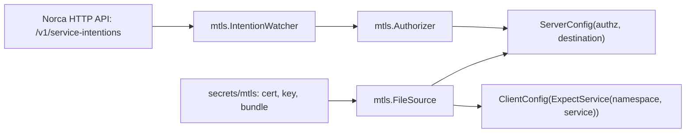

## What and why

A sidecar proxy adds a hop, a container and resources to every instance. Applications that can do TLS
themselves don't need it: in app mode (`mtls { mode = "app" }`, the default mode) Norca only issues and
renews the workload certificate and the trust bundle, and the application uses them for its server and
client connections. Most languages' TLS libraries handle this. For Go, the `api/mtls` package of the
Norca API module does the Norca-specific parts: reloading the files after a renewal, verifying peers by
their SPIFFE ID per trust domain, and enforcing the [service intentions](/docs/features/native-mtls/intentions).

## How it works

For every task of a group that has a service with an `mtls` block, the client writes into the task's
secrets directory:

| File | Environment variable | Content |
| --- | --- | --- |
| `secrets/mtls/cert.pem` | `NOMAD_MTLS_CERT_FILE` | The workload certificate (default lifetime 24 hours) |
| `secrets/mtls/key.pem` | `NOMAD_MTLS_KEY_FILE` | Its private key, generated on the client |
| `secrets/mtls/bundle.pem` | `NOMAD_MTLS_CA_FILE` | The trust bundle: the CAs of the region and of the federated regions |
| – | `NOMAD_MTLS_SPIFFE_ID` | The SPIFFE ID of the certificate |

The certificate carries the URI SAN `spiffe://<trust-domain>/ns/<namespace>/job/<job>/group/<group>`
and the DNS names `<service>.service.<namespace>.nomad`, `<service>.service.<namespace>.<region>.nomad`
(and `<service>.service.nomad` in the `default` namespace) of the group's mtls services. The client
replaces the files at two thirds of the lifetime and after a CA rotation; an application must re-read
them (the Go library does so), or be signaled or restarted by the client with `change_mode` (see
[Reacting to renewals](#reacting-to-renewals)).

An application in app mode should:

1. present the workload certificate, both as a server and as a client;
2. verify the peer's chain against the trust bundle, by the SPIFFE trust domain of the peer rather than by
   host name, and trust a CA only for the trust domain in its own certificate;
3. as a server, authorize the peer with the intentions of its namespace; as a client, check that the
   server asserts the expected service.

Instances of app mode services are registered with the meta `norca-mtls = "app"`, so sidecar upstreams and
gateways can connect to them like to sidecars.

**The Go package** `github.com/hashicorp/nomad/api/mtls` depends only on the Go standard library and the
API client:

| API | Purpose |
| --- | --- |
| `NewFileSourceFromEnv()`, `NewFileSource(cert, key, ca)` | Load the files (from the `NOMAD_MTLS_*` variables or `${NOMAD_SECRETS_DIR}/mtls`) and reload them when they change |
| `(*FileSource).ServerConfig(authz, destination)` | A `tls.Config` for a server: requires a client certificate, verifies it against the bundle, authorizes it |
| `(*FileSource).ClientConfig(verify)` | A `tls.Config` for a client: presents the certificate, verifies the server by SPIFFE ID |
| `ExpectService(namespace, service)` | A `verify` function requiring the server to assert a service |
| `NewIntentionWatcher(client, namespace)` | Keeps the intentions of a namespace in memory with blocking queries |
| `Authorizer{Namespace, Intentions, DefaultAllow}` | Authorizes a verified peer for a destination service |
| `Evaluate(...)` | The evaluation of intentions, as used by sidecars and `norca service intention check` |
| `ParseID`, `IDFromCertificate`, `PeerFromConnectionState` | SPIFFE ID helpers |



## Example

The job: the service `api` in app mode, and the workload identity in `NOMAD_TOKEN` so the application can
read the intentions of its namespace.

```hcl
job "api" {
  group "api" {
    network {
      port "https" {
        to = 8443
      }
    }

    service {
      name     = "api"
      port     = "https"
      provider = "nomad"

      mtls {
        mode = "app"
      }
    }

    task "api" {
      driver = "docker"

      identity {
        env = true
      }

      config {
        image = "example/api:1"
        ports = ["https"]
      }
    }
  }
}
```

The application, a TLS server that accepts only peers the intentions allow, and a client of another mTLS
service:

```go
package main

import (
	"context"
	"crypto/tls"
	"log"
	"net"
	"strconv"

	"github.com/hashicorp/nomad/api"
	"github.com/hashicorp/nomad/api/mtls"
)

func main() {
	ctx := context.Background()

	// The certificate, key and trust bundle written by the client.
	src, err := mtls.NewFileSourceFromEnv()
	if err != nil {
		log.Fatal(err)
	}
	namespace := src.ID().Namespace

	// The intentions of the namespace, read with the workload identity
	// (NOMAD_TOKEN) from the agent at NOMAD_ADDR.
	client, err := api.NewClient(api.DefaultConfig())
	if err != nil {
		log.Fatal(err)
	}
	watcher := mtls.NewIntentionWatcher(client, namespace)
	go watcher.Run(ctx)
	if err := watcher.WaitReady(ctx); err != nil {
		log.Fatal(err)
	}
	authz := &mtls.Authorizer{Namespace: namespace, Intentions: watcher}

	// Server: only peers allowed to connect to "api".
	ln, err := tls.Listen("tcp", ":8443", src.ServerConfig(authz, "api"))
	if err != nil {
		log.Fatal(err)
	}
	go serve(ln)

	// Client: a healthy instance of "db"; the server must assert the
	// service "db" of the same namespace.
	instances, _, err := client.Services().Get("db", &api.QueryOptions{
		Namespace: namespace,
		Params:    map[string]string{"healthy": "true"},
	})
	if err != nil || len(instances) == 0 {
		log.Fatal("no healthy db instance: ", err)
	}
	addr := net.JoinHostPort(instances[0].Address, strconv.Itoa(instances[0].Port))
	conn, err := tls.Dial("tcp", addr, src.ClientConfig(mtls.ExpectService(namespace, "db")))
	if err != nil {
		log.Fatal(err)
	}
	defer conn.Close()
}
```

Here `serve` stands for the application's accept loop. With the sidecar of another service as the client,
create the intention that allows it, for example `norca service intention create web api`.

## Reacting to renewals

The client renews the certificate at about two thirds of its lifetime (16 hours, minus up to 72 minutes
of jitter, with the default `leaf_cert_ttl` of 24 hours), re-issues it right after a CA rotation, and
rewrites the bundle when a CA is added or retired. The files are replaced atomically. An application that
reloads them itself (the Go library does) needs nothing else. One that reads them only when it starts
tells the client with `change_mode` what to do with the running task:

```hcl
job "observe" {
  group "openobserve" {
    service {
      name     = "openobserve"
      port     = "http"
      provider = "nomad"

      mtls {
        # mode = "app" is the default
        change_mode = "restart"
      }
    }

    task "openobserve" {
      driver = "docker"
      config {
        image = "example/openobserve:1"
      }
    }
  }
}
```

An application that reloads its certificate on a signal, only after a renewal:

```hcl
mtls {
  change_mode   = "signal"
  change_signal = "SIGHUP"
  change_on     = "certificate"
}
```

The options (`change_mode`, `change_signal`, `change_on`) are described in the
[mtls block](/docs/job-specification/mtls#mtls-parameters). How they behave:

- **Which tasks:** the `mtls` block of a group service applies to every task of the group except the
  injected Envoy tasks (and Connect proxies); that of a task service only to its task. To restart one task
  of a group with several tasks, put the service into that task. When several services apply to a task, a
  restart wins over signals and different signals are all sent.
- **When:** after the new files are written: a renewal, the re-issue after a CA rotation, or a trust
  bundle that gained a CA (a rotation in this region or in a federated region). Removing a retired CA from
  the bundle does not trigger it: the task can keep trusting it until it restarts for another reason.
- **Once per burst:** changes within about a second, plus a random splay of up to 5 seconds, lead to one
  restart or signal. After a CA rotation the new CA reaches the bundle first and the re-issued certificate
  follows a few seconds later; the client waits for the certificate (up to 2 minutes), so the task is
  restarted once, with the task event "mTLS certificate renewed and trust bundle rotated" (otherwise
  "mTLS certificate renewed" or "mTLS trust bundle rotated").
- **Only running tasks:** nothing happens while the task is starting, restarting or dead: it reads the
  current files when it starts. A restart for a renewal does not count against the
  [restart policy](/docs/job-specification/restart). If a signal can't be delivered to the running task,
  the task is killed and its restart policy applies, like with [templates](/docs/job-specification/template).
- **Client restarts:** a task restored after a client agent restart keeps its certificate while it is
  valid and signed by the active CA, so a client upgrade restarts nothing. If the CA rotated or the
  certificate reached its renewal time while the agent was down, the new files are written and the change
  mode applies.
- **Placement and updates:** the signals are added to the implied `${attr.os.signals}` constraint of the
  task, like template signals. Changing these options is an in-place update.

The renewals of the tasks are spread by the jitter, but a CA rotation reaches every task of the region at
once: all tasks with `change_mode = "restart"` restart within seconds of each other. Run more than one
instance of such services, or use a signal if the application can reload its certificate.

## Configuration reference

| Key | Type | Default | Description |
| --- | --- | --- | --- |
| `service { mtls { mode } }` | string | `"app"` | `"app"`, `"sidecar"` or `"gateway"`. See [mtls](/docs/job-specification/mtls). |
| `service { mtls { change_mode } }` | string | `"noop"` | `"noop"`, `"signal"` or `"restart"`: what happens to the running task after new files were written. App mode only. |
| `service { mtls { change_signal } }` | string | – | The signal of `change_mode = "signal"`. |
| `service { mtls { change_on } }` | string | `"any"` | `"any"`, `"certificate"` or `"bundle"`: the changes that trigger `change_mode`. |
| `server { mtls { leaf_cert_ttl } }` | duration | `"24h"` | Lifetime of the workload certificates. See [mtls](/docs/configuration/mtls). |

## CLI and API

| Task | CLI | HTTP API |
| --- | --- | --- |
| Read the intentions an application enforces | [`norca service intention list`](/docs/commands/service/intention/list) | [`GET /v1/service-intentions`](/docs/api/service-intentions#list-intentions) |
| Check a decision the library would make | [`norca service intention check`](/docs/commands/service/intention/check) | – |
| Read the trust bundle | – | [`GET /v1/mtls/roots`](/docs/api/mtls#read-trust-bundle) |

## Limits and status

- App mode works on group and task services; sidecar and gateway modes only on group services.
- The application is responsible for re-reading renewed files; the Go library checks them every five
  seconds when a certificate or the bundle is used. Otherwise `change_mode` signals or restarts the task;
  there is no `script` change mode and no configurable splay.
- The module path of the Go package is `github.com/hashicorp/nomad/api`, unchanged from Nomad v1.6.5.
- An `Authorizer` denies connections that no intention matches unless `DefaultAllow` is set.

## Design

[Consul independence – plan, item 5](/docs/design/consul-independence-plan#5-native-mtls-and-service-authorization).
