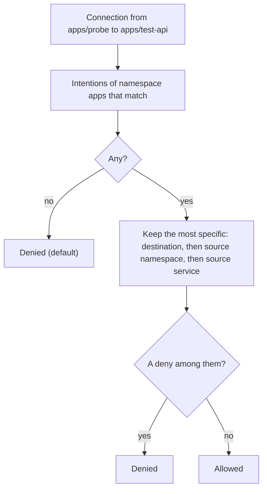

## What and why

Mutual TLS proves who is on the other end of a connection; it does not decide whether that peer may
connect. A `ServiceIntention` is that decision: it allows or denies connections from a source service to
a destination service. Envoy sidecars enforce intentions on every inbound connection, and applications
in [app mode](/docs/features/native-mtls/app-mode) enforce them with the `api/mtls` Go library. Without
an intention that allows it, a connection is denied.

## How it works

**The object.** An intention belongs to the namespace of its destination service and has a unique key:
source namespace, source service, destination service.

| Field | Description |
| --- | --- |
| `Namespace` | Namespace of the destination service (default `default`); never a wildcard |
| `Destination` | Destination service, or `*` for every service of the namespace |
| `SourceNamespace` | Namespace of the source service (default: `Namespace`), or `*` |
| `Source` | Source service, or `*` |
| `Action` | `allow` or `deny` |
| `Description` | Free text, at most 1024 bytes |

On the command line the source is written as `<service>` (in the destination namespace) or
`<namespace>/<service>`; either part may be `*`.

**Evaluation.** For a connection, the peer's namespace comes from the SPIFFE ID of its certificate and its
services from the certificate's DNS names. Among the intentions of the destination namespace that match:

1. the most specific one decides: an exact destination counts most, then an exact source namespace, then
   an exact source service;
2. at equal specificity, `deny` wins over `allow`;
3. if none matches, the connection is denied (an application using the library can set
   `Authorizer.DefaultAllow`; sidecars always deny).

Service names are compared without regard to case.



For example, with these intentions in namespace `apps`:

| Intention | Action |
| --- | --- |
| `*/* -> *` | deny |
| `probe -> test-api` | allow |
| `dev/* -> test-api` | deny |

a connection from `apps/probe` to `test-api` is allowed (exact destination, source namespace and source
service), from `apps/web` to `test-api` is denied (only `*/* -> *` matches), and from `dev/probe` to
`test-api` is denied (`dev/* -> test-api`).

**Regional scope.** Intentions are stored in the Raft state of one region and are not replicated from the
authoritative region, unlike ACL policies, tokens, namespaces and quotas. A write goes to the region of the
request (`-region`), and the sidecars and applications of a region enforce the intentions stored there.
For a connection across regions, the intentions of the **destination** region decide. The source of an
intention has no region: it matches the source service in every region whose certificates the destination
trusts. To apply the same rules everywhere, create them in each region.

**Propagation.** Sidecars follow the intentions of their namespace with blocking queries; a change applies
to new connections within about a second. Established connections keep running until Envoy has drained
the replaced listener (see [Authorization](/docs/features/native-mtls/sidecar-and-gateway#authorization)).
Changes are also published on the event stream topic `ServiceIntention` (events
`ServiceIntentionUpserted` and `ServiceIntentionDeleted`).

**ACLs.**

| Operation | Requirement |
| --- | --- |
| Create, replace, delete | Namespace capability `write-intention`, which no policy shorthand includes |
| List, read | `read-job` on the namespace, or a workload identity of the namespace (so an application reads the intentions it enforces with its own identity) |

## Example

From the [three-node example](/docs/getting-started/examples/03-three-node), where `probe` reaches
`test-api` through an mTLS upstream:

```shell
# without an intention the connection is denied
norca service intention check -namespace apps probe test-api      # exit code 2: denied

norca service intention create -namespace apps -description "probe reads test-api" probe test-api
norca service intention list -namespace apps
norca service intention check -namespace apps probe test-api      # exit code 0: allowed

# deny every service of namespace dev, whatever else allows it at lower specificity
norca service intention create -namespace apps -deny 'dev/*' test-api

norca service intention delete -namespace apps probe test-api
```

An ACL policy for the team that manages the intentions of `apps`:

```hcl
namespace "apps" {
  capabilities = ["read-job", "write-intention"]
}
```

## Configuration reference

Intentions need no agent configuration. The fields of the object are listed above; the HTTP API takes
them as JSON (see the [API reference](/docs/api/service-intentions)).

## CLI and API

| Task | CLI | HTTP API |
| --- | --- | --- |
| Create or replace | [`norca service intention create`](/docs/commands/service/intention/create) | [`PUT /v1/service-intention`](/docs/api/service-intentions#create-or-replace-intention) |
| Delete | [`norca service intention delete`](/docs/commands/service/intention/delete) | [`DELETE /v1/service-intention`](/docs/api/service-intentions#delete-intention) |
| List | [`norca service intention list`](/docs/commands/service/intention/list) | [`GET /v1/service-intentions`](/docs/api/service-intentions#list-intentions) |
| Read one | [`norca service intention info`](/docs/commands/service/intention/info) | [`GET /v1/service-intention`](/docs/api/service-intentions#read-intention) |
| Evaluate a connection | [`norca service intention check`](/docs/commands/service/intention/check) | – (the `Evaluate` function of `api/mtls`) |

## Limits and status

- Intentions are L4 only: they allow or deny a connection, not individual requests.
- A source service is identified by the DNS names of its certificate, which contain the mtls services of
  its group. A service name interpolated at runtime is not in the certificate and can't be matched.
- Intentions are not replicated between regions.

## Design

[Consul independence – plan, item 5](/docs/design/consul-independence-plan#5-native-mtls-and-service-authorization).
