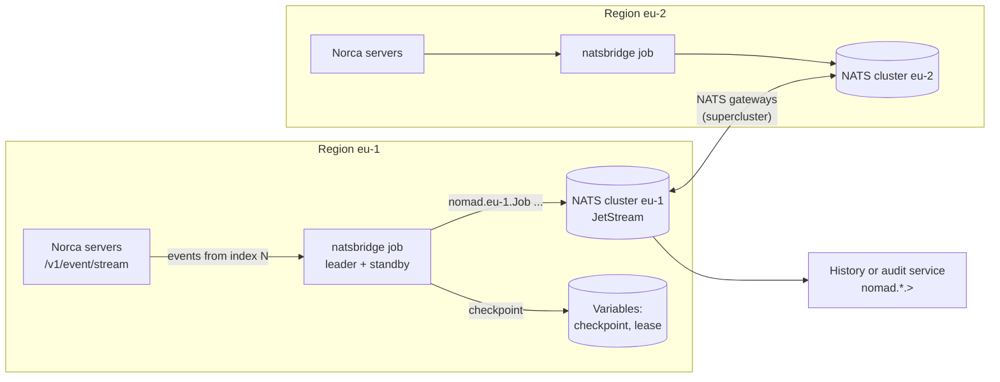

## What and why

Every Norca region has an [event stream](/docs/features/event-stream)
(`/v1/event/stream`): job registrations, deployments, allocations, node
changes, scaling decisions and the events of the Norca features. In a
multi-cloud setup with one region per cloud, a history or audit service wants
the events of all regions in one place, durable, and without holding an HTTP
stream open to every region.

`norca-natsbridge` forwards the event stream of one region to
[NATS](https://nats.io) subjects. It runs as an ordinary job in every region;
a NATS supercluster carries the subjects between the clouds, and JetStream can
keep them in durable streams. The `nats` pack of the
[Norca pack registry](/docs/features/packages/registry) deploys a NATS cluster
per region and, with `bridge_enabled = true`, the bridge next to it.

NATS is used only as an event and notification bridge. Nothing in Norca reads
from NATS: scheduling, deployments and [multiregion rollouts](/docs/features/multiregion)
run over Norca's own RPC. A NATS outage delays the events but affects neither
scheduling nor deployments.

## How it works



### Subjects and messages

Every event is published to

```plaintext
<prefix>.<region>.<topic>        for example nomad.eu-1.Job, nomad.eu-1.Allocation
```

The prefix is `nomad` by default (`-subject-prefix`, which may contain dots,
for example `norca.events`). Characters a subject token cannot contain (`.`,
`*`, `>`, white space) are replaced by `_` in the region and the topic.
Consumers subscribe to `nomad.*.>` (all regions) or `nomad.<region>.>`, or bind
a JetStream stream to these subjects.

The payload is the event JSON exactly as the server sent it, with a `Region`
field added in front, so large integers keep their precision:

```json
{"Region":"eu-1","Topic":"Job","Type":"JobRegistered","Key":"web","Namespace":"default","FilterKeys":null,"Index":4711,"Payload":{"Job":{}}}
```

Headers repeat the metadata, so consumers can filter without decoding the
payload:

| Header | Value |
| --- | --- |
| `Nats-Msg-Id` | `<region>:<index>:<topic>:<type>:<namespace>:<key>` |
| `Nomad-Region` | region |
| `Nomad-Index` | Raft index of the event |
| `Nomad-Topic` | topic |
| `Nomad-Type` | event type, for example `JobRegistered` |
| `Nomad-Namespace` | namespace (if any) |
| `Nomad-Key` | key of the event, for example the job ID (if any) |

### Delivery

- The bridge subscribes with an exact start index: every event from that index
  on is delivered, or the server answers that the index is gone.
- After the events of one Raft index are published (acknowledged by JetStream,
  or flushed to the server with core NATS), their index becomes the resume
  position. It is stored in a **checkpoint** at most every second, and always
  when the bridge stops or loses the leadership.
- After a restart, or when another instance takes over, the bridge resumes
  from the checkpoint. Events published after the last checkpoint write are
  published again: delivery is **at-least-once**. With JetStream the stable
  `Nats-Msg-Id` lets the stream discard these duplicates within its duplicate
  window; core NATS consumers deduplicate by `Nats-Msg-Id`.
- A failed publish is retried with a backoff (1 to 30 seconds). While NATS is
  unreachable the bridge does not read further, and the servers keep the
  events in their event buffer.
- If the servers can no longer resume from the checkpoint, because more events
  happened than the [`event_buffer_size`](/docs/configuration/server#event_buffer_size)
  holds, the bridge publishes a **gap marker** (topic `Bridge`, type
  `EventGap`, with the index from which events may be missing) to
  `<prefix>.<region>.Bridge`, and continues with the newest events. Size the
  event buffer of the servers for the longest NATS outage or bridge downtime
  that must not produce a gap.

### Checkpoint and leader election

By default the checkpoint is a Variable, `nomad/jobs/<job>/checkpoint`,
written with the workload identity of the job through the task API socket.
The instances of the job run on different nodes, so whichever instance leads
next must see the position of the previous one. The writes use check-and-set
and never move the stored index backwards.

The instances elect a leader over a lease Variable (`nomad/jobs/<job>/lease`)
with the leader election of the [controller SDK](/docs/features/operator-framework):
one instance publishes, the others stand by. A stopped leader stores its
checkpoint and releases the lease, so a standby takes over at once; a failed
leader is replaced after the lease duration (20 seconds). Run the job with two
or more instances on distinct hosts.

## Example

The bridge job and its ACL policy are in the Norca repository:
[`nomad/natsbridge/examples/natsbridge.nomad.hcl`](https://github.com/bacanoo-io/norca/blob/main/nomad/natsbridge/examples/natsbridge.nomad.hcl)
and [`natsbridge-policy.hcl`](https://github.com/bacanoo-io/norca/blob/main/nomad/natsbridge/examples/natsbridge-policy.hcl).

```shell
# Build the binary and install it on the nodes.
cd nomad/natsbridge && go build -o /usr/local/bin/norca-natsbridge ./cmd/norca-natsbridge

# Bind the ACL policy to the job, so it runs with its workload identity.
norca acl policy apply -namespace default -job natsbridge \
  natsbridge natsbridge-policy.hcl

# Optional: NATS credentials in the job's Variable, rendered into its secrets directory.
norca var put nomad/jobs/natsbridge nats_creds=@bridge.creds

norca job run -var nats_url=nats://nats.service.example:4222 natsbridge.nomad.hcl
```

The core of the job, shortened from the example (which adds the variables,
the NATS credentials template and the resources): two instances on distinct
hosts, the task API socket with the workload identity, JetStream with
deduplication, and the metrics endpoint as a health-checked service:

```hcl
variable "nats_url" {
  type    = string
  default = "nats://127.0.0.1:4222"
}

job "natsbridge" {
  group "bridge" {
    count = 2

    constraint {
      operator = "distinct_hosts"
      value    = "true"
    }

    network {
      port "metrics" {}
    }

    task "bridge" {
      driver = "raw_exec"

      config {
        command = "/usr/local/bin/norca-natsbridge"
        args = [
          "-nats-url", var.nats_url,
          "-topics", "Job,Deployment,Evaluation,Allocation,Node,Service,Scaling",
          "-metrics-addr", "${NOMAD_ADDR_metrics}",
        ]
      }

      identity {
        env = true
      }

      env {
        NORCA_ADDR                  = "unix://${NOMAD_SECRETS_DIR}/api.sock"
        NATSBRIDGE_JETSTREAM        = "true"
        NATSBRIDGE_JETSTREAM_STREAM = "NORCA_EVENTS"
        NATSBRIDGE_JETSTREAM_CREATE = "true"
      }

      # A stopped leader stores its checkpoint and releases the lease.
      kill_timeout = "20s"

      service {
        name     = "natsbridge-metrics"
        port     = "metrics"
        provider = "nomad"

        check {
          type     = "http"
          path     = "/healthz"
          interval = "10s"
          timeout  = "2s"
        }
      }
    }
  }
}
```

The ACL policy grants `read-job` in all namespaces and `read` on nodes (the
default topics), and `list`, `read` and `write` on `nomad/jobs/natsbridge/*`
for the checkpoint and the lease:

```hcl {filename="natsbridge-policy.hcl"}
namespace "*" {
  capabilities = ["read-job"]
}

namespace "default" {
  capabilities = ["read-job"]

  variables {
    path "nomad/jobs/natsbridge/*" {
      capabilities = ["list", "read", "write"]
    }
  }
}

node {
  policy = "read"
}
```

### With the `nats` pack

The `nats` pack deploys a NATS cluster per region (JetStream, gateways for a
supercluster, TLS and client authentication from a Variable or the secret
store) and, with `bridge_enabled = true`, the bridge job connected to the
client service of the cluster. It publishes into the JetStream stream
`NORCA_EVENTS_<region>`:

```hcl {filename="nats-eu-1.hcl"}
# example/04-multi-region/nats-eu-1.hcl, with the bridge turned on
region            = "eu-1"
count             = 3
separate_scope    = "$${meta.zone}"
separate_required = true
gateway_enabled   = true
remote_gateways = [
  { name = "eu-2", urls = ["nats://10.0.1.11:7222", "nats://10.0.1.12:7222"] },
]
bridge_enabled = true
```

```shell
norca pack run nats --registry=norca --name=nats --region=eu-1 -f nats-eu-1.hcl
norca acl policy apply -region eu-1 -namespace default -job natsbridge \
  natsbridge natsbridge-policy.hcl
```

The pack can't create ACL policies; `norca pack run` prints the policy text.
The bridge reads its own NATS credentials from `nomad/jobs/<bridge_job_name>`
(`nats_token`, `nats_creds`, `nats_nkey_seed`, `nats_ca`, `nats_cert` and
`nats_key`, all optional). See the
[nats pack README](https://github.com/bacanoo-io/norca-registry/blob/main/packs/nats/README.md)
for users and accounts, storage and the supercluster.

## Configuration reference

The bridge is configured with flags; most have an environment variable as the
default.

| Flag | Environment | Default | Description |
| --- | --- | --- | --- |
| `-addr` | `NORCA_ADDR` (`NOMAD_ADDR`) | `http://127.0.0.1:4646` | API address, or `unix://${NOMAD_SECRETS_DIR}/api.sock` |
| `-token` | `NORCA_TOKEN` (`NOMAD_TOKEN`) | | ACL token or workload identity |
| `-region` | `NORCA_REGION` (`NOMAD_REGION`) | agent's region | Region of the stream and the subjects |
| `-namespace` | `NATSBRIDGE_NAMESPACE` | `*` | Namespace of the events |
| `-topics` | `NATSBRIDGE_TOPICS` | `Job,Deployment,Evaluation,Allocation,Node,Service,Scaling` | `Topic` or `Topic:key`, comma separated (server-side filter) |
| `-event-types` | `NATSBRIDGE_EVENT_TYPES` | all | Event types to publish (client-side filter) |
| `-start-at` | `NATSBRIDGE_START_AT` | `now` | Without a checkpoint: `now` or `oldest` |
| `-nats-url` | `NATS_URL` | `nats://127.0.0.1:4222` | NATS server URLs, comma separated |
| `-nats-name` | | `norca-natsbridge-<region>` | NATS connection name |
| `-nats-creds`, `-nats-nkey`, `-nats-token` | `NATS_CREDS`, `NATS_NKEY`, `NATS_TOKEN` | | Credentials file, NKey seed file, token |
| `-nats-ca`, `-nats-cert`, `-nats-key` | `NATS_CA`, `NATS_CERT`, `NATS_KEY` | | TLS CA, client certificate and key |
| `-subject-prefix` | `NATSBRIDGE_SUBJECT_PREFIX` | `nomad` | First part of the subjects |
| `-publish-timeout` | `NATSBRIDGE_PUBLISH_TIMEOUT` | `10s` | Timeout of publishing one batch |
| `-jetstream` | `NATSBRIDGE_JETSTREAM` | `false` | Publish with JetStream and wait for the acknowledgements |
| `-jetstream-stream` | `NATSBRIDGE_JETSTREAM_STREAM` | | Stream the messages must be stored in |
| `-jetstream-create` | `NATSBRIDGE_JETSTREAM_CREATE` | `false` | Create that stream for `<prefix>.<region>.>` if missing |
| `-jetstream-duplicates` | `NATSBRIDGE_JETSTREAM_DUPLICATES` | `10m` | Duplicate window of a stream it creates |
| `-checkpoint` | `NATSBRIDGE_CHECKPOINT` | `variable` | `variable`, `file` or `none` |
| `-checkpoint-path` | `NATSBRIDGE_CHECKPOINT_PATH` | `<state-prefix>/checkpoint` | Variable path or file; required for `file` |
| `-checkpoint-interval` | `NATSBRIDGE_CHECKPOINT_INTERVAL` | `1s` | Minimum time between checkpoint writes |
| `-state-namespace` | `NORCA_NAMESPACE` (`NOMAD_NAMESPACE`) | `default` | Namespace of the checkpoint and lease Variables |
| `-state-prefix` | | `nomad/jobs/<NOMAD_JOB_ID>`, else `natsbridge/<region>` | Variable path prefix |
| `-leader-elect` | `NATSBRIDGE_LEADER_ELECT` | `true` | Elect one publishing instance |
| `-lease-path` | | `<state-prefix>/lease` | Variable path of the lease |
| `-lease-duration` | | `20s` | Time after which a lease that is not renewed is taken over |
| `-identity` | | `NOMAD_ALLOC_ID` | Identity of this instance |
| `-metrics-addr` | `NATSBRIDGE_METRICS_ADDR` | `127.0.0.1:9464` | `/metrics` and `/healthz`; empty disables |
| `-log-level` | `NATSBRIDGE_LOG_LEVEL` | `info` | `debug`, `info`, `warn` or `error` |

The default topics are those a workload identity with `read-job` and node read
may subscribe to. `ACLToken`, `ACLPolicy`, `NodePool` and `*` need a
management token; the `Backup` topic needs the
[`backup` read](/docs/other-specifications/acl-policy#backup-rules) permission.

The `nats` pack variables of the bridge: `bridge_enabled` (`false`),
`bridge_job_name` (`natsbridge`), `bridge_count` (`2`), `bridge_driver`
(`raw_exec`; `exec` or `docker` with `bridge_image`), `bridge_binary`,
`bridge_artifact_url`, `bridge_subject_prefix` (`nomad`), `bridge_topics`,
`bridge_jetstream_stream` (`NORCA_EVENTS_<region>`), `bridge_resources`, and
`bridge_nkey` for `auth_mode = "userpass"`.

### Metrics

`/metrics` on `-metrics-addr` serves Prometheus metrics:

| Metric | Description |
| --- | --- |
| `norca_natsbridge_events_published_total{topic}` | Events published (gap markers as topic `Bridge`) |
| `norca_natsbridge_events_duplicate_total` | Events JetStream reported as duplicates |
| `norca_natsbridge_events_skipped_total{reason}` | `own` (checkpoint and lease writes), `type` (event type filter) |
| `norca_natsbridge_publish_failures_total` | Events whose publish failed (retried) |
| `norca_natsbridge_stream_errors_total{reason}` | Failed subscriptions, interrupted streams |
| `norca_natsbridge_gaps_total` | Gap markers |
| `norca_natsbridge_checkpoint_failures_total` | Failed checkpoint reads and writes |
| `norca_natsbridge_received_index`, `norca_natsbridge_published_index`, `norca_natsbridge_checkpoint_index` | Positions |
| `norca_natsbridge_lag_index` | Received index minus published index |
| `norca_natsbridge_lag_seconds` | Age of the oldest received but unpublished batch |
| `norca_natsbridge_leader` | 1 on the publishing instance |

## CLI and API

The bridge has no CLI of its own besides its flags. It uses:

| What | Interface |
| --- | --- |
| Event stream | `GET /v1/event/stream` ([Events HTTP API](/docs/api/events)) |
| Checkpoint and lease | Variables, through the task API socket |
| Deploy | `norca job run natsbridge.nomad.hcl`, or `norca pack run nats --var bridge_enabled=true` |
| Stop gracefully | `SIGINT` or `SIGTERM`: the checkpoint is stored, the lease released |

## Limits and status

- Available as a separate binary, `norca-natsbridge`, built from the
  `nomad/natsbridge` module of the Norca repository; no image is published.
  A built-in output in the agent may follow later.
- Delivery is at-least-once; consumers of core NATS must deduplicate.
- The bridge's own checkpoint and lease writes are Variables events; when the
  `Variables` topic is forwarded, they are skipped.
- After a restore of the cluster from a snapshot taken before the checkpoint,
  the Raft index is lower than the checkpoint and the bridge waits; delete the
  checkpoint Variable in that case.

## Design

[Multi-cloud connectivity](/docs/design/nomad-fork-development-plan#multi-cloud-connectivity)
in the development plan: the event stream to NATS bridge is the first stage of
the events and audit layer (event stream, NATS bridge, history and audit
service).
