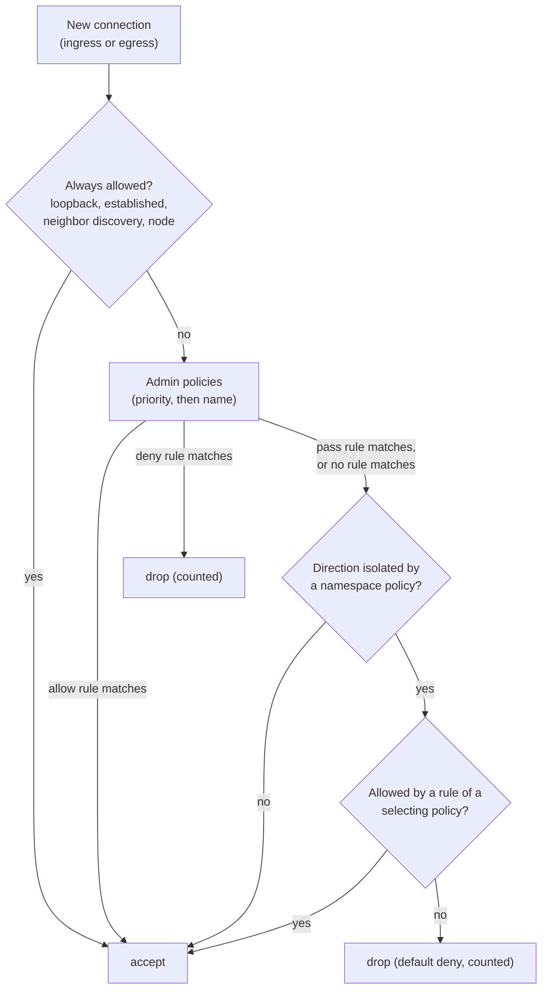

## What and why

Nomad v1.6.5 has no way to say "this allocation may only talk to the database
and to DNS" or "no workload may reach the cloud metadata service". Access
control exists only for traffic that passes through Consul proxies, on an
identity basis.

Norca adds **network rules** at two levels:

- A **`NetworkPolicy`** belongs to a namespace. It selects allocations by the
  `meta` of their job and task group and lists the ingress and egress traffic
  they may have. Being selected isolates the allocation in that direction:
  everything that no selecting policy allows is dropped.
- An **`AdminNetworkPolicy`** is cluster-wide. Its rules have an explicit
  action, `allow`, `deny` or `pass`, are evaluated first in priority order, and
  cannot be overridden by namespace policies. A cluster administrator can, for
  example, block the metadata service for every workload.

The rules are enforced by the client with **nftables in the network namespace
of each allocation** (bridge and CNI network modes). Egress is filtered by CIDR
and port (level A); ingress is filtered on the node and on the host ports
(level B). Nodes that cannot enforce the rules are filtered out by the
scheduler, so a rule never silently has no effect.

The idea comes from Kubernetes (NetworkPolicy, and AdminNetworkPolicy for the
administrator layer with explicit deny). The design and implementation are
Norca's own: selectors use job and group `meta`, the scheduler checks whether a
node can enforce the rules, and the rules are compiled per allocation on the
client.

## How it works

**Selection.** A policy selects the allocations of a task group if every key of
its `selector` appears with the same value in the job `meta` merged with the
task group `meta` (group values override job values). An empty selector selects
every allocation of the namespace (namespace policy) or of the matching
namespaces (admin policy).

**Isolation.** A namespace policy isolates a direction (`ingress` or `egress`)
if it has rules in that direction, or lists the direction in `default_deny`.
For an isolated direction, only the union of the traffic allowed by all
policies selecting the allocation passes. Admin policies do not isolate by
themselves: traffic that no admin rule decides and no namespace policy isolates
is allowed.

**Rules.** A rule matches traffic if it matches one of its peers and one of its
ports. A rule without peers matches any address, a rule without ports matches
any port. Peers are either CIDR blocks, or allocations **on the same node**
selected by `namespace` and `selector`. Ports are `5432/tcp`,
`8000-8100/udp`, `53` (TCP) or, for ingress, a port label of the allocation
(`db/tcp`, resolved to the port inside the allocation).

**Always allowed.** Loopback traffic, replies to allowed connections
(`ct state established,related`), IPv6 neighbor discovery and, for ingress,
traffic from the node itself (the gateway of the allocation network), so the
client's health checks keep working.

**Evaluation order.** For each packet of a new connection:



**Enforcement on the client.** Every node fingerprints whether it can program
nftables; nodes that can get the attribute
`norca.network_policy.nftables = true`. After the network of an allocation is
set up, the `network_policy` alloc runner hook fetches the effective rules of
the allocation from the servers (a blocking query, so policy changes and new
peer allocations are picked up), compiles them and writes the table
`inet norca` into the allocation's network namespace in one atomic
transaction. Allocations that no policy selects get no table.

**Scheduling.** When a policy with `enforcement = "required"` (the default)
selects a task group, only nodes with `norca.network_policy.nftables = true`
are feasible, and groups in `host` network mode are not placed at all. With
`enforcement = "best_effort"` the scheduler does not filter; job registration
warns about groups whose network mode cannot enforce the selecting policies,
and the client emits a `Network Policy Not Enforced` task event when it cannot
apply the rules. If a required policy cannot be applied on the client, the
allocation fails.

**Across nodes.** In bridge mode, allocations on other nodes are reached
through host ports, so the source of such traffic is the address of the sending
node (or of an external client), not of an allocation. Selector peers therefore
match allocations on the same node only; traffic from other nodes is matched by
CIDR. Identity-based control between nodes is provided by
[native mTLS and service intentions](/docs/features/native-mtls).

## Example

From `example/policies/`: a namespace policy that lets `test-app` open
connections only to the node network and to DNS, and an admin policy that
blocks the cloud metadata service for every workload.



```hcl {filename="netpol-test-app.hcl"}
name        = "test-app"
namespace   = "apps"
description = "test-app: egress only to the cluster network and DNS"

# Matches the job meta of the test-app pack (app = "<job_name>").
selector {
  app = "test-app"
}

egress {
  to {
    cidr = ["10.0.0.0/24"] # the subnet of the nodes
  }
}

egress {
  ports = ["53/udp", "53/tcp"]
}

enforcement = "required"
```


```hcl {filename="admin-netpol-no-metadata.hcl"}
name        = "no-metadata-service"
description = "Block the cloud metadata service for all workloads"
priority    = 10

# Without a selector the policy selects every allocation of these namespaces.
namespaces = ["*"]

egress {
  name   = "metadata"
  action = "deny"

  to {
    cidr = ["169.254.169.254/32"]
  }
}

# Keep placing groups that cannot enforce the rules (host networking, nodes
# without nftables), with a warning at job registration.
enforcement = "best_effort"
```



```shell
norca network-policy apply -admin admin-netpol-no-metadata.hcl
norca network-policy apply netpol-test-app.hcl
norca network-policy list -admin
norca network-policy status -namespace apps test-app   # selected allocations, enforced on their nodes
```

A database that accepts connections only from the API on the same node and
from the application subnet:

```hcl
name      = "db-only-from-api"
namespace = "prod"

selector {
  app = "postgres"
}

ingress {
  from {
    selector {
      app = "api"
    }
  }
  from {
    cidr = ["10.20.0.0/16"]
  }
  ports = ["5432/tcp"]
}
```

## Configuration reference

Policies are files applied with `norca network-policy apply`; the full format
is in the [network policy specification](/docs/other-specifications/network-policy).

| Key | Type | Default | Description |
| --- | --- | --- | --- |
| `name` | string | required | Name, `[a-zA-Z0-9-_]{1,128}`. |
| `namespace` | string | `-namespace` flag | Namespace of a namespace policy (not valid with `-admin`). |
| `description` | string | `""` | Up to 1024 characters. |
| `selector` | block | selects all | Meta key/value pairs of the selected allocations (up to 32 keys). |
| `ingress`, `egress` | block, repeatable | none | Rules: `name`, `action` (admin only), `from` (ingress) or `to` (egress) peers, `ports`. Up to 64 rules per direction. |
| `default_deny` | list of strings | `[]` | Directions a namespace policy isolates even without rules: `"ingress"`, `"egress"`. |
| `enforcement` | string | `"required"` | `"required"` filters nodes that cannot enforce the rules; `"best_effort"` places anyway, with warnings. |
| `priority` | int | `0` | Admin only: 0 to 1000, lower is evaluated first, then by name. |
| `namespaces` | list of strings | all namespaces | Admin only: namespace names or glob patterns. |

Node attribute (fingerprinted, not configured): `norca.network_policy.nftables`
is `true` on Linux nodes that can program nftables (`nf_tables` in the kernel;
the `nft` tool is not needed).

ACL:

- Namespace policies: the namespace capabilities `read-network-policy`
  (included in the namespace `read` and `write` policies) and
  `write-network-policy` (granted explicitly, or with
  `network_policy { policy = "write" }` inside a `namespace` block of an ACL
  policy).
- Admin policies: `operator` read (list, status) or write (apply, delete).

Observability: the counter metric `nomad.client.allocs.network_policy.dropped`
counts the packets dropped by admin `deny` rules and by default deny, with the
labels `alloc_id`, `namespace`, `job`, `task_group`, `direction`, `kind`
(`admin` or `default-deny`), `policy` and `rule` (needs
`publish_allocation_metrics` in the [telemetry](/docs/configuration/telemetry)
configuration). Changes are published on the event stream topic
`NetworkPolicy` (`NetworkPolicyUpserted`, `NetworkPolicyDeleted`,
`AdminNetworkPolicyUpserted`, `AdminNetworkPolicyDeleted`).

## CLI and API

| Task | CLI | HTTP API |
| --- | --- | --- |
| Create or update | [`norca network-policy apply [-admin]`](/docs/commands/network-policy/apply) | `PUT /v1/network-policy/:name`, `PUT /v1/admin-network-policy/:name` |
| List | [`norca network-policy list [-admin]`](/docs/commands/network-policy/list) | `GET /v1/network-policies`, `GET /v1/admin-network-policies` |
| Show with the selected allocations | [`norca network-policy status [-admin]`](/docs/commands/network-policy/status) | `GET /v1/network-policy/:name/status`, `GET /v1/admin-network-policy/:name/status` |
| Delete | [`norca network-policy delete [-admin]`](/docs/commands/network-policy/delete) | `DELETE /v1/network-policy/:name`, `DELETE /v1/admin-network-policy/:name` |

See [Network policies API](/docs/api/network-policies) for parameters and
payloads. The Go API client has `NetworkPolicies()` with `List`, `Info`,
`Register`, `Delete`, `Status` and the `Admin*` variants. The web UI shows the
network policies of a namespace with their selected allocations, and the admin
policies, on the Network page.

## Limits and status

Available in Norca 0.1.0 (levels A and B of the design; level C, allocation
ingress between nodes by label, is dropped in favor of
[native mTLS](/docs/features/native-mtls)).

- Linux clients only, bridge and CNI network modes. `host` mode cannot be
  enforced.
- Selector peers match allocations on the same node; other nodes and external
  clients are matched by CIDR.
- Not available: `except` blocks in CIDR peers, sampled logs of dropped
  connections, protection against deleting a namespace that has network
  policies.
- Limits per policy: 64 rules per direction, 64 peers per rule, 256 CIDRs per
  peer, 64 ports per rule, 32 selector keys.
- All servers of the region must run Norca 0.1.0 or later to write policies.

## Design

[Kubernetes features specification, item 7](/docs/design/kubernetes-features-spec#7-network-rules).
