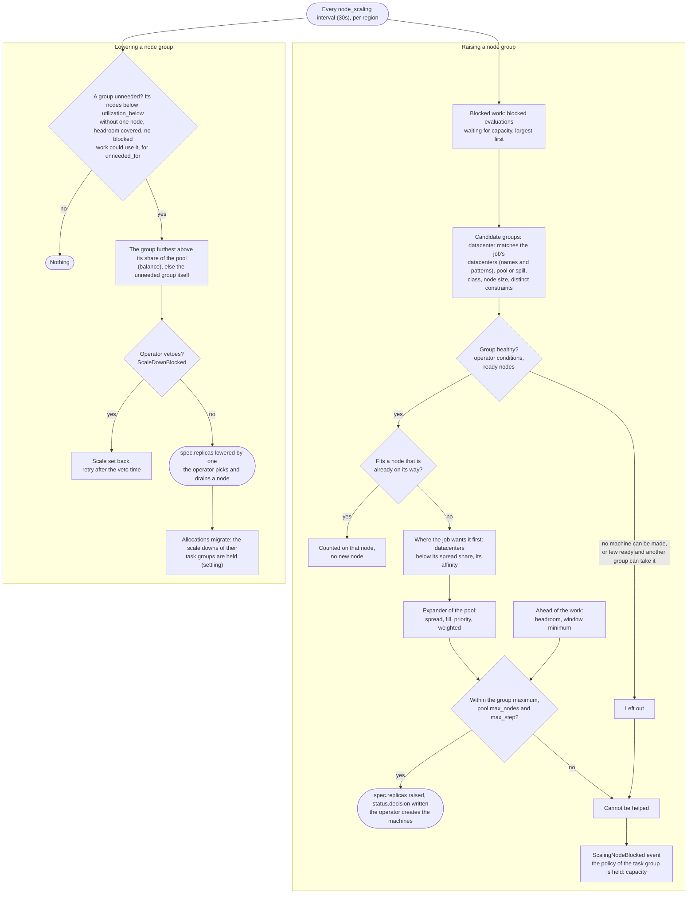

## What and why

The [built-in autoscaler](/docs/features/autoscaler) scales task groups. Node scaling gives it
the other half of the picture: how many **nodes** a node pool needs. A node that is added takes
minutes to start, so a cluster that only grows when work is already waiting makes the work wait; a
cluster that is sized by hand is either too small or too expensive.

Node scaling is built from three parts:

- a **node group** is an object of the kind [`norca.io/NodeGroup`](/docs/features/node-scaling/nodegroup):
  the nodes of one node pool in one datacenter (and, if you want, one node class), with a
  minimum, a maximum and a **scale** (`spec.replicas`, the number of nodes it should have);
- the **built-in autoscaler** of the leader decides the scale: from the work that cannot be
  placed, from the **headroom** you ask for, and from **checks** on the group, and writes it to
  `spec.replicas`;
- an **operator** creates and deletes the machines to match the scale, through a
  **provider** application for a platform ([`norca.io/NodeProvider`](/docs/features/node-scaling/nodeprovider)).

> [!NOTE]
> **What is available today.** The decisions (the kinds, the policy derived from the objects, the
> trigger on blocked work, the headroom, the expanders, the dry run) and the operator,
> `norca-nodescaler` (the `nodescaler-operator` pack), with its provider contract. There is no
> provider for a cloud yet: the node providers that exist are the `mock` and `docker` types of
> `norca-provider`, for tests.
> **Without a provider for your platform the scale is a recommendation**: use it with
> `enforce = false` and read the events, or let your own tooling (or a person, with
> `norca object scale`) act on `spec.replicas`.

## How the scale is decided

Every `NodeGroup` that is enabled and of the built-in engine becomes a scaling policy, derived
from the object each time the objects change. The policy is evaluated like the policy of a task
group, so the checks, the strategies (`target-value`, `threshold`), the evaluation interval, the
cooldown, the rate limit and the oscillation guard are the ones described on the
[autoscaler](/docs/features/autoscaler) page. The target is the object itself: the decision is
written to `spec.replicas` through the scale subresource, and the cooldown is read from the event
log of the object, so a new leader keeps it.

The checks of a group only **raise** its scale; a check that would lower it is ignored. **A group is
lowered by its `scale_down` block alone** (see [Scale down](#scale-down)), which keeps the protections
a scale down of nodes needs.

Besides the checks, three triggers act on the groups. They run every `interval` of the
[`node_scaling`](/docs/configuration/autoscaler#node_scaling-block) block (30 seconds by default).



The two ends of the picture are where node scaling meets the policies of the task groups: work
that cannot be helped holds the scale ups of its group (the reason `capacity`), and a node that is
drained leaves the groups on it unsettled, which holds their scale downs until the allocations run
again (see [how a policy decides](/docs/features/autoscaler#how-a-policy-decides)).

### Blocked work

Work that cannot be placed for want of capacity raises the scale of the groups that could take
it, **without waiting for the cooldown of the group**:

1. The unplaced allocations are packed, the largest first, into virtual nodes of the size of a node
   of the group (`status.allocatable`, or `spec.node.capacity` less `spec.node.reserved`). Four
   allocations of 6 GB on nodes of 8 GB need four nodes, not three.
2. An allocation that cannot share a node with its own kind, because of `distinct_hosts` or a port
   by number (a proxy on ports 80 and 443), needs a node of its own, however small it is. The room
   that is left on that node is used by other work.
3. Work that can go to several groups (a job with several datacenters) is split between them by
   the **expander**: `spread` (the group with the fewest nodes, the default), `fill` (the fullest
   group below its maximum), `priority` (the lowest `priority`) or `weighted` (by `weight`). It is
   set for the region and can be overridden for a pool.
4. A `distinct_property` on `${node.datacenter}` or `${node.pool}` is respected: the live
   allocations of the job are counted by the value of their node, a group whose value has no room
   left gets no work, and the work is capped at the room each group has.
5. **Nodes that were asked for and have not joined yet** (`status.joining`) are empty room for the
   work, filled first. The same work is therefore not asked for twice, however the expander
   splits it at the next look.
6. A job of a node pool uses the groups of that pool. A job that may run in **any** pool (`node_pool = "all"`) grows no group by default; the groups with `spill = true` are the ones it may grow, in the datacenters it names. An event says so when no group allows it.
7. A constraint on `${node.class}` leaves out the groups whose class fails it.
8. `spec.replicas` is raised by what is left, within the `max` of the group and the `max_nodes` and
   `max_step` of the pool.

When the nodes the group has are not known (an operator does not report them and the cluster gauges
cannot be read), **the group is left alone**: without that number the nodes on their way cannot be told
from the ready ones, and the work would be asked for again at every look. A group whose datacenter, pool and class have no node at all (a new class, or every node down) is known to have none: it grows from nothing.

### Headroom

`headroom_nodes` (or `headroom_percent`, a share of the nodes the group has; the larger of the two
applies) keeps free capacity worth that many nodes ahead of the work, so that new work can be placed
at once while the next node starts. The free capacity is read from the cluster gauges of the group:
the ready, eligible nodes and the allocated share of CPU and memory (the scarcer of the two). Nodes
on their way count as free; the nodes that blocked work needs do not. **The headroom is an
ahead-of-time trigger, so it waits for the cooldown of the group.** When the gauges cannot be read,
nothing is added.

### Scale down

A group with a `policy.scale_down` block loses one node at a time; **a group without it is never
lowered by the autoscaler.** The scale is lowered by one when, for `unneeded_for` (10 minutes by
default) without a break:

- no blocked work could use the group;
- the group has all its nodes (none joining, none being removed) and is above its `min`;
- its allocated share **without one node of the group** is below `utilization_below` (40% by
  default): three nodes at 20% are 30% on two nodes, so one may go; three nodes at 30% are 45%;
- the free capacity without that node still covers the headroom;
- `delay_after_add` (10 minutes by default) has passed since the scale was last raised, and the
  group is not in its cooldown;
- the operator does not hold it (the condition `ScaleDownBlocked`, until its `retryAfter`).

One group of a node pool is lowered at a time, and the pool waits while a node of it is being
removed. **The group that gives the node is the one furthest above its share of the pool**, when it
is at least a node above it and may be lowered; otherwise the unneeded group itself (among several,
the one with the most nodes). After a datacenter was lost and came back, the unneeded group is the
returned, empty one: lowering a group that grew instead moves the work back, a node at a time (see
[`balance`](/docs/configuration/autoscaler#scale-down)). **The decision
is only the number: the operator chooses the node, drains it and deletes its instance.** When no node
of the group may go, the operator sets `ScaleDownBlocked` with a `retryAfter` time, and the
autoscaler sets the scale back to the nodes the group has, so the two do not pull the number up and
down. A new leader starts the wait of `unneeded_for` again.

## Dry run

**A group is a *dry run* until you set `enforce = true`.** A decision is then recorded in the event
log of the object (`norca object events norca.io/NodeGroup <name>`, reason `ScalingDryRun`, once
for the same decision) and **`spec.replicas` is not changed.** Run a group this way first and compare
the decisions with what you expect.

## Events and metrics

Decisions and the reasons for not deciding are events of the `Scaling` topic of the
[event stream](/docs/features/event-stream):

| Event | Meaning |
| --- | --- |
| `ScalingDecision` | The scale of a group was changed (`Check` is `blocked-demand`, `headroom`, the name of a check, `scale-down`, or `scale-down-veto` when a vetoed scale down is set back). |
| `ScalingNodeBlocked` | Work is not helped by more nodes: every group that could take it is at its maximum, a limit of the pool, the size of a node is unknown, or no group fits. `Reason` says which. |
| `ScalingNodeAllocationTooLarge` | An allocation does not fit an empty node of a group; the job and the group are named. |
| `ScalingNodeUnverifiable` | The work is blocked by a constraint that cannot be checked against a node that does not exist yet (a `distinct_property` on a `meta` key, for example). No node is added for it; the fix is in the job. |

The last three are raised when the reason appears or changes, not at every look. The demand that
cannot be placed is in the [cluster gauges](/docs/configuration/metrics_store) of the metrics store:
`norca.cluster.blocked_cpu_mhz`, `blocked_memory_mb`, `blocked_evals`, `blocked_allocs_exclusive`
and `blocked_unverifiable`, per datacenter and node pool; the allocated share and the ready nodes
per datacenter, node pool and node class are the other cluster gauges. The built-in source
`norca` of the autoscaler serves them to the checks of a group, with the pool, datacenter and
class of the group as defaults:

```hcl
policy {
  check "allocated" {
    source = "norca"
    query  = "cluster.cpu_allocated"
    strategy "target-value" { target = 70 }
  }
}
```

## Example

Two groups of the pool `workers`, in two datacenters, scaled from blocked work and a headroom of
one node. Both are a dry run until you are happy with the decisions:

```hcl
kind = "norca.io/NodeGroup"
name = "workers-dc-a"

spec {
  pool       = "workers"
  datacenter = "dc-a"
  min        = 1
  max        = 10
  replicas   = 3
  provider   = "hetzner-eu"
  enforce    = false

  headroom_nodes = 1

  node {
    capacity {
      cpu    = 4000   # MHz
      memory = 8192   # MB
      disk   = 40000  # MB
    }
    reserved {
      cpu    = 100
      memory = 256
    }
  }
}
```

```shell
$ norca object apply workers-dc-a.hcl
$ norca object events norca.io/NodeGroup workers-dc-a
```

In the server configuration, spread the work between the groups and cap the pool:

```hcl
autoscaler {
  enabled = true

  node_scaling {
    expander = "spread"

    pool "workers" {
      max_nodes = 12
      max_step  = 3
    }
  }
}
```

## How the operator runs

The operator is a [controller](/docs/features/operator-framework/controllers) of the operator
framework, run as a job (the `nodescaler-operator` pack), and it follows the
[rules for where a controller runs](/docs/features/operator-framework/controllers#where-to-run-a-controller):

- **One operator per region.** Node groups belong to a region, and so does the operator that
  serves them (`-region`). Another region has an operator of its own.
- **Two instances, one at work.** The pack runs 2 instances on different nodes
  (`count`, with `distinct_hosts`) and, where there are several, in different datacenters (a
  `spread`): when a datacenter is lost, nodes are needed in the others, and an operator that went
  with it would add none until it is placed again. With leader election (`-leader-election`, on by default) only
  the leader reconciles the groups and sweeps the orphans; the other keeps its cache current and
  takes over when the leader is gone. A third instance is one more standby, not more throughput.
- **What is shared out:** the [join endpoint](/docs/features/node-scaling/nodegroup#nodes-that-make-their-own-keys)
  runs on every instance, so the joins and the renewals of the certificates of the nodes are served
  by any of them; the one-time tokens are written check-and-set, so it does not matter which one a
  node reaches.
- **More work on the leader:** `-workers` (2 by default) is how many groups the leader reconciles at
  the same time. One group is never reconciled by two workers at once, so raise it when there are
  many groups. The pack does not set it: add the flag to the arguments of the job to change it.

- **The provider is one instance.** A second one would not be a standby: a registration has one
  endpoint, and the heartbeat of the other instance would hide that the endpoint is dead. What makes
  a provider survive the loss of its node or its datacenter is being placed again, so its job must
  be allowed in at least two datacenters (the `norca-provider` pack refuses a single named
  datacenter unless `allow_single_datacenter = true`). Until it runs again, the groups of the
  provider get no blocked work: no machine could be made for them.

**Limits that follow from it:**

- The reconciling of a region does not scale out: it is one process, and adding instances does not
  divide it. What helps a region with many groups is more `-workers` on the leader.
- **Do not run two operators for one region without leader election (`-leader-election=false`).** The
  status writes are check-and-set and the requests to a provider can be repeated, so nothing breaks
  at once, but both would act on the same groups: their writes would conflict and be retried, and
  two of them could decide about the same node during a replacement or a drain.
- When the leader is lost, nothing is reconciled until the standby has the lease (20 seconds by
  default); the state is in the objects, the nodes and the provider, so the new leader goes on
  from there.

## Limits

- The groups of one node pool and datacenter must not overlap: use one group without `node_class`,
  or groups with different classes.
- A job fixed to one datacenter stays blocked until its owner changes the job or raises the group;
  **the scaler never moves work between datacenters.**
- A constraint of a job on `${node.class}` is checked against the `node_class` of each group, the way the scheduler checks it, with `=`, `!=`, `regexp`, `set_contains`, `set_contains_all`, `set_contains_any`, `is_set` and `is_not_set` (the class of a node is always set, even when it is empty). The nodes of a group without `node_class` have no class. Other operators, and a value that is itself a property of a node (`${meta.class}`), cannot be checked ahead of time and are reported like an unverifiable constraint.
- The autoscaler lowers the scale of a group, but choosing, draining and deleting the node is the
  work of the operator; until the operator does it, `spec.replicas` stays below the nodes the group
  has and the pool waits.
