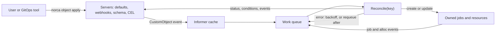

## What and why

A job and its deployment already keep a workload running: Norca restarts and
reschedules allocations, rolls out updates and registers services. What a job
cannot express is the knowledge of how to operate a particular system: how to
build and fail over a database cluster, upgrade it in order, schedule its
backups, or create and remove a cloud load balancer that follows a service.

The operator framework lets you add that knowledge to the cluster. You register
an **object kind** (a new type, for example `norca.io/LoadBalancer`) with a JSON
Schema, default values and CEL validation rules. Users then write **custom
objects** of that kind, which hold the desired state (`spec`). A **controller**,
a program that usually runs as a Norca job, watches the objects, makes the world
match the spec (creates jobs, Variables, external resources) and reports the
observed state (`status`, conditions and an event log) back on the object.

The idea comes from Kubernetes (CustomResourceDefinitions and the operator
pattern with controllers). The design and the implementation are Norca's own:
objects are stored in the Raft state of the servers next to jobs, they are
authorized with Norca ACL rules, they are validated with the same CEL
environment as [admission control](/docs/features/admission-control), and
changes are delivered on the [event stream](/docs/features/event-stream).


  
  
  
  


## How it works

The servers store the kinds and the objects. Every write of an object goes
through the leader, which fills in the schema defaults, runs the type-bound
webhooks, validates the result against the schema and the CEL rules, and
increases the object's `generation` when the spec changed. The controller is a
client like any other: it lists the objects, follows the `CustomObject` topic of
the event stream, and reconciles each changed object.



The loop is level-based: `Reconcile` reads the current state of the object and
of what it owns, and does whatever brings them in line with the spec. It must be
idempotent, because the same key is reconciled again after errors, after a
requeue delay, after changes of owned jobs, and on the periodic
resynchronization. The status records the `observedGeneration`, so anyone can
tell whether the controller has acted on the latest spec.

## Example

The running example of this section is the LoadBalancer operator, the sample
operator of the controller SDK
([`nomad/controller/examples/loadbalancer`](https://github.com/bacanoo-io/norca/tree/main/nomad/controller/examples/loadbalancer)).
A `norca.io/LoadBalancer` object names a service and a frontend port; the
controller keeps a load balancer that forwards to the healthy instances of the
service. Its built-in `nomad` class runs the load balancer as a Norca job
(`lb-<name>`, a TCP proxy) owned by the object.

{}

### Register the kind

The kind file of the example (the schema is in `loadbalancer.schema.json` next
to it):

```hcl {filename="loadbalancer.kind.hcl"}
kind "LoadBalancer" {
  group       = "norca.io"
  description = "Load balancer forwarding to the healthy instances of a Nomad service"
  namespaced  = true
  schema      = file("loadbalancer.schema.json")

  rule {
    expression = "!has(oldSelf) || self.spec.internal == oldSelf.spec.internal"
    message    = "internal can't be changed; delete and recreate the load balancer."
  }

  columns {
    column "Service" { path = "spec.service" }
    column "Port" { path = "spec.port" }
    column "Class" { path = "status.class" }
    column "Addresses" { path = "status.addresses" }
    column "Ready" { path = "status.conditions[?type=='Ready'].status" }
  }
}
```

```shell
$ norca object-kind apply loadbalancer.kind.hcl
Successfully applied object kind "norca.io/LoadBalancer"!
```

### Run the controller

Install the operator as a pack, which applies the kind, the ACL policy of the
controller and the controller job as one release (see
[Ecosystem](/docs/features/operator-framework/ecosystem#operator-packs)):

```shell
$ norca pack run ./packs/loadbalancer-operator --name=lb
```

### Create an object

```hcl {filename="web.hcl"}
kind = "norca.io/LoadBalancer"
name = "web"

spec {
  service = "web"
  port    = 8080
}
```

```shell
$ norca object apply web.hcl
$ norca object list norca.io/LoadBalancer
$ norca object get norca.io/LoadBalancer web
```

The server fills in the schema defaults (`class = "nomad"`, `internal = false`,
`replicas = 1`, `datacenters = ["*"]`). The controller adds its finalizer,
creates the `lb-web` job, and writes the addresses, the targets and the `Ready`,
`Progressing` and `Degraded` conditions to the status. `norca object events
norca.io/LoadBalancer web` shows what it did.

{}

## Configuration reference

An object kind is written in HCL and applied with `norca object-kind apply`.
The full format is on the [object kind specification](/docs/other-specifications/object-kind)
page; the objects are described on the [custom object specification](/docs/other-specifications/custom-object)
page.

| Kind key | Type | Default | Description |
| --- | --- | --- | --- |
| `kind "<Kind>"` | block | required | The kind name (CamelCase); the block label. |
| `group` | string | required | Lower case DNS name of the API group, for example `norca.io`. |
| `description` | string | `""` | Shown by listings and the UI. |
| `namespaced` | bool | `true` | Objects live in namespaces; `false` makes the kind cluster-scoped. |
| `schema` | string | required | JSON Schema (draft 2020-12) of `{"spec": ..., "status": ...}`, with `default` values. |
| `rule` | block, repeatable | none | CEL validation rule: `expression`, `message`. |
| `columns` | block | none | Display columns: `column "<Name>" { path = "..." }`. |
| `scale` | block | none | Scale subresource: `spec_path`, `status_path`. |
| `version` | number | `1` | Schema version; raising it migrates stored objects. |
| `migration` | block | none | CEL conversion of older objects: `spec`, `status`. |
| `webhook "<name>"` | block, repeatable | none | Type-bound admission webhook. |
| `limits` | block | none | Server-side write and watch limits. |

Permissions are ACL rules per namespace and kind:

```hcl
namespace "default" {
  object "norca.io/LoadBalancer" {
    capabilities = ["read", "write", "write-status", "write-events", "manage-finalizers"]
  }
}
```

The capabilities are `read`, `write`, `write-status`, `write-events`,
`manage-finalizers` and `deny`; `policy = "read"` or `"write"` is a shorthand.
Managing kinds needs `operator` write. See the
[ACL policy specification](/docs/other-specifications/acl-policy#custom-objects-norca).

## CLI and API

| Task | CLI | HTTP API |
| --- | --- | --- |
| Register, list, inspect, delete kinds | [`norca object-kind apply`](/docs/commands/object-kind/apply), [`list`](/docs/commands/object-kind/list), [`inspect`](/docs/commands/object-kind/inspect), [`delete`](/docs/commands/object-kind/delete) | [`/v1/object-kinds`, `/v1/object-kind/:group/:kind`](/docs/api/object-kinds) |
| Check a kind offline | [`norca object-kind lint`](/docs/commands/object-kind/lint) | none |
| Approve or revoke a webhook | [`norca object-kind webhook approve`](/docs/commands/object-kind/webhook-approve), [`revoke`](/docs/commands/object-kind/webhook-revoke) | [`PUT /v1/object-kind/:group/:kind/webhook/:name/approve`](/docs/api/object-kinds#approve-or-revoke-a-webhook) |
| Write, list, read, delete objects | [`norca object apply`](/docs/commands/object/apply), [`list`](/docs/commands/object/list), [`get`](/docs/commands/object/get), [`delete`](/docs/commands/object/delete) | [`/v1/objects/:group/:kind`, `/v1/object/:group/:kind/:name`](/docs/api/objects) |
| Status, finalizers, event log | [`norca object events`](/docs/commands/object/events) | [`/v1/object/.../status`, `/finalizers`, `/events`](/docs/api/objects#update-the-status) |
| Scale | [`norca object scale`](/docs/commands/object/scale) | [`/v1/object/.../scale`](/docs/api/objects#read-the-scale) |
| Scaffold an operator | [`norca operator init`](/docs/commands/operator/init) | none |
| Watch changes | none | `GET /v1/event/stream?topic=CustomObject:<group>/<Kind>` (see [event stream](/docs/features/event-stream)) |

## Limits and status

- Implemented: native objects with schema, defaults, CEL rules (with
  `oldSelf`), columns, `generation`, check-and-set writes and dry runs; the
  status, finalizer, event log and scale subresources; garbage collection with
  the `background`, `foreground` and `orphan` deletion modes; protection of
  managed jobs and objects; type-bound webhooks with administrator approval;
  schema versions with CEL migrations; per-kind limits; the Go controller SDK
  with `webhook`, `envtest` and `fake` packages; `norca operator init`;
  `norca object-kind lint`; the Objects and Type definitions pages of the
  [web UI](/docs/features/web-ui).
- One stored version per kind. There are no multiple served versions and no
  conversion webhooks.
- `replicated = true` is reserved: replication of kinds across regions is not
  implemented and the servers reject it. Controllers run per region.
- Leader election of controllers uses a lease Variable written with
  check-and-set; there is no native lease object.
- Type-bound webhooks are https only, without client certificates.
- There are no server-wide default limits and no limits on event stream
  subscriptions; limits apply only to kinds with a `limits` block.
- The sizes are bounded: a schema and an object (JSON) at most 256 KiB each,
  at most 64 rules and 16 columns per kind, 64 labels, 16 owners and 32
  finalizers per object, and the last 20 events in the event log.
- The jobspec has no `load_balancer` block yet: the LoadBalancer sample creates
  objects from services marked with the `norca_lb_class`, `norca_lb_port` and
  `norca_lb_internal` service meta keys. Its only provider is the self-hosted
  `nomad` class; cloud providers are pending.

## Design

See [Kubernetes features: 8. Operator framework](/docs/design/kubernetes-features-spec#8-operator-framework)
and its common principles.
