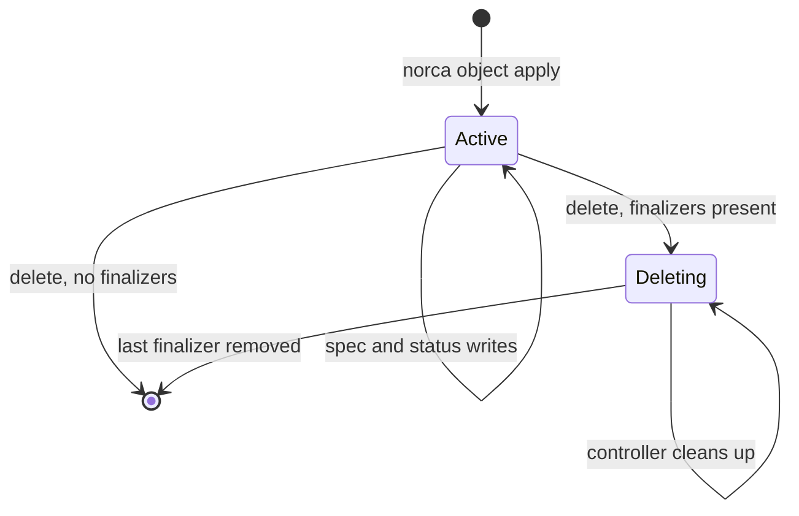
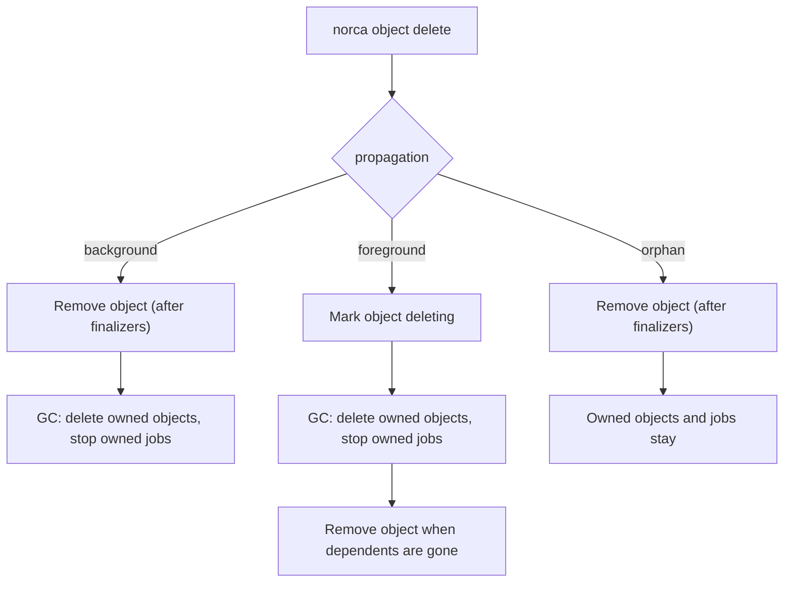

The servers manage the lifecycle of custom objects, so that controllers can
clean up reliably even when they are restarted, and so that the jobs a
controller creates disappear with the object that owns them.

## Finalizers

A finalizer is a name on an object (for example
`norca.io/loadbalancer-cleanup`) that blocks its deletion. Deleting an object
with finalizers only marks it for deletion: the server records the deletion
time and mode, and the object stays visible (`norca object get` shows
`Deleting`). The controller sees the change, cleans up (removes the cloud load
balancer, stops a backup job), and removes its finalizer. When the last
finalizer is gone, the object disappears.



- Adding a finalizer needs the `manage-finalizers` capability, through the
  finalizers endpoint or by listing it in `finalizers` on an apply.
- Finalizers can't be added to an object that is being deleted (`409`).
- Finalizers are removed only through the finalizers endpoint (the SDK's
  `RemoveFinalizer`); an apply never removes them.
- An object has at most 32 finalizers. Names start and end with a letter or
  digit and may contain `.`, `_`, `/` and `-`.

Because the finalizer is stored on the object, cleanup also happens when the
controller was down at the time of the deletion: it finds the object marked
when it starts again.

## Owners and garbage collection

Objects and jobs can belong to a custom object:

- **Jobs** carry the owner in their meta, under reserved keys:
  `norca.owner = "<namespace>/crd/<group with dashes>/<Kind>/<name>"` and
  `norca.owner.kind = "<group>/<Kind>"`. The SDK sets them with
  `controller.SetOwner(job, obj)`; the web UI links such jobs to their owner.
- **Objects** list their owners in `Owners` (in a file: `owner { kind, name,
  namespace }` blocks; the SDK's `SetObjectOwner`). An owner's namespace
  defaults to the object's namespace. `Job` and `Variable` owner kinds are
  stored but not acted on.

When an owner is deleted, a garbage collector on the leader deletes what it
owned, according to the deletion mode chosen on the delete
(`norca object delete -propagation`, `?propagation=`):

| Mode | Behavior |
| --- | --- |
| `background` (default) | The object is deleted at once (after its finalizers); its dependents are deleted afterwards. |
| `foreground` | The dependents are deleted first; the object disappears when they are gone and its finalizers are removed. |
| `orphan` | The dependents stay. Use it when you replace an operator and the running workloads must survive. |



- Owned jobs are stopped, not purged; the job garbage collector purges them
  later.
- An object is deleted only when all its custom object owners are gone.
- Owned objects are deleted like a `background` deletion, so their own
  finalizers and dependents are honored.
- While an object with the same kind, namespace and name exists again (it was
  re-created or restored from a backup), the dependents of the deleted owner are
  not collected: the new owner adopts them. The SDK's `AdoptJobs` finds such
  jobs instead of creating duplicates.
- A record of each deleted owner (a tombstone) is kept for a retention period
  (5 minutes) after the deletion, and until its dependents are gone, so
  dependents that a controller created while the owner was being deleted are
  collected too.

## Event log

Every object has a short event log, separate from the cluster event stream,
which records what the controllers did:

```shell
$ norca object events norca.io/LoadBalancer web
```

The listing shows, oldest first, when each event was last seen, its type,
reason, count, reporter and message.

- Each event has a `Type` (`Normal` or `Warning`), a CamelCase `Reason`, a
  `Message` (at most 1024 characters) and optional `Meta`. The server sets the
  `Reporter` (the writer's identity) and the times.
- A repetition of the newest event (same type, reason, message and reporter)
  increases its `Count` instead of adding a new entry. The SDK's
  `EventRecorder` also suppresses repetitions on the client side.
- The log keeps the last 20 events. A write adds at most 10 events and needs the
  `write-events` capability.
- The server writes events itself, for example `Scaled` when the scale changes
  and `Migrated` or `MigrationFailed` during a
  [schema migration](/docs/features/operator-framework/ecosystem#schema-versions-and-migrations).
- New entries are published on the event stream as `CustomObjectEventRecorded`.

## Protection of managed jobs and objects

A controller marks the jobs it manages with the reserved job meta key
`norca.managed-by` (the SDK's `SetManagedBy(job, controller.ManagedByFromEnv())`
sets `workload:<namespace>/<job>` of the controller itself). When the value
names an identity, only that identity can update, stop, revert or scale the
job; other writers get `403`:

| Value | Who may change the job |
| --- | --- |
| `workload:<namespace>/<job>[/<task>]` | the workload identity of that job (task) |
| `role:<name>`, `policy:<name>` | tokens with the ACL role or policy |
| `token:<accessor ID>` | the token |

- Management tokens and clusters without ACLs are not restricted, so the garbage
  collector (which uses the leader's token) and administrators can always act.
- A group with its own `scaling` block can still be scaled by others: its count
  belongs to the autoscaler. The SDK's `PreserveScaledCounts` keeps the count of
  such groups when the controller registers a new version of the job.
- Values that are not identities are not enforced.

The `managed_by` field of objects works the same way for the spec of an object
(see [Who manages the spec](/docs/features/operator-framework/object-kinds#who-manages-the-spec)).

## Scale subresource

A kind with a `scale` block exposes the replica count of its objects as a
subresource. Reading it needs `read`, setting it needs `write`; the `managed_by`
identity of the object is not enforced, so an autoscaler can scale an object
whose spec is managed by a GitOps tool.

```shell
$ norca object scale db.example.com/PostgresCluster/billing
$ norca object scale -message "more read load" db.example.com/PostgresCluster/billing 5
```

The new count is written to the spec path, validated like any spec change
(schema and CEL rules, with `request.operation = "scale"`), increases the
generation, and is recorded as a `Scaled` event with the new and previous count.

The [autoscaler](/docs/features/autoscaler) can target an object instead of a
task group, with a `custom-object` target in the policy of the group whose load
it measures:

```hcl
scaling {
  min = 1
  max = 7

  policy {
    target "custom-object" {
      kind      = "db.example.com/PostgresCluster"
      name      = "billing"
      namespace = "prod" # defaults to the job's namespace
    }

    check "cpu" {
      # ...
    }
  }
}
```

The decision is written to the object's scale, and the controller derives the
group count from the object. The cooldown is derived from the `Scaled` events of
the object's event log, so it survives leader changes.

## Reference

- [`norca object delete`](/docs/commands/object/delete),
  [`norca object events`](/docs/commands/object/events),
  [`norca object scale`](/docs/commands/object/scale)
- [Objects HTTP API: finalizers, events and scale](/docs/api/objects#update-the-finalizers)
