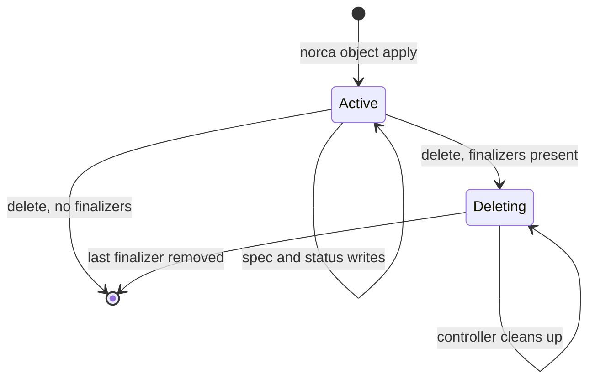
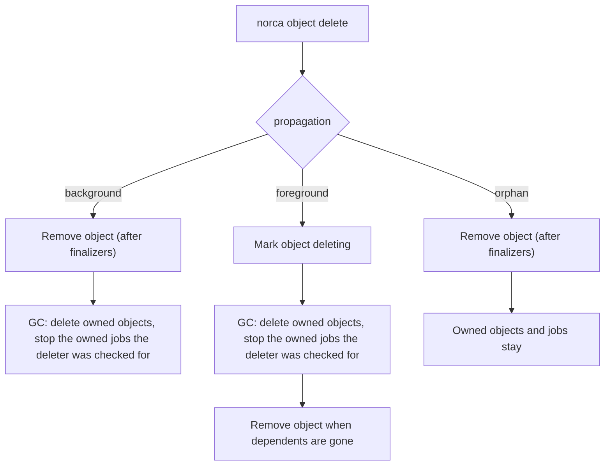

The servers manage the lifecycle of custom objects, so that controllers can
clean up reliably even when they are restarted, and so that the jobs a
controller creates disappear with the object that owns them.

## Finalizers

A finalizer is a name on an object (for example
`norca.io/loadbalancer-cleanup`) that blocks its deletion. Deleting an object
with finalizers only marks it for deletion: the server records the deletion
time and mode, and the object stays visible (`norca object get` shows
`Deleting`). The controller sees the change, cleans up (removes the cloud load
balancer, stops a backup job), and removes its finalizer. When the last
finalizer is gone, the object disappears.



- Adding a finalizer needs the `manage-finalizers` capability, through the
  finalizers endpoint or by listing it in `finalizers` on an apply.
- Finalizers can't be added to an object that is being deleted (`409`).
- Finalizers are removed only through the finalizers endpoint (the SDK's
  `RemoveFinalizer`); an apply never removes them.
- **The finalizer `norca.io/operators` belongs to the servers.** The built-in
  operators of the servers put it on and take it off (tenants, volume
  requests, snapshot schedules). On the finalizers endpoint only a management
  token may add or remove it; any other token gets `403`, also with
  `manage-finalizers`. An apply from any other token leaves it out of the
  finalizers it adds.
- An object has at most 32 finalizers. Names start and end with a letter or
  digit and may contain `.`, `_`, `/` and `-`.

Because the finalizer is stored on the object, **cleanup also happens when the
controller was down at the time of the deletion**: it finds the object marked
when it starts again.

## Owners and garbage collection

Objects and jobs can belong to a custom object:

- **Jobs** carry the owner in their meta, under reserved keys:
  `norca.owner = "<namespace>/crd/<path group>/<Kind>/<name>"` (the group with
  its dashes doubled and its dots replaced with dashes) and
  `norca.owner.kind = "<group>/<Kind>"`. The SDK sets them with
  `controller.SetOwner(job, obj)`; the web UI links such jobs to their owner.
- **Objects** list their owners in `Owners` (in a file: `owner { kind, name,
  namespace }` blocks; the SDK's `SetObjectOwner`). An owner's namespace
  defaults to the object's namespace. `Job` and `Variable` owner kinds are
  stored but not acted on.

**Naming an owner takes a right on the owner.** A dependent holds back the
foreground deletion of its owner, and the deletion of an owner asks its
caller for rights on the dependents (see below). So whoever makes a custom
object the owner of an object or of a job needs the `write` or
`manage-finalizers` capability on the kind of the owner in the namespace of
the owner (the `object` rules of `namespace "*"` for a cluster-scoped
owner). **It holds for every owner**: one in another namespace, a
cluster-scoped one, and one in the namespace of the dependent, of another
kind or of its own. Without the right the write is refused with `403`:

```plaintext
owner db.example.com/PostgresCluster "billing" in namespace "prod": naming an owner requires the write or manage-finalizers capability on the owner
```

For a cluster-scoped owner the message says `cluster-scoped` in the place of
`in namespace "<namespace>"`. The owner need not exist, and the answer is
the same whether it exists or not. Management tokens and clusters without
ACLs are not restricted.

- **On an object** the right is asked for a new owner. A reference the stored
  object already has (the same kind, namespace and name) is kept without it.
  The stored reference, and the one in the reply, carries the `ID` of an
  owner that exists only when the writer may read the owner (`read` on its
  kind in its namespace).
- **On a job** the right is asked when a registration brings a new mark: a
  new job, or a `norca.owner` or `norca.owner.kind` that differs from the
  stored job's (a revert to a version with another mark included). A
  registration that keeps the mark of the stored job is not checked again, so
  whoever may update the job still can, and removing the mark takes no right
  on the owner. A `norca.owner` that is not of the form above, or a
  `norca.owner.kind` that is not the kind the value names, is refused with
  `400`.
- **A dispatch can't set the reserved meta keys** `norca.owner`,
  `norca.owner.kind` and `norca.managed-by` (`400`), and a
  [parameterized job](/docs/job-specification/parameterized) that lists one
  of them in `meta_required` or `meta_optional` is not accepted. The children
  of a parameterized or periodic job inherit the mark of their parent.

When an owner is deleted, a garbage collector on the leader deletes what it
owned, according to the deletion mode chosen on the delete
(`norca object delete -propagation`, `?propagation=`):

| Mode | Behavior |
| --- | --- |
| `background` (default) | The object is deleted at once (after its finalizers); its dependents are deleted afterwards. |
| `foreground` | The dependents are deleted first; the object disappears when they are gone and its finalizers are removed. |
| `orphan` | The dependents stay. Use it when you replace an operator and the running workloads must survive. The object leaves a tombstone too, which only keeps its event log. |



- **Owned jobs are stopped, not purged**; the job garbage collector purges them
  later.
- An object is deleted only when all its custom object owners are gone.
- Owned objects are deleted like a `background` deletion, so their own
  finalizers and dependents are honored.
- While an object with the same kind, namespace and name exists again (it was
  re-created or restored from a backup), the dependents of the deleted owner are
  not collected: the new owner adopts them. The SDK's `AdoptJobs` finds such
  jobs instead of creating duplicates.
- A record of each deleted owner (a tombstone) is kept for a retention period
  after the deletion (the server option
  [`object_tombstone_gc_threshold`](/docs/configuration/server#object_tombstone_gc_threshold),
  5 minutes by default), and until its dependents are gone, so objects that a
  controller created while the owner was being deleted are collected too.
  Jobs attached in that time are not stopped, see below. The tombstone of an
  `orphan` deletion keeps only the event log; no dependent is collected for it.

**What the deleter needs.** The collector acts with the rights of the
servers, so a `background` or `foreground` deletion asks its caller for the
rights the dependents need, for everything that depends on the object
directly or through other objects:

- `submit-job` in the namespace of each running job;
- `csi-write-volume` in the namespace and read on plugins for each
  [volume request](/docs/features/csi-volume-requests) that does not retain
  its volume and each
  [snapshot schedule](/docs/features/volume-snapshot-schedules) with
  `delete_snapshots`, also when the dependent has another owner that is
  alive.

Without them the deletion is refused with `403` and nothing is marked. An
`orphan` deletion takes no dependent and needs only the right to delete the
object.

- **A job marked `norca.managed-by`** is stopped this way by anyone who may
  delete its owner and has `submit-job` in its namespace: deleting the
  owner is the way others are meant to take.
- **Only the jobs that were dependents when the deletion was asked for are
  stopped.** A job attached to the owner afterwards, or whose owner the
  servers deleted themselves, keeps running: the leader logs a warning, and
  an owner that is still being deleted in the foreground gets the event
  `DependentKept`.
- **A volume request or snapshot schedule that would destroy storage** and
  was written, or made destructive, after the deletion was asked for, or
  whose owner the servers deleted themselves, is not deleted: it stays, its
  reference to the deleted owner is removed, and it gets the warning event
  `DependentKept`.

**Letting go of the dependents.** Deleting an object again with
`-propagation orphan` (`?propagation=orphan`), while it is marked for
deletion in the `background` or `foreground` mode, turns that deletion into
an `orphan` one. It takes what a first `orphan` deletion takes: the right to
delete the object, and none on the dependents. Use it when a `foreground`
deletion waits for a dependent whose finalizer nobody removes.

- The collector takes no further dependent of the object.
- The object no longer waits for its dependents: it goes when its own
  finalizers are removed, at once if it has none, and leaves the tombstone of
  an `orphan` deletion.
- The dependents that were not deleted yet stay as they are, and keep their
  reference to the owner.
- **What was done already is not undone**: a deleted dependent is gone, a
  dependent that was marked for deletion stays marked and goes when its
  finalizers are removed, and a stopped job stays stopped. A pass of the
  collector that runs at that moment may still take the dependents it had
  read.

Every other repeated delete of an object that is being deleted changes
nothing and returns the object as it is: an `orphan` deletion is not turned
into another mode, nor a `background` deletion into a `foreground` one or
back.

## Event log

Every object has a short event log, separate from the cluster event stream,
which records what the controllers did:

```shell
$ norca object events norca.io/LoadBalancer web
```

The listing shows, oldest first, when each event was last seen, its type,
reason, count, reporter and message.

- Each event has a `Type` (`Normal` or `Warning`), a CamelCase `Reason`, a
  `Message` (at most 1024 characters) and optional `Meta`. The server sets the
  `Reporter` (the writer's identity) and the times.
- A repetition of the newest event (same type, reason, message and reporter)
  increases its `Count` instead of adding a new entry. The SDK's
  `EventRecorder` also suppresses repetitions on the client side.
- The log keeps the last 20 events. A write adds at most 10 events and needs the
  `write-events` capability. The reason `Scaled` belongs to the scale
  subresource, and the meta keys `nomad_autoscaler.engine` and
  `nomad_autoscaler.suspended_until` to the built-in autoscaler: a write with
  them is refused with `400`.
- The server writes events itself, for example `Scaled` when the scale changes
  and `Migrated` or `MigrationFailed` during a
  [schema migration](/docs/features/operator-framework/ecosystem#schema-versions-and-migrations).
- New entries are published on the event stream as `CustomObjectEventRecorded`.
- **The event log of a deleted object stays with its tombstone**, for
  [`object_tombstone_gc_threshold`](/docs/configuration/server#object_tombstone_gc_threshold)
  (5 minutes by default), in every deletion mode, and is listed by name with
  the same right as before. The servers can still add their own events to it
  meanwhile. When an object of the name exists again, its own log is shown,
  never the one of the deleted object.

## Protection of managed jobs and objects

A controller marks the jobs it manages with the reserved job meta key
`norca.managed-by` (the SDK's `SetManagedBy(job, controller.ManagedByFromEnv())`
sets `workload:<namespace>/<job>` of the controller itself). When the value
names an identity, only that identity can update, stop, revert or scale the
job; other writers get `403`:

| Value | Who may change the job |
| --- | --- |
| `workload:<namespace>/<job>[/<task>]` | the workload identity of that job (task) |
| `role:<name>`, `policy:<name>` | tokens with the ACL role or policy |
| `token:<accessor ID>` | the token |

- **A job ID is one segment of the value**: a `%` or a `/` in it is written
  `%25` or `%2F` (`ManagedByFromEnv` does it), so the job `ctrl/x` is not an
  identity of the job `ctrl`. For the same reason the child jobs of a periodic
  or parameterized job (`<parent>/periodic-...`, `<parent>/dispatch-...`) do
  not match a value that names the parent.
- Management tokens and clusters without ACLs are not restricted, so the garbage
  collector (which uses the leader's token) and administrators can always act.
- A group with its own `scaling` block can still be scaled by others: its count
  belongs to the autoscaler. The SDK's `PreserveScaledCounts` keeps the count of
  such groups when the controller registers a new version of the job.
- Values that are not identities are not enforced.

The `managed_by` field of objects works the same way for the spec of an object
(see [Who manages the spec](/docs/features/operator-framework/object-kinds#who-manages-the-spec)).

## Scale subresource

A kind with a `scale` block exposes the replica count of its objects as a
subresource. Reading it needs `read`, setting it needs `write`; the `managed_by`
identity of the object is not enforced, so an autoscaler can scale an object
whose spec is managed by a GitOps tool.

```shell
$ norca object scale db.example.com/PostgresCluster/billing
$ norca object scale -message "more read load" db.example.com/PostgresCluster/billing 5
```

The new count is written to the spec path, validated like any spec change
(schema and CEL rules, with `request.operation = "scale"`), increases the
generation, and is recorded as a `Scaled` event with the new and previous count.

The [autoscaler](/docs/features/autoscaler) can target an object instead of a
task group, with a `custom-object` target in the policy of the group whose load
it measures:

```hcl
scaling {
  min = 1
  max = 7

  policy {
    target "custom-object" {
      kind      = "db.example.com/PostgresCluster"
      name      = "billing"
      namespace = "prod" # defaults to the job's namespace
    }

    check "cpu" {
      # ...
    }
  }
}
```

The decision is written to the object's scale, and the controller derives the
group count from the object. The cooldown is derived from the `Scaled` events of
the object's event log, so it survives leader changes.

## Reference

- [`norca object delete`](/docs/commands/object/delete),
  [`norca object events`](/docs/commands/object/events),
  [`norca object scale`](/docs/commands/object/scale)
- [Objects HTTP API: finalizers, events and scale](/docs/api/objects#update-the-finalizers)
