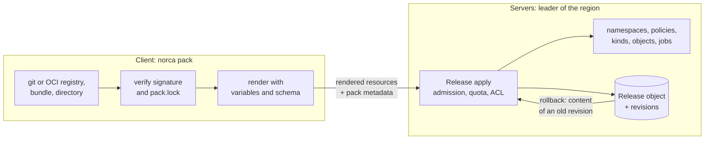

## What and why

Running more than one job by hand quickly becomes repetitive: the same job specification is copied
between environments with small changes, the ACL policy, the namespace and the admission policy that
belong to an application are applied with separate commands, and nobody can say afterwards which
version of what was installed, or roll it back. Norca solves this with a package manager that is
part of the `norca` binary.

The package manager is **Nomad Pack v0.4.2** (MPL 2.0), built in as the `norca pack` command tree.
There is no separate `nomad-pack` binary. The pack format stays the same (a directory with
`metadata.hcl`, `variables.hcl`, `templates/` and `outputs.tpl`, rendered with `[[ ]]` Go templates),
so existing packs keep working. Norca adds five things on top of it:

- **An extended package format.** Besides jobs, a pack can contain namespaces, quotas, ACL policies,
  Variables entries, object kinds, admission policies and custom objects, identified by the extension
  of the template file, and constraints, rules and an install form for its variables in
  `variables.hcl`. One pack can therefore install an application with its namespace and policies, or
  an operator with its object kind and controller.
- **Server-side releases.** `norca pack run` renders the pack on the client and sends the rendered
  resources to the servers, which apply them in a fixed order and record an immutable revision of a
  `packs.norca.io/Release` object. Releases can be upgraded atomically, rolled back, tested with hook
  jobs, checked for drift and uninstalled.
- **Registries and supply chain.** Packs come from git registries, from OCI registries (Harbor, Zot,
  GitHub Container Registry, ...) or from local directories. Packs in OCI registries can be signed
  with cosign compatible keys and verified against a per-registry trust policy, carried into
  air-gapped environments as offline bundles, and pinned with a `pack.lock` file. Admission policies
  can require signed packs in protected namespaces.
- **Cluster pack registries and the catalog.** The servers can keep pack registries too. The web UI
  lists their packs and installs or upgrades them from a form built from the pack's `variables.hcl`;
  the leader renders the pack and applies it as a release revision
  ([catalog and install form](/docs/features/packages/catalog)).
- **The Norca pack registry.** The public registry
  [`bacanoo-io/norca-registry`](https://github.com/bacanoo-io/norca-registry) holds the operations packs
  of a Norca cluster: NATS, the cross-region mTLS gateway, RustFS, PostgreSQL, Forgejo, OpenObserve,
  the OpenTelemetry Collector, an optional Consul and the reference operator pack.

## How it works

`norca pack` renders on the client: what the servers receive is the list of rendered resources
together with the pack's metadata (name, version, registry, OCI digest, signatures, requirements,
variables schemas). Packs of [cluster pack registries](/docs/features/packages/catalog) are rendered
by the leader instead, from its cache, for the installs of the web UI and the API.



1. The client resolves the pack: from the local cache of a git registry, from an OCI registry
   (downloaded on first use and verified against the trust policy), from an offline bundle imported
   into the cache, or from a directory.
2. It checks `pack.lock` (if present), checks the variable values against the pack's constraints
   and rules (and its JSON Schema, if it has one) and renders the templates.
3. The servers check the pack's requirements and the admission policies (including signature checks
   for releases), apply every resource through its normal endpoint with the caller's token, wait for
   the deployments, run the hooks and record a new revision of the release.
4. `norca pack rollback` applies the content of a kept revision as a new revision; `norca pack diff
   --live` compares the live resources with the deployed revision; `norca pack uninstall` deletes
   the resources in reverse order.

Against servers without the release API, or with `--client-side`, `norca pack` deploys the jobs from
the client exactly as Nomad Pack does.

## Example

```shell
# Add the Norca pack registry, pinned to a release tag.
norca pack registry add norca https://github.com/bacanoo-io/norca-registry --ref=v0.1.0

# Inspect, render and plan a pack (at the pinned tag), then install it as the release "rustfs".
norca pack info   rustfs --registry=norca
norca pack render rustfs --registry=norca --var='buckets=["norca-backup"]'
norca pack plan   rustfs --registry=norca --var='buckets=["norca-backup"]'
norca pack run    rustfs --registry=norca --var='buckets=["norca-backup"]'

# Revisions, rollback and removal.
norca pack history rustfs
norca pack rollback rustfs 1
norca pack uninstall rustfs
```

Without `--ref` the pack commands use the ref the registry was added with, and without `--name` the
release is named after the pack (see [refs and deployment names](/docs/commands/pack#refs-and-deployment-names)).

## Pages in this section


  
  
  
  
  
  
  


## CLI and API

| Task | Command or endpoint |
| --- | --- |
| Manage registries | [`norca pack registry add`](/docs/commands/pack/registry/add), [`list`](/docs/commands/pack/registry/list), [`update`](/docs/commands/pack/registry/update), [`delete`](/docs/commands/pack/registry/delete) |
| Inspect and render packs | [`norca pack list`](/docs/commands/pack/list), [`info`](/docs/commands/pack/info), [`render`](/docs/commands/pack/render), [`generate var-file`](/docs/commands/pack/generate/var-file) |
| Install and change releases | [`norca pack plan`](/docs/commands/pack/plan), [`run`](/docs/commands/pack/run), [`upgrade`](/docs/commands/pack/upgrade), [`rollback`](/docs/commands/pack/rollback) |
| Observe releases | [`norca pack status`](/docs/commands/pack/status), [`history`](/docs/commands/pack/history), [`diff`](/docs/commands/pack/diff), [`test`](/docs/commands/pack/test) |
| Remove | [`norca pack uninstall`](/docs/commands/pack/uninstall), [`destroy`](/docs/commands/pack/destroy), [`stop`](/docs/commands/pack/stop) |
| Supply chain | [`norca pack push`](/docs/commands/pack/push), [`sign`](/docs/commands/pack/sign), [`verify`](/docs/commands/pack/verify), [`key generate`](/docs/commands/pack/key/generate), [`bundle`](/docs/commands/pack/bundle), [`deps vendor`](/docs/commands/pack/deps/vendor) |
| Authoring | [`norca pack generate`](/docs/commands/pack/generate), [`fmt`](/docs/commands/pack/fmt) |
| Cluster registries, catalog, server-side installs | Web UI **Packages**; [Pack registries HTTP API](/docs/api/pack-registries) (`/v1/pack-registries`, `/v1/packs`, `/v1/release/:name/deploy-pack`) |
| HTTP API | [Releases HTTP API](/docs/api/releases) (`/v1/releases`, `/v1/release/:name`) |

The complete command list is in the [`norca pack` reference](/docs/commands/pack).

## Limits and status

- Available: the built-in Nomad Pack, the extended package format, server-side releases with hooks,
  tests, drift detection and multi-region installs, OCI registries, signing, offline bundles,
  `pack.lock`, variable constraints, rules and schemas, signature enforcement in admission policies,
  cluster pack registries with the catalog and install form of the web UI.
- `norca pack` renders on the client; the servers render only the packs of cluster pack registries.
- Releases installed with the CLI from a local directory or a bundle are upgraded with the CLI; those
  from a git or OCI registry are upgraded in the web UI once the cluster has a registry of its source.
- `*.netpol.hcl.tpl` (network rules) is reserved and rejected by the release apply for now.
- Signatures are key-based cosign signatures; transparency log (Rekor) entries and keyless
  (Sigstore identity) signing are not supported.
- The [web UI](/docs/features/web-ui) lists the releases under **Packages** (pack, revision, phase,
  drift, signature), shows resources, revisions and events, and can roll back, run the tests, check
  drift and uninstall. Its **Catalog** and **Registries** tabs install packs of cluster registries,
  and their releases get **Upgrade**, as do releases installed with the CLI from a registry of the
  cluster (**Add its registry to upgrade** adds a missing one); for packs from a local directory,
  changed values become an `upgrade` command to run with the CLI.

## Design

The design and its rationale are in the
[package management plan](/docs/design/package-management-plan), in particular
[target architecture](/docs/design/package-management-plan#target-architecture),
[extended package format](/docs/design/package-management-plan#extended-package-format) and
[registries and supply chain](/docs/design/package-management-plan#registries-and-supply-chain).
