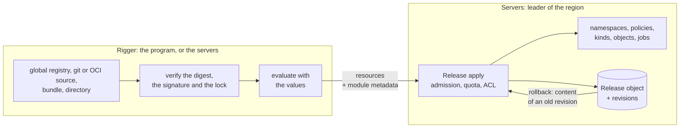

## What and why

Running more than one job by hand quickly becomes repetitive: the same job specification is copied
between environments with small changes, the ACL policy, the namespace and the admission policy that
belong to an application are applied with separate commands, and nobody can say afterwards which
version of what was installed, or roll it back. Norca solves this with a package manager that is
part of the `norca` binary.

The package manager is **Rigger**, the `norca rigger` command tree; the standalone `rigger` program
has the same commands. It installs:

- **Modules.** A module is a package written in typed HCL: a directory with its variables, its jobs
  and other resources (namespaces, quotas, ACL policies, Variables, object kinds, admission policies,
  external services and custom objects), and its tests. One module can therefore install an
  application with its namespace and policies, or an operator with its object kind and controller.
- **Stacks.** A stack names the modules of a region with their values, wires them through their
  outputs, and pins their versions in a lock file.
- **Releases.** Every install of a module is a release: the servers apply its resources in a fixed
  order and record an immutable revision of a `rigger.norca.io/Release` object. Releases can be
  upgraded atomically, rolled back, tested with hook jobs, checked for drift and uninstalled.
- **Registries and supply chain.** Modules come from the global registry, from git registries, from
  OCI registries or from directories. They are versioned by tags, signed with keys that a stack
  trusts, and carried into a cluster without a network as bundles. Admission policies can require
  signed releases in protected namespaces.
- **Registries of the cluster and the catalog.** The servers keep registries too. The web UI lists
  their modules and stacks and installs them from a form built from their variables; the servers
  fetch, verify and evaluate the module themselves
  ([Rigger catalog](/docs/features/packages/rigger-catalog)).
- **The Norca registry.** The public repository
  [`bacanoo-io/norca-registry`](https://github.com/bacanoo-io/norca-registry) holds the operations
  modules of a Norca cluster: NATS, the cross-region mTLS gateway, RustFS, PostgreSQL, Forgejo,
  OpenObserve, the OpenTelemetry Collector, Traefik, an optional Consul and the operator modules. The
  global registry lists them as `norca/<name>`.

> [!NOTE]
> This page is an overview. **The full documentation of Rigger is its own section,
> [Rigger](/docs/rigger)**: how the parts fit together, writing a module and a stack, the language,
> versions and lock files, the lifecycle of releases, registries, publishing and signing,
> configuration, permissions and troubleshooting. The command reference is
> [`norca rigger`](/docs/commands/rigger).

## How it works

Somebody evaluates the module: **the `rigger` program on the machine it runs on, or the servers.**
Either way the result is a list of resources with the metadata of the module (name, version, source,
commit, digest, signatures, requirements), applied through the
[release API](/docs/api/releases) with the caller's token.



1. Rigger resolves the module: from a directory, from a git or OCI source, from the global registry
   (which lists the commit, the tree digest and the signatures of each version), or from a bundle.
2. It checks the lock file of the stack (if there is one) and the signatures the stack trusts, checks
   the values against the `validation` and `rule` blocks of the module, and evaluates it.
3. The servers check the requirements of the module and the admission policies (including signature
   checks for releases), apply every resource through its normal endpoint with the caller's token,
   wait for the deployments, run the hooks and record a new revision of the release.
4. `norca rigger release rollback` applies the content of a kept revision as a new revision;
   `norca rigger release status` shows what drifted from the deployed revision;
   `norca rigger release uninstall` deletes the resources in reverse order.

With `-server` (or `RIGGER_SERVER=1`) the commands send the module or the stack to the servers, which
fetch and evaluate; an apply of a stack then runs on the leader as an operation with its own log. The
install form of the web UI and the [install API](/docs/api/rigger-install) work the same way. **The
servers fetch only from registries they have synced, and nothing syncs on its own.**

## Example

One module of a directory:

```shell
norca rigger install ./example/modules/test-app -name test-app -f test-app.hcl
norca rigger release status test-app
```

A module of the Norca registry, installed by the servers from the global registry:

```shell
norca rigger registry sync global
norca operator api -X PUT /v1/rigger/install <<'EOF'
{"Release": "rustfs", "Registry": "global", "Module": "norca/rustfs", "Version": "~> 0.2",
 "ValuesJSON": {"buckets": ["norca-backup"], "console_enabled": true}}
EOF
```

Several modules as a stack:

```hcl {filename="stack.hcl"}
rigger {
  name = "platform"
}

module "bus" {
  source  = "norca/nats"
  version = "~> 2.0"
}
```

```shell
norca rigger stack sync .       # resolve the versions, fetch and verify the modules, write rigger.lock.hcl
norca rigger stack plan .       # what an apply would change
norca rigger stack apply .      # install the releases of the stack

# Revisions, rollback and removal of one release.
norca rigger release history bus
norca rigger release rollback bus 1
norca rigger release uninstall bus
```

The [deployment examples](/docs/getting-started/examples#the-module-registry) show each of these
against a real cluster.

## Pages in this section


  
  
  
  
  
  


## CLI and API

| Task | Command or endpoint |
| --- | --- |
| Install one module, manage releases | [`norca rigger install`](/docs/commands/rigger/install), [`norca rigger release`](/docs/commands/rigger/release) (`list`, `status`, `history`, `rollback`, `uninstall`) |
| Stacks | [`norca rigger stack`](/docs/commands/rigger/stack) (`sync`, `validate`, `plan`, `apply`, `status`, `destroy`, `publish`), [`norca rigger operation`](/docs/commands/rigger/operation) |
| Registries of the cluster | [`norca rigger registry`](/docs/commands/rigger/registry) (`list`, `status`, `sync`, `search`, `select`, `unselect`) |
| Authoring | [`norca rigger module`](/docs/commands/rigger/module) (`validate`, `test`, `render`, `publish`), [`norca rigger fmt`](/docs/commands/rigger/fmt) |
| Supply chain | [`norca rigger key`](/docs/commands/rigger/key), [`norca rigger bundle`](/docs/commands/rigger/bundle), [`norca rigger login`](/docs/commands/rigger/login), [`norca rigger index`](/docs/commands/rigger/registry-index) |
| Installs, stacks and registries on the servers | Web UI **Packages**; [Rigger Installs](/docs/api/rigger-install), [Rigger Stacks](/docs/api/rigger-stacks) and [Rigger Registries](/docs/api/rigger-registries) HTTP APIs |
| Releases | [Releases HTTP API](/docs/api/releases) (`/v1/releases`, `/v1/release/:name`) |
| Server settings | [`rigger` block](/docs/configuration/rigger) of the server |

The complete command list is in the [`norca rigger` reference](/docs/commands/rigger).

## Limits and status

- **A registry is synced only when someone asks for it** (`norca rigger registry sync`, **Sync** in
  the web UI). A newer version is not offered until the next sync.
- **`norca rigger install` takes a directory or a source.** With `--server` the servers install a
  module of a registry of the cluster they synced, or a built-in module.
- **A release is installed in one region.** For several regions, sync the registry and install in
  each.
- The servers fetch only from registered sources and bundles, and read no `oci://` and no directory
  source; the `rigger` program does, on the machine it runs on.
- Signatures are key-based; keyless signing is not supported.
- The [web UI](/docs/features/web-ui) shows Rigger under **Packages**: the releases (module,
  revision, phase, drift, signature) with their resources, revisions, values and events, where a
  release is rolled back, tested, checked for drift and uninstalled, and the **Stacks**, **Catalog**
  and **Registries** tabs ([Rigger catalog](/docs/features/packages/rigger-catalog)).
