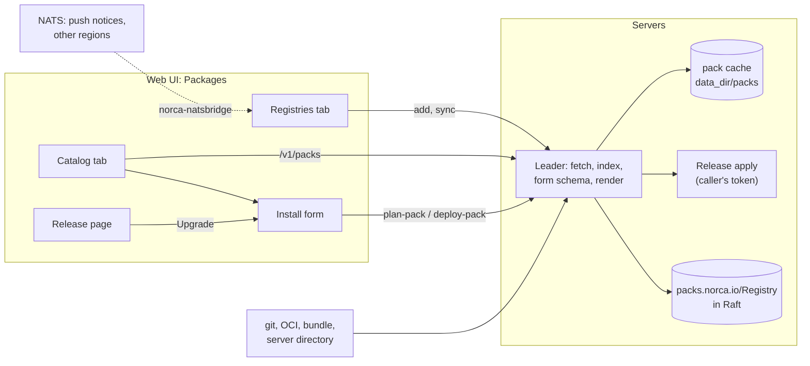

## What and why

`norca pack registry add` caches a registry on one workstation, and `norca pack run` renders packs
there. That suits operators with a terminal, but nobody else can see which packs are available, and
installing one needs the CLI, the registry cache and the right variable file.

**Cluster pack registries** are kept by the servers instead: registries of the kind
`packs.norca.io/Registry` that the leader fetches and indexes. The web UI lists their packs in a
**catalog**, and installs and upgrades them from an **install form** built from the pack's own
`variables.hcl`: tabs, groups, fields with the right widgets, conditional fields, validation and
secrets. The leader renders the pack and applies it as an ordinary
[release](/docs/features/packages/releases) revision, so rollbacks, history, drift checks and tests
work as for releases installed with the CLI.

## How it works



1. A registry is added in the UI (**Packages → Registries**) or with the API. The leader fetches it into
   its pack cache, verifies the packs against the trusted keys of the registry and records the packs it
   found in the status of the registry. It syncs again on request, on the registry's sync interval and,
   with the [NATS bridge](/docs/features/nats-bridge#pack-registry-syncs), when packs are pushed.
2. **Packages → Catalog** lists the packs of all registries of the region: the newest version, the
   category, whether the cluster can run it (the pack's `requires` block) and whether it is signed.
3. **Install** opens the form of the pack. The leader builds it from `variables.hcl` and `metadata.hcl`
   ([the install form](#the-install-form)). **Plan** renders the pack on the leader and shows the
   changes; **Install** applies it. **Atomic** below the form is the
   [atomic mode](/docs/features/packages/releases#atomic-mode-and-production-namespaces) of this
   install or upgrade: the namespace default (shown with its value, from the namespace meta
   `pack.atomic` or `environment`), or on or off for this operation (`--atomic` in the CLI command).
4. Releases installed from a cluster registry get **Upgrade** on their page: the same form with the
   values of the deployed revision, and a version select to move to another pack version. Releases
   installed with the CLI get it too when the cluster has a registry of the same source
   ([CLI installs](#cli-installs)).

All writes, pack details and renders run on the leader, which keeps the cache; the other servers and
the client agents forward them.

## Example

Add the [Norca pack registry](/docs/features/packages/registry) and the built-in packs as cluster
registries, then install a pack, with the API (the UI does the same):

```shell
curl -X POST "$NORCA_ADDR/v1/pack-registry" -H "X-Nomad-Token: $NORCA_TOKEN" -d '{
  "Name": "norca",
  "Spec": {
    "type": "git",
    "source": "https://github.com/bacanoo-io/norca-registry",
    "defaultRef": "v0.1.0",
    "syncInterval": "6h"
  }
}'
curl -X POST "$NORCA_ADDR/v1/pack-registry" -H "X-Nomad-Token: $NORCA_TOKEN" \
  -d '{"Name": "builtin", "Spec": {"type": "dir", "source": "builtin"}}'

# The catalog, and the form schema of one pack.
curl "$NORCA_ADDR/v1/packs" -H "X-Nomad-Token: $NORCA_TOKEN"
curl "$NORCA_ADDR/v1/pack/builtin/redis" -H "X-Nomad-Token: $NORCA_TOKEN"

# Plan, then install the release "cache" in the namespace "apps".
body='{"Registry": "builtin", "Pack": "redis",
       "Values": {"mode": "replica", "count": 2, "auth_enabled": true},
       "Secrets": [{"Path": "nomad/jobs/redis", "Items": {"password": "s3cret-value"}}]}'
curl -X POST "$NORCA_ADDR/v1/release/cache/plan-pack?namespace=apps" -H "X-Nomad-Token: $NORCA_TOKEN" -d "$body"
curl -X POST "$NORCA_ADDR/v1/release/cache/deploy-pack?namespace=apps" -H "X-Nomad-Token: $NORCA_TOKEN" -d "$body"
```

The release is an ordinary release: `norca pack status cache -namespace=apps`, `history`, `rollback`
and `uninstall` work on it.

## Registries

| Field | Meaning |
| --- | --- |
| `spec.type` | `git`, `oci`, `dir` (a directory on the servers; the source `builtin` is the packs that ship with Norca), `bundle` (an [offline bundle](/docs/features/packages/supply-chain) on the servers) or `uploads` ([uploaded packs](#uploaded-packs)) |
| `spec.source` | A git URL, `oci://host/repository`, a server path, or `builtin` |
| `spec.defaultRef` | The tag or branch to fetch (`latest`) |
| `spec.syncInterval` | Sync periodically, for example `15m` or `24h` (at least `1m`); empty or `0s` syncs on request only |
| `spec.trustedKeys` | Public keys of the [signatures](/docs/features/packages/supply-chain); with keys, only packs signed by them can be installed |
| `spec.authSecret` | `{namespace, path}` of a Variable with the credentials of a private git or OCI source ([private registries](#private-registries)) |
| `status.phase`, `status.message` | `Ready` or `Error`, with the error of the last sync |
| `status.lastSyncedAt`, `status.lastGoodSyncAt` | The last sync attempt and the last successful one |
| `status.packs`, `status.packCount` | The packs found, one entry per version |

A sync replaces the cache only when it succeeded: after a failed sync the registry is `Error`, the
catalog keeps the packs of the last good sync, and they can still be installed. A server that becomes
leader fetches the registries again before it serves their packs (the status counts the successful
syncs in `syncGeneration`, and the cache records the generation it was fetched for).

### Private registries

Private git and OCI sources take their credentials from a [Variable](/docs/concepts/variables):

| Source | Items |
| --- | --- |
| OCI (`oci://`) | `username` and `password`, or `token` |
| git, `https://` | `password` or `token`, and optionally `username` (default `git`) |
| git, ssh (`ssh://`, `user@host:path`) | `ssh_private_key` and `known_hosts` (the host key of the server) |

```shell
norca var put -namespace=default registries/ghcr username=bot token=ghp_...
curl -X POST "$NORCA_ADDR/v1/pack-registry" -H "X-Nomad-Token: $NORCA_TOKEN" -d '{
  "Name": "internal",
  "Spec": {"type": "oci", "source": "oci://ghcr.io/example/packs", "authSecret": {"path": "registries/ghcr"}}
}'
```

- **Saving needs read access to the Variable**, on every save. Writing registries alone is not enough:
  otherwise someone could point the source of a registry at a host of their choosing and receive the
  credentials of others. A sync keeps the saved source and needs no access to the Variable.
- **Credentials go to the host of the source only.** OCI requests to other hosts (a token service on
  another host, redirects) carry no credentials, so registries whose token service is elsewhere, such
  as Docker Hub, can't be used with credentials. git gets the credentials only for the source URL and
  follows no redirects; ssh checks the host key against `known_hosts`. Git sources with credentials must
  be `https://` or ssh.
- The credentials never appear in a URL, the clone, the cache or the status of the registry, and the
  servers never use credentials of their own environment or docker configuration.

### Uploaded packs

Packs without a registry, such as packs installed with the CLI from a local directory, are uploaded to
a registry of the type `uploads` (by default the registry `uploads`, created by the first upload):
**Upload pack** on the Registries tab, or `PUT /v1/pack-upload` with the archive as the body. An upload
is at most 8 MiB and is one of:

- a bundle of [`norca pack bundle create`](/docs/commands/pack/bundle/create), verified with the trusted
  keys of the registry;
- a tar or tar.gz of a pack directory (`metadata.hcl` at its root) or of several pack directories. These
  carry no signatures: a registry with trusted keys takes bundles only. Every pack needs a version in
  its `metadata.hcl`.

```shell
tar czf web-app.tgz -C ./packs web-app
curl -X PUT "$NORCA_ADDR/v1/pack-upload?filename=web-app.tgz" -H "X-Nomad-Token: $NORCA_TOKEN" \
  --data-binary @web-app.tgz
```

The servers keep the archive in their state (in chunks, which backups include), so every leader can
rebuild the registry from it; a later upload of the same pack version replaces the earlier one. The
Registries tab lists the uploads of the registry with their packs, and removes them.

Syncs:

| When | How |
| --- | --- |
| The registry is saved | Before the request returns |
| On request | **Sync** in the UI, `POST /v1/pack-registry/:name/sync` |
| Periodically | The leader syncs registries whose `syncInterval` passed since the last attempt |
| Packs were pushed | A push notice on NATS, through `norca-natsbridge -sync-pushes` ([pack registry syncs](/docs/features/nats-bridge#pack-registry-syncs)) |
| Another region found new packs | `norca-natsbridge -sync-regions`, for registries of the same name and source |

## The install form

The form is declared in the pack, next to the variables; see
[form and constraints](/docs/features/packages/writing-packs#form-and-constraints) for the blocks. In
short:

- `metadata.hcl` declares the tabs (`ui { tab "id" { label, icon } }`);
- a variable's `ui` block places it (`tab`, `group`, `order`), names it (`label`) and picks its widget,
  units, presets, allowed values (`options`) and condition (`show_if`);
- a `secret` block makes it a secret input whose value goes to an item of a Variable of the pack;
- `validation` blocks and `rule` blocks state the constraints, which the form, the CLI and the servers
  check.

Without these blocks the form still works: the tab and group follow from the variable name, the widget
from the type, and variables without a default are required.

| Widget | For | Control |
| --- | --- | --- |
| `text` | strings | Input |
| `number` | numbers | Number input with its unit, bounds and preset buttons |
| `slider` | numbers with a validation `min` and `max` | Slider between the bounds, beside a number input with the unit; `step` sets its steps (default 1 for whole numbers, else a power of ten below a hundredth of the range), `presets` are marks and buttons |
| `switch` | booleans | Switch |
| `segmented`, `select` | allowed values | Radio group (up to three values) or select, with `option_labels` |
| `secret` | secret strings | Masked input |
| `code` | configuration text | Monospace text area |
| `tags`, `datacenter-multiselect` | lists | Comma or line separated values |
| `key-value` | maps | `key=value` lines |
| `object-list` | lists of objects (`list(object({...}))`, the default for them) | A table: a row per item, a column per attribute (a select for an attribute with `item_options`, a number input, a checkbox or text; lists and objects in a cell as JSON), rows added and removed, errors per cell. Lists whose items have no declared attributes stay JSON |
| (objects) | `object({...})` | A field per attribute |
| `namespace-select`, `region-select` | names | The namespaces and regions of the cluster |
| `node-pool-select`, `storage-volume-select` | names | Input |

The form sends only the values that differ from the pack's defaults, the required ones and those the
release already had; hidden fields (`show_if`) are not sent. A tab shows the number of its errors, and
Install opens the first tab with one. The **JSON** tab shows the values the install sends as JSON and
takes edits, which the other tabs show; a text that is not valid JSON or names a variable the pack
doesn't have blocks the install until it is fixed (Variable secrets are entered on their own tab). The
**CLI command** tab shows the equivalent `norca pack run`.

### Secrets

A variable with a `secret` block is a secret input: its value becomes an item of the Variable the block
names (a Variable the pack declares in a `*.var.hcl.tpl` template), applied by the servers but never
stored in the release and never rendered into the templates. On an upgrade, a secret left empty keeps
the stored item. This also holds for `norca pack run --var`.

Variables with secret-like names but without a `secret` block are recorded as `(redacted)` in the
release, but rendered into the templates like any variable; an upgrade from the form asks for them
again.

## CLI installs

`norca pack run` records in the release where the pack came from: `source`, the git URL or `oci://`
location of its registry, and `ref`, the tag or branch. The release page uses them:

- a cluster registry with the same source that has the pack: **Upgrade** opens the form with the values
  of the deployed revision, and the leader renders the pack from that registry;
- no such registry: **Add its registry to upgrade** adds one, filled in from the release (name, type,
  source, reference), and **Upgrade** follows. Add private sources on the Registries tab, with their
  credentials;
- a pack from a local directory or an offline bundle: **Upload the pack to upgrade** uploads it (a tar.gz
  of its directory, or the bundle) to the `uploads` registry, and **Upgrade** follows.

Sources compare without the scheme case, a trailing `/` or `.git`, and for OCI without the tag.
Releases installed before the source was recorded are upgraded with the CLI, or once with the CLI to
record it.

## Permissions

| What | ACL |
| --- | --- |
| List registries, the catalog, pack details | `object "packs.norca.io/Registry"` `read` in the `namespace "*"` block, or `read` or `write` on `packs.norca.io/Release` in any namespace |
| Add, change, sync, remove registries | `object "packs.norca.io/Registry"` `write` in the `namespace "*"` block |
| Plan and install | `write` on `packs.norca.io/Release` in the namespace of the release, and the permissions for its resources (applied with the caller's token) |

```hcl
namespace "*" {
  object "packs.norca.io/Registry" {
    capabilities = ["read", "write"]
  }
}
```

## CLI and API

| Task | Interface |
| --- | --- |
| Registries | `GET /v1/pack-registries`, `POST /v1/pack-registry`, `GET`, `PUT`, `DELETE /v1/pack-registry/:name`, `POST /v1/pack-registry/:name/sync` ([Pack registries HTTP API](/docs/api/pack-registries)) |
| Uploads | `PUT /v1/pack-upload`, `DELETE /v1/pack-upload/:registry/:digest` |
| Catalog and pack details | `GET /v1/packs`, `GET /v1/pack/:registry/:pack` |
| Plan and install | `POST /v1/release/:name/plan-pack`, `POST /v1/release/:name/deploy-pack` |
| Releases afterwards | [`norca pack status`](/docs/commands/pack/status), [`history`](/docs/commands/pack/history), [`rollback`](/docs/commands/pack/rollback), [`uninstall`](/docs/commands/pack/uninstall), [Releases HTTP API](/docs/api/releases) |
| Push notices | `norca-natsbridge notify-push` ([NATS bridge](/docs/features/nats-bridge#pack-registry-syncs)) |

## Limits and status

- Available: cluster registries of the types `git`, `oci`, `dir`, `bundle` and `uploads`, private git
  and OCI sources, pack uploads, periodic and
  NATS-triggered syncs, the catalog, the install form, server-side plan and install, and upgrades of
  releases installed from a cluster registry.
- The form installs into the region of the UI; multi-region installs are set with the CLI. Lists of
  objects are edited as JSON.

## Design

The [package management plan](/docs/design/package-management-plan).
