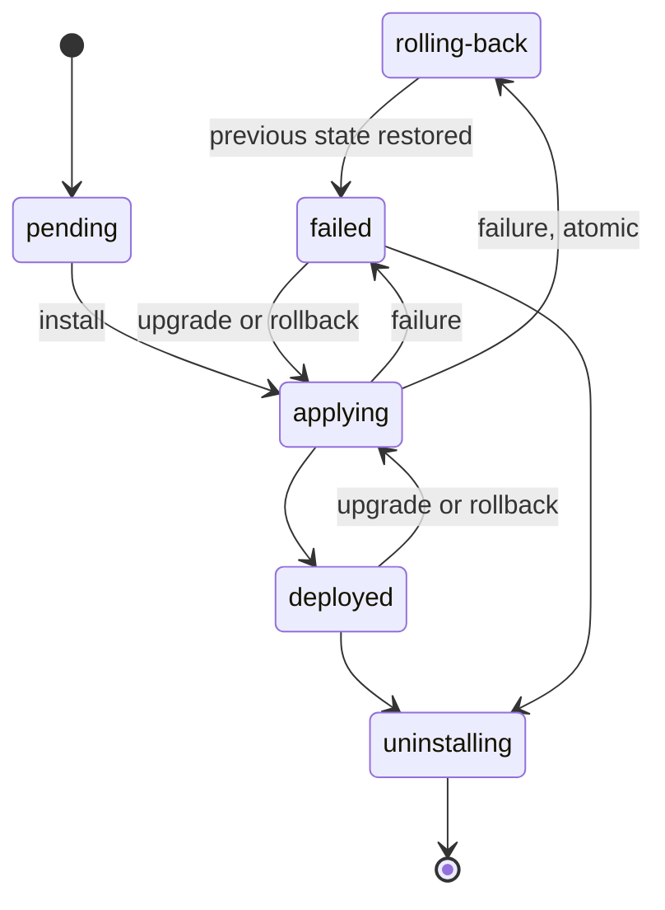
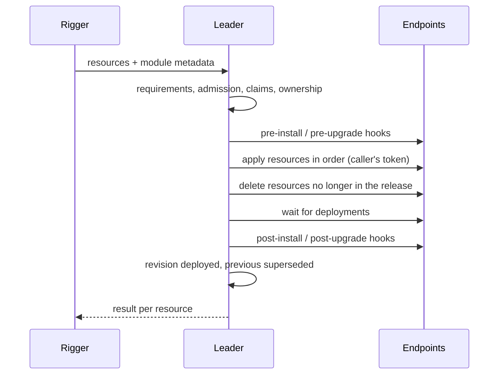

An install of a module is a **release**. Rigger evaluates the module and sends the resources it
gives to the servers through the [release API](/docs/api/releases). The servers apply them in a fixed
order, record an immutable revision of the release, and can roll it back, test it, detect drift and
uninstall it. Who evaluates is a choice: the `rigger` program on the machine it runs on, or the
servers themselves ([`-server`](/docs/api/rigger-stacks#from-the-command-line), the
[install API](/docs/api/rigger-install), the [catalog](/docs/features/packages/rigger-catalog)).

A release that the pack manager made before it was removed is still listed, rolled back and
uninstalled; nothing upgrades it.

## Quick start

```shell
norca rigger install ./example/modules/test-app -name web                # install: revision 1
norca rigger install ./example/modules/test-app -name web -var count=3   # upgrade: revision 2
norca rigger release history web                                         # revisions
norca rigger release rollback web 1                                      # revision 3 = content of 1
norca rigger release status web                                          # the current revision, and what drifted
norca rigger release uninstall web                                       # delete everything, in reverse order
```

A [stack](/docs/features/packages/modules#stacks) installs several releases together and owns them:
`norca rigger stack apply` installs, upgrades and (with `-prune`) removes them, and
`norca rigger stack status` shows their revisions and drift.

## Releases and revisions

A release is a custom object of the built-in kind `rigger.norca.io/Release` in the namespace of the
install; its revisions are objects of `rigger.norca.io/ReleaseRevision` named `<release>.<n>`, owned
by the release. The kinds are registered by the first release operation. They can be read with the
object API (`norca object list rigger.norca.io/Release`), but **only the
[release API](/docs/api/releases) writes them**.

Several names inside a release keep the word pack: `spec.pack` is the package of the release (for
Rigger, the module), and the job meta keys of a release start with `pack.`.

| Release field | Content |
| --- | --- |
| `spec.pack` | name, version, registry, source, ref, commit, digest, signatures, signer verified by the servers, requirements, and the manager (`rigger`) |
| `spec.owner` | the stack that owns the release (its namespace, name, version, source, part); absent for a release no stack owns |
| `spec.revision`, `spec.maxHistory`, `spec.atomic` | newest revision, history limit (default 10), mode of the last operation |
| `status.phase` | `pending`, `applying`, `deployed`, `failed`, `rolling-back`, `uninstalling` |
| `status.revision` | the deployed revision (after a failed atomic upgrade: the previous one) |
| `status.resources` | the resources the release owns, with the modify index, version and content hash after the apply |
| `status.conditions` | `Ready`, `HooksSucceeded`, `Drifted` |
| `status.lastOperation`, `status.lastTest` | the last operation (ID, action, user, error, rollback) and test run |

A revision holds the rendered resources (msgpack, gzip, base64; at most about 224 KiB compressed), the
values recorded with it (values of variables whose name looks secret, for example `password` or
`token`, are recorded as `(redacted)`), the digest of what Rigger applied, the action (`install`,
`upgrade`, `rollback` with `rollbackOf`) and its phase (`deployed`, `superseded`, `failed`). The
oldest revisions beyond the history limit (`max_history` of a module of a stack, at most 100) are
deleted; the deployed one is always kept. Deployments, failures, rollbacks, tests and drift are
written to the object event log of the release
(`norca object events rigger.norca.io/Release <name>`).



## Resources and their order

A release holds more than jobs. A module has one resource per file, and the name of the file says
its kind (see [modules](/docs/features/packages/modules#files)); the servers apply them in this
order:

| File of a module | Resource | Order |
| --- | --- | --- |
| `<name>.quota.hcl` | Quota | 1 |
| `<name>.namespace.hcl` | Namespace | 2 |
| `<name>.acl.hcl` | ACL policy | 3 |
| `<name>.var.hcl` | Variables entry | 4 |
| `<name>.kind.hcl` | Object kind | 5 |
| `<name>.admission.hcl` | Admission policy | 6 |
| `<name>.external.hcl` | External service | 7 |
| `<name>.object.hcl` | Custom object | 8 |
| `<name>.norca.hcl` | Job | 9 |

Deletion uses the reverse order. A quota is applied before the namespaces, so a namespace that
references a quota of the same release is written once, with the quota, and never exists without it;
and a namespace is deleted before its quota. A release has at most 256 resources.

**External services:** the release registers an external service before its jobs start, so the
built-in DNS name exists when they do, and deregisters it on uninstall or when an upgrade drops it.
The `http` and `tcp` checks of the service need `checked_by`: the servers choose the node that runs
them, and the token that applies the release needs `node` write for it. Without a `namespace` the
service is registered in the namespace of the release.

**Secrets:** a sensitive value of a module goes only into an item of a Variable, where it becomes a
secret item. Its value is written to the Variable but **never stored in the release**; an upgrade or
a rollback that sends no value for a secret item keeps the stored one. **A release writes a Variable
only in the state it read** (check-and-set, also for a Variable that did not exist): if somebody else
changed it in between, for example rotated a password, nothing is written and the apply of that
resource fails with "changed since the release read it", like any failed step
([atomic mode](#atomic-mode-and-production-namespaces) restores what the operation applied before,
and leaves the changed Variable as it is).

Jobs without `namespace` or `region` belong to the namespace and region of the release. All resources
of a release must be in its region; jobs with a `multiregion` block use the
[multiregion deployment](/docs/features/multiregion) as usual. **Rigger installs a release in one
region**: for several regions, install it in each (`-region`).

### Requirements

`metadata.hcl` can state what the module needs from the servers; the servers reject the release (also
in a plan) if they can't provide it:

```hcl {filename="metadata.hcl"}
module {
  name    = "loadbalancer-operator"
  version = "0.5.0"

  requires {
    norca    = ">= 0.1.0"
    features = ["releases", "custom-objects", "admission-cel", "object-webhooks", "object-limits"]
  }
}
```

Known features: `releases`, `release-hooks`, `custom-objects`, `admission-cel`, `admission-webhooks`,
`admission-release-signatures`, `quotas`, `multiregion-deployments`, `native-service-catalog`,
`backups`, `secret-store`, `mtls`, `object-webhooks`, `object-migrations`, `object-limits`.

**Operators** are modules of this kind: the object kind (with its webhooks, schema version, migration
and limits), the ACL policy bound to the controller job, admission policies and the controller job,
applied in this order as one release. The servers approve the webhooks of a kind applied with a
management token; otherwise an administrator approves them with
`norca object-kind webhook approve`. `loadbalancer-operator` of the
[Norca registry](/docs/features/packages/registry#loadbalancer-operator) is the reference operator
module; `rigger operator init` scaffolds a controller project with an operator module. See the
[operator framework](/docs/features/operator-framework).

## Install, upgrade, rollback, uninstall

The leader runs one operation per release at a time (a second one gets `409 Conflict`):

1. validation: requirements, admission (signatures), the claims of the resources of the release
   (below), ownership conflicts;
2. `pre-install` or `pre-upgrade` hooks;
3. every resource in the fixed order, through the normal endpoint of its type with the caller's token
   (admission, quotas and ACL apply), then the resources of the previous revision that are no longer
   in the release are deleted in reverse order;
4. waiting for the deployments of the jobs, when the request asks for it (`wait` of a module of a
   stack), up to the timeout (default 5m, at most 2h; `timeout` of a module of a stack, `-timeout`
   of `rigger install`);
5. `post-install` or `post-upgrade` hooks;
6. the revision becomes `deployed`, the previous one `superseded`.



A plan of the release API shows per resource whether it is created, updated, unchanged or deleted,
with the job diffs, without writing. `norca rigger release rollback <release> [revision]` applies
the content of a kept revision (default: the one deployed before the current one) as a new revision.
`norca rigger release uninstall` runs the `pre-delete` hooks, deletes the resources in reverse order,
runs the `post-delete` hooks and deletes the release; the release API can also keep the resources
(`propagation=orphan`) and skip the hooks (`no_hooks`).

**An upgrade that drops a resource, and an uninstall, delete only what is still the release's.**
Right before each deletion the operation claims the resource and reads it again. It does not delete
a resource that somebody else deleted and created again under its name since the release recorded
it, nor one that a tenant or another release owns or that another release operation or a tenant
pass is writing at that moment. Such a resource is left as it is: the change of the operation says
`not deleted: <why>`, for example `not deleted: it was deleted and created again since the release recorded it`,
the operation records a warning naming it, and the release no longer lists it. A resource that was
only changed since (drift) is still the release's and is deleted. A Variable or an object is deleted
with a check-and-set against that read, so one changed in between is not deleted either; for the
other types the one deletion request after the read is the window left.

**A namespace is deleted before the quota it names, and a namespace that stays keeps its quota.**
No quota is taken off a namespace. A namespace that is not deleted (it is no longer the release's,
or its deletion is refused, for example because it still has running jobs or Variables) is not
written at all and still names the quota, so the quota is not deleted either: the quota endpoint
refuses to delete a quota in use. The operation fails with that error, for example
`quota "web" is in use by namespace "web"`, the release keeps the quota (`status.resources` still
lists it), and the operation warns
`quota "web" was not deleted: namespace "web", which the operation did not delete, still names it; the release keeps the quota`.
An upgrade stops at the first deletion that fails: when the deletion of the namespace itself is
refused, the upgrade fails with the error of the namespace and does not come to the quota, which
stays the release's too. A quota that a namespace outside the release names is not deleted either,
with the same error and without the warning.

**A resource is written by one operation at a time.** An install, upgrade or rollback claims every
resource of its release (hooks aside) on the leader before it writes anything, the release itself
included, and holds the claims until it has recorded in the release what it owns. The
[tenant operator](/docs/features/tenants) claims the resources of a tenant the same way for each of
its passes. A resource that another release operation or a tenant pass is writing at that moment
fails the operation with `409 Conflict`, and nothing is written, for example
`resources of the pack are being written by other operations: namespace "shared" is being written by release "apps/web"`.
The other operation is named only to a caller who may write the resource; anybody else reads
`is being written by another operation`. Run the operation again when the other one is over.
A plan (a dry run) claims nothing, but the resources other operations are writing are
conflicts for it too (`409 Conflict`); one the caller may not write is shown as denied in the plan
instead.

**An operation is tied to the leadership of the server that runs it.** When that server loses the
leadership, or establishes it again (after a snapshot restore, for example), the operation stops at
its next write, and stops waiting for deployments and hook jobs. Every write of an operation is also
checked against the state of its release: an operation stops too when the new leader has already
marked its release `failed`, or another operation has changed it since, even before its own server
learns that it is no longer the leader. **What the operation wrote so far stays as it is**: there is
no atomic rollback, hook jobs are not purged, and nothing more is recorded in the release. The
request answers `503 Service Unavailable`, for example
`release "web": the operation was interrupted by a leader change; the new leader marks the release failed`.
The new leader marks the release `failed` (its last operation reads
`the operation was interrupted by a leader change`); a server that becomes the leader again does so
once the interrupted operations there have stopped. Upgrade or roll back again (or uninstall again)
to bring the release to a known state. A test run that is interrupted answers
`release "web": the test was interrupted by a leader change; no result was recorded`, records no
result and no event, and does not change the phase of the release.

A server that is not the leader refuses a release operation with `503 Service Unavailable`
(`this server is not the leader, and release operations run on the leader; retry the operation`),
for example right after a leader change; retry it.

## Atomic mode and production namespaces

With `atomic = true` of a module of a stack (`Atomic` of the release API), a failure of any step (a
resource, a deployment, a hook) restores every resource the operation changed to its state before
the operation, in reverse order; jobs are re-registered as a new version, like `norca job revert`.
The release becomes `failed`, its deployed revision stays the previous one, and the failed revision
is kept for inspection. With `atomic = false` the release stays as far as it got.

**The restore puts back only what is still as the operation left it.** It reads each resource again
right before it acts. A resource somebody else changed after the operation's write, or created again
after the operation deleted it, is theirs: it is left as it is, and the operation records a warning
naming it (`status.lastOperation.warnings`), for example
`namespace "web" was not restored: it changed after the operation wrote it, and is left as it is`.
The write back is a check-and-set against that read where the endpoint of the type has one
(namespaces, quotas, ACL policies, Variables, object kinds, objects and jobs; of the deletions, those
of Variables and objects), so a change made in between is kept as well, with the same kind of
warning; for the other writes and deletions the one request after the read is the window left. A
resource the restore wrote back or created again stays the release's: `status.resources` records it
with its modify index and version after the restore. A quota the operation deleted with a
namespace that named it comes back first: the restore creates the quota again, and then the
namespace, with its quota, in one write. In a region that is not the authoritative
region, a namespace, quota or ACL policy of a release is compared with its replicated copy, which
has indexes of its own: the restore reports it as changed and leaves it.

Without a setting, the namespace decides: **a namespace is a production namespace when its meta
`environment` is `production` or `prod`** (case insensitive), and operations on releases there are
atomic. The namespace meta `pack.atomic = "true"` or `"false"` overrides this for any namespace:

```hcl {filename="payments.namespace.hcl"}
name = "payments"
meta {
  environment = "production"
}
```

## Hooks and tests

A hook is a batch (or sysbatch) job of the module with a `hook` block: `on` names `pre-install`,
`post-install`, `pre-upgrade`, `post-upgrade`, `pre-delete`, `post-delete` or `test` (several in a
list). Rigger writes the block as the job meta `pack.hook`, `pack.hook_weight`, `pack.hook_timeout`
and `pack.hook_delete`, which the servers read. Hooks of a phase run one after the other ordered by
`weight` (then job ID); an earlier run of a hook job is purged first. **A hook job is registered only
while its ID is free and purged only while it is the release's**: a job of the same ID that does not
belong to the release is never overwritten or purged. The hook fails if such a job holds the ID when
the hook registers, or replaces the hook job while it runs; a purge that finds such a job leaves it
and records a warning of the operation. A hook succeeds when all its allocations complete; it fails
on a failed allocation or after its `timeout` (default 5m). The deletion policy `delete` is
`on-success` (default: purge after success, keep failed runs for debugging), `always` or `never`.
Hook jobs run with the caller's token, like all resources.

```hcl {filename="smoke-test.norca.hcl"}
job "smoke-test" {
  type = "batch"

  hook {
    on      = ["post-install", "post-upgrade", "test"]
    weight  = 10
    timeout = "2m"
    delete  = "on-success"
  }

  group "test" {
    task "curl" {
      driver = "docker"
      config {
        image   = "docker.io/curlimages/curl:8.22.0"
        command = "curl"
        args    = ["-fsS", var.health_url]
      }
    }
  }
}
```

The `test` hooks of the deployed revision are run on request: from the page of the release in the
web UI, or with [`POST /v1/release/:name/test`](/docs/api/releases#run-tests). The result is
recorded in `status.lastTest` and in the event log.

## Drift detection

After every apply the servers record a hash of each resource's content (without indexes, times and
status fields). The hash of a Variable is keyed with a root key of the keyring
(`hmac-sha256:<root key ID>:<hex>`), so a reader of the release can't test guesses of its items
against it. `norca rigger release status <release>`, `norca rigger stack status` and a check on the
leader every 5 minutes compare the live resources with these hashes: deleted or changed resources
set the `Drifted` condition and publish a `ReleaseDrifted` event on the `CustomObject` event topic.
**Drift is never corrected automatically**; upgrade or roll back to restore the revision.

## Ownership

A resource belongs to the release whose `status.resources` lists it. Installing a release whose
resources belong to another release fails with `409 Conflict`. The release API can move them to the
new release (`TakeOwnership`); with ACLs, that needs release `write` in the namespaces of the
releases they are taken from (see [permissions](#permissions)). Jobs of a release carry the meta
`pack.release`, `pack.release_namespace` and the owner reference of the operator framework
(`norca.owner`, `norca.owner.kind`); custom objects get an owner reference to the release. Releases
delete their resources themselves, so the object garbage collector never deletes them.
**The release marks are protected:** registering a job with new or changed `pack.release` /
`pack.release_namespace` needs release `write` in the namespace they name, and a dispatch can't set
them (see [Job.Register](/docs/api/jobs)), so a job submitted with `submit-job` alone can't pass for
a hook or a job of a release.

**One release has one owner.** The owner of a release is a stack, by its namespace and name: a stack
prunes and destroys what it owns. An apply that would give the release of a stack to another stack,
or a release that another manager applied to Rigger, is refused unless it is taken over with
`-adopt` (see [one manager](/docs/api/releases#one-manager-per-release) and
[one owner](/docs/api/releases#one-owner-per-release) per release).

`TakeOwnership` takes a resource from the release that owns it (after the operation has recorded
its result; an operation interrupted by a [leader change](#install-upgrade-rollback-uninstall) by
then takes nothing off the other releases and warns `resources of release "<namespace>/<name>" not
taken over: ...`), never from an operation that is writing it now: a resource another release operation or a tenant pass has claimed is a conflict with
it too (see [install, upgrade, rollback, uninstall](#install-upgrade-rollback-uninstall)). **An
operation fails if a resource gets another owner while it runs**: right before each write it checks
that it still holds the claim of the resource and that no tenant and no other release (except one it
takes the resource from) owns it now, for example
`namespace "shared" belongs to release "apps/other" now` (a caller who may not write the resource
reads `has another owner now`). On one leader the claims already rule this out; the check counts
after a leader change, as the new leader starts without the claims of the old one.

## Signatures in protected namespaces

An admission policy with the resource `release` and `trusted_keys` admits, in its namespaces, only
releases whose package has a valid cosign compatible signature of its digest by one of the keys.
Rigger sends the digest of the module and its signatures (the files of its `.rigger-signatures`
directory, see [supply chain](/docs/features/packages/supply-chain#keys-and-signatures)); the servers
verify them themselves. A release without a digest, without a signature or signed by other keys is
rejected (or only warned about with `action = "warn"`):

```hcl {filename="signed-releases.hcl"}
name   = "signed-releases"
action = "deny"
match {
  namespaces = ["prod-*"]
  resources  = ["release"]
}
trusted_keys = [file("acme.pub")]   # in a file for norca admission-policy apply: the PEM text

rule {
  expression = "release.pack.serverRendered"
  message    = "Only modules that the servers fetched and evaluated themselves"
}
```

CEL rules of such policies see `release` (`name`, `namespace`, `action`, `pack.{name, version,
registry, path, digest, signer, signed, trustedSigner, serverRendered}`, `resources`) and `request`.
The key ID of the verifying key is recorded as `spec.pack.trustedSigner`. Admission policies are
described in [Admission control](/docs/features/admission-control).

## Permissions

Release operations need the object capabilities of the kind at namespace level:

```hcl
namespace "apps" {
  object "rigger.norca.io/Release" {
    capabilities = ["read", "write"]
  }
}
```

The registries and the operations of Rigger are kinds of the same group, so a rule for
`rigger.norca.io/*` covers the releases with them.

**Applying a release grants nothing else: every resource is written with the caller's own token**, so
someone who can't write ACL policies can't install a module containing one.

The token of an install, upgrade or rollback must be allowed to write **every** resource of the
release, hook jobs included (for a Variables entry the `write` capability is enough). Otherwise the
operation is refused with `403` before anything is applied or recorded: no release and no revision is
created for it. There is one exception: a namespace, quota, ACL policy, object kind, admission policy
or external service that the release **owns already** and that the new revision leaves **unchanged**
needs no right. A team can therefore upgrade or roll back a release that an operator installed with
such resources, as long as it leaves them as they are; when the new revision would change one of
them, or the live resource is no longer what the release says, the operation needs the right to
write it. A plan reports the resources the token may not write as `Permission denied`.

**A job with ACL policies bound to it** (the `job_acl` of a policy, or `norca acl policy apply -job`)
needs more than `submit-job`: when the release would create the job or change it in any way, the
token must hold every policy bound to it, by name or through one of its roles, or be a management
token. The release refuses such an operation with `403` before anything is applied, and the error
names the missing policies; no revision is recorded. An upgrade or rollback that leaves the job
exactly as it is needs none of them, so a team can upgrade an operator's release that doesn't touch
its job. The plan shows the error on the job's change. See
[changing a job with associated policies](/docs/concepts/workload-identity#changing-a-job-with-associated-policies).

Reading the content of a revision (`/revision/:n`) also needs `read-job` in the namespace, as it
contains job specifications.

With ACLs enabled, resources that a release **adopts** without writing them are checked the same way,
before anything is written. These are every resource of a revision that only records what the client
deployed itself (`RecordOnly` of the release API). For each of them the token needs what writing it
would need:

| Resource | Needs |
| --- | --- |
| Namespace, ACL policy | A management token |
| Quota | `quota { policy = "write" }` |
| Variable | `write` and `read` on its path (the release records a keyed hash of the items) |
| Object kind | `operator { policy = "write" }` |
| Admission policy | `admission { policy = "write" }` |
| Object | object `write` on its kind in its namespace (`namespace "*"` for cluster-scoped kinds) |
| Job | `submit-job` in its namespace |

Hooks are never adopted. Taking resources over from other releases (`TakeOwnership`) changes those
releases, so it also needs object `write` on `rigger.norca.io/Release` in the namespace of every
release a resource is taken from. A missing permission fails the operation with `403 Forbidden`, for
example
`Permission denied: the token may not write job "web" (namespace "apps"), so the release can't adopt it`, and
nothing is written.

## HTTP API

| Operation | HTTP |
| --- | --- |
| List, details | `GET /v1/releases?namespace=`, `GET /v1/release/:name` |
| Install, upgrade | `PUT /v1/release/:name` |
| Plan | `POST /v1/release/:name/plan` |
| Revisions | `GET /v1/release/:name/history`, `GET /v1/release/:name/revision/:n` |
| Rollback | `POST /v1/release/:name/rollback` (`Revision`, `Atomic`, `Wait`, `Timeout`, `DryRun`, `Adopt`) |
| Tests | `POST /v1/release/:name/test?timeout=` |
| Drift | `GET /v1/release/:name/drift` |
| Uninstall | `DELETE /v1/release/:name?propagation=background\|orphan&no_hooks=&timeout=` |

The Go client is `client.Releases()` in `github.com/bacanoo-io/norca/norca/api`. The endpoints are described
in detail in the [Releases HTTP API](/docs/api/releases).

## CLI

| Command | Purpose |
| --- | --- |
| [`norca rigger install`](/docs/commands/rigger/install) | Install or upgrade one release of a module, of a directory or by its source |
| [`norca rigger stack apply`](/docs/commands/rigger/stack) | Install, upgrade and prune the releases of a stack |
| [`norca rigger stack plan`](/docs/commands/rigger/stack) | Show what an apply would change |
| [`norca rigger stack status`](/docs/commands/rigger/stack) | Show the releases of a stack, their revision and drift |
| [`norca rigger release list`](/docs/commands/rigger/release) | List the releases |
| [`norca rigger release status`](/docs/commands/rigger/release) | Show a release and what drifted |
| [`norca rigger release history`](/docs/commands/rigger/release) | List the revisions |
| [`norca rigger release rollback`](/docs/commands/rigger/release) | Apply an earlier revision as a new revision |
| [`norca rigger release uninstall`](/docs/commands/rigger/release) | Uninstall a release |

## Design

The release object, the order of an apply and the hooks come from the
[package management plan](/docs/design/package-management-plan): see
[release object](/docs/design/package-management-plan#release-object),
[install, upgrade, rollback](/docs/design/package-management-plan#install-upgrade-rollback) and
[hooks and tests](/docs/design/package-management-plan#hooks-and-tests). The plan describes the pack
manager, which Rigger replaced.
