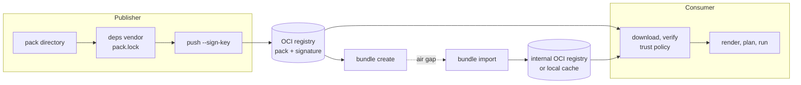

Besides git registries, `norca pack` stores packs as artifacts in OCI registries (Harbor, GitHub
Container Registry, Zot, `distribution`, ...), signs them with cosign compatible key pairs, moves them
into air-gapped environments as offline bundles, and pins the content of packs and of their vendored
dependencies in a `pack.lock` file. All of this happens on the client. On the server side,
[admission policies with `trusted_keys`](/docs/features/packages/releases#signatures-in-protected-namespaces)
admit only releases of signed packs, and releases record the digest and signer of their pack.



## Quick start

```shell
# Once: a signing key pair (cosign format) and the internal registry with its trust policy.
export NORCA_PACK_KEY_PASSWORD=...           # or answer the prompt
norca pack key generate                      # writes cosign.key and cosign.pub
norca pack registry add internal oci://registry.example.internal/packs \
    --trust-key=./cosign.pub --require-signature

# Publisher: vendor dependencies (writes pack.lock), push and sign.
norca pack deps vendor --path=./redis
norca pack push ./redis --registry=internal --sign-key=cosign.key

# Consumer: the pack is downloaded, verified and cached on first use.
norca pack run redis --registry=internal              # newest version, release "redis"
norca pack run redis --registry=internal --ref=0.2.1  # a given version, release "redis-0.2.1"
```

## OCI registries

A pack version is one OCI artifact. An OCI registry definition names a location below which every
pack has its own repository named like the pack; the tag is the pack version:

```plaintext
oci://registry.example.internal/packs           registry URL ("registry add")
registry.example.internal/packs/redis:0.2.1      pack "redis", version 0.2.1
```

Pack names, registry names and tags become directories of the pack cache, so they are checked before
anything is downloaded from an OCI registry or imported from a
[bundle](#air-gapped-installation-with-offline-bundles):

- A tag (a `--ref` of an OCI registry, a tag picked from the registry's tag list, or a tag in a
  bundle) must follow the OCI tag grammar: up to 128 letters, digits, `_`, `.` and `-`, not starting
  with `.` or `-`. It must not end with a dot or be a Windows device name such as `CON`, `NUL`, `COM1`
  or `LPT1` (with or without an extension).
- A pack name or the name a registry is cached under must not be empty, `.` or `..`, contain any of
  `/ \ : @ * ? " < > |` or control characters, end with a dot or a space, or be a Windows device name.

Invalid names and tags fail with an error such as `invalid tag "NUL"`. These checks apply on every
OS. The refs of git registries (branches, tags, commits) are not affected.

### Configuration file

OCI registries and trust policies live in the client configuration file,
`<user config dir>/norca/pack/config.hcl` (`~/.config/norca/pack/config.hcl` on Linux,
`%AppData%\norca\pack\config.hcl` on Windows), or the file named by `NORCA_PACK_CONFIG`. It can be
written by hand, distributed by configuration management, or managed with
`norca pack registry add|delete` (which keep the rest of the file, including comments):

```hcl {filename="config.hcl"}
registry "internal" {
  url             = "oci://registry.example.internal:5000/packs"
  plain_http      = false                        # true for internal registries without TLS
  ca_cert         = "/etc/norca/registry-ca.pem" # additional CA to trust
  tls_skip_verify = false

  trust {
    require_signature = true
    public_keys       = ["/etc/norca/pack-signing.pub"]
  }
}

# Default trust policy for OCI registries and bundles without their own trust block.
trust {
  require_signature = false
  public_keys       = []
}
```

Relative file names are relative to the configuration file.

| Key | Type | Default | Description |
| --- | --- | --- | --- |
| `registry "<name>"` | block | – | An OCI registry, by the name used with `--registry` |
| `registry.url` | string | required | `oci://host[:port]/path` below which the pack repositories are |
| `registry.plain_http` | bool | `false` | Connect over plain HTTP |
| `registry.ca_cert` | string | `""` | Additional PEM CA certificate to verify the registry with |
| `registry.tls_skip_verify` | bool | `false` | Do not verify the registry's TLS certificate |
| `registry.trust` | block | – | Trust policy of this registry |
| `trust` | block | – | Default trust policy |
| `trust.require_signature` | bool | `false` | Reject packs without a valid signature by one of `public_keys` |
| `trust.public_keys` | list(string) | `[]` | Files with trusted public keys (PEM) |

### Commands

| Command | Purpose |
| --- | --- |
| [`norca pack registry add <name> oci://host/path`](/docs/commands/pack/registry/add) `[--plain-http] [--registry-ca-cert=..] [--registry-tls-skip-verify] [--trust-key=..]... [--require-signature] [--target=<pack>] [--ref=<version>]` | Add (or replace) an OCI registry; downloads the target pack, or all packs if the registry offers the catalog API |
| [`norca pack registry list`](/docs/commands/pack/registry/list) | Lists cached registries and configured OCI registries |
| [`norca pack registry update <name> [--target] [--ref]`](/docs/commands/pack/registry/update) | Downloads the newest version (or `--ref`) of the cached packs of an OCI registry |
| [`norca pack registry delete <name>`](/docs/commands/pack/registry/delete) | Removes the registry definition and its cached packs |
| [`norca pack push <dir> [oci://host/path/<pack>[:tag]] [--registry] [--tag] [--sign-key]`](/docs/commands/pack/push) | Packages and publishes a pack directory |
| `norca pack run\|plan\|render <pack> --registry=<name> [--ref=<version>]` | Downloads on first use; without `--ref` the newest semantic version is used (pre-releases only if there is no release; the tag `latest` if no tag is a version), and the default deployment (release) name is the pack name; with `--ref` it is `pack@ref` unless `--name` is given |

`push` requires a valid pack whose `pack.lock` (if present) matches and whose dependencies are
vendored, so that the published pack renders without network access to the dependencies' sources.
Pushing is reproducible: unchanged content always yields the same manifest digest, so signatures
stay valid. Set `SOURCE_DATE_EPOCH` to record a creation time in the manifest.

If a configured registry can't be reached and no version is requested, the newest cached version is
used (with a warning).

### Authentication and TLS

Credentials are taken, in this order, from the `--registry-username`/`--registry-password` flags (of
the commands that have them: `push`, `sign`, `verify`, `bundle create`, `bundle import`), the
`NORCA_PACK_REGISTRY_USERNAME`/`NORCA_PACK_REGISTRY_PASSWORD` environment variables (a password
without user name is used as an identity token), and the docker configuration
(`~/.docker/config.json` or `$DOCKER_CONFIG`, including credential helpers, that is `docker login`).
Credentials are never written into the pack configuration. TLS is verified against the system CA
pool plus `ca_cert`; `plain_http` and `tls_skip_verify` exist for internal registries.

## Signing and trust policies

Signatures are cosign compatible key-based signatures:

- [`norca pack key generate`](/docs/commands/pack/key/generate) writes an ECDSA P-256 key pair in the
  format of `cosign generate-key-pair` (`cosign.key`, encrypted; `cosign.pub`). Keys generated by
  cosign work as well. The password comes from `NORCA_PACK_KEY_PASSWORD` (or `COSIGN_PASSWORD`) or an
  interactive prompt.
- [`norca pack sign --key=cosign.key --registry=internal redis:0.2.1`](/docs/commands/pack/sign) (or
  `push --sign-key`) signs the manifest digest and stores the signature next to the pack, exactly
  where and how cosign stores it. Signing again with the same key replaces that key's previous
  signature.
- [`norca pack verify [--key=cosign.pub]... --registry=internal redis:0.2.1`](/docs/commands/pack/verify)
  prints the digest and the signer's key ID; without `--key` the keys of the registry's trust policy
  are used.
- `cosign verify --key cosign.pub --insecure-ignore-tlog=true <host>/<path>/redis@sha256:...` checks
  the same signatures (add `--allow-http-registry=true` for plain HTTP registries), and signatures
  made with `cosign sign --key ... --tlog-upload=false --new-bundle-format=false` are accepted by
  Norca. Transparency log (Rekor) entries and keyless (Sigstore identity) signing are not supported
  yet.

The **trust policy** of a registry is checked whenever a pack is downloaded, vendored, bundled,
imported, and every time a cached pack is rendered, planned or run:

- `require_signature = true`: the pack must carry a valid signature by one of `public_keys`, or it is
  rejected (and not cached). Requiring signatures without configured keys is an error.
- `require_signature = false`: signatures by trusted keys are reported, unsigned packs are allowed.
- A registry's own `trust` block replaces the default `trust` block: its `public_keys` replace the
  default keys if it lists any, and its `require_signature` replaces the default if set.
- The default policy applies to OCI locations that match no configured registry (for example
  `oci://` dependency sources) and to bundles imported into the cache under a name that is not
  configured.

The key ID shown everywhere is `sha256:` followed by the hex SHA-256 of the public key's PKIX DER
encoding.

**Offline re-verification:** every pack downloaded into the cache keeps its signed manifest and its
signatures in `.norca-origin.json`. Before a cached pack is used, the client checks the manifest
against its digest, the pack files against the content digest signed in the manifest, and the
signatures against the *current* trust policy. A pack modified in the cache, or one whose signer is
no longer trusted, is rejected. Git registries and local pack directories are not signed and not
subject to the trust policy.

The servers can enforce signatures too: an admission policy with the `release` resource and
`trusted_keys` admits only releases of packs signed by one of its keys, verified by the servers
themselves ([signatures in protected namespaces](/docs/features/packages/releases#signatures-in-protected-namespaces)).

## Air-gapped installation with offline bundles

An offline bundle carries packs, their dependencies and their signatures across an air gap in one
file:

```shell
# Connected side: bundle packs from a registry (with oci:// dependencies and signatures) ...
norca pack bundle create --output=packs.tar --registry=internal redis:0.2.1 postgres
# ... or from local directories, signing them on the way.
norca pack bundle create --output=packs.tar --sign-key=cosign.key ./redis
norca pack bundle inspect packs.tar

# Transfer packs.tar and the public key (cosign.pub) into the isolated environment.

# Isolated side, either: push everything into the internal OCI registry ...
norca pack registry add internal oci://registry.isolated.example/packs \
    --trust-key=./cosign.pub --require-signature
norca pack bundle import packs.tar --registry=internal
norca pack run redis --registry=internal

# ... or, without any registry, import into the local cache of a machine.
norca pack bundle import packs.tar --cache-as=offline
norca pack run redis --registry=offline --ref=0.2.1
```

- [`bundle create`](/docs/commands/pack/bundle/create) adds dependencies with `oci://` sources
  (recursively). Other dependencies must be vendored into the pack (`norca pack deps vendor`);
  otherwise the pack could not render offline and `bundle create` fails. If the source registry's
  trust policy requires signatures, they are checked while bundling.
- [`bundle import`](/docs/commands/pack/bundle/import) verifies every pack against the trust policy of
  the target (the registry pushed to, or the default policy for `--cache-as` names that are not
  configured) before importing anything into that target, and checks every digest against the
  bundle index. Packs keep their digests, so signatures made on the connected side stay valid in the
  internal registry.
- The pack names and tags of a bundle are checked against the
  [rules above](#oci-registries) when the bundle is opened (`inspect`, `import`) and again when it is
  verified; a bundle with an invalid name or tag is rejected as a whole and nothing is imported.
  `bundle create` refuses invalid tags. A cache import never writes outside of the directory of its
  cache registry.
- `--push-to=oci://host/path` pushes into an unconfigured location; `--cache-as` and `--registry` can
  be combined.
- To use a cache shared by several users or prepared on another machine, point
  `NORCA_PACK_CACHE_DIR` at it.

The bundle is a reproducible, uncompressed tar archive (see [Formats](#formats)); every pack
repository in it is a standard OCI image layout, so generic OCI tooling can read it too
(`oras cp --from-oci-layout repositories/redis:0.2.1 ...`).

Operating the Norca pack registry in an air-gapped environment is described in
[Operating with the pack registry](/docs/operations/pack-registry#air-gapped-clusters).

## pack.lock

`pack.lock` records the content digests of a pack and of its vendored dependencies, so that an
install is reproducible and tampering with vendored code is detected:

```hcl {filename="pack.lock"}
lock_version = 1

pack {
  name    = "web"
  version = "1.2.0"
  digest  = "sha256:..."            # the pack without deps/ and pack.lock
}

dependency "redis" {
  source          = "oci://registry.example.internal/packs/redis"
  ref             = "0.2.1"
  digest          = "sha256:..."    # deps/redis, including its own deps/
  manifest_digest = "sha256:..."    # for oci:// sources
}
```

- [`norca pack deps vendor`](/docs/commands/pack/deps/vendor) vendors the dependencies (`oci://`
  sources are pulled from OCI registries and verified with the trust policy) and writes `pack.lock`.
  If a dependency with unchanged source and ref now has different content, vendoring fails unless
  `--update-lock` is given.
- `render`, `plan` and `run` verify the lock file if the pack has one (`--lock=verify`, the default;
  `NORCA_PACK_LOCK` sets the default). `--lock=require` also fails without a lock file,
  `--lock=update` (re)writes it for a pack in a local directory, `--lock=ignore` skips the check.
- `push` and `bundle create` refuse packs whose lock file does not match.
- The output is reproducible: the same content always produces the same bytes. The digests depend
  only on relative paths and file contents (not on timestamps or permissions); note that line ending
  conversion (for example git `autocrlf`) changes contents.

## Provenance in the job meta

Jobs deployed from an OCI registry or a bundle record their provenance next to the existing `pack.*`
meta keys, and releases record the same values in `spec.pack`:

| Meta key | Value |
| --- | --- |
| `pack.digest` | Manifest digest of the pack artifact |
| `pack.signer` | Key ID of the trusted key that signed it (only when verified) |

## Formats

**Pack artifact** (OCI image manifest, `application/vnd.oci.image.manifest.v1+json`):

| Part | Media type | Content |
| --- | --- | --- |
| `artifactType` | `application/vnd.norca.pack.v1` | |
| config | `application/vnd.norca.pack.config.v1+json` | `{"name","version","description","url","dependencies":[{"name","source","ref"}],"tree_digest"}` |
| layer | `application/vnd.norca.pack.content.v1.tar+gzip` | The pack directory: regular files only, sorted, no timestamps or owners, mode 0644 |
| annotations | | `org.opencontainers.image.title`, `.version`, `.description`, `.url`, `dev.norca.pack.name`, `dev.norca.pack.tree-digest` |

The **tree digest** of a directory is the SHA-256 of the lines `<hex sha256 of file>  <slash
separated path>\n`, sorted by path, over all regular files except `.git/` and `.norca-origin.json`.
Symbolic links are not allowed in packs. Downloads are limited to 64 MiB compressed and 256 MiB
unpacked, and unpacking rejects absolute paths, `..` and non-regular files.

**Signatures** (cosign's format): an image manifest tagged `sha256-<hex>.sig` in the pack's
repository; one layer per signature with media type
`application/vnd.dev.cosign.simplesigning.v1+json`, whose content is the payload

```json
{"critical":{"identity":{"docker-reference":"<host>/<repository>"},"image":{"docker-manifest-digest":"sha256:..."},"type":"cosign container image signature"},"optional":null}
```

and whose annotation `dev.cosignproject.cosign/signature` holds the base64 ASN.1 ECDSA signature of
its SHA-256. Verification requires the digest in the payload to match; the repository name is not
compared, so mirrored packs keep their signatures.

**Bundle**: a tar archive with `norca-bundle.json` (format version, and per pack: name, version, tag,
manifest digest, tree digest, source, whether it is signed, which packs depend on it) and one OCI
image layout per pack below `repositories/<pack>/`, tagged like the registry repository.

## Environment variables

| Variable | Meaning |
| --- | --- |
| `NORCA_PACK_CONFIG` | Path of the client configuration file |
| `NORCA_PACK_CACHE_DIR` | Location of the pack cache |
| `NORCA_PACK_REGISTRY_USERNAME`, `NORCA_PACK_REGISTRY_PASSWORD` | OCI registry credentials |
| `NORCA_PACK_KEY_PASSWORD` (`COSIGN_PASSWORD`) | Password of the signing key |
| `NORCA_PACK_LOCK` | Default of the `--lock` flag |

## Design

See [registries and supply chain](/docs/design/package-management-plan#registries-and-supply-chain)
in the package management plan.
