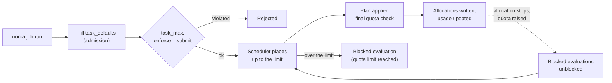

## What and why

When several teams share a cluster, one team's jobs can take all the capacity of
a region, and a job without a `resources` block silently gets the built-in
defaults. Nomad v1.6.5 has the API, the CLI and the scheduler hooks of resource
quotas, but no server-side implementation.

Norca implements **namespace quotas**. A quota specification is a named object
with a limit per region: the total CPU, memory and `memory_max` of the
non-terminal allocations, the number of non-terminal allocations, and the total
size of Variables. A quota is attached to one or more namespaces, whose usage is
added up. The specification can also hold **task defaults**, filled in for tasks
that do not set their resources, and **task maximums**, which reject tasks that
ask for too much.

The idea comes from Kubernetes (ResourceQuota and LimitRange). The design and
implementation are Norca's own: quotas are attached to namespaces, limits
are set per region, and over-quota placements wait as blocked evaluations
instead of being rejected.

## How it works



- **Admission.** When a job is planned or submitted in a namespace with a quota,
  the servers fill in the `cpu`, `memory` and `memory_max` of tasks that do not
  set them from `task_defaults`, then reject tasks whose resources exceed
  `task_max`. With `enforce = "submit"` they also reject a job whose total
  demand (count times resources of every group) exceeds the limit of the region
  by itself. See [admission control](/docs/features/admission-control) for the
  order of the admission chain.
- **Scheduling.** The scheduler places allocations only while they fit into the
  remaining quota. The remaining placements become a blocked evaluation marked
  with the quota, and `norca job run` shows `Quota limit hit` with the exhausted
  dimension. The plan applier makes the final check, so parallel schedulers
  cannot exceed a quota together. A plan that keeps or reduces the usage of an
  over-committed quota (for example after the limit was lowered) is allowed.
- **Usage.** The usage is updated in the same Raft transaction as the
  allocations, so it is always consistent. It counts the reserved resources of
  every non-terminal allocation: `cpu` in MHz (reserved `cores` converted to MHz
  with the node's CPU data), `memory` and `memory_max` in MB (`memory` when
  `memory_max` is not set), taking task lifecycles into account as the
  scheduler does. Device resources are not counted.
- **Freeing.** When an allocation stops or a quota is raised, the blocked
  evaluations of the quota are retried automatically.
- **Variables.** A write that would make the Variables of the quota's namespaces
  larger than `variables_limit` is rejected.
- **Regions.** Quota specifications are written in the authoritative region and
  replicated to the other regions; each region enforces its own `limit` block
  and tracks its own usage. A region without a `limit` block is not limited.
- **Events.** The `Quota` topic of the [event stream](/docs/features/event-stream)
  publishes changes of quota specifications and `QuotaExhausted` and
  `QuotaFreed` events when a dimension becomes exhausted or available again.
  The [built-in autoscaler](/docs/features/autoscaler) caps scale ups at the
  quota ceiling.

## Example

The quota of the `apps` namespace of the [deployment examples](/docs/getting-started/examples)
(`example/policies/quota-apps.hcl`):

```hcl {filename="quota-apps.hcl"}
name        = "apps"
description = "Resources of the example applications"

# One limit per region. "global" is the default region name; add a limit
# block for every region of a federation.
limit {
  region = "global"

  region_limit {
    cpu    = 4000 # MHz
    memory = 4096 # MB
  }

  variables_limit = 50 # MB
  allocations     = 30
}

# Filled in for tasks that do not set them.
task_defaults {
  cpu    = 100
  memory = 128
}

# The most a single task may request.
task_max {
  cpu    = 1000
  memory = 1024
}

# "schedule": allocations are placed up to the limit, the rest waits as a
# blocked evaluation; "submit" also rejects jobs whose total demand exceeds
# the limit.
enforce = "schedule"
```

Create the quota, attach it to the namespace and watch the usage:

```shell
norca quota apply quota-apps.hcl
norca namespace apply -quota apps apps
norca quota status apps
```

```plaintext
Name          = apps
Description   = Resources of the example applications
Limits        = 1
Enforce       = schedule
Task Defaults = cpu=100, memory=128
Task Max      = cpu=1000, memory=1024

Quota Limits
Region  CPU Usage    Memory Usage  Memory Max Usage  Variables Usage  Allocations Usage
global  1500 / 4000  1536 / 4096   1536 / inf        0 / 50           6 / 30
```

A quota must exist before a namespace refers to it, and a quota that is still
attached to a namespace cannot be deleted.

## Configuration reference

The full reference is the [quota specification](/docs/other-specifications/quota).

| Key | Type | Default | Description |
| --- | --- | --- | --- |
| `name` | string | required | Unique name (letters, digits, `-`, `_`, at most 128). |
| `description` | string | `""` | At most 256 characters. |
| `limit.region` | string | required | The region of the limit; one `limit` per region. |
| `limit.region_limit.cpu` | int | `0` | Total CPU in MHz. |
| `limit.region_limit.memory` | int | `0` | Total memory in MB. |
| `limit.region_limit.memory_max` | int | `0` | Total `memory_max` in MB. |
| `limit.variables_limit` | int | `0` | Total size of Variables in MB. |
| `limit.allocations` | int | `0` | Number of non-terminal allocations. |
| `task_defaults` | block | none | `cpu`, `memory`, `memory_max` filled in for tasks that do not set them. |
| `task_max` | block | none | Maximum `cpu`, `cores`, `memory`, `memory_max` of a task. |
| `enforce` | string | `"schedule"` | `schedule` or `submit`. |

A limit of `0` means unlimited and a negative limit disallows any usage.

## CLI and API

| Task | CLI | HTTP API |
| --- | --- | --- |
| Create or update a quota | [`norca quota apply`](/docs/commands/quota/apply) | [`POST /v1/quota`](/docs/api/quotas#create-or-update-quota-specification) |
| Write an example file | [`norca quota init`](/docs/commands/quota/init) | |
| List quotas | [`norca quota list`](/docs/commands/quota/list) | [`GET /v1/quotas`](/docs/api/quotas#list-quota-specifications) |
| Show a quota | [`norca quota inspect`](/docs/commands/quota/inspect) | [`GET /v1/quota/:name`](/docs/api/quotas#read-quota-specification) |
| Show usage | [`norca quota status`](/docs/commands/quota/status) | [`GET /v1/quota/usage/:name`](/docs/api/quotas#read-quota-usage) |
| Delete a quota | [`norca quota delete`](/docs/commands/quota/delete) | [`DELETE /v1/quota/:name`](/docs/api/quotas#delete-quota-specification) |
| Attach to a namespace | [`norca namespace apply -quota`](/docs/commands/namespace/apply) | [`POST /v1/namespace/:name`](/docs/api/namespaces) |

ACL: reading quotas needs `quota { policy = "read" }`, writing them
`quota { policy = "write" }` (or a management token). Only the quota capability
is checked: a token that can read quotas sees every quota specification and its
usage, also of namespaces it has no access to. `norca quota status -json`
outputs only the specification; `norca quota inspect` (without `-json`) outputs
the specification with the usage of every region.

## Limits and status

- Available: per-region limits on CPU, memory, `memory_max`, allocations and
  Variables size, task defaults and maximums, the `schedule` and `submit`
  enforcement modes, blocked evaluations that are retried when quota is freed,
  replication from the authoritative region, the `Quota` event topic.
- The `memory` limit is compared with the reserved memory of the allocations,
  not with their `memory_max`; set `memory_max` in `region_limit` to limit
  memory oversubscription.
- Device (GPU), disk, IOPS and network resources cannot be limited.
- `task_defaults` cannot set `cores`. A task that sets the built-in default
  values (`cpu = 100`, `memory = 300`) is treated as not setting them.
- System and sysbatch jobs have no fixed count, so `enforce = "submit"` does not
  check their demand; their placements are still limited by the scheduler.
- Quota writes need every server of the region on a Norca version that supports
  quotas.

## Design

[Kubernetes features: 1. Namespace quotas](/docs/design/kubernetes-features-spec#1-namespace-quotas)
and the [common principles](/docs/design/kubernetes-features-spec#common-principles).
