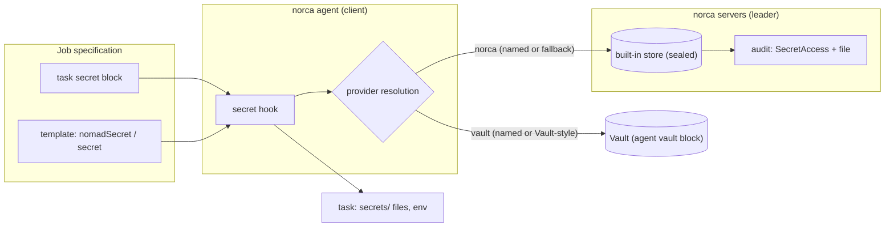

> [!NOTE]
> **Status: in progress.** Phases 0–4 of the [plan](/docs/design/secrets-plan) are available: the
> store itself, the `shares` seal, versioned secrets with audit, delivery to tasks with the `norca` and
> `vault` providers, and Vault compatibility without a Vault. External providers (OpenBao, AWS, GCP and
> Scaleway secret managers, plugins), the KMS and transit seals, expiry and rotation events, replication
> between regions and dynamic secrets are **not available yet**. See [Limits and status](#limits-and-status).

## What and why

Nomad v1.6.5 keeps encrypted [Variables](/docs/concepts/variables) in Raft, but the key that encrypts
them lies on every server's disk next to the key that wraps it: whoever can read a server's data
directory can decrypt every Variable. Variables have no versions and no audit of who read a value, and a
task can only receive a value through a template. The only external store is Vault, which is no longer
open source and is not shipped by Norca.

Norca adds a secret store to the servers. Its keys are protected by a **seal**: with the `shares` seal,
the unseal key is split into Shamir shares held by operators, and a restarted server cannot decrypt
anything until enough shares are entered. Secrets are separate `Secret` objects with versions, metadata
and soft delete; every value read and every write is **audited**. A task asks for a secret with a
declarative `secret` block, and the client delivers it into the task's `secrets/` directory and
environment, re-delivering it when a new version is written.

The existing Vault integration is unchanged. A lookup goes to an external store when one is defined for
it, and **falls back** to the built-in store when none is defined. Jobs written for Vault (task `vault`
blocks, `{{ with secret "kv/data/..." }}` templates) therefore run on a cluster without Vault: the
built-in store answers their KV reads.

## How it works



- **Servers.** The store's core comes from [uBixVault](https://github.com/cwolsen7905/ubixvault)
  (BSD-3-Clause; a source copy of v1.5.0 lives in `nomad/secretstore/ubix` of the Norca repository):
  its AES-256-GCM barrier, Shamir sharing, seal, KV v2 versioning and audit. Its storage is Norca's own
  Raft (a table of encrypted blobs), so there is one consensus system per region and secrets are
  replicated, snapshotted and backed up with the rest of the state. The active core runs on the leader;
  followers forward secret requests. Access is decided by Norca ACL policies and workload identities;
  uBixVault's tokens, policies and HTTP layer are not used.
- **Seal.** The root keys of the keyring and the key of the secret store are wrapped by the region's
  seal. A server that cannot unwrap them is **sealed**: it serves everything that needs no decryption and
  rejects Variables, workload identity signing, mTLS issuance and the secret store. See
  [Seal](/docs/features/secrets/seal).
- **Clients.** For each `secret` block of a task, the client resolves the provider, fetches the value
  with the task's workload identity, writes it into `secrets/` (mode 0400) or the task environment, and
  watches it for changes. See [Delivery to tasks](/docs/features/secrets/delivery).
- **Resolution order.** Explicit `provider`, then the client's `route` rules, then the group, job and
  namespace default, then (for Vault-style lookups only) the agent's Vault integration, then the
  built-in `norca` store as the fallback. Fallback means "nothing defined", never "the defined provider
  failed".


  
  
  
  


## Example

A complete round trip on a cluster with ACLs, from writing a secret to a task that reads it:

```shell
# Write the secret; the password is read from standard input, not from the command line.
norca secret put -namespace apps -owner team-a app/db username=app password=-
```

```hcl {filename="app.nomad.hcl"}
job "app" {
  namespace = "apps"

  group "web" {
    # The tasks of the group may read the secrets below app/.
    # The submitter of the job needs read-secret on this pattern.
    secret_access {
      path = "${job}/*"
    }

    task "server" {
      driver = "docker"

      config {
        image = "nginx:1.27"
      }

      secret "db" {
        path = "${job}/db"

        file {
          destination = "secrets/db.env"
          format      = "env"
        }

        env {
          DB_PASSWORD = "password"
        }

        change_mode   = "signal"
        change_signal = "SIGHUP"
      }
    }
  }
}
```

The task events of the allocation show which provider delivered the secret, for example
`secret db: provider norca (fallback)`, never the value.

## Configuration reference

| Block | Where | Purpose | Reference |
| --- | --- | --- | --- |
| `keyring { seal "shares" { ... } }` | server | The seal of the keyring and the secret store | [keyring](/docs/configuration/keyring) |
| `secrets { audit_file, ... vault_fallback }` | server | Audit file, registration of jobs with `vault` blocks without Vault | [secrets](/docs/configuration/secrets#server-secrets-block) |
| `secrets { route, vault_kv, vault_compat }` | client | Provider routes, Vault path mapping, Vault-compatible endpoint | [secrets](/docs/configuration/secrets#client-secrets-block) |
| `secret`, `secret_access`, `secrets` | job specification | Delivery, read grants, default provider | [secret](/docs/job-specification/secret), [secret_access](/docs/job-specification/secret_access), [secrets](/docs/job-specification/secrets) |

## CLI and API

| Task | CLI | HTTP API |
| --- | --- | --- |
| List, inspect, read, write secrets | [`norca secret`](/docs/commands/secret) | [`/v1/secrets`, `/v1/secret/:path`](/docs/api/secrets) |
| Import from Vault KV or Variables | [`norca secret import`](/docs/commands/secret/import) | – |
| Seal status | [`norca operator seal-status`](/docs/commands/operator/seal-status) | [`GET /v1/operator/seal`](/docs/api/operator/seal#read-seal-status) |
| Unseal, recover a restored store | [`norca operator unseal`](/docs/commands/operator/unseal) | [`/v1/operator/unseal`, `/v1/operator/seal/recover`](/docs/api/operator/seal) |
| Move to another seal | [`norca operator keyring rewrap`](/docs/commands/operator/keyring-rewrap) | [`POST /v1/operator/keyring/rewrap`](/docs/api/operator/seal#rewrap-the-keyring) |

The web UI has a **Secrets** page (Configuration group) with the seal status of every server; values are
shown only after an explicit, audited reveal. See [Web UI](/docs/features/web-ui).

## Limits and status

Available (phases 0–4):

- uBixVault core on Norca's Raft; the `shares` seal (and `aead`, the Nomad behaviour, for development and
  migration); `norca operator unseal`, seal status, online rewrap, recovery of a store restored from a
  backup that was wrapped by other shares.
- Versioned `Secret` objects (at most 64 KiB per version, 10 versions kept by default, up to 100), soft
  delete, undelete and destroy; ACL capabilities `list-secrets`, `read-secret`, `write-secret`,
  `destroy-secret`; the `Secret` and `SecretAccess` event topics and an audit file.
- The `secret` block with the `norca` and `vault` providers and the fallback; `nomadSecret`;
  `secret_access`; admission policies see the referenced secrets.
- Vault compatibility without a Vault; `norca secret import -from-vault` and `-from-variable`.

Not available yet:

- External providers: OpenBao/Vault provider blocks with JWT login, AWS Secrets Manager, Google Secret
  Manager, Scaleway Secret Manager, plugins. The only providers are `norca` and `vault` (the agent's
  existing Vault integration).
- Seals other than `shares` and `aead`: `awskms`, `gcpckms`, `scwkms` and `transit` are rejected with
  "not implemented yet". Only one seal can be configured.
- Expiry and rotation: `expires_at` and `rotate_every` are stored and shown, but produce no events or
  warnings yet; there are no rotation jobs.
- Replication of secrets between regions; secrets are region-local.
- Dynamic secrets: the `engine` and `role` attributes of the `secret` block are reserved and rejected.

## Design

[Embedded secret storage – plan](/docs/design/secrets-plan): architecture, the uBixVault basis, the
seal, resolution and fallback, Vault compatibility, permissions, audit, and the phases still to come.
