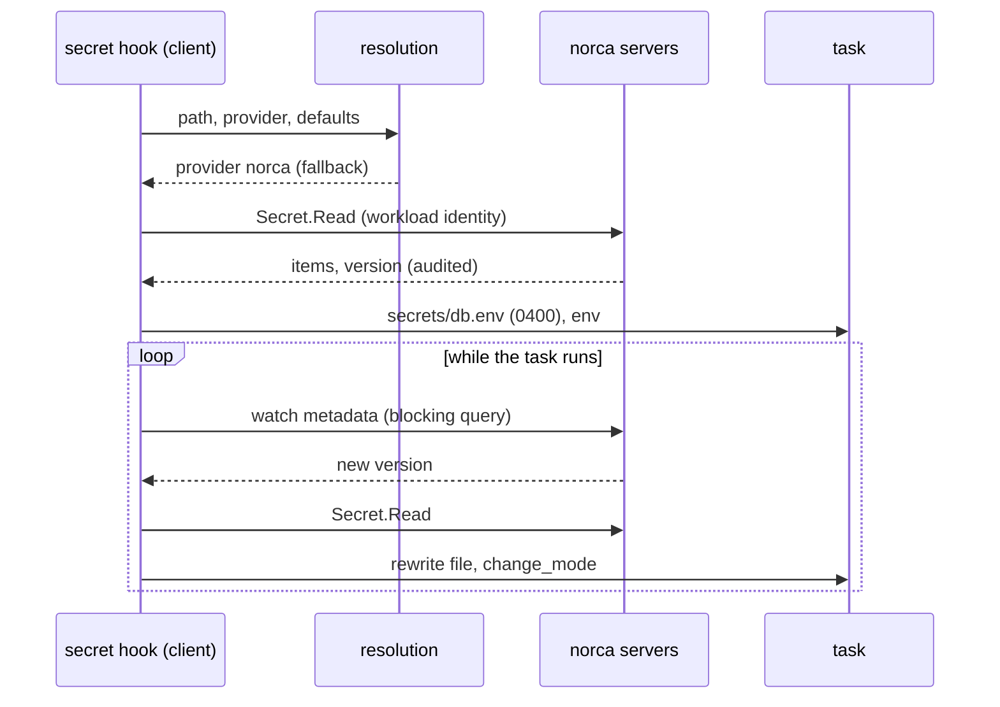

## What and why

A task should receive a secret without the value ever appearing in the job, the allocation, the client
state or the task events, and without a token in the job specification. The `secret` block of a task
names a secret by path and says how to deliver it: as a file below `secrets/`, as environment variables,
or both. The client fetches it with the task's workload identity, delivers it before the task starts, and
delivers it again when a new version is written.

## How it works



### Lifecycle

- The secret hook runs before the task starts, after the identity and Vault hooks and before templates. It
  blocks the start until every secret is delivered; `optional = true` makes a secret non-blocking.
- An unavailable provider or a missing secret is retried until `timeout` (default 5 minutes) with task
  events; a denied or invalid request fails the task at once.
- Files are written atomically (temporary file and rename) with mode 0400, owned by the task's user when
  the agent may change owners.
- Symlinks are never followed, as the task can write to its `secrets/` directory: every directory on the
  way to the file, `secrets/` included, must be a real directory. A symlink (or a Windows junction)
  among them fails the delivery of the secret with an error instead of writing outside of the task
  directory; a symlink at the destination itself is replaced by the new file.
- `env` values are set only in the task's environment. They are not part of the environment the client
  persists, nor of the persisted driver handle.
- A restarted client fetches every secret again; for a task that is still running this happens in the
  background, so the task keeps its files if the provider is unreachable.
- Changes: the `norca` provider watches the secret's metadata with a blocking query and fetches the value
  only when the version changes; the `vault` provider reads again every 5 seconds. A pinned `version` is
  not watched. On a change, `change_mode` applies: `restart` (default), `signal`, `script` or `noop`.
- Task events name the resolution and the version, never values, for example
  `secret db: provider norca (fallback)`.

### Providers

| Provider | Backend | Credential | Available |
| --- | --- | --- | --- |
| `norca` | The built-in store | The task's workload identity | Always; the fallback |
| `vault` | The Vault of the agent's [`vault`](/docs/configuration/vault) block | The task's Vault token: the task needs a [`vault`](/docs/job-specification/vault) block | When the agent's `vault` block is enabled |

Other provider names are accepted by the job specification but fail on the client with
`provider "<name>" ... is not configured on this client`. External providers (OpenBao, cloud secret
managers, plugins) are not available yet.

### Resolution order

Every lookup (a `secret` block, a `nomadSecret` call, a Vault-style lookup) is resolved by the client in
this order; the first step that names a provider wins:

| Step | Defined by | Example |
| --- | --- | --- |
| 1. Explicit | `provider` in the `secret` block, or a `provider:` prefix in `nomadSecret` | `provider = "vault"` |
| 2. Client route | `client { secrets { route "<prefix>" { provider = "..." } } }`, longest prefix wins | `route "kv/" { provider = "vault" }` |
| 3. Default | `secrets { default_provider }` of the group, else of the job, else the namespace metadata `secrets.default_provider` | `default_provider = "vault"` |
| 4. Vault integration | The agent's enabled `vault` block, for Vault-style lookups only (task `vault` block, Vault `secret` template function) | – |
| 5. Fallback | Nothing above names a provider | the built-in `norca` store |

- **Fallback means "not defined", never "failed".** A provider that is defined but unreachable, denies the
  request or doesn't have the secret fails the lookup with its own error; it never silently falls back to
  the built-in store.
- A step that names a provider the client doesn't have fails the lookup. A client `route` to an unknown
  provider is a configuration error at agent start.
- The namespace default is captured on the job when it is registered (like the namespace's default node
  pool): a changed namespace default applies to jobs registered afterwards, never silently to running
  tasks.
- `secret` blocks and `nomadSecret` calls are not Vault-style: without a defined provider they reach the
  fallback even when the agent has a Vault integration.

### Access: `secret_access`

Tasks have no implicit access to secrets. The `secret_access` block of a group (for all its tasks) or of a
task grants the tasks' workload identities `read-secret` and `list-secrets` on matching paths in the job's
namespace, while the allocation is not terminal:

```hcl
group "web" {
  secret_access {
    path = "${job}/*"
  }
}
```

- Patterns use globs and the placeholders `${job}`, `${group}` and, in tasks, `${task}`. `${job}` is the
  parent's ID for dispatched and periodic children, which inherit the parent's grants.
- When the job is registered or planned, the **submitter's** token must hold `read-secret` on each
  pattern as a whole; `write-secret` alone is not enough. A job therefore never grants its tasks more than
  its submitter may read. Revert and multiregion registration go through the same check.
- A task without a grant fails at start with the provider's permission error, and the audit records the
  denied read with the workload identity.

A policy bound to the job (`norca acl policy apply -job ...`) that grants `read-secret` works as well.

### Templates: `nomadSecret`

The template function `nomadSecret` returns the items of a secret as a map and follows the same resolution
order (with an optional `provider:` prefix):

```hcl
template {
  destination = "local/app.conf"
  data        = <<EOT
{{ with nomadSecret "app/db" }}password = "{{ .password }}"{{ end }}
EOT
}
```

The first call of a path waits for the first fetch (up to 5 minutes); afterwards the secret is watched and
a new version makes all templates of the task render again, with their own change modes.

### Admission policies

Admission policies see the secrets a job references in the `request.secrets` list (group, task, source,
name, provider, default and effective provider, path with placeholders replaced, version, file format,
environment variables, optional). For example, `request.secrets.all(s, size(s.env) == 0)` forbids
environment delivery in a namespace. `nomadSecret` calls are found in embedded templates only. See
[admission control](/docs/features/admission-control).

## Example

```hcl {filename="api.nomad.hcl"}
job "api" {
  # Default provider of all groups; a group can override it.
  secrets {
    default_provider = "norca"
  }

  group "api" {
    secret_access {
      path = "jobs/${job}/*"
    }

    task "server" {
      driver = "docker"

      config {
        image = "example/api:1.4"
      }

      secret "db" {
        path    = "jobs/${job}/db"

        file {
          destination = "secrets/db.env"
          format      = "env"
        }

        env {
          DB_USER     = "username"
          DB_PASSWORD = "password"
        }

        change_mode   = "signal"
        change_signal = "SIGHUP"
        timeout       = "30s"
      }

      secret "cert" {
        path     = "jobs/${job}/cert"
        optional = true

        file {
          destination = "secrets/cert.pem"
          format      = "template"
          template    = "{{ .cert }}"
        }

        change_mode = "script"
        change_script {
          command = "/bin/reload"
        }
      }
    }
  }
}
```

File formats: `env` writes one `KEY="value"` line per item (sorted; `"`, `\`, `$` and backquotes escaped,
newlines as `\n`), `json` a JSON object of the items, `raw:<item>` the value of one item, and `template` a
Go template over the items.

## Configuration reference

| Key | Type | Default | Description |
| --- | --- | --- | --- |
| `client.secrets.route "<prefix>".provider` | string | – | Provider of the lookups whose path starts with the prefix. |
| Namespace metadata `secrets.default_provider` | string | – | Default provider of the jobs of the namespace. |

Job specification: [`secret`](/docs/job-specification/secret),
[`secret_access`](/docs/job-specification/secret_access), [`secrets`](/docs/job-specification/secrets).
Agent: [`client { secrets }`](/docs/configuration/secrets#client-secrets-block).

## CLI and API

There is no separate CLI for delivery. `norca alloc status` shows the task events with the resolution of
each secret; the secrets themselves are managed with [`norca secret`](/docs/commands/secret).

## Limits and status

- Available: the `norca` and `vault` providers, the resolution order with fallback, `nomadSecret`,
  `secret_access`, change modes, admission on referenced secrets.
- Not available yet: external providers, dynamic secrets (`engine` and `role` are rejected), the
  per-client provider listing of the design.
- Recommendation: prefer `file` delivery to `env`. Environment variables are visible to every process of
  the task and are often logged by applications; an admission policy can forbid `env` per namespace.

## Design

[Secret storage plan – Provider resolution and fallback](/docs/design/secrets-plan#provider-resolution-and-fallback)
and [Delivery to tasks](/docs/design/secrets-plan#delivery-to-tasks).
