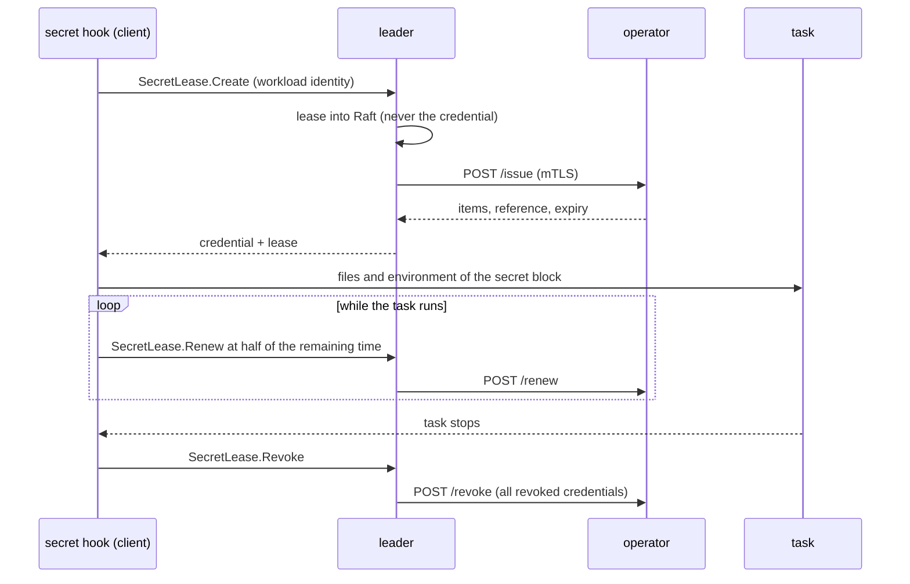

## What and why

A static secret is shared by every task that reads it and lives until someone rotates it. A leaked
copy stays valid, and nobody can tell which task it came from. A **dynamic secret** is a credential
created for one task when it starts, limited to what the task's role allows, renewed while the task runs
and revoked when it stops. A leaked credential is useless soon after, and each credential belongs to
exactly one task.

An **engine** names an **operator**: a service that creates the credentials of its target system, such
as database users, certificates or cloud sessions. Norca keeps the part every target system shares: leases,
renewal, revocation, workload identity and audit. The operator is an ordinary job built on the
[operator SDK](#writing-an-operator), so a new kind of credential needs no change in Norca and no format
of its own in the job: the operator answers with named items, and the job maps them with the usual `file`
and `env` blocks. No Vault or OpenBao with its engines is needed.

## How it works



- **Engines.** A `SecretEngine` of a namespace names the service of its operator and its **roles**, with
  their `ttl`, `max_ttl`, a `config` passed to the operator, and the `params` a job may send. Engines
  are kept in Raft. An engine can be created before its operator runs. Everything in an engine is
  stored in Raft and shown to readers, so **`config` must hold nothing secret.**
- **Requests.** A task asks for a credential with a [`secret`](/docs/job-specification/secret) block that
  names the engine and a role. The client requests a lease with the task's workload identity. The leader
  writes the **lease** to Raft first, so that the next leader can revoke a credential if the leader goes
  away during the call, then calls the operator, and returns the credential to that client only. The
  client delivers it like any secret.
- **Leases.** A lease records the engine, the role, the task (namespace, job, group, task, allocation,
  node), the issue time, `ttl`, `max_ttl`, the current expiry, the revocation state and the operator's
  reference of the credential. **It never holds the credential.** A lease belongs to one task: tasks of an
  allocation don't share credentials.
- **Renewal.** The client renews the lease at half of its remaining time; a renewal extends it by the
  role's `ttl`, never beyond `max_ttl` after its creation, and reaches the operator. When the lease can't be
  extended any more, the client asks for a new credential at half of the time that is left, delivers it
  and applies the block's `change_mode`. A renewal that finds the lease revoked also leads to a new
  credential.
- **Revocation.** The client revokes the lease when the task stops. The **lease watcher** of the leader
  revokes every lease whose allocation has stopped (or is gone), that expired without renewal, or that
  reached `max_ttl`. The operator gets the whole list of revoked credentials that have not expired, in one
  call, whenever the list changes and every 5 minutes, so an operator that was down catches up. Failed calls
  are retried with a backoff from 5 seconds up to 5 minutes and counted in
  `nomad.secrets.engine.sync_failed`. The leases are in Raft, so a new leader's watcher continues after a
  leader change. Revoked leases are removed once their credential has expired.
- **Audit and events.** Every creation, renewal and revocation is an audit record on the `SecretAccess`
  topic and in the audit file (operations `lease-create`, `lease-renew`, `lease-revoke`), with the
  engine, role and lease ID, never the credential. Engines and leases have events on the `Secret` topic.

### What the operator returns

An answer is a list of named items, which covers more than a username and a password:

| Target | Items | Renewal |
| --- | --- | --- |
| Database user | `username`, `password` | extends the user |
| TLS certificate | `cert`, `key`, `ca` | issues a new certificate: the renewal returns new items |
| Cloud session | `access_key`, `secret_key`, `session_token` | not renewable: the task gets a new one in time |
| API token | `token` | extends the token |

The answer can also set when the credential ends, and that it can't be renewed. A renewal that returns new
items reaches the task like a new version of the secret: the files are rewritten and `change_mode` applies.
Those items are not stored anywhere on the servers.

### When the operator is down

A task whose credential can't be created waits for it, up to the `timeout` of the block. With
[`fallback`](/docs/job-specification/secret) it starts on a static secret of the built-in store
instead:

```hcl
secret "db" {
  engine   = "postgres"
  role     = "app"
  fallback = "app/db-static"

  file {
    destination = "secrets/db.env"
  }
}
```

- The fallback is used only when a task starts and the operator can't be reached, after three attempts. A
  request that is denied or refused never starts on it, and a failed renewal of a running task keeps
  its credential and retries.
- The task runs on the fallback until it restarts, and then asks for a credential again. If that
  fails, it starts on the fallback again. `fallback_keep_on_restart = true` keeps it on the fallback, also
  after a restart of the client.
- `fallback_recover = "signal"` keeps asking while the task runs, every `fallback_recover_interval`
  (10s by default), and applies `change_mode` when a credential is delivered.
- The fallback stays valid all the time, and all the tasks share it, so **give it fewer rights than the
  dynamic credentials.** A task on a fallback has a `secret db: provider fallback` task event, an audited read
  of the static secret, and counts in the metric `nomad.client.secrets.fallback`.

The task needs a `secret_access` grant for the fallback path as well.

## Example

The engine specification (`norca secret engine apply`):

```hcl {filename="postgres.hcl"}
name = "postgres"
type = "operator"

operator {
  service = "postgres-operator"
}

role "app" {
  ttl     = "1h"
  max_ttl = "24h"
  config  = { member_of = "orders_rw" }
}
```

```shell
norca secret engine apply -namespace apps postgres.hcl
```

The job:

```hcl {filename="worker.norca.hcl"}
job "worker" {
  namespace = "apps"

  group "worker" {
    # The tasks may request credentials of the app role. The submitter
    # needs read-secret on the pattern.
    secret_access {
      path = "engines/postgres/creds/app"
    }

    task "worker" {
      driver = "docker"

      config {
        image = "example/orders-worker:1.4"
      }

      secret "db" {
        engine = "postgres"
        role   = "app"

        env {
          DB_USER     = "username"
          DB_PASSWORD = "password"
        }
      }
    }
  }
}
```

A certificate, with one file per item and request parameters:

```hcl
secret "tls" {
  engine = "internal-pki"
  role   = "api-client"
  params = { common_name = "api.apps.internal" }

  file {
    destination = "secrets/tls.crt"
    format      = "raw:cert"
  }
  file {
    destination = "secrets/tls.key"
    format      = "raw:key"
  }

  change_mode   = "signal"
  change_signal = "SIGHUP"
}
```

The role lists the keys a job may send (`params = ["common_name"]`); any other key is refused when the lease
is requested, and the operator checks the values against the role.

```shell
# The leases of the engine (never the credentials).
norca secret lease list -namespace apps -engine postgres

# Revoke one lease, or every lease of the engine.
norca secret lease revoke -namespace apps 2b0f4f8e-...
norca secret lease revoke -namespace apps -engine postgres
```

## Writing an operator

An operator implements `Backend` of the `controller/secrets` package and serves it with its workload
certificate:

```go
type postgres struct{ db *sql.DB }

func (p *postgres) Issue(ctx context.Context, req *secrets.IssueRequest) (*secrets.Credential, error) {
	// Idempotent by req.LeaseID: the leader may repeat the call.
	user, password, err := p.createUser(ctx, req.LeaseID, req.Config["database"])
	if err != nil {
		return nil, err
	}
	return &secrets.Credential{
		Items: map[string]string{"username": user, "password": password},
		Ref:   user,
	}, nil
}

func (p *postgres) Renew(ctx context.Context, req *secrets.RenewRequest) (*secrets.Renewal, error) {
	return &secrets.Renewal{}, p.extend(ctx, req.Ref, req.TTL)
}

func (p *postgres) Revoke(ctx context.Context, req *secrets.RevokeRequest) error {
	for ref := range req.Revoked {
		if err := p.dropUser(ctx, ref); err != nil {
			return err
		}
	}
	return nil
}

func main() {
	ctx, stop := signal.NotifyContext(context.Background(), os.Interrupt, syscall.SIGTERM)
	defer stop()
	if err := secrets.Serve(ctx, ":"+os.Getenv("NORCA_PORT_api"), secrets.TLSFromEnv(), &postgres{}); err != nil {
		log.Fatal(err)
	}
}
```

`controller/examples/secretoperator` is a complete sample with a table in memory, and
the [PostgreSQL operator](#the-postgresql-operator) a real one. The rules of the contract:

- **`Issue` is idempotent** by the lease ID: a credential must not be created twice.
- **`Revoke` gets every revoked credential** that has not expired, again with each change. It must accept
  references it doesn't know. A reference is the lease ID when an issue did not finish, so keep the lease
  ID with what you create.
- **Refusing a request:** return `&secrets.Invalid{Reason: "..."}`, for example for a param out of the bounds of
  the role. The task fails instead of waiting or starting on its fallback. Any other error counts as an
  outage.
- **Never log the items.** A failure answers with a status only, so an error can't carry a credential to
  the servers.
- **Keep no state the leader needs:** after a failure the leases are the truth.

The job of the operator is a service with `mtls { mode = "app" }`, and it keeps the admin credential of its
target system as an ordinary secret:

```hcl
job "postgres-operator" {
  group "operator" {
    network {
      port "api" {}
    }

    secret_access {
      path = "operators/postgres/*"
    }

    service {
      name = "postgres-operator"
      port = "api"

      mtls {
        mode = "app"
      }
    }

    task "operator" {
      driver = "docker"

      config {
        image = "example/postgres-operator:1.0"
      }

      secret "admin" {
        path = "operators/postgres/admin"

        env {
          PGPASSWORD = "password"
        }
      }
    }
  }
}
```

Norca never handles that credential: reads are audited, backups include it with the secret store, and a
compromised operator exposes one target system, not the servers. An operator rotates it with the
[expiry and rotation](/docs/features/secrets/secrets#expiry-and-rotation) of secrets, through its `change_mode`.

The leader calls the operator over mTLS with a certificate of the CA of the region, with the SPIFFE ID
`spiffe://<trust domain>/norca/server`, and checks that the operator presents the workload certificate of its
service. The SDK accepts no other client. An engine and its operator belong to one region, like the
leases: a job in another region uses the engine of that region.

The wire format is JSON over HTTPS: `POST /issue`, `/renew`, `/revoke` and `/health`, with the fields of the
Go types of the package.

## The PostgreSQL operator

The [PostgreSQL operator](https://github.com/bacanoo-io/norca-registry/tree/main/operators/postgres) of the
registry repository creates a login role for each lease and drops it when the lease is revoked. It is a separate
program, not part of Norca, and comes as Go source with a job and an engine to adapt. It serves one PostgreSQL
server, reached with the standard variables `PGHOST`, `PGPORT`, `PGDATABASE`, `PGUSER`, `PGPASSWORD` and `PGSSLMODE`.

Rights come from group roles, so the engine holds no SQL. The admin role needs `CREATEROLE`, not superuser, and
`ADMIN OPTION` on the groups:

```sql
CREATE ROLE norca_operator LOGIN CREATEROLE PASSWORD '...';
CREATE ROLE orders_rw NOLOGIN;
GRANT orders_rw TO norca_operator WITH ADMIN OPTION;
GRANT CONNECT ON DATABASE orders TO orders_rw;
GRANT SELECT, INSERT, UPDATE, DELETE ON ALL TABLES IN SCHEMA public TO orders_rw;
```

| Role `config` | |
| --- | --- |
| `member_of` | The group roles of the credential, comma-separated. Required; an unknown group refuses the request. |
| `database` | The database delivered to the task; by default `PGDATABASE`. |
| `host`, `port` | The address delivered to the task; by default that of `PGHOST`. |
| `sslmode` | Added to the `uri` item. |

A task gets the items `username`, `password`, `host`, `port`, `database` and `uri`.

- **Stateless.** The name of a role comes from its lease ID (`v_<lease ID>`), so a restart loses nothing and more
  than one instance can run. A repeated issue gives the role a new password.
- **The lease bounds the login.** `VALID UNTIL` follows the lease, so password logins stop when it ends, even if
  the revocation can't reach the operator. Expiry only stops new logins: open connections stay until the
  revocation.
- **Revocation** stops new logins, ends the open connections and drops the role. What the role created goes to
  the admin role, so a table a task created outlives its credential. Objects in other databases fail the drop:
  the operator reports it, and keeps retrying while the revocation is listed.
- **Sweep.** The leader stops listing a revocation when the credential expires. Every 5 minutes
  (`-sweep-interval`) the operator drops roles that expired more than an hour ago (`-sweep-grace`), which covers a
  revocation it never saw.
- **Passwords stay out of the logs.** The password is hashed (SCRAM-SHA-256) in the operator, so `log_statement`
  and `pg_stat_activity` show no plain text.
- **Keep the admin role.** Rotate its password freely, but from PostgreSQL 16 only the role that created a
  credential can drop it: after a change of `PGUSER` the older credentials need a superuser.
- **Other roles are safe.** Only roles named with the prefix (`-role-prefix`, `v_` by default) and 32 hex digits
  are ever changed or dropped.

## Permissions

| Action | Requires |
| --- | --- |
| List and read engines and leases | `read-secret-engine` (namespace) |
| Create, update, delete engines; revoke leases | `write-secret-engine` (namespace) |
| Request a credential (a task) | `read-secret` on `engines/<engine>/creds/<role>`, from a [`secret_access`](/docs/job-specification/secret_access) grant of the job or a policy bound to the job; the task needs a `secret` block naming the engine and the role |
| Renew or revoke a lease (a task) | the workload identity of the task the lease belongs to |

`read-secret-engine` and `write-secret-engine` are namespace capabilities, not part of the `read` or
`write` shorthands, and not valid in `secret` path rules. **Credentials are created for workload identities
only, never for ACL tokens.** Engine and lease events of the `Secret` topic are visible with
`read-secret-engine`.

## Configuration

Two settings of the [server `secrets` block](/docs/configuration/secrets) bound the calls to an operator:
`operator_max_concurrent` (10), per engine and leader, and `operator_timeout` (10s), which includes the wait
for a turn. A task waits for that long at most for one attempt when it starts.

## Observability

- **Audit** (`SecretAccess` topic, audit file): `engine-write`, `engine-delete` (path
  `engines/<engine>`), `lease-create`, `lease-renew`, `lease-revoke` (path
  `engines/<engine>/creds/<role>`, with `Engine`, `Role`, `LeaseID` and, for revocations, the `Reason`:
  `allocation-stopped`, `expired`, `max-ttl`, `operator` or `issue-failed`). Revocations of the lease watcher
  have the accessor `{"System": "secret-engine"}`, with the task of the lease.
- **Events** (`Secret` topic): `SecretEngineUpserted`, `SecretEngineDeleted` (key: the engine),
  `SecretLeaseCreated`, `SecretLeaseRenewed`, `SecretLeaseRevoked`, `SecretLeaseDeleted` (key: the lease
  ID, filter key: the engine).
- **Metrics:** `nomad.secrets.leases.created`, `.renewed`, `.revoked` (labels `engine`, `reason`),
  the gauge `nomad.secrets.leases.active` (on the leader), `nomad.secrets.engine.synced`,
  `nomad.secrets.engine.sync_failed`, and `nomad.client.secrets.fallback` (label `engine`) on the clients.
- **Task events:** `secret db: delivered (lease <id>, until <max_ttl end> at most)`, `new credential
  delivered`, `renewed credential delivered`, `lease <id> ended (...); requesting a new credential`, `provider
  fallback`, `credential delivered, leaving the fallback`.

## Behaviour in edge cases

- **The operator is down.** Tasks wait or start on their fallback; running tasks keep their credential and
  retry the renewal until the lease ends. Revocations reach the operator when it is back.
- **Client restart.** The client keeps the lease ID (never the credential) in its state and resumes
  renewing it; the delivered file stays. If the lease ended meanwhile, the task gets a new credential with
  its `change_mode`.
- **Client down.** Its leases are not renewed: the leader revokes them when they expire (`ttl`), or when
  the allocations are marked lost.
- **Leader change.** The new leader's watcher revokes what is due and sends the revocations. A leader that
  goes away during an issue leaves a lease with the lease ID as its reference, which the next one revokes.
- **Full restore of a backup.** A lease issued after the backup is lost, and its credential can't be revoked
  until it expires. The [preview](/docs/features/backup-restore#full-region-restore) warns about them.
- **Deleting an engine** fails while it has live leases; revoke them first with
  `norca secret lease revoke -engine`.
- **Sealed store.** Credentials can't be created or renewed while the store is sealed; the watcher waits
  for the unseal.

## Vault-style dynamic paths

A credential has a lease that must be renewed and revoked with its task, which a template function or the
Vault-compatible endpoint can't do. Use a `secret` block with `engine` and `role`. Vault-style dynamic
paths (`<mount>/creds/<role>`) keep failing with a message that they need a Vault/OpenBao provider or a
`secret` block of the built-in engine; they never fall back silently.

## Limits and status

- Available: operator engines, leases with renewal and revocation, the fallback, the `secret` block with
  `engine`, `role`, `params` and `fallback`, the operator SDK, CLI and API.
- Not available: ready-made operators beyond the [PostgreSQL operator](#the-postgresql-operator), which has no
  published image or pack; a private key that stays on the client (a CSR in the request); credentials for ACL tokens (only
  tasks get credentials); a web UI page for engines and leases; Vault-style dynamic paths (see above).

## Design

[Embedded secret storage – plan, Rotation and dynamic secrets](/docs/design/secrets-plan#rotation-and-dynamic-secrets).
The plan describes the first, built-in NATS backend, which was replaced by operators.
