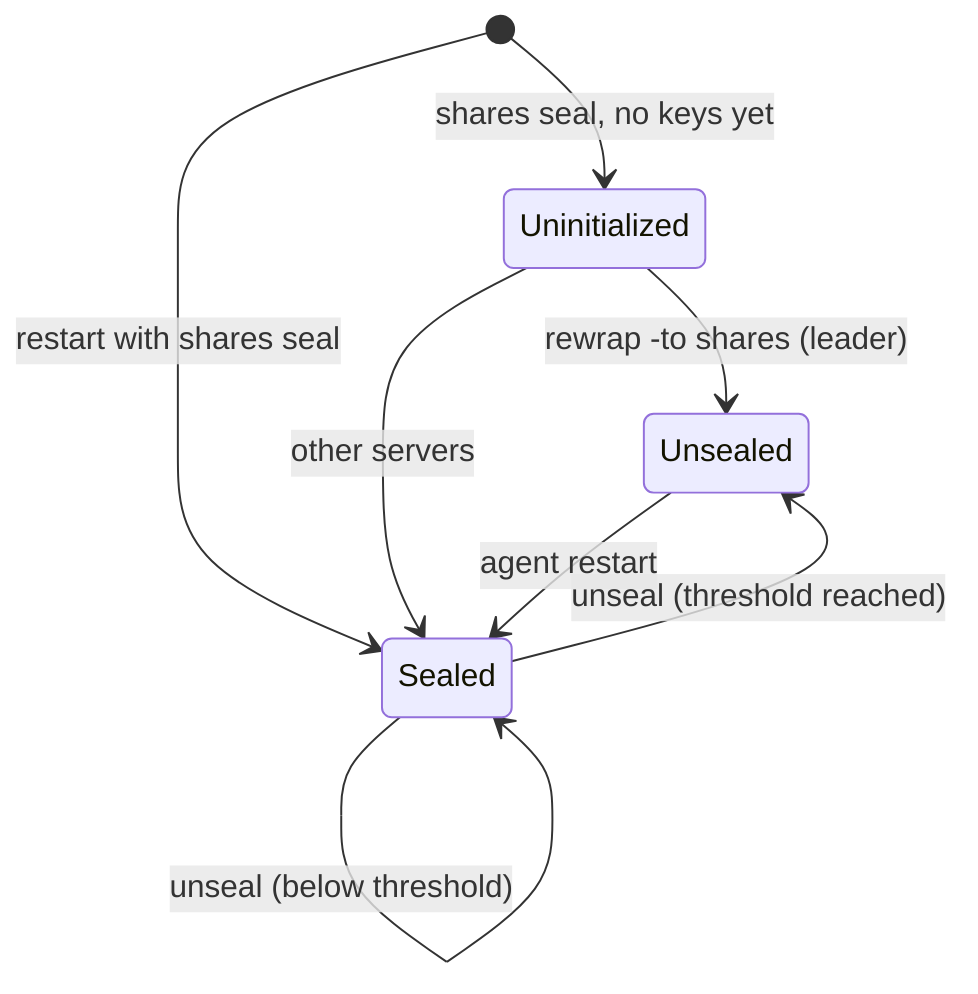

## What and why

In Nomad v1.6.5 every server keeps its root keys in the `keystore` directory, wrapped by a
key-encrypting key that is stored in the same file. Anyone who can read a server's data directory can
therefore decrypt every Variable, the native mTLS CA key and every backup taken with the cluster's own
keys.

Norca puts the keys behind a **seal**. With the `shares` seal, the root keys of the keyring and the key of
the secret store are wrapped by a random unseal key that exists on the servers only in memory. The unseal
key is split into Shamir shares (by default 5) that operators keep; a threshold of them (by default 3)
reconstructs it. A server that has restarted is **sealed** until the threshold of shares has been entered
on it.

## How it works

### Seal types

| Seal | Wraps the keys with | After a restart | Use |
| --- | --- | --- | --- |
| `shares` | A random unseal key split into Shamir shares | Sealed until `threshold` shares are entered with `norca operator unseal` | Production |
| `aead` | A key-encrypting key stored next to the key (the Nomad behaviour) | Unsealed | Development and migration only; the agent logs a warning |

Without a `keyring` block the server uses the `aead` seal. The KMS seals (`awskms`, `gcpckms`, `scwkms`)
and the `transit` seal of the design are not implemented: a configuration that names them is rejected
with "not implemented yet". Only one seal can be configured.

### Server states



- **Uninitialized.** A new region whose servers are configured with `seal "shares"` has no keys yet. The
  first `norca operator keyring rewrap -to shares` creates the unseal key on the leader, prints the shares
  once and unseals the leader. Every other server is sealed and is unsealed with the new shares.
- **Sealed.** The server joins Raft and serves everything that needs no decryption, but rejects Variables,
  workload identity signing, mTLS certificate issuance and the secret store. The HTTP API answers such
  requests with status 503 and `server is sealed`.
- **Unsealed.** The server holds the unseal key in memory and can unwrap its keys. Every server is
  unsealed on its own; the region keeps working while enough servers are unsealed.

### Key distribution

In a region with the `shares` seal, key material never travels between servers in usable form. Keyring
replication, the key fan-out of a keyring restore and a rewrap carry keys wrapped by the region's seal, and
every server unwraps them with its own unsealed seal. A sealed server, or a stolen server certificate,
yields nothing usable. With the `aead` seal the keys travel as in Nomad.

### Rewrap: moving to another seal

`norca operator keyring rewrap -to <seal>` moves the root keys and the secret store key to another seal
**online**:

1. Every server adds wraps of the new seal to its keys. Until the rewrap is complete, both the old and the
   new seal unwrap them.
2. The rewrap is complete when the leader and every other server of the Raft configuration has finished,
   reported that it is sealed, or is down. A sealed or down server does not hold it up.
3. At completion the wraps of the old seal are dropped. After a `shares` to `shares` rewrap (a rekey) the
   old shares stop working; servers that did not take part must be unsealed with the **new** shares.

A rewrap to `shares` prints the new shares once; they are stored nowhere. A rewrap does not rotate the
keys: after leaving `aead`, rotate the root keys with
[`norca operator root keyring rotate -full`](/docs/commands/operator/root/keyring-rotate), since copies of
old key files or backups may still hold the keys unprotected.

### Restoring a store wrapped by another seal

A full restore of a backup taken with other shares brings back a secret store key that the region's
current seal does not wrap. `norca operator seal-status` then shows the store as "needs recovery". Two
ways recover it:

- The backup's own copy of the secret store key (in backups taken with the keyring): a full restore or
  `norca operator backup restore-bootstrap` re-wraps it with the region's seal automatically.
- `norca operator unseal -recover`: enter the **old** shares on the leader until they unwrap the restored
  key; the leader then wraps it with the current seal. `-recover -reset` discards the old shares entered
  so far.

See [Operating the seal](/docs/operations/seal-unseal#restore-with-another-seal).

## Example

```hcl {filename="norca.hcl"}
server {
  enabled = true

  keyring {
    seal "shares" {
      shares    = 5
      threshold = 3
    }
  }
}
```

```shell
# Once per region: generate the unseal key and print the five shares.
$ norca operator keyring rewrap -to shares
Rewrap 6f1c... to "shares" started

Unseal share 1: ...
...
Unseal share 5: ...

The unseal shares are shown only this once and are stored nowhere. A restarted
server stays sealed until 3 of them are entered with 'norca operator unseal'.
Losing more than 2 of the 5 shares makes the keys unrecoverable.
Follow the progress with 'norca operator seal-status'.

# After every restart of a server: three share holders each enter one share.
$ norca operator unseal -server-id norca-2
Unseal share (will be hidden):
Server "norca-2" is sealed: 1 of 3 shares entered

$ norca operator seal-status
```

## Configuration reference

| Key | Type | Default | Description |
| --- | --- | --- | --- |
| `server.keyring.seal "<type>"` | block | none (`aead`) | The seal; the label is `shares` or `aead`. One seal only. |
| `seal "shares".shares` | int | `5` | Number of shares generated at the first rewrap to `shares` (2–255). |
| `seal "shares".threshold` | int | `3` (at most `shares`) | Shares needed to unseal a server (2 to `shares`). |

Full reference: [`keyring` block](/docs/configuration/keyring).

## CLI and API

| Command | API | ACL |
| --- | --- | --- |
| [`norca operator seal-status`](/docs/commands/operator/seal-status) | [`GET /v1/operator/seal`](/docs/api/operator/seal#read-seal-status) | `operator:read` |
| [`norca operator unseal`](/docs/commands/operator/unseal) | [`POST /v1/operator/unseal`](/docs/api/operator/seal#enter-an-unseal-share) | `operator:write` |
| [`norca operator unseal -recover`](/docs/commands/operator/unseal) | [`POST /v1/operator/seal/recover`](/docs/api/operator/seal#recover-a-restored-secret-store) | `operator:write` |
| [`norca operator keyring rewrap`](/docs/commands/operator/keyring-rewrap) | [`POST /v1/operator/keyring/rewrap`](/docs/api/operator/seal#rewrap-the-keyring) | `operator:write` |

The web UI shows the seal type and the state of every server on the Secrets page and in the dashboard's
federation strip. Unsealing is done with the CLI only.

## Limits and status

- Available: `shares` and `aead`, unseal, seal status, online rewrap (`aead` to `shares`, `shares` to
  `shares`, `shares` to `aead`), recovery of a restored store.
- Not available: the `awskms`, `gcpckms`, `scwkms` and `transit` seals, and a second seal next to the
  first. The server TLS identity stays on disk, as in Nomad.
- With `shares`, losing more than `shares - threshold` shares makes the keys unrecoverable. Keep the
  `age`-encrypted backups described in [backup and restore](/docs/features/backup-restore) as a second
  recovery path.

## Design

[Secret storage plan – Key protection (seal)](/docs/design/secrets-plan#key-protection-seal) and
[Backup and restore](/docs/design/secrets-plan#backup-and-restore).
