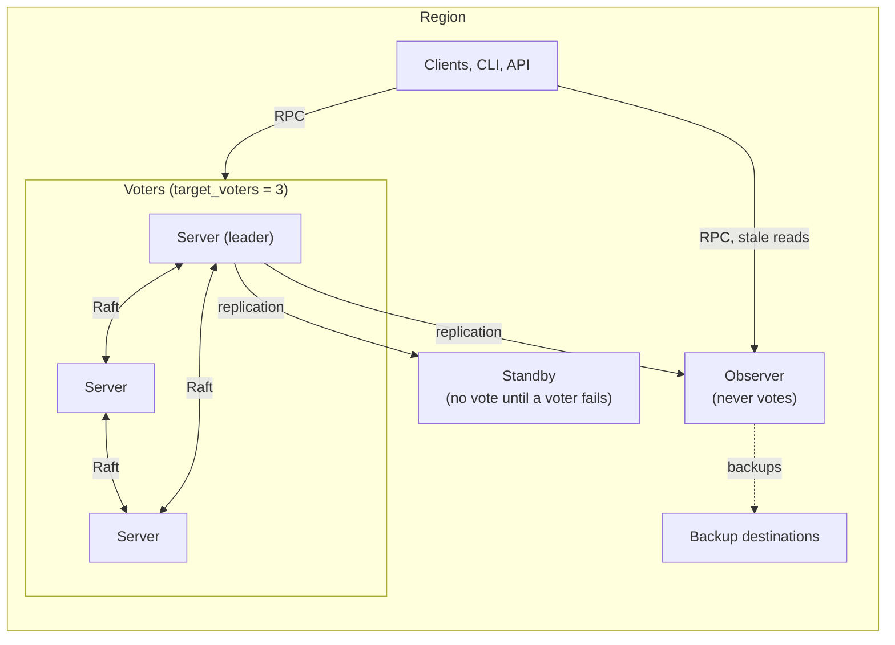

## What and why

The servers of a region form one Raft cluster, and every server in it votes.
More voters make every write slower and do not help much: three voters survive
the loss of one, five the loss of two. A region that needs more servers for
reads, for scheduling or for backups, or a spare server in another site, does
not need more votes.

Norca gives every server a **role**:

- **`voter`** - votes and can become the leader. This is the default, and a
  cluster of voters only works as before.
- **`observer`** - replicates the Raft log and the state, answers stale reads,
  runs scheduler workers and can take the backups, but **never votes and never
  becomes the leader.**
- **`standby`** - an observer until a voter fails. Autopilot then gives it the
  vote of the failed voter, and takes the vote back when the voter returns:
  **the voter set is restored without a person**, by a server that already has
  the state.

Nomad v1.6.5 has the `non_voting_server` option, but its autopilot promotes
every stable server, so the option has no lasting effect there. In Norca the
role replaces the option, and **autopilot is the only owner of the voter set**:
it decides every vote from the roles, and the manual command only asks it.

## How it works



- **Roles.** The role is set in the [`server` block](/docs/configuration/server#role)
  and advertised to the other servers. `bootstrap_expect` counts only servers
  with the role `voter`; standbys and observers never bootstrap a cluster. A
  server takes a new role after a restart.
- **Votes.** Autopilot gives a `voter`-role server its vote once it is stable,
  never gives one to an observer, and gives one to a standby only under the
  rules below. A voter that was restarted as an observer or a standby is
  demoted, one server per round, and only while the voters that are left have a
  healthy majority among themselves; a leader in that state hands the leadership
  over first.
- **Reads.** Observers and standbys answer [stale reads](/docs/api#consistency-modes)
  from their own copy of the state, like every follower. Consistent reads and
  writes go to the leader. Clients and the CLI can use an observer as their
  server address.
- **Scheduling.** Observers and standbys run scheduler workers, which adds
  scheduling capacity. A server meant only for reads and backups sets
  [`num_schedulers = 0`](/docs/configuration/server#num_schedulers).
- **Leader load.** The leader replicates to every observer and standby, so its
  CPU and network use grow with their number.

### Automatic failover

Standbys are promoted only where autopilot
[`target_voters`](/docs/configuration/autopilot#target_voters) is set. Autopilot
promotes a standby when all of these hold:

1. The healthy voters are fewer than `target_voters`.
2. A voter has been unhealthy for
   [`standby_failover_after`](/docs/configuration/autopilot#standby_failover_after)
   (one minute by default), or is gone from the Raft configuration.
3. The [`standby_cooldown`](/docs/configuration/autopilot#standby_cooldown)
   since the last change made for a standby has passed.
4. A standby is healthy, stable and within `max_trailing_logs` of the leader.

**The standby that is chosen** is one in the datacenter of the failed voter if
there is one, then the most caught up. After the promotion, autopilot's cleanup
removes the failed voter. For the time between the two there is one voter more
than the target, which the healthy voters and the standby carry.

When the failed server comes back, it joins without a vote, gets its vote again
once it is stable, and **the standby steps back** after the cooldown. A
demotion never brings the voters below the target.

> [!NOTE]
> With `target_voters` set, a failed voter is not removed before it has been
> unhealthy for `standby_failover_after`. An outage shorter than that changes
> nothing: no promotion, no removal.

### Manual failover

[`norca operator raft promote-standby`](/docs/commands/operator/raft/promote-standby)
is the failover by hand, for a voter that is known to be lost or when one
minute is too long:

```shell-session
$ norca operator raft promote-standby -id <standby> -replace <failed voter>
```

The leader checks that the standby is healthy and caught up, removes the failed
voter from the Raft configuration, and autopilot promotes the standby without
waiting for the failover time or the cooldown. **Nothing is removed unless the
promotion can follow.**

### Backups from an observer

With [`prefer_observer`](/docs/configuration/backup#prefer_observer) in the
`backup` block, the leader asks a healthy observer, the most caught up first,
to take the scheduled and the manual [backups](/docs/features/backup-restore).
The observer takes the snapshot from its own copy of the state, encrypts and
uploads it, and the leader records it. The leader takes the backup itself when
no observer can, when the observer's backup fails, and always before a full
restore.

### Work taken off the leader

Every server that is not the leader, observers included, handles part of a
request before it forwards it:

- **Job validation.** A job registration that fails the static validation is
  rejected by the server that received it. Checks that read the state (quotas,
  node pools, admission policies, webhooks) stay with the leader.
- **Capacity dry run.** `dry_run_capacity` of
  [job registration and plan](/docs/api/jobs#create-job) runs the scheduler on
  the state of the receiving server and reports the groups that would not be
  placed. It does not bind the leader.
- **Rate limits per ACL token.** The
  [`limits` block](/docs/configuration#limits) can limit the read and the
  write requests of each token on every server; a request over the limit gets
  `429` with `Retry-After`. The limits are off by default.

## Example

A region with three voters in three datacenters, and a standby and an observer
in a fourth site.

The voters:

```hcl
server {
  enabled          = true
  bootstrap_expect = 3
  role             = "voter"
}

autopilot {
  target_voters          = 3
  standby_failover_after = "1m"
  standby_cooldown       = "5m"
}
```

The standby:

```hcl
server {
  enabled = true
  role    = "standby"

  server_join {
    retry_join = ["10.0.1.10", "10.0.2.10", "10.0.3.10"]
  }
}
```

The observer, which also takes the backups (the `backup` block is the same on
every server):

```hcl
server {
  enabled        = true
  role           = "observer"
  num_schedulers = 0

  server_join {
    retry_join = ["10.0.1.10", "10.0.2.10", "10.0.3.10"]
  }

  backup {
    enabled         = true
    prefer_observer = true
    # schedule, destinations and encryption as on the voters
  }
}
```

The peers and their roles:

```shell-session
$ norca operator raft list-peers
Node          ID        Address         State     Voter  Role      RaftProtocol
dc1.global    0a4f...   10.0.1.10:4647  leader    true   voter     3
dc2.global    7c21...   10.0.2.10:4647  follower  true   voter     3
dc3.global    d93b...   10.0.3.10:4647  follower  true   voter     3
sb1.global    51e8...   10.0.4.10:4647  follower  false  standby   3
ob1.global    b6a0...   10.0.4.11:4647  follower  false  observer  3
```

When `dc3` is powered off, nothing changes for one minute. Then `sb1` shows
`Voter true`, and `dc3` is removed from the list. When `dc3` is started again,
it joins, gets its vote back, and after the cooldown `sb1` shows `Voter false`
again.

## Failure scenarios

| What happens | What the cluster does |
| --- | --- |
| One voter of three fails, a standby is ready | After `standby_failover_after` the standby is promoted, then the failed voter is removed |
| The failed voter comes back | It joins without a vote and gets its vote when it is stable; the standby steps back after the cooldown |
| A voter is unreachable for less than `standby_failover_after` | Nothing changes |
| Two voters of three fail | There is no quorum, and Raft cannot change its configuration without one: **nothing is promoted**, the region needs a manual recovery |
| The standby is behind | It is not chosen; without a caught-up standby nothing is promoted |
| The leader fails | The voters elect a new leader; a standby is promoted afterwards if a voter is still missing |
| Every observer fails | Stale reads go to the other servers, and the leader takes the backups |
| A voter is restarted as an observer | It is demoted; a standby fills in if the voters fall below the target |

## Configuration reference

| Setting | Where | Meaning |
| --- | --- | --- |
| `role` | [`server` block](/docs/configuration/server#role) | `voter` (default), `standby` or `observer` |
| `target_voters` | [`autopilot` block](/docs/configuration/autopilot#target_voters) | The number of voters autopilot keeps with standbys: `0` (default, no standby is promoted), `1`, `3`, `5` or `7` |
| `standby_failover_after` | [`autopilot` block](/docs/configuration/autopilot#standby_failover_after) | How long a voter must be unhealthy before a standby replaces it (`1m`) |
| `standby_cooldown` | [`autopilot` block](/docs/configuration/autopilot#standby_cooldown) | The minimum time between two changes made for standbys (`5m`) |
| `prefer_observer` | [`backup` block](/docs/configuration/backup#prefer_observer) | An observer takes the scheduled and manual backups |
| `token_*` | [`limits` block](/docs/configuration#limits) | Request limits per ACL token |

The agent configuration of autopilot is the initial one; later changes are made
with [`norca operator autopilot set-config`](/docs/commands/operator/autopilot/set-config).
The [deployer](/docs/deployer/configuration) sets the role with
`server_settings.role` and the backups with `backup.prefer_observer`.

## CLI and API

- [`norca operator raft list-peers`](/docs/commands/operator/raft/list-peers)
  shows the role of every server next to its vote.
- [`norca operator raft promote-standby`](/docs/commands/operator/raft/promote-standby)
  and the [API](/docs/api/operator/raft#promote-a-standby-server) are the manual
  failover.
- The [autopilot health API](/docs/api/operator/autopilot) shows the role and
  the health of every server.
- Every promotion and step back of a standby is an event of the `Server` topic
  of the [event stream](/docs/api/events): `StandbyPromoted` and
  `StandbyDemoted`.
- The [metrics store](/docs/configuration/metrics_store) of the leader keeps
  `norca.cluster.autopilot_voters`, `norca.cluster.autopilot_standbys_ready`,
  `norca.cluster.autopilot_standby_promotions` and
  `norca.cluster.autopilot_standby_demotions`.

## Limits and status

Available. Tested in the lab with three voters in three datacenters, one
standby and one observer: failover with a voter powered off, its return, the
manual failover, stale reads, and backups taken by the observer.

- **Observers do not serve consistent reads**; those go to the leader.
- **Observers and standbys belong to their region.** Raft does not span
  regions, so a server of one region cannot be an observer of another.
- **A standby does not help without a quorum.** With the majority of the
  voters lost, nothing can be promoted.
- A server changes its role only with a restart.
- An observer takes backups only when its `backup` block names the same
  destinations and encryption as the leader's.
- The number of observers and standbys a leader carries well is not measured
  yet; each one costs the leader replication work.
- The web UI does not show the roles yet.

## Design

[Observers and hot standby servers](/docs/design/server-roles-plan). The
feature is a clean room development: Norca's own design on the public parts of
Raft and autopilot.
