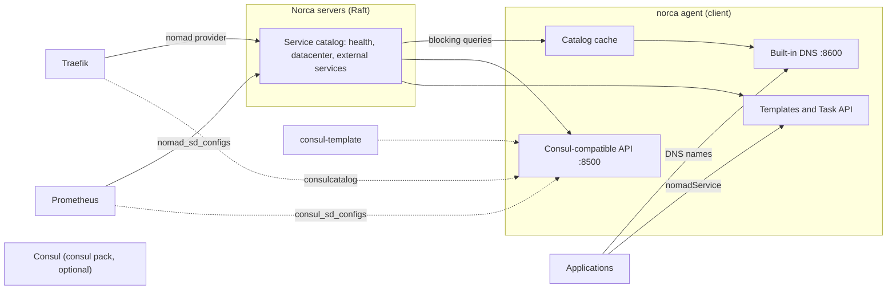

## What and why

Nomad v1.6.5 already has a native service provider (`provider = "nomad"`), but its catalog stores no
health state, so every lookup also returns instances whose checks fail, and there is no DNS interface.
In practice that meant installing and operating Consul next to the scheduler for three things:
health-based discovery, DNS names and the service mesh.

Norca closes these gaps in the native provider. The catalog records the health of every instance, the
clients can answer DNS queries and serve a read API in Consul's format, services outside the cluster can
be registered, and lookups can prefer instances close to the caller. Consul stays available as an
option for what Norca does not cover, installed from HashiCorp's official release by a pack. The
service mesh part, mutual TLS between services, is covered by [native mTLS](/docs/features/native-mtls).

## How it works

Discovery has four tiers. Each one builds on the native catalog stored in the servers' Raft state, and
the first three are part of Norca; the fourth is an external product that Norca can install.

| Tier | What it is | Typical consumers | Default |
| --- | --- | --- | --- |
| [Native catalog](/docs/features/service-discovery/catalog) | Service registrations with health, check states and datacenter; the HTTP API, `nomadService` in templates, the Task API | Applications, Traefik's `nomad` provider, Prometheus `nomad_sd_configs` | Always on; health filtering is opt-in for the HTTP API and templates |
| [Built-in DNS](/docs/features/service-discovery/dns) | A DNS server on every client that answers `*.service.nomad` (and optionally `*.service.consul`) names with healthy instances | Applications and hosts that resolve names | Off |
| [Consul-compatible API](/docs/features/service-discovery/consul-compatible-api) | An HTTP API on every client with the catalog, health, status and agent service endpoints of Consul | Traefik `consulcatalog`, Prometheus `consul_sd_configs`, consul-template, self-registering frameworks | Off |
| [Full Consul](/docs/features/service-discovery/consul-pack) | The official Consul release, installed and run as Norca jobs by the `consul` pack | Consul Connect with L7 features, Consul KV, sessions, prepared queries | Not installed |



Solid arrows are native integrations; dashed arrows are tools that only know Consul and read the
Consul-compatible API instead of a Consul agent. A tool that supports Norca's native API (the Nomad API
1.6.5 compatible `/v1/service` endpoints) should use it; the Consul-compatible API is for those that
don't.

On top of the tiers:

- [Topology-aware routing](/docs/features/service-discovery/topology): a `discovery` block on a service
  makes lookups prefer instances in the caller's datacenter, with an overflow rule and a regional
  failover list.
- [External services](/docs/features/service-discovery/external-services): machines outside the
  cluster, managed databases and DNS aliases appear in the catalog, the DNS and the Consul-compatible API
  like the services of allocations.


  
  
  
  
  
  


## Example

A client configuration that turns on everything the clients can serve, from the
[local development example](/docs/getting-started/examples/01-local-dev):

```hcl {filename="dev.hcl"}
client {
  # Templates and the Task API return only healthy instances by default.
  native_service_discovery {
    default_healthy_only = true
  }

  # Built-in DNS server answering from the native catalog.
  dns {
    enabled       = true
    bind          = "127.0.0.1:8600"
    consul_compat = true # *.service.consul names as well
    ttl           = "5s"
  }

  # Read-only Consul-compatible HTTP API for tools that only know Consul.
  consul_compat {
    enabled         = true
    bind            = "127.0.0.1:8500"
    datacenter_from = "region"
    namespaces      = ["default"]
  }
}
```

```shell
norca agent -dev -config dev.hcl

# in a second terminal, once a job with a service named test-app runs
norca service info -verbose test-app
dig @127.0.0.1 -p 8600 test-app.service.nomad SRV
curl 'http://127.0.0.1:8500/v1/health/service/test-app?passing'
```

## Configuration reference

| Block | Agent | Page |
| --- | --- | --- |
| `client { native_service_discovery { ... } }` | Client | [native_service_discovery](/docs/configuration/native_service_discovery) |
| `server { native_service_discovery { ... } }` | Server | [native_service_discovery](/docs/configuration/native_service_discovery#server-block) |
| `client { dns { ... } }` | Client | [dns](/docs/configuration/dns) |
| `client { consul_compat { ... } }` | Client | [consul_compat](/docs/configuration/consul_compat) |
| `service { discovery { ... } }` | Job | [discovery](/docs/job-specification/discovery) |

## CLI and API

| Task | CLI | HTTP API |
| --- | --- | --- |
| Read the instances of a service with their health | [`norca service info`](/docs/commands/service/info) | [`GET /v1/service/:name`](/docs/api/services#read-service) |
| Register, renew and remove external services | [`norca service register`](/docs/commands/service/register), [`ttl`](/docs/commands/service/ttl), [`deregister`](/docs/commands/service/deregister) | [External services API](/docs/api/external-services) |
| Read the catalog the way a Consul client does | – | [Consul-compatible API](/docs/api/consul-compatible) |

## Limits and status

- All four phases of the design that concern discovery (health-based catalog, DNS with topology-aware
  routing, the Consul-compatible read layer, external services with the Consul agent write endpoints)
  are implemented, as is the `consul` pack.
- The DNS server listens on the host. Workloads in `bridge` networking do not get it as their
  nameserver automatically; they find services through templates, the Task API or an address of the
  host that they can reach.
- The Consul-compatible API is not a Consul agent: Consul KV, sessions, prepared queries, Connect and
  every other endpoint answer `501 Not Implemented`.

## Design

[Consul independence – plan](/docs/design/consul-independence-plan), items 1 to 4 and 6.
