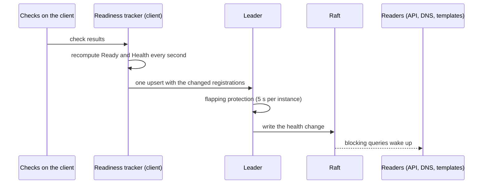

## What and why

In Nomad v1.6.5 a service registration of the native provider (`provider = "nomad"`) has no health
field: the checks of the service restart tasks and gate deployments, but every lookup still returns the
instances whose checks fail. Tools that read the catalog, such as Traefik's `nomad` provider or
Prometheus `nomad_sd_configs`, therefore send traffic to broken instances.

In Norca every registration carries the health of its instance: a `Ready` flag, an aggregate `Health`
(`passing`, `warning` or `critical`), the state of each check and the time of the last change. Lookups
can filter on it, the built-in DNS and the Consul-compatible API only hand out healthy instances, and
registrations also carry the topology zone of their node and the discovery settings of their service.

## How it works



**Health of an instance.** The client that runs the checks computes it, following the check roles
(see [health check roles](/docs/features/health-check-roles)):

- an instance is *ready* once the startup check of its workload has passed, and while all readiness
  checks of its service pass;
- its `Health` is `critical` until the startup check has passed, and then the worst state of the
  readiness checks and the checks without a role; liveness checks restart the task and do not count;
- an instance whose service has no checks is always ready and `passing`.

An instance is *healthy* when it is ready and its health is not `critical`.

**Writes only on change.** The client recomputes the health of its registrations every second and sends
the changed ones in a single upsert; once a minute it re-sends the current state, so a change that the
servers lost is corrected. On the leader, a health change of an instance that changed less than five
seconds ago is held back, and only the last held-back change is written when the five seconds have
passed (flapping protection). The leader counts the written changes in the metric
`nomad.service_registration.health_updates` and the held-back ones in
`nomad.service_registration.health_updates_deferred`, both labelled with the region.

**Who filters.** Health filtering is opt-in where the Nomad API 1.6.5 behaviour must stay compatible,
and always on where Norca adds the interface:

| Consumer | Returns |
| --- | --- |
| `GET /v1/service/:name` | Every instance; only healthy ones with `?healthy=true` |
| Templates (`nomadService`) and the Task API of a workload | Every instance, unless `client { native_service_discovery { default_healthy_only = true } }` is set on the client or the request sets `healthy` |
| `norca service info` | Every instance with its health; only healthy ones with `-healthy` |
| [Built-in DNS](/docs/features/service-discovery/dns) | Healthy instances |
| [Consul-compatible API](/docs/features/service-discovery/consul-compatible-api) | Every instance with its checks in Consul format; healthy ones with `?passing` |
| [Native mTLS](/docs/features/native-mtls) sidecar upstreams and gateways | Healthy instances |

**Publishing instances that are not ready.** Members of a stateful cluster (a database, NATS) often must
find each other before any of them is ready. With `discovery { include_not_ready = true }` on the
service, its instances count as healthy for discovery whatever their checks report.

## Example

A service with a readiness check, whose instances drop out of healthy lookups while the check fails:

```hcl
job "web" {
  group "web" {
    network {
      port "http" {}
    }

    service {
      name     = "web"
      port     = "http"
      provider = "nomad"

      check {
        name     = "ready"
        type     = "http"
        path     = "/ready"
        interval = "5s"
        timeout  = "2s"
        role     = "readiness"
      }
    }

    task "web" {
      driver = "docker"
      config {
        image = "example/web:1"
        ports = ["http"]
      }
    }
  }
}
```

```shell
norca service info -verbose web       # Ready, Health, Health Since and the check table per instance
norca service info -healthy web       # only the healthy instances
curl 'http://127.0.0.1:4646/v1/service/web?healthy=true'
```

## Configuration reference

| Key | Type | Default | Description |
| --- | --- | --- | --- |
| `client { native_service_discovery { default_healthy_only } }` | bool | `false` | Lookups made by the workloads of the client (templates, Task API) return only healthy instances unless the request sets `healthy`. See [native_service_discovery](/docs/configuration/native_service_discovery). |
| `service { discovery { include_not_ready } }` | bool | `false` | Instances of the service are discoverable even when they are not healthy. See [discovery](/docs/job-specification/discovery). |

## CLI and API

| Task | CLI | HTTP API |
| --- | --- | --- |
| Instances with health and checks | [`norca service info -verbose`](/docs/commands/service/info) | [`GET /v1/service/:name`](/docs/api/services#norca-extensions) |
| Only healthy instances | `norca service info -healthy` | `GET /v1/service/:name?healthy=true` |

## Limits and status

- Registrations written by clients that predate the health-based catalog have an empty `Health`; for
  them the `Ready` flag alone decides.
- Changes held back by the flapping protection are lost when the leader loses its leadership; the
  periodic re-send of the clients corrects them within a minute.
- The output of a check is kept only in brief (the first 256 bytes, recorded when the status changes).

## Design

[Consul independence – plan, item 1](/docs/design/consul-independence-plan#1-health-based-catalog).
