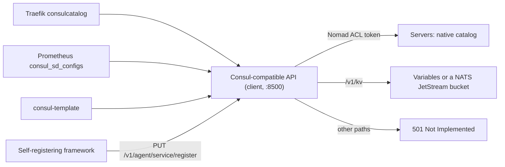

## What and why

Many tools discover services only through Consul's HTTP API: Traefik's `consulcatalog` provider,
Prometheus `consul_sd_configs`, consul-template's service functions, and frameworks that register
themselves at the local Consul agent. Some have a native integration with the Nomad API, but not all,
and not every installation can switch.

A Norca client can serve a small part of Consul's documented HTTP API on top of the native catalog: the
read endpoints of the catalog, health and status, and the agent endpoints that register services and
update TTL checks. The tools connect to the client instead of a Consul agent, without changes. The API is
off by default. It is an implementation of the public, documented behaviour of the API; it contains no
Consul code.

## How it works



**Endpoints.** Read endpoints (GET or HEAD):

| Endpoint | Served from |
| --- | --- |
| `/v1/agent/self` | The local node; `Config.Datacenter` is the region (or the node's datacenter, see `datacenter_from`) |
| `/v1/status/leader`, `/v1/status/peers` | The leader and the servers of the region |
| `/v1/catalog/datacenters` | The regions of the federation, or the datacenters of the region |
| `/v1/catalog/services` | Service names and tags |
| `/v1/catalog/service/:name` | The instances of a service |
| `/v1/catalog/nodes`, `/v1/catalog/node/:node` | The client nodes and the services on them |
| `/v1/health/service/:name` | Instances with their checks; `?passing` keeps the passing ones |
| `/v1/health/checks/:name`, `/v1/health/state/:state` | Check states in Consul format |
| `/v1/health/connect/:name` | Always an empty list (there is no Consul Connect) |
| `/v1/agent/services`, `/v1/agent/service/:id`, `/v1/agent/checks` | The services registered at this agent |

Write endpoints (PUT), added for self-registering applications (design phase 4):

| Endpoint | Effect |
| --- | --- |
| `/v1/agent/service/register` | Registers an [external service](/docs/features/service-discovery/external-services) owned by this client node |
| `/v1/agent/service/deregister/:id` | Removes it |
| `/v1/agent/check/pass/:id`, `/warn/:id`, `/fail/:id` | Sets a TTL check (`?note=` is the output) |
| `/v1/agent/check/update/:id` | Sets a TTL check from a body with `Status` and `Output` |

The Consul KV (`GET`, `PUT` and `DELETE /v1/kv/:key`, with `recurse`, `keys`, `separator`, `raw`,
`cas`, `flags` and blocking queries), for consul-template's `key`, `keyOrDefault`, `ls` and `tree`,
Traefik's and Spring Cloud's Consul KV configuration and similar tools. The keys live in Norca
Variables below `consul/kv` (default) or in a NATS JetStream key-value bucket, set by
`consul_compat { kv { backend } }`:

| | `variables` (default) | `nats` |
| --- | --- | --- |
| Storage | Raft of the region, encrypted, in the Norca backups | The JetStream bucket (`consul-kv`), with its replicas |
| Needs | Nothing | A NATS server with JetStream, e.g. of the `nats` pack |
| `ModifyIndex`, blocking queries | Raft index of the Variable | Revision of the key; a NATS watch wakes the query |
| Keys and values | Variables path at most 128 characters (`~XX` for other characters), values up to 64 KB | Any key, values up to 512 KB (the bucket's message size) |
| `flags` | Kept | Rejected (`400`) |
| ACL | The Variables rules of `consul/kv/<key>`, checked by the servers | The same rules, checked by the client |

Sessions and locks (`?acquire`, `?release`) and transactions (`/v1/txn`) are not served (`501`), and a
recursive delete removes the keys one by one, not atomically.

Every other path answers `501 Not Implemented` with a message that names the path, so a missing feature
shows up instead of failing silently. The full list with parameters is on the
[Consul-compatible API reference](/docs/api/consul-compatible).

**Mapping.**

- **Tokens:** a token in `X-Consul-Token`, `Authorization: Bearer` or `?token=` is used as a *Nomad*
  ACL token, so Norca's ACL rules apply (`read-job` on the namespace to read services,
  `register-external-service` to register). Requests without a token use `anonymous_token`.
- **Datacenters:** with `datacenter_from = "region"` (default), a Consul datacenter is a Norca region and
  `?dc=` forwards to that region. With `"datacenter"`, the Consul datacenters are the datacenters of the
  local region, and `?dc=` filters the instances by datacenter.
- **Namespaces:** the API shows the namespaces in `namespaces`. Services of the first one appear under
  their own name, those of the others as `<namespace>--<name>`.
- **Blocking queries:** `?index=` and `?wait=` map to Norca blocking queries (default wait 5 minutes, at
  most 10). `X-Consul-Index` carries the catalog index; `X-Consul-KnownLeader` and
  `X-Consul-LastContact` come from the Norca query metadata; `?stale` allows stale reads.
- **Health:** each instance gets a node check (`serfHealth`), a check with its aggregate health
  (`critical` while it is not ready) and one check per service check. External services report their
  own checks.
- **Topology:** `?near=_agent` orders the instances of a service by the
  [topology preference](/docs/features/service-discovery/topology) of the service relative to this
  client.
- **Filters:** `?tag=`, `?node-meta=key:value` and `?filter=` (a boolean expression over the Consul
  response objects) are supported.

**The agent's own `consul` block.** The default `bind` of the API, `127.0.0.1:8500`, is also the default
address of the agent's `consul` block. When the `consul` block points at the API of the same agent, the
agent would talk to itself, so it turns off `auto_advertise`, `server_auto_join` and `client_auto_join`
and adds `consul` to the fingerprint deny list, logs what it turned off, and `norca config validate`
warns about it. Task templates keep using the `consul` block's address, so consul-template's
`service` functions read the native catalog through the API. Pointing `consul.address` or
`consul_compat.bind` elsewhere restores the full Consul integration.

## Example

```hcl {filename="client.hcl"}
client {
  consul_compat {
    enabled         = true
    bind            = "127.0.0.1:8500"
    datacenter_from = "region"
    namespaces      = ["default", "apps"]
    anonymous_token = "<secret ID of a read-only token>"
  }
}
```

A read-only token for `anonymous_token` (from `example/policies/acl-catalog-read.hcl`):

```hcl {filename="acl-catalog-read.hcl"}
namespace "*" {
  capabilities = ["read-job"]
}

node {
  policy = "read"
}
```

```shell
curl http://127.0.0.1:8500/v1/catalog/services
curl 'http://127.0.0.1:8500/v1/health/service/test-app?passing'
curl 'http://127.0.0.1:8500/v1/health/service/apps--test-api?passing'   # a service of the second namespace
```

Traefik and Prometheus need no special settings: point their Consul address at the client
(`127.0.0.1:8500`), and the datacenter, if they set one, at the Norca region.

## Configuration reference

All keys are in the `client { consul_compat { ... } }` block. Full reference:
[consul_compat](/docs/configuration/consul_compat).

| Key | Type | Default | Description |
| --- | --- | --- | --- |
| `enabled` | bool | `false` | Start the API. |
| `bind` | string | `"127.0.0.1:8500"` | Address to listen on. |
| `datacenter_from` | string | `"region"` | `"region"` or `"datacenter"`: what a Consul datacenter is. Also applies to the datacenter label of `*.service.consul` DNS names. |
| `namespaces` | list(string) | `["default"]` | Namespaces shown; the first without a prefix. |
| `anonymous_token` | string | `""` | Nomad ACL token for requests without a token; use a read-only token. |
| `kv` | block | | KV backend: `backend` (`"variables"`, `"nats"`, `"disabled"`), `namespace`, `path`, `nats { urls, bucket, ... }`. |

## CLI and API

There is no CLI. Endpoints and parameters: [Consul-compatible API reference](/docs/api/consul-compatible).

## Limits and status

- Sessions (and the KV locks built on them), transactions, prepared queries, events, ACL endpoints,
  Connect and config entries are not served (`501`). For secrets use Norca Variables or the
  [secret store](/docs/features/secrets) directly; the KV is for tools that only know Consul.
- `/v1/health/connect/:name` is always empty and registrations with Connect settings or a non-typical
  `Kind` are rejected.
- Agent check registrations support `TTL`, `HTTP` and `TCP` checks; script, gRPC, H2PING, UDP, alias and
  TCP-with-TLS checks are rejected.
- `?near=` with a node name is accepted but leaves the answer unsorted; only `_agent` (or `_self`) sorts.
- The Consul Enterprise `ns` parameter is not supported; use `namespaces` and the name prefix.

## Design

[Consul independence – plan, item 3](/docs/design/consul-independence-plan#3-consul-compatible-read-layer)
and [item 4](/docs/design/consul-independence-plan#4-external-service-registration).
