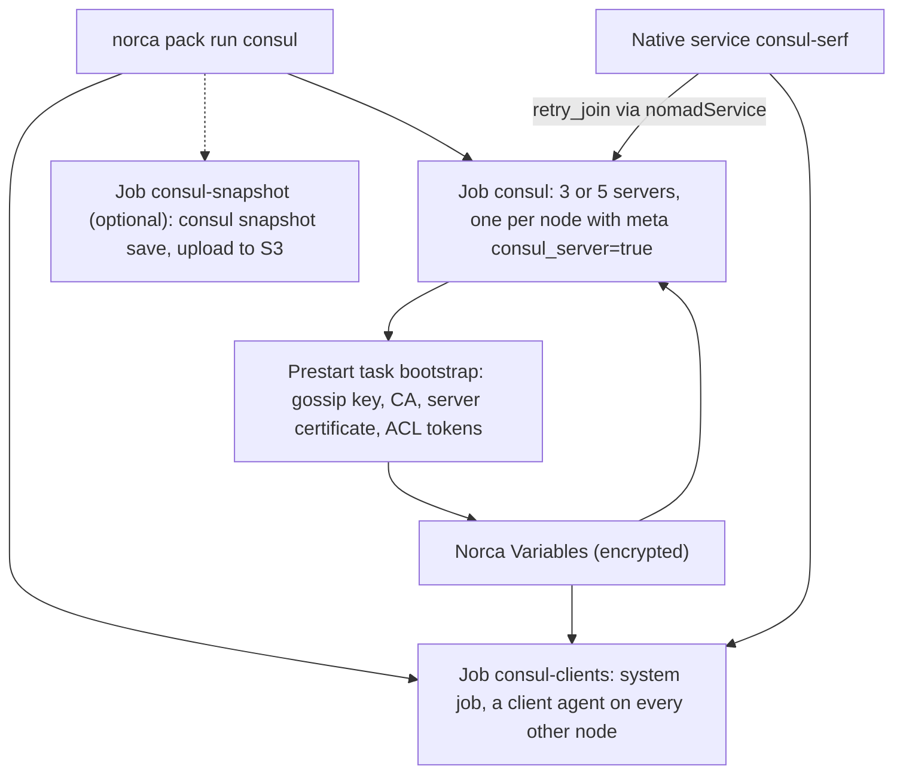

## What and why

Norca's native discovery, DNS, Consul-compatible API and [native mTLS](/docs/features/native-mtls)
replace Consul for most installations. A few things still need a real Consul: Consul Connect with L7
traffic management, sessions and locks, the full Consul KV, prepared queries and config entries.

For those, the `consul` pack of the [Norca pack registry](https://github.com/bacanoo-io/norca-registry)
installs and runs the **official, current Consul release** as Norca jobs: the servers as a service job,
a client agent on every other node as a system job, and optionally a periodic snapshot job. It
bootstraps the gossip key, TLS and ACLs without manual steps and applies a security baseline to every
install.

> [!WARNING]
> **Consul is not part of Norca and is not open source.** HashiCorp licenses Consul under the Business
> Source License 1.1 (BSL 1.1). Norca does not distribute, include, vendor or modify Consul and ships no
> Consul binary or image; the pack only references the official release (the `hashicorp/consul` image,
> or the release archive by URL and checksum), which the nodes download from HashiCorp or from your
> mirror of the unmodified artifacts. **You accept the Consul license when you install it**: the pack
> does not render until you set `consul_license_accepted = true`. BSL 1.1 allows internal production
> use; the restriction concerns products competing with HashiCorp. Confirm this legally for your own
> use case.

Why not the last MPL release of Consul (v1.16.4)? It misses years of security fixes that were released
only under the BSL, and supports only Envoy versions that no longer receive fixes. The pack therefore
installs a current release.

## How it works



- **No circular dependency.** Norca does not need Consul to start. The Consul agents find each other
  through Norca's native service discovery (the group service `consul-serf`, read with
  `nomadService` in a `retry_join` template), and their secrets come from Norca Variables.
- **Bootstrap without manual steps.** A prestart task runs the `norca` CLI through the task API socket
  with its workload identity: it generates the gossip key (`norca operator gossip keyring generate`), a
  CA and a server certificate (`norca tls ca create`, `norca tls cert create`) and the ACL tokens once,
  stores them with check-and-set in a Variable, and derives the Variables of the server, client and
  snapshot jobs from it. The servers bootstrap ACLs with `acl.tokens.initial_management`; a poststart
  task creates the agent policy and token. With Norca ACLs enabled, one ACL policy for the bootstrap
  task is the only manual step; the pack prints it.
- **Security baseline on every install:** Consul ACLs on with `default_policy = "deny"` and no
  anonymous access, gossip encryption, TLS with verified server names and `auto_encrypt` for the
  clients, plain HTTP and gRPC on localhost only, DNS on localhost, no update check.
- **Operations:** rolling upgrades one server at a time (servers first, then clients), a disruption
  budget of one server, an optional hourly `consul snapshot save` uploaded to the S3-compatible store of
  the Norca backups, documented manual steps for certificate renewal and gossip key rotation.
- **Air-gapped installs:** the image is referenced by registry, repository, tag and optional digest
  (`image_registry` defaults to `docker.io`), so a mirror of the unmodified official image in an internal
  registry can be pinned by digest.

Norca's own `consul {}` agent block is not changed by the pack. While Consul runs on a node, Norca's
default Consul address (`127.0.0.1:8500`) reaches it, so either wire Norca to it with a token or turn the
integration off on every node:

```hcl
consul {
  auto_advertise   = false
  server_auto_join = false
  client_auto_join = false
}
```

## Example

On the nodes that will run the Consul servers (one per datacenter, one datacenter per availability
zone):

```hcl
datacenter = "eu-central-1a"

client {
  meta {
    consul_server = "true"
  }
  host_volume "consul-server" {
    path = "/srv/consul"
  }
}
```

Then, with the registry added as `norca`:

```shell
norca pack run consul --registry=norca --var consul_license_accepted=true
norca job status consul
norca var get -item=management_token nomad/jobs/consul/servers/bootstrap   # the Consul management token
```

## Configuration reference

The pack's variables (the most important ones; the
[pack README](https://github.com/bacanoo-io/norca-registry/blob/main/packs/consul/README.md) lists all):

| Variable | Default | Description |
| --- | --- | --- |
| `consul_license_accepted` | `false` | Must be `true`: you accept the BSL 1.1 license of Consul |
| `consul_version` | `2.1.0` | Consul release; pin the release you validated |
| `server_count` | `3` | 3 or 5 (1 for development) |
| `driver` | `docker` | `docker`, `exec` or `raw_exec` |
| `image_registry`, `image_digest` | `docker.io`, `""` | Internal mirror and digest pinning |
| `server_node_meta`, `datacenter_attribute` | `consul_server`, `${node.datacenter}` | Placement of the servers |
| `host_network` | `""` | Private network (for example the VPN interface) |
| `datacenter`, `domain` | `dc1`, `consul` | Consul datacenter and domain |
| `tls_enabled` | `true` | TLS for RPC, HTTPS and gRPC |
| `clients_enabled` | `true` | The client system job |
| `snapshot_enabled` | `false` | The snapshot job |

## CLI and API

The pack is installed and managed with the `norca pack` commands (see
[packages](/docs/features/packages)): `norca pack run`, `norca pack render`, `norca pack plan`,
`norca pack uninstall`. Consul itself is used with its own CLI and API.

## Limits and status

- The pack cannot create Norca ACL policies: with Norca ACLs, the bootstrap task's policy is applied once
  by hand.
- No automatic certificate renewal or gossip key rotation.
- One Consul datacenter per install; WAN federation between Norca regions is not configured.
- The bootstrap task needs the `exec` or `raw_exec` driver and the `norca` binary on the server nodes.
- Consul DNS on the agents has no token; Norca's [built-in DNS](/docs/features/service-discovery/dns) is
  the recommended resolver.

## Design

[Consul independence – plan, item 6](/docs/design/consul-independence-plan#6-full-consul-as-an-option).
