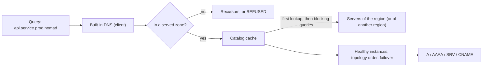

## What and why

Many applications and tools find their peers by DNS name, and configurations written for Consul often
contain `*.service.consul` names. Nomad v1.6.5 has no DNS interface for its native catalog.

Every Norca client can run a DNS server that answers `<service>.service.nomad` names from the native
catalog, with A, AAAA and SRV records of the healthy instances, ordered by topology and with regional
failover. Optionally it answers `*.service.consul` names as well, so existing configurations keep
working during a migration. The server is off by default.

## How it works



**Names.** With the default domain `nomad` (configurable with `domain`):

| Name | Answer |
| --- | --- |
| `<service>.service.nomad` | Instances of the service in the first namespace of `namespaces` (default `default`), in the client's region |
| `<service>.service.<namespace>.nomad` | The same in the given namespace |
| `<service>.service.<namespace>.<region>.nomad` | The same in another region (forwarded to its servers) |
| `<tag>.<service>.service...` | Only instances registered with the tag |
| `_<service>._<tag>.service...` | RFC 2782 style SRV name; `_tcp` and `_udp` mean no tag filter |
| `<hex IP>.addr.nomad` | The address of an SRV target |
| `<service>.service[.<datacenter>].consul` | With `consul_compat = true`: the same in Consul's naming. The optional label is a Norca region, or a datacenter of the local region with `client { consul_compat { datacenter_from = "datacenter" } }`. |

**Records.** A and AAAA queries return the addresses of the instances (each address once, in random
order). SRV queries return one record per instance with its port; the target is
`<hex IP>.addr.<domain>`, and its address is in the additional section. An instance whose address is a
host name, such as an [external service](/docs/features/service-discovery/external-services) of kind
`alias`, is answered with a CNAME record; a name has a CNAME only when no instance has an IP address.

**Which instances.** Only healthy instances (and those of services with
`discovery { include_not_ready = true }`) are returned. In the client's own region they are selected by
the [topology preference](/docs/features/service-discovery/topology) of the service; when the region
has none, the regions of the service's `failover` list are tried in order. A service without eligible
instances answers `NXDOMAIN`.

**Namespaces.** The server answers only for the namespaces in `namespaces`; a name in any other
namespace is answered with `REFUSED`.

**Other names.** Queries outside the served zones are forwarded to the `recursors` when the query asks
for recursion; without recursors they are refused.

**Cache.** The client keeps the registrations of each looked-up service in memory and keeps them up to
date with blocking queries, so repeated answers don't reach the servers. An entry that is not used for
five minutes is dropped. Services of other regions are read through region forwarding.

**Authorization.** The cache reads the catalog with the `token` of the `dns` block, or with the
identity of the node, which can read the services of every namespace of its region. Other regions don't
accept the identity of a node: when ACLs are enabled and names of other regions must resolve, set a
`token` that is valid in every region (a global token with `read-job`).

**TTL.** Answers and the negative-cache TTL of the SOA record use `ttl` (default 5 seconds).

## Example

```hcl {filename="client.hcl"}
client {
  dns {
    enabled    = true
    bind       = "127.0.0.1:8600"
    namespaces = ["default", "apps", "observability"]
    recursors  = ["10.0.0.2"]
  }
}
```

```shell
dig @127.0.0.1 -p 8600 test-app.service.apps.nomad SRV
dig @127.0.0.1 -p 8600 _test-app._tcp.service.apps.nomad SRV
dig @127.0.0.1 -p 8600 test-app.service.apps.eu-1.nomad A
```

To use the server as the resolver of the host for the `nomad` zone only, point a forwarding resolver
(for example systemd-resolved, dnsmasq or unbound) at `127.0.0.1:8600` for that zone.

## Configuration reference

All keys are in the `client { dns { ... } }` block. Full reference: [dns](/docs/configuration/dns).

| Key | Type | Default | Description |
| --- | --- | --- | --- |
| `enabled` | bool | `false` | Start the DNS server. |
| `bind` | string | `"127.0.0.1:8600"` | Address to listen on, over UDP and TCP. |
| `domain` | string | `"nomad"` | Domain of the native catalog. |
| `consul_compat` | bool | `false` | Answer `*.service.consul` names as well. Not allowed with `domain = "consul"`. |
| `recursors` | list(string) | `[]` | Nameservers (`host` or `host:port`) for other names. |
| `ttl` | duration | `"5s"` | TTL of the answers. |
| `namespaces` | list(string) | `["default"]` | Namespaces answered for; the first is used for names without a namespace. |
| `token` | string | node identity | ACL token used to read the catalog. Also used by native mTLS sidecars to read other regions. |

## CLI and API

The DNS server has no CLI or API of its own. Check what it would return with
[`norca service info -healthy`](/docs/commands/service/info) or
[`GET /v1/service/:name?healthy=true&near=self`](/docs/api/services#norca-extensions) on the same
client.

## Limits and status

- The server listens on the host (by default on the loopback address). Workloads in `bridge` networking
  do not get it as their nameserver; the design deferred that, as `resolv.conf` has no port field and
  cannot be limited to one zone. Workloads use templates, the Task API or environment variables
  instead.
- No PTR, TXT or other record types; DNSSEC is not supported.
- Consul's prepared query (`*.query.consul`), node (`*.node.consul`) and other Consul DNS names are not
  answered.

## Design

[Consul independence – plan, item 2](/docs/design/consul-independence-plan#2-built-in-dns).
