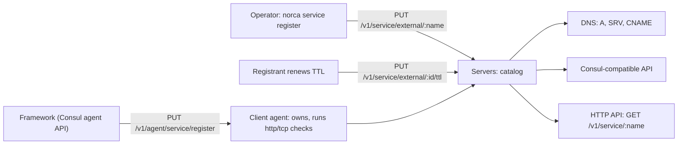

## What and why

Not everything an application talks to runs as a Norca allocation: a database on its own machine, a
managed database of a cloud provider, a legacy system, or an application framework that registers itself
at the local Consul agent (for example Spring Cloud Consul). In Nomad v1.6.5 such services can only be
found through Consul.

Norca registers them in the native catalog as *external services*: registrations without a job or
allocation, with their own health checks. They appear in the catalog, the
[built-in DNS](/docs/features/service-discovery/dns) and the
[Consul-compatible API](/docs/features/service-discovery/consul-compatible-api) exactly like the services
of allocations. An external service of kind `alias` is a DNS alias, answered with a CNAME record, so
applications can reach a managed database by an internal name that survives a migration of the target.

## How it works

**Kinds.**

| Kind | Fields | DNS answer |
| --- | --- | --- |
| `address` (default) | An IP address or host name, and a port | A/AAAA (a host name: CNAME), SRV |
| `alias` | A target DNS name | CNAME to the target |

**Keeping a registration alive.** An external service is kept up to date in one of three ways:

| Way | How | Removed when |
| --- | --- | --- |
| TTL check | The registrant renews the check within its TTL (`norca service ttl`, or the TTL endpoint); a check that is not renewed turns `critical` with the output `TTL expired` | It has been critical for `deregister_critical_after` (default 1 hour through the native API; 0 keeps it) |
| HTTP or TCP check | Registered through a **client** agent, which then owns the registration and runs the checks | As above, or when the owning node goes down |
| Static | No TTL check and no owning node; requires `operator` write in addition | Only by `norca service deregister` |

The health of an external service is the worst state of its checks (`passing` without checks); like
any instance, it is healthy unless its health is `critical`.

The leader tracks the TTL deadlines in memory, like node heartbeats: a renewal only resets the deadline,
and only status changes are written to Raft. After a leader change, every TTL check gets a full TTL.

**Consul agent registrations.** Applications that register themselves at a Consul agent can use the
agent endpoints of the Consul-compatible API (`PUT /v1/agent/service/register` and the check endpoints).
Such registrations are always owned by the client node they were registered at: the node runs their
HTTP and TCP checks, and they are removed when the node goes down. As in Consul, their checks start
`critical` unless the registration sets a `Status`, and `DeregisterCriticalServiceAfter` applies.

**ACLs.** Registering, renewing and deregistering need the namespace capability
`register-external-service`, which no policy shorthand (`read`, `write`, ...) includes. Static
registrations also need `operator` write.



## Example

A DNS alias for a managed database, and a machine outside the cluster kept alive by a TTL check:

```shell
norca service register -namespace prod -alias db.c9xk2.eu-central-1.rds.example.com billing-db
dig @127.0.0.1 -p 8600 billing-db.service.prod.nomad   # CNAME db.c9xk2.eu-central-1.rds.example.com

norca service register -address 10.0.5.20 -port 5432 -ttl 30s -tag primary legacy-pg
norca service ttl legacy-pg                             # renew; repeat within 30 seconds
norca service ttl -status warning -output "replication lag" legacy-pg

norca service info legacy-pg                            # Job ID column: (external address)
norca service deregister legacy-pg
```

A service with an HTTP check run by the client agent the CLI talks to:

```shell
NOMAD_ADDR=http://127.0.0.1:4646 norca service register \
  -address 10.0.5.30 -port 8080 -http http://10.0.5.30:8080/health -interval 10s legacy-api
```

The same through the native API, with two checks:

```shell
curl -X PUT http://127.0.0.1:4646/v1/service/external/legacy-api -d '{
  "Address": "10.0.5.30",
  "Port": 8080,
  "Checks": [
    {"Type": "http", "HTTP": "http://10.0.5.30:8080/health", "Interval": 10000000000},
    {"Type": "ttl", "TTL": 60000000000}
  ]
}'
```

## Configuration reference

External services need no agent configuration. The fields of a registration:

| Field | Type | Default | Description |
| --- | --- | --- | --- |
| `ID` | string | the name | ID of the registration, unique in the namespace |
| `Name` | string | – | Service name (from the URL) |
| `Kind` | string | `"address"` | `"address"` or `"alias"` |
| `Address` | string | – | IP address or host name (`address`) |
| `Target` | string | – | Target DNS name (`alias`) |
| `Port` | int | `0` | Port |
| `Tags`, `Meta` | list, map | – | As for other services |
| `Datacenter` | string | the owning node's | Datacenter the service is reported in |
| `Checks` | list | – | `ttl`, `http` or `tcp` checks; see the [API](/docs/api/external-services) |
| `DeregisterCriticalAfter` | duration | `1h` | Time critical before deregistration; `0` keeps the service |

## CLI and API

| Task | CLI | HTTP API |
| --- | --- | --- |
| Register or update | [`norca service register`](/docs/commands/service/register) | [`PUT /v1/service/external/:name`](/docs/api/external-services#register-external-service) |
| Renew or set TTL checks | [`norca service ttl`](/docs/commands/service/ttl) | [`PUT /v1/service/external/:id/ttl`](/docs/api/external-services#update-ttl-checks) |
| Deregister | [`norca service deregister`](/docs/commands/service/deregister) | [`DELETE /v1/service/external/:id`](/docs/api/external-services#deregister-external-service) |
| List the external services | – | [`GET /v1/services/external`](/docs/api/external-services#list-external-services) |
| Register at the agent, Consul style | – | [Consul agent endpoints](/docs/api/consul-compatible#agent-write-endpoints) |

## Limits and status

- Check types: `ttl`, `http` and `tcp`. Script, gRPC and TLS TCP checks are not supported.
- HTTP and TCP checks must be registered through a client agent; a server-only agent rejects them.
- A registration with Connect settings, or a `Kind` other than a typical service, is rejected by the
  Consul agent endpoints.
- The Consul KV is not mapped to Variables; this is a deliberate non-goal.

## Design

[Consul independence – plan, item 4](/docs/design/consul-independence-plan#4-external-service-registration).
