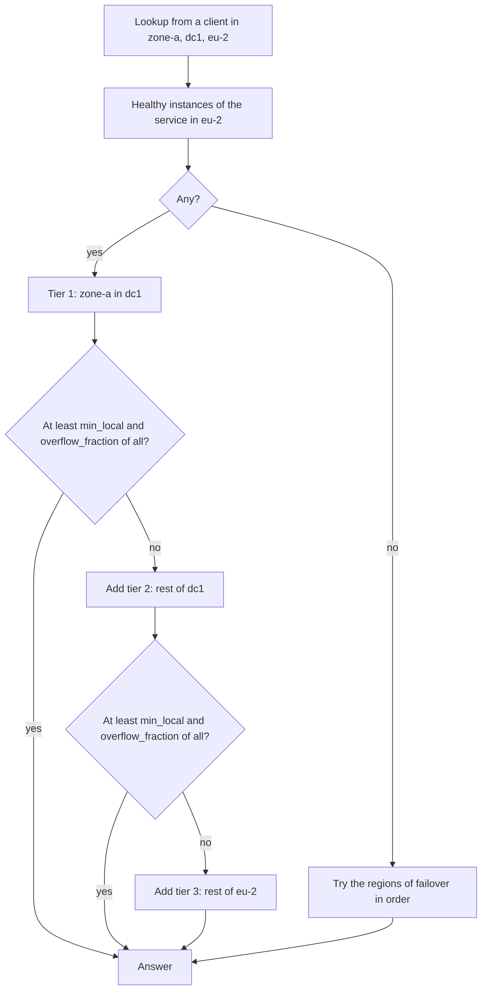

## What and why

In a region spread over several zones (or a federation with one region per cloud), sending every
request to any instance of a service costs latency and cross-zone or cross-cloud traffic. Consul solves
this with the `near` setting of prepared queries and the failover rules of service resolvers; the
native catalog of Nomad v1.6.5 has nothing comparable.

In Norca, a `discovery` block on a service tells every consumer of the catalog how to choose among its
instances: prefer the caller's zone, then its datacenter, then the rest of the region, and fall back to
other regions in a given order when the local region has no healthy instance. An overflow rule keeps a
small zone from receiving all the traffic of a large region. The preference is off by default
(`prefer = "none"`).

## How it works

**The zone of a node** comes from the client configuration, `client { topology { zone = ... } }`. The
value is either a literal zone or a reference to a node attribute or meta value. The default is
`${meta.zone}`, so setting the node meta `zone` is enough:

```hcl
client {
  meta {
    zone = "zone-a"
  }
}
```

On clouds whose fingerprinters report the zone, reference the attribute instead, for example
`zone = "${attr.platform.aws.placement.availability-zone}"`. The client writes its zone into every
service registration it makes (the `Zone` field), and uses it as the caller's zone in lookups.

**Tiers.** For a lookup from a client, the healthy instances of the service in the client's region are
sorted into tiers:

| `prefer` | Tier 1 | Tier 2 | Tier 3 |
| --- | --- | --- | --- |
| `"zone"` | Same zone and datacenter as the caller | Same datacenter | Rest of the region |
| `"datacenter"` | Same datacenter | Rest of the region | – |
| `"region"`, `"none"` | Every instance of the region, unsorted | – | – |

The first tier is always returned. Each next tier is added while the instances returned so far are
fewer than `min_local` (at least one), **or** fewer than `overflow_fraction` of all eligible instances
(the overflow rule). With `overflow_fraction = 0` only `min_local` decides.

**Regional failover.** When no tier of the local region has an instance, the regions of `failover` are
queried in their order (the caller's own region is skipped), and the instances of the first region that
has any are returned. Listing every region in the same order lets one job definition serve all regions.



**Default overflow fraction.** A service that does not set `overflow_fraction` gets the default of the
servers that register the job, `server { native_service_discovery { default_overflow_fraction } }`
(0.2 unless configured). The servers fill it in at job registration, so the stored job, `norca job
inspect` and the plan diff show the concrete value. Each region's servers apply their own setting, so a
multiregion job can resolve to different fractions in different regions; set `overflow_fraction` in the
job for a uniform value. The setting is reloaded on `SIGHUP` and applies to registrations from then on:
a job that leaves the fraction unset shows the change in `norca job plan` and gets a new version when it
is submitted again.

**Where it applies.**

| Consumer | Topology-aware |
| --- | --- |
| [Built-in DNS](/docs/features/service-discovery/dns) | Yes, with regional failover |
| Templates (`nomadService`) and the Task API of a workload | Yes, with regional failover; `near=none` turns it off |
| `GET /v1/service/:name?near=self` | Yes, with regional failover |
| [Consul-compatible API](/docs/features/service-discovery/consul-compatible-api) with `?near=_agent` | Yes, in the local region |
| [Native mTLS](/docs/features/native-mtls) sidecar upstreams | Yes |
| Tools that read the whole catalog (Traefik `nomad` provider, Prometheus `nomad_sd_configs`) | No: they receive every instance |

For an edge proxy such as Traefik, run one instance per zone (with a constraint on the zone) or let it
read the Consul-compatible API from a client of its zone with `near=_agent`.

## Example

From the [three-node](/docs/getting-started/examples/03-three-node) and
[multi-region](/docs/getting-started/examples/04-multi-region) examples:

```hcl
service {
  name     = "test-app"
  port     = "http"
  provider = "nomad"

  discovery {
    prefer    = "zone"
    min_local = 2
    failover  = ["eu-1", "eu-2"]
  }
}
```

```shell
# on a node of zone-a in eu-2: the zone-a instances while at least two are healthy
dig @127.0.0.1 -p 8600 test-app.service.apps.nomad SRV
# the same through the HTTP API of that node
curl 'http://127.0.0.1:4646/v1/service/test-app?namespace=apps&healthy=true&near=self'
```

With six instances spread over three zones, the answer holds the two instances of the caller's zone;
while one of them is replaced, the rest of the datacenter is added. When no instance in eu-2 is healthy,
the same query answers with the instances of eu-1.

## Configuration reference

| Key | Type | Default | Description |
| --- | --- | --- | --- |
| `client { topology { zone } }` | string | `"${meta.zone}"` | Zone of the node: a literal, `${attr.<name>}`, `${meta.<name>}` or `${node.datacenter}`. See [topology](/docs/configuration/topology). |
| `server { native_service_discovery { default_overflow_fraction } }` | float | `0.2` | Overflow fraction filled in for services that don't set one (0 to 1; 0 disables the rule). See [native_service_discovery](/docs/configuration/native_service_discovery#server-block). |
| `discovery { prefer }` | string | `"none"` | `"none"`, `"zone"`, `"datacenter"` or `"region"`. |
| `discovery { min_local }` | int | `0` (acts as 1) | Instances a tier must hold before the next tier is left out. |
| `discovery { overflow_fraction }` | float | server default | Fraction of all eligible instances a tier must hold before the next tier is left out. |
| `discovery { failover }` | list(string) | `[]` | Regions queried in order when the local region has no eligible instance. |
| `discovery { include_not_ready }` | bool | `false` | See the [health-based catalog](/docs/features/service-discovery/catalog). |

Full reference of the job block: [discovery](/docs/job-specification/discovery).

## CLI and API

| Task | CLI | HTTP API |
| --- | --- | --- |
| See the zone of every instance | [`norca service info -verbose`](/docs/commands/service/info) | [`GET /v1/service/:name`](/docs/api/services#norca-extensions) (`Zone`) |
| Look up as a client of a zone would | – | `GET /v1/service/:name?near=self` on that client |
| See the resolved overflow fraction | `norca job inspect` | `GET /v1/job/:job_id` |

## Limits and status

- The topology order applies within the caller's region; instances returned by a failover region are
  not ordered by zone.
- The discovery settings are copied into every registration of the service. If several jobs register
  the same service name with different settings, the settings of the most recently modified
  registration apply.
- Changing `default_overflow_fraction` does not change stored jobs until they are submitted again.

## Design

[Consul independence – plan, topology-aware routing and regional failover](/docs/design/consul-independence-plan#topology-aware-routing-and-regional-failover).
