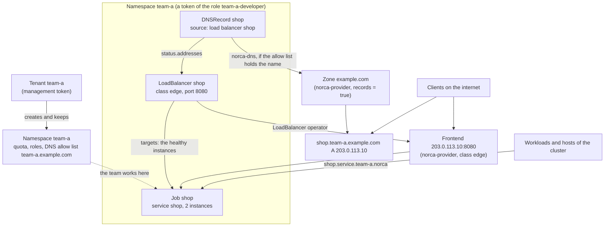

Each of these features has its own page. This page uses them together, once,
in the order you would do it: the people who run the cluster prepare it and
write a [tenant](/docs/features/tenants) for a team; a member of the team
then runs a service, puts a
[load balancer](/docs/features/operator-framework/loadbalancer-providers) in
front of it and gives it a public name with a
[DNS record](/docs/features/dns-records). After every step it says what you
should see.

**The story.** Team A gets the namespace `team-a`. It runs the service `shop`
there, reachable from the internet at `shop.team-a.example.com`, and from
inside the cluster at `shop.service.team-a.norca`.



| Who | Token | Does |
| --- | --- | --- |
| The cluster operator | a management token | prepares the platform (step 1), writes the tenant (step 2) |
| A member of team A | a token of the role `team-a-developer` | runs the job, writes the `LoadBalancer` and the `DNSRecord` (step 3) |

The addresses are examples: `203.0.113.10` is the machine the load balancers
listen on, `198.51.100.21` and `198.51.100.22` are two client nodes.

## 1. The platform

Done once, with a management token. Every part has its own page; here are
only the lines this example depends on.

### The pack registry

The packs below come from the [Norca pack registry](/docs/features/packages/registry),
pinned to the tag `v0.4.0`:

```shell-session
$ norca pack registry add norca https://github.com/bacanoo-io/norca-registry --ref=v0.4.0
```

### The LoadBalancer operator, for the namespace of the team

The LoadBalancer operator (`norca-loadbalancer`) keeps the `LoadBalancer`
objects of the namespaces its `-namespace` flag names; `"*"` is every
namespace its token can access. Here it has to keep the ones of `team-a`,
from a job that is **not** in that namespace.

> [!NOTE]
> The [loadbalancer-operator pack](/docs/features/packages/registry#loadbalancer-operator)
> starts the controller for one namespace: the one its own job runs in
> (`namespace`). In the namespace of a tenant that job would count against
> the quota of the team and keep the namespace from being deleted. This
> example therefore runs the controller from the files
> of the [operator](https://github.com/bacanoo-io/norca-platform/tree/main/loadbalancer/operator)
> in the repository `norca-platform`, in the namespace `default`, for every
> namespace. From version 0.4.0 of the pack, which the tag `v0.4.0` of the
> registry does not hold yet, its variable `watch_namespace` does the same,
> and the operator packs on the registry's `main` branch run their jobs in the
> namespace `norca-system` by default, off the nodes with the `raw_exec`
> driver (see [operator packs](/docs/features/packages/registry#packs)).

The ACL policy of the operator, `loadbalancer-policy.hcl`, has the rules of
the namespace `default`, where the job runs. Two things are added to it. In
the `variables` block of the namespace `default`, the tokens the operator
sends to the providers (the `token_variable` of a class):

```hcl
    path "providers/*" {
      capabilities = ["read"]
    }
```

And a block for the namespace of the tenant:

```hcl
# The namespace of a tenant: its services, and its LoadBalancer objects.
namespace "team-a" {
  capabilities = ["list-jobs", "read-job", "submit-job"]

  variables {
    path "nomad/jobs/lb-*" {
      capabilities = ["list", "read", "write", "destroy"]
    }
  }

  object "norca.io/LoadBalancer" {
    capabilities = ["read", "write", "write-status", "write-events", "manage-finalizers"]
  }
}
```

A block `namespace "*"` instead of `namespace "team-a"` covers every tenant,
also the ones written later.

Then, in the directory `loadbalancer/operator` of a checkout of the
repository:

```shell-session
$ norca object-kind apply loadbalancer.kind.hcl
$ norca object-kind apply loadbalancerclass.kind.hcl
$ norca acl policy apply -namespace default -job loadbalancer-controller \
    loadbalancer-controller loadbalancer-policy.hcl
$ norca job run -var 'namespace=*' -var 'objects=native' loadbalancer.norca.hcl
```

The job runs two instances of the controller with leader election; its
header says how to build the binary and install it on the nodes. The flags
for the providers (`-class-ca-file`, `-class-ttl`, `-class-token-namespace`)
are described in
[Load balancer providers](/docs/features/operator-framework/loadbalancer-providers);
add the ones your provider needs to the `args` of the job.

### norca-provider: a load balancer class and a DNS zone

[norca-provider](/docs/features/operator-framework/loadbalancer-providers#norca-provider)
serves both things the example needs from outside the cluster: the load
balancer class `edge`, and the DNS zone `example.com`. These are the
`providers` of its configuration (the variable `providers` of the
[norca-provider pack](/docs/features/packages/registry#norca-provider),
0.4.0 or later):

```json
[
  {
    "name": "edge",
    "type": "tcpproxy",
    "token": "env:EDGE_TOKEN",
    "token_variable": "providers/edge",
    "loadbalancer": {
      "classes": [
        {"class": "edge", "ports": "8000-8999", "params": {"advertise_address": "203.0.113.10"}}
      ]
    }
  },
  {
    "name": "dns-eu",
    "type": "rfc2136",
    "params": {"server": "ns1.example.com", "tsig_key": "norca", "tsig_secret": "env:TSIG_SECRET"},
    "token": "env:DNS_TOKEN",
    "token_variable": "providers/dns-eu",
    "dns": {"zones": [{"zone": "example.com", "records": true}]}
  }
]
```

- **The class.** The type `tcpproxy` forwards TCP connections inside
  norca-provider, so the frontend address of a load balancer of the class is
  an address of the machine norca-provider runs on (`advertise_address`),
  and `ports` are the frontend ports the class offers. Any other class works
  the same way in this example: a load balancer of a cloud has its own
  address.
- **The zone.** `"records": true` lets norca-dns write record sets in the
  zone. Without it the zone serves only the challenge records of
  [certificates from ACME](/docs/features/certificates-acme#dns-01).
- **The tokens.** `providers/edge` and `providers/dns-eu` are Variables of
  the namespace `default` (item `token`) that the two operators read. The
  `env:` values are items of the Variable `nomad/jobs/norca-provider`
  (`secrets = true` of the pack).
- **https.** The two operators call norca-provider over https
  (`tls_enabled` of the pack); they accept an http endpoint only when told
  to, for a lab.

`provider.hcl` holds the variable `providers` with this JSON and the other
values of the pack. The kind `norca.io/LoadBalancerClass` was registered in
the step before, so the class can register:

```shell-session
$ norca pack run norca-provider --registry=norca -f provider.hcl
```

### norca-dns

The operator of the `DNSRecord` objects, from the
[norca-dns pack](/docs/features/packages/registry#norca-dns). It keeps the
records of every namespace:

```shell-session
$ norca pack run norca-dns --registry=norca
```

If the certificate of norca-provider is signed by a private CA, give the CA
to the pack in `zone_ca_cert`.

### What you see

| Command | What it shows |
| --- | --- |
| `norca object list norca.io/LoadBalancerClass` | the class `edge` |
| `norca object get norca.io/LoadBalancerClass edge` | `spec.endpoint`, `spec.capabilities.ports = "8000-8999"`, and a recent `status.heartbeat` |
| `norca object get norca.io/DNSZone example.com` | `spec.records = true` and a recent `status.heartbeat` |
| `norca job status loadbalancer-controller` | two running allocations |
| `norca job status norca-dns` | one running allocation |

## 2. The tenant

Still with the management token: **writing a tenant is as strong as a
management token**, because the servers make ACL policies from it (see
[Who may write a tenant](/docs/features/tenants#who-may-write-a-tenant)).

```hcl {filename="team-a.hcl"}
kind = "norca.io/Tenant"
name = "team-a"

spec {
  namespace {
    description = "Team A"
  }

  quota {
    region "global" {
      cpu    = 4000
      memory = 8192
    }
  }

  roles {
    developer {
      capabilities = ["list-jobs", "read-job", "submit-job", "read-logs", "alloc-exec"]
      objects = {
        "norca.io/LoadBalancer" = ["read", "write"]
        "norca.io/DNSRecord"    = ["read", "write"]
      }
    }

    viewer = ["list-jobs", "read-job"]
  }

  dns_suffixes = ["team-a.example.com"]
}
```

- **`quota`** limits what the allocations of the namespace reserve together
  in the region `global` (use the name of your region): 4000 MHz and 8192 MB.
- **`roles`.** A list of capabilities covers jobs. The rights on custom
  objects are not namespace capabilities, so the role that writes
  `LoadBalancer` and `DNSRecord` objects names them in `objects`, kind by
  kind. They hold in the namespace of the tenant only.
- **`dns_suffixes`** is the allow list of DNS names: the namespace may write
  `team-a.example.com` and every name below it, and nothing else.
- **`network`** is left out: the namespace is not isolated on the network.
  [Network isolation](#network-isolation) below says what
  `isolation = "namespace"` does to this example.

```shell-session
$ norca object apply team-a.hcl
Successfully applied object "norca.io/Tenant/team-a" (generation 1, modify index 412)!
$ norca object get norca.io/Tenant team-a
```

Shortly after, the tenant has the condition `Ready` with the status `True`
and the reason `Reconciled`, `status.namespace` is `team-a`, and
`status.resources` lists what the servers made:

| Type | Name | What it holds |
| --- | --- | --- |
| `namespace` | `team-a` | the description, the quota `team-a`, the metadata `norca.io/dns-suffixes = "team-a.example.com"` |
| `quota` | `team-a` | the limit of the region `global` |
| `acl-policy`, `acl-role` | `team-a-developer` | the capabilities and the object rules above |
| `acl-policy`, `acl-role` | `team-a-viewer` | `list-jobs` and `read-job` in `team-a` |

`norca namespace status team-a` shows the quota and the metadata;
`norca object events norca.io/Tenant team-a` has the `Created` events of the
resources.

**A member of the team** gets a token of a role of the tenant:

```shell-session
$ norca acl token create -name="alice" -role-name="team-a-developer"
```

## 3. The team: a service, a load balancer, a name

Everything in this step is done with the token of the role
`team-a-developer`. The team needs three facts from the platform: its
namespace (`team-a`), the load balancer class (`edge`, frontend ports 8000 to
8999) and the names it may write (`team-a.example.com` and below).

```shell-session
$ export NORCA_TOKEN=<the Secret ID of the token>
$ export NORCA_NAMESPACE=team-a
```

### The job and its service

```hcl {filename="shop.norca.hcl"}
job "shop" {
  namespace   = "team-a"
  datacenters = ["*"]

  group "web" {
    count = 2

    constraint {
      operator = "distinct_hosts"
      value    = "true"
    }

    network {
      mode = "bridge"
      port "http" {
        to = 80
      }
    }

    service {
      name     = "shop"
      port     = "http"
      provider = "nomad"

      check {
        type     = "http"
        path     = "/"
        interval = "10s"
        timeout  = "2s"
      }
    }

    task "web" {
      driver = "docker"

      config {
        image = "docker.io/traefik/whoami:v1.11.0"
      }

      resources {
        cpu    = 100
        memory = 64
      }
    }
  }
}
```

```shell-session
$ norca job run shop.norca.hcl
$ norca service info shop
```

**What you see:** two running allocations on two nodes, and two instances of
the service `shop` in the [native catalog](/docs/features/service-discovery/catalog)
of the namespace, each with the address of its node and the port Norca chose
there (`198.51.100.21:23817` and `198.51.100.22:28411` in this example). The
two allocations reserve 200 MHz and 128 MB of the quota.

### The load balancer

```hcl {filename="shop-lb.hcl"}
kind      = "norca.io/LoadBalancer"
name      = "shop"
namespace = "team-a"

spec {
  service = "shop"
  class   = "edge"
  port    = 8080
}
```

`service` is a service of the namespace of the object, `class` the class the
platform named, `port` the frontend port.

```shell-session
$ norca object apply shop-lb.hcl
$ norca object get norca.io/LoadBalancer shop
```

**What you see** once the operator has called the provider:

| Status | Value |
| --- | --- |
| `class` | `edge` |
| `addresses` | `["203.0.113.10:8080"]`, the frontend address |
| `targets` | `["198.51.100.21:23817", "198.51.100.22:28411"]`, the healthy instances of the service |

| Condition | Status | Reason | Message |
| --- | --- | --- | --- |
| `Ready` | `True` | `Ready` | `forwarding to 2 targets` |
| `Progressing` | `False` | `Provisioned` | |
| `Degraded` | `False` | `TargetsAvailable` | |

```shell-session
$ curl http://203.0.113.10:8080/
Hostname: 5c2f8a1d3b7e
...
```

When `Ready` is false, its reason says why: `NoHealthyTargets` (the service
has no healthy instance yet), `UnknownClass`, `ProviderUnavailable` or
`Unsupported` (for example a port outside 8000 to 8999); see
[what the operator reports](/docs/features/operator-framework/loadbalancer-providers#what-the-operator-reports).
The targets follow the service: scale the job, and `targets` changes with it.

> [!NOTE]
> A service can ask for its load balancer itself, with an
> [`expose { load_balancer { ... } }`](/docs/job-specification/service)
> block (`class`, `port`) in its `service` block. The operator then writes
> the same `LoadBalancer` object, named after the service, and deletes it
> with the job. An object written by hand, as here, stays until it is
> deleted.

### The public name

```hcl {filename="shop-dns.hcl"}
kind      = "norca.io/DNSRecord"
name      = "shop"
namespace = "team-a"

spec {
  name = "shop.team-a.example.com"
  type = "A"
  ttl  = 300
  source { load_balancer = "shop" }
}
```

The record has no values of its own: `source` takes the frontend addresses
of the `LoadBalancer` object `shop` of the same namespace, without the
ports.

```shell-session
$ norca object apply shop-dns.hcl
$ norca object get norca.io/DNSRecord shop
```

**What you see:**

| Status | Value |
| --- | --- |
| `zone` | `example.com` |
| `name`, `type`, `ttl` | `shop.team-a.example.com`, `A`, `300` |
| `values` | `["203.0.113.10"]` |
| `owned` | `true`: the record set is the operator's |

| Condition | Status | Reason | Message |
| --- | --- | --- | --- |
| `Ready` | `True` | `RecordWritten` | `the zone example.com holds A shop.team-a.example.com` |

`Conflict` and `Degraded` are `False`.

```shell-session
$ dig +short A shop.team-a.example.com
203.0.113.10
$ curl http://shop.team-a.example.com:8080/
Hostname: 5c2f8a1d3b7e
...
```

**The name follows the load balancer.** If the `LoadBalancer` gets another
frontend address, norca-dns writes the record set again; nobody edits the
`DNSRecord`. While the load balancer has no address yet, the record waits
with the reason `NoValues`.

## 4. Names inside the cluster

The public name leads through the load balancer. Workloads and hosts of the
cluster don't need that detour: the instances of `shop` are in the native
catalog, and the catalog has names of its own.

| | Public name | Name inside the cluster |
| --- | --- | --- |
| Name | `shop.team-a.example.com` | `shop.service.team-a.norca` |
| Kept by | the `DNSRecord`, in the zone `example.com` | the native catalog; nothing to write |
| Answers | the frontend address of the load balancer, `203.0.113.10` | the healthy instances themselves: `198.51.100.21`, `198.51.100.22`, with their ports in SRV records |
| Resolves | everywhere | on the clients of the cluster that run the built-in DNS |
| Use it for | clients outside the cluster | calls between workloads of the cluster |

**The built-in DNS.** Every client can run a
[DNS server](/docs/features/service-discovery/dns) that answers
`<service>.service.<namespace>.norca` from the catalog. It is off by default,
and it answers only for the namespaces its configuration lists, so the
cluster operator turns it on and adds the namespace of the tenant, on every
client:

```hcl {filename="client.hcl"}
client {
  dns {
    enabled    = true
    namespaces = ["default", "team-a"]
  }
}
```

```shell-session
$ dig +short @127.0.0.1 -p 8600 shop.service.team-a.norca A
198.51.100.21
198.51.100.22
$ dig +short @127.0.0.1 -p 8600 shop.service.team-a.norca SRV
1 1 23817 c6336415.addr.norca.
1 1 28411 c6336416.addr.norca.
```

The port of an instance is chosen by Norca, so a caller needs the SRV record
(or a static port in the job). A name of a namespace that is not in
`namespaces` is answered with `REFUSED`.

**The Consul-style name.** With `consul_compat = true` the same server also
answers `shop.service.consul`. These names have no namespace in them: they
are looked up in the first namespace of `namespaces`. For the service of a
tenant use the `.norca` name, which carries the namespace. (Services
registered with `provider = "consul"` are a different matter: they live in a
[full Consul](/docs/features/service-discovery/consul-pack), with Consul's
own DNS.)

**Inside a task.** The DNS server listens on the host (`127.0.0.1:8600` by
default); a workload in `bridge` networking, like `shop`, does not get it as
its name server. A task reads the catalog with the `nomadService` function of
a [template](/docs/job-specification/template) instead. The lookup is tied to
the namespace of the job, so another job of team A finds `shop` like this,
and a job of another namespace does not:

```hcl
template {
  data        = <<EOF
{{ range nomadService "shop" }}
upstream {{ .Address }}:{{ .Port }}
{{ end }}
EOF
  destination = "local/upstreams.conf"
}
```

**Knowing a name is not access.** The DNS server answers every caller on its
node, whatever namespace the caller belongs to. What a workload may reach is
decided by the network rules, see [Network isolation](#network-isolation).

## 5. What happens if

### The team writes a name outside its allow list

```hcl
spec {
  name   = "www.example.com"
  type   = "A"
  values = ["203.0.113.10"]
}
```

The object is accepted, and nothing is written to the zone. The record
shows:

| Condition | Status | Reason | Message |
| --- | --- | --- | --- |
| `Ready` | `False` | `NotAllowed` | `the namespace "team-a" may not write www.example.com: its allow list (namespace metadata norca.io/dns-suffixes) is "team-a.example.com"` |

`Degraded` is `True`, and the record has a `NotAllowed` event.

Only the cluster operator can change that, with `dns_suffixes` of the
tenant. A metadata key set on the namespace by hand is set back by the
tenant.

### The name is already in the zone

Somebody created `shop.team-a.example.com` in the zone by hand, with the
address `192.0.2.44`, before the team wrote its record. norca-dns changes
only the record sets it wrote:

| Condition | Status | Reason | Message |
| --- | --- | --- | --- |
| `Ready` | `False` | `Conflict` | `the zone example.com has A records of shop.team-a.example.com that norca-dns did not write (192.0.2.44); set adopt = true to take them over` |
| `Conflict` | `True` | `Conflict` | the same message |

The zone keeps `192.0.2.44`. To take the record set over, the team says so
in the record:

```hcl
spec {
  name  = "shop.team-a.example.com"
  type  = "A"
  adopt = true
  source { load_balancer = "shop" }
}
```

The record set is written with the address of the load balancer, and the
record gets the event `Adopted`. A record set that is in the zone exactly as
the record wants it is taken over without `adopt`.

### Another team tries

Team B has its own tenant, `team-b`, with `dns_suffixes =
["team-b.example.com"]`. With a token of the role `team-b-developer`:

- **Reading or changing what team A has** is refused by the ACL:
  `norca job status -namespace team-a` answers `Permission denied`, and so
  do `norca object get -namespace team-a norca.io/DNSRecord shop` and every
  write in `team-a`. The roles of a tenant hold rights in its own namespace
  only.
- **Writing a name of team A.** A `DNSRecord` in `team-b` for
  `shop.team-a.example.com` gets the reason `NotAllowed`: the allow list of
  `team-b` does not hold the name. If two namespaces were allowed the same
  name, the record that holds the record set would keep it and the other
  one would get `Conflict`, with the message `a DNSRecord in another
  namespace writes A shop.team-a.example.com`: it names neither the
  namespace nor the record of team A.
- **Using the load balancer or the service of team A.** `source {
  load_balancer = "shop" }` and `service = "shop"` name objects of the
  namespace of the object that says so. In `team-b` they mean the `shop` of
  team B.
- **Connecting to the instances of team A** over the network is a different
  matter: see the next section.

### Network isolation

The tenant above has no `network` block, so no network rule separates the
namespaces: the ACL keeps team B from reading and changing what team A has,
not from connecting to an address it knows.

`network { isolation = "namespace" }` in the spec of the tenant makes the
[network policy](/docs/features/network-rules) `tenant-isolation` in the
namespace. It selects every allocation of the namespace and is enforced
strictly. For this example that means:

- **An allocation of another namespace on the same node is refused.** A
  workload of team B that connects to the address of an allocation of `shop`
  is dropped; one of team A, or of a namespace in `allow_from_namespaces`, on
  the same node gets through.
- **Groups need `bridge` or CNI networking**, on nodes that can program
  nftables. A group in host networking is not placed in the namespace. (The
  job `shop` above is in `bridge` mode.)
- **Traffic from other nodes and from outside is dropped too.** The rule of
  the tenant matches allocations on the same node. What comes from another
  node or from outside arrives at the host port of an allocation with the
  address of the machine that sent it, and such traffic is matched by CIDR
  only, which a tenant does not write.
  This includes **the load balancer**: the `LoadBalancer` stays `Ready`,
  because it has healthy targets, and its connections are dropped at the
  allocations. It also includes the instances of team A on other nodes.

Network policies add up, so the cluster operator lets the load balancer in
with a second policy in the namespace, for the address norca-provider
connects from:

```hcl {filename="from-load-balancer.hcl"}
name        = "from-load-balancer"
namespace   = "team-a"
description = "The load balancers of the class edge may connect"

ingress {
  from {
    cidr = ["203.0.113.10/32"]
  }
}
```

```shell-session
$ norca network-policy apply from-load-balancer.hcl
```

The tenant keeps only the policy it made, `tenant-isolation`: this one is
the cluster operator's to delete when the tenant goes.

The same kind of rule for the network of the nodes would let the instances
of team A reach each other across nodes, but an address of a node does not
say which namespace the caller is in. Between nodes, who may call a service
is decided by identity: [native mTLS](/docs/features/native-mtls) and its
service intentions.

### The team asks for more than its quota

The scheduler places what fits into the quota. The rest waits as a blocked
evaluation, and `norca job run` shows `Quota limit hit` with the dimension
that is used up (see [quotas](/docs/features/quotas)). It is placed when
other allocations of the namespace stop or the cluster operator raises the
quota in the tenant.

### Things are deleted

Delete in the order opposite to the one they were made in:

1. **The `DNSRecord`.** `norca object delete norca.io/DNSRecord shop`: the
   finalizer `norca.io/dns-records` keeps the object until norca-dns has
   removed the record set from the zone (event `RecordDeleted`); the name
   stops resolving.
2. **The `LoadBalancer`.** `norca object delete norca.io/LoadBalancer shop`:
   the finalizer `norca.io/loadbalancer-cleanup` keeps the object until the
   provider has removed the load balancer; the frontend port closes.
3. **The job.** `norca job stop -purge shop`.
4. **The tenant**, by the cluster operator:
   `norca object delete norca.io/Tenant team-a`.

What happens when the order is another one:

- **The load balancer goes before the record.** The record loses its source
  and shows `Ready = False` with the reason `NoValues`. The record set is
  removed from the zone (event `RecordDeleted`): the address is no longer
  the team's. It is written again when a load balancer of the name is back.
- **The tenant is deleted while jobs are left.** The tenant stays, with the
  condition `NamespaceNotEmpty` (`the namespace "team-a" still has 1 job(s):
  the tenant is deleted when it is empty`), until the jobs are stopped and
  purged and the namespace has no CSI volumes, variables and objects. Then
  the servers delete the namespace, its network policy if it has one, the
  roles, the policies and, last, the quota. A namespace the tenant had adopted would be given back as the tenant
  found it, see
  [Deleting](/docs/features/tenants#deleting).
- **The tenant is deleted while a `DNSRecord` or a `LoadBalancer` is left.**
  The tenant waits in the same way (`still has 2 object(s)`), and deletes
  nothing meanwhile: the roles of the team stay, so the team can delete the
  objects itself.

## See also

- [Tenants](/docs/features/tenants): the spec, the status and the limits of
  the `Tenant` kind
- [DNS records](/docs/features/dns-records)
- [Load balancer providers](/docs/features/operator-framework/loadbalancer-providers)
- [Built-in DNS](/docs/features/service-discovery/dns) and the
  [native catalog](/docs/features/service-discovery/catalog)
- [Network rules](/docs/features/network-rules)
- [Quotas](/docs/features/quotas)
- [The Norca pack registry](/docs/features/packages/registry)
