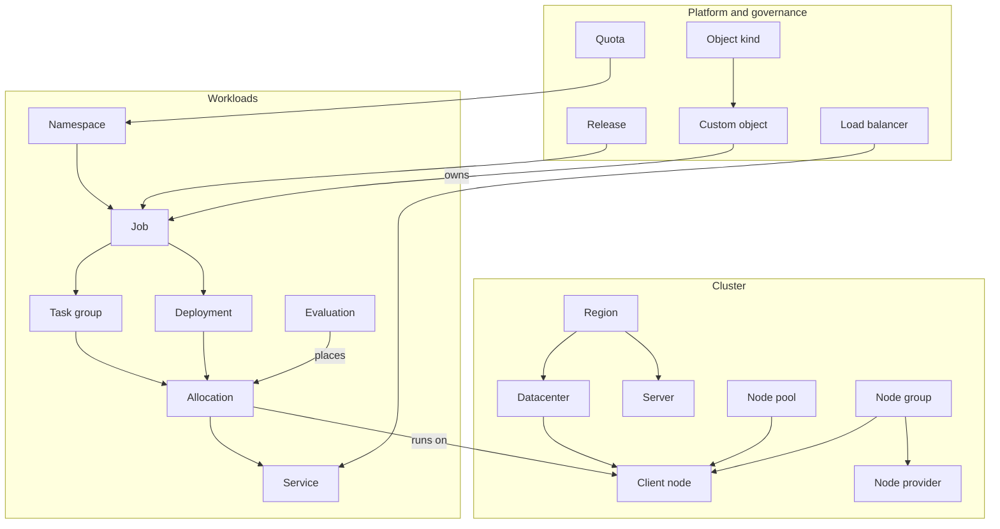

**Status:** Proposal · 2026-11-07 · concept accepted, not built yet · Clickable mockup:
[Preview](/docs/features/web-ui/preview) · Previous plan:
[Web UI and Tabler migration – plan](/docs/design/ui-plan)

The [first UI plan](/docs/design/ui-plan) replaced the frame: a supported Ember release, Tabler through
Norca's own component layer, a dashboard, and a page for every Norca feature. Version 2 keeps that frame
and technology and changes the **information design**: what a page shows, how pages link to each other,
and which numbers an operator sees first. It starts from the objects the API offers and how they depend
on each other, not from the menu of Nomad v1.6.5.


The [preview](/docs/features/web-ui/preview) is a static mockup with example data. It shows the
direction, not the specification: it does not show everything the API and the metrics store offer, and
each page is reviewed in detail against the real API (fields, endpoints, ACLs) when it is built.


## What changes and why

| Area | Today | v2 |
| --- | --- | --- |
| Links | Many lists and cards show a short UUID as the link text | The name is the link text; the short ID is muted next to it |
| Conditions | Coloured by meaning since 2026-11-06 (`RollBlocked=True` is a warning, `Rolling=True` is in progress), from a list of the known condition types; the health of an object shows its worst condition | The kind of an object declares what its conditions mean, so the conditions of a new operator are coloured right without a change of the UI |
| Menu | Grouped by task; node groups and load balancers hidden behind "Objects" | Grouped by relationship: cluster, workloads, networking, governance, security, platform, operations |
| Dashboard | Counts and one capacity chart for one datacenter and pool at a time | Capacity and pressure for every datacenter and pool from the internal metrics store |
| Detail pages | Related objects partly shown, often as text, not links | A **Related** card on every detail page, one row per relation |
| Overviews | None beyond the dashboard and the topology view | Region map, activity, ownership tree, node lifecycle |
| Metrics | Charts offer fixed ranges; what is not stored is not explained | Ranges follow the store's retention; missing history is marked "planned" |

## How the objects relate

Every page is built from the relations between objects: a client node belongs to a datacenter and a node
pool and may be created by a node group; an allocation links its job, task group, node, evaluation and
deployment; a release lists everything it created.

## Names instead of raw IDs

One rule for every object link: the **human name is the link text**, the short ID follows in muted
monospace, and the full ID is in the tooltip and on the copy button. The name comes from the payload when
it carries one (for example the node name of an allocation), then from what the page has already
loaded, then from a per-region node index kept current by `Node` events; the short ID is the last
resort.

Objects without a name get a readable title: a deployment is "`web` v7", an evaluation is
"job-register of job `api`". An allocation name (`job.group[index]`) is reused by its replacement, so it
is always shown with its short ID.

## Conditions coloured by meaning

**A condition is not good because it is True.** Each kind says which of its conditions are bad when True (a
hint in the kind definition), and the condition chips, the object health in lists and the dashboard
warnings all use it.

| Condition | True | False |
| --- | --- | --- |
| `Degraded`, `JoinFailing` | danger | good |
| `RollBlocked`, `RollBehind`, `ForeignNode`, `ScaleDownBlocked`, `DeletionBlocked`, `Drifted` | warning | good |
| `Rolling`, `Progressing` | in progress | neutral |
| Every other condition (`Ready`, `Available`, `Provisioned`, …) | good | danger |
| Any condition `Unknown` | neutral | neutral |

## The sidebar, grouped by relationship

| Group | Items |
| --- | --- |
| Overview | Dashboard, Region map, Activity |
| Cluster | Regions and servers, Datacenters and node pools, Clients, Node groups, Topology, Storage |
| Workloads | Jobs, Deployments, Allocations, Evaluations, Packages |
| Networking | Services, Endpoints and domains, Load balancers, Intentions and rules |
| Governance | Namespaces, Quotas, Scaling policies, Admission policies |
| Security | Access control, Secrets (with engines and leases), Variables, Certificates |
| Platform | Objects, Type definitions, Operators |
| Operations | Backups, Metrics |

Each item answers one question. A kind gets its own item when the core registers it (node groups, node
providers) or when it exists in the cluster (load balancers). Items the token may not read stay hidden,
and a group with no visible item disappears.

## The dashboard on the internal metrics

The federation strip (one column per region) stays. The rest is built on the cluster gauges of the
internal metrics store: CPU and memory allocated and used, ready nodes, and blocked demand per datacenter
and node pool.

- **Capacity per datacenter and pool:** rows are the datacenters, columns the pools. Rows under
  **pressure come first**, with the reason named (blocked demand, 80 % or more allocated, nodes not
  ready); healthy datacenters fold behind "Show all".
- **Two modes:** small sparklines per cell, or a compact **heat table** with one coloured number per cell
  (CPU, memory, nodes not ready or blocked evaluations; hover for the sparklines). With more than about
  ten datacenters the heat table is the default.
- **Control plane:** autopilot health, failure tolerance, Raft lag and last contact per server.
- **Operations in progress:** deployments, drains, node group scale-ups and rolling replacements,
  release upgrades, restores waiting for approval.
- **Warnings** by condition meaning, **quota pressure** with a trend, and the latest events with names.

**Every number links to the filtered list it counts.** A batch history endpoint (several series in one
request) is proposed so that the capacity block does not need one request per series.

## The region map

One page that shows a whole region, with **levels of detail** so that it stays readable with hundreds or
thousands of nodes:

1. **Region:** one box per datacenter with aggregates only (nodes by state, CPU and memory per pool,
   blocked demand, operations in progress); the servers as the leader plus a count.
2. **Datacenter:** its node pools, each as a state mosaic.
3. **Pool:** up to about 40 nodes as tiles. Above that, a **mosaic** of all nodes (one square each) and
   tiles only for the nodes that need attention: down, draining, being replaced, initializing, joining.
4. **Node:** the client page.

The aggregates come from the cluster gauges; the node list is fetched only on drill-down. The map has
zoom and pan, a node search that drills down to the node, state filters and a list view.

## Detail windows: Related card and navigation

- **Related card** on every detail page, one row per relation, each a name link. For example: allocation
  → evaluation, deployment, previous and next allocation; client → datacenter, node pool, node group,
  services, load balancers; job → release, owner object, scaling policies, namespace quota, load
  balancers; deployment → its evaluations.
- **Pages for the objects that lack one:** evaluation, datacenter, node pool, namespace, and a global
  allocation list.
- **Filters become links:** a datacenter or pool value anywhere opens the filtered client list; list
  filters live in the address, so a filtered view can be linked.
- **Kind-specific panels** for node groups (why it scaled, join failures, scale-down vetoes, rollout),
  node providers, load balancers and load balancer classes (heartbeat age against the TTL).

## Overview pages

| Page | What it answers |
| --- | --- |
| Region map | Where does work run, and where is there pressure or change right now? |
| Activity | What happened? The event stream as a filterable table with names, pause and resume. |
| Ownership tree | What did this pack or operator create, and is it healthy? Release → resources → custom objects → owned jobs and objects → allocations. |
| Node lifecycle | How did each node of a node group get here? One lane per instance: requested, joined, running, replaced, drained, deleted. |

They update from the existing event stream connection; metrics are polled at the store's sample interval.

## Client disk and server Raft statistics

- **Client page:** what the node offers, what is allocated and what is used, side by side for CPU,
  memory and disk; disks per mount point (size, used, available, inodes) and the allocation directory.
  These are live values from the client statistics API.
- **Regions and servers:** autopilot health of every server (healthy, voter, last contact, term, index
  and lag), the size of the Raft database, and the Raft communication (commit time, append entries per
  peer).
- **Server page:** the server's own Raft statistics, its Raft database and its metrics store status.

The history of the host and Raft numbers is not stored yet (see below).

## The metrics page

The internal metrics store runs on every server and is not replicated. The Metrics page shows:

- The **retention** of the store and the per-server status: oldest point, disk use against
  `max_disk_size`, series against `max_series`, dropped reports, with a warning when the retention differs
  between servers or the disk cap removes data before the retention does. A retention that can be
  changed with a reload is planned; today it is read once at start.
- **Ranges offered only as stored:** the range selectors of every chart offer only what the store keeps.
  With a 7-day retention they offer 1 h, 6 h, 24 h and 7 d, and no 30 d.
- **What is stored and what is planned**, in plain words. The store keeps today the history of task
  groups, cluster capacity (including blocked demand and ready nodes), autopilot health and quotas.
  Planned: node host statistics, per-server Raft, and the history of the scheduler and of objects such
  as node groups and load balancers. **A chart that needs planned history is drawn as an outline with a
  "planned" badge, never with invented values**, and the badge links to this explanation.

Metrics of operators stay on the operator's own `/metrics` port and are not reachable through the agent;
showing them needs a decision first (a status summary in the object, or a proxy in the agent).

## Priorities

| # | Change | Effort |
| --- | --- | --- |
| 1 | Conditions coloured by meaning, and object health that uses it | small |
| 2 | Names instead of raw IDs on every object link | medium |
| 3 | Node group page: why it scaled, join failures, vetoes, rollout state, conditions in the header | small |
| 4 | Dashboard capacity per datacenter and pool, with blocked demand and ready nodes | medium |
| 5 | Missing links on detail pages (allocation, client, job, deployment) | small |
| 6 | Sidebar grouped by relationship | small |
| 7 | Pages for evaluation, node pool, namespace, and a global allocation list | medium |
| 8 | Operations in progress on the dashboard | medium |
| 9 | Activity page | medium |
| 10 | Region map with levels of detail | large |
| 11 | Load balancer, load balancer class and node provider panels | medium |
| 12 | Metrics page: store status, retention, quota history | small |
| 13 | Ownership tree and node lifecycle timeline | large |

Later, after a backend decision: operator metrics in the UI, and a Certificates page (mTLS roots, CA
rotation, distrusted CAs), which needs an API first.
