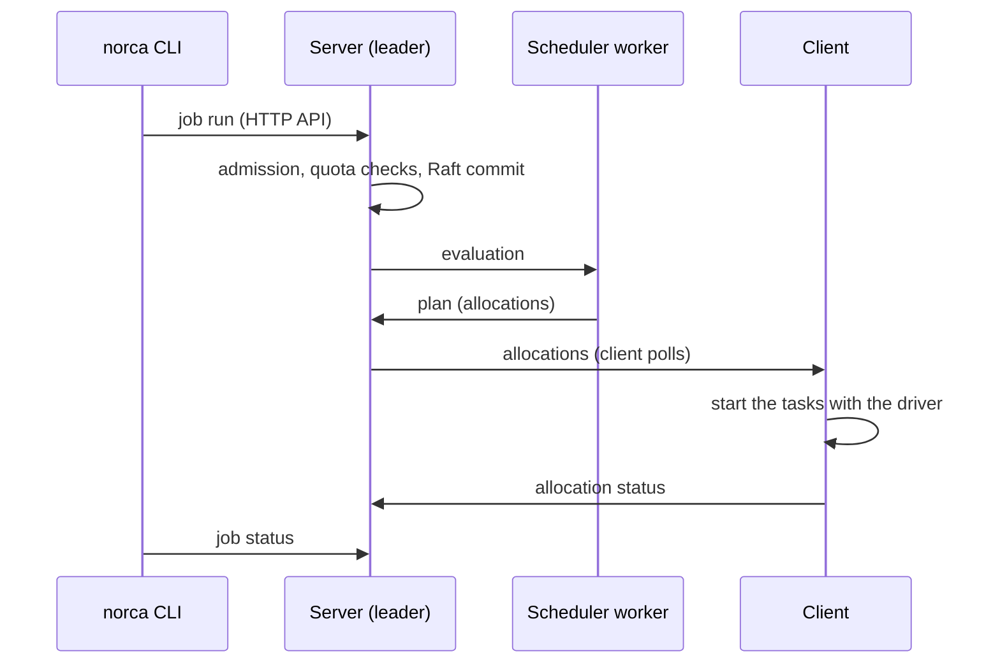

A development agent is a server and a client in one process. It keeps its state in memory, has no ACLs
and no TLS, and listens on `127.0.0.1`. It is the quickest way to try Norca; everything is gone when
it stops. Don't use it in production.

{}

### Start the agent

```shell
norca agent -dev
```

The CLI talks to `http://127.0.0.1:4646` by default (`NORCA_ADDR` changes it). Open the web UI at
<http://127.0.0.1:4646/ui/>; the dashboard is the landing page.

### Write a job file

```shell
norca job init            # writes example.nomad.hcl
```

The example job runs a Redis container with the Docker driver; the agent's user must be allowed to use
Docker.

### Plan and run it

```shell
norca job plan example.nomad.hcl
norca job run example.nomad.hcl
norca job status example
```

### Look at the allocation

```shell
norca alloc status <alloc ID>
norca alloc logs <alloc ID>
norca service list                  # the native service catalog
```

### Stop it

```shell
norca job stop -purge example
```

{}



## Next

- [01 – Local development agent](/docs/getting-started/examples/01-local-dev) adds the autoscaler, the
  built-in DNS, the Consul-compatible API and the secret store to the development agent.
- [Concepts](/docs/concepts) explains jobs, allocations, evaluations and the architecture.
- The [job specification](/docs/job-specification) describes every block of a job file.
