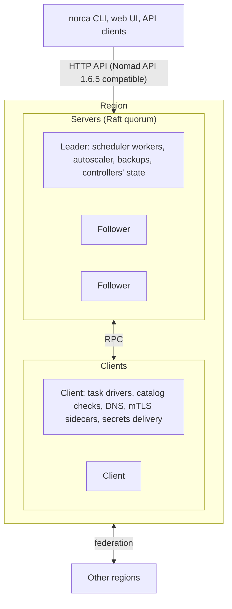

Norca is an independent, open source workload scheduler and orchestrator. It deploys and manages
containers (Docker, Podman), virtual machines, Java applications and plain binaries on a cluster of
machines, across datacenters and regions, from one declarative job file.

Norca is built on the source code of **HashiCorp Nomad v1.6.5**, the last Nomad release published under
the Mozilla Public License 2.0, and extends it with its own features. It is not a product of HashiCorp or
IBM and is not affiliated with them.

## What Norca adds

The core of Nomad v1.6.5 is there unchanged in behaviour: jobs, task groups and tasks, the service,
batch, system and sysbatch schedulers, task drivers, node pools, namespaces, ACLs, Variables, workload
identities, CSI and host volumes, federation of regions and the HTTP API. On top of that Norca adds:

| Area | Norca features |
| --- | --- |
| Scaling | [Built-in autoscaler](/docs/features/autoscaler) with typed, validated scaling policies |
| Policy | [Namespace quotas](/docs/features/quotas), [admission control](/docs/features/admission-control) with CEL and webhooks, [disruption budgets](/docs/features/disruption-budget), [network rules](/docs/features/network-rules) |
| Scheduling | [Cross-job affinity](/docs/features/cross-job-affinity), [health check roles](/docs/features/health-check-roles), [multiregion deployments](/docs/features/multiregion) |
| Networking | [Service discovery without Consul](/docs/features/service-discovery) (catalog, DNS, Consul-compatible API), [native mTLS](/docs/features/native-mtls) |
| Extensibility | [Operator framework](/docs/features/operator-framework) with custom object kinds, [event stream extensions](/docs/features/event-stream), [system bus](/docs/features/system-bus) |
| Data | [Embedded secret store](/docs/features/secrets), [backup and restore](/docs/features/backup-restore) |
| Delivery | [Package management](/docs/features/packages) with `norca pack`, releases and the pack registry |
| Interface | A new [web UI](/docs/features/web-ui) |

Several of these features take their idea from Kubernetes; their design and implementation are Norca's
own. See [Kubernetes-inspired features](/docs/features/kubernetes-inspired).

There is no separate control plane: every feature is built into the `norca` binary and stored in the
servers' Raft state, like the rest of the cluster state.

## Architecture in one picture

## Where to go next


  
  
  
  

