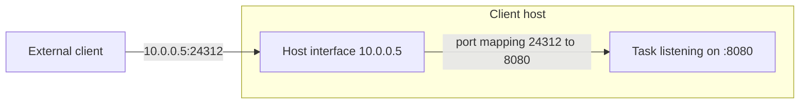
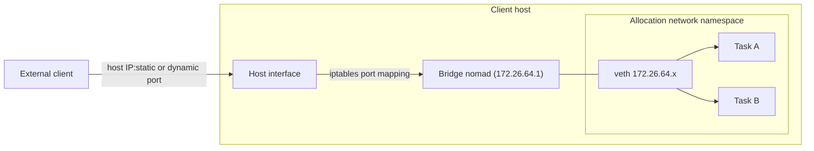
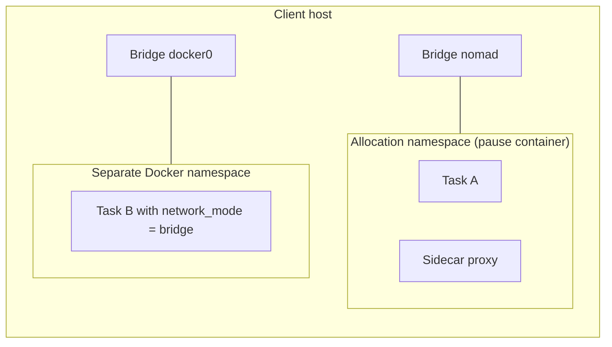

Norca is a workload orchestrator and so it focuses on the scheduling aspects of
a deployment, touching areas such as networking as little as possible.

**Networking in Norca is usually done via _configuration_ instead of
_infrastructure_**. This means that Norca provides ways for you to access the
information you need to connect your workloads instead of running additional
components behind the scenes, such as DNS servers and load balancers.

This can be confusing at first since it is quite different from what you may
be used to from other tools. This section explains how networking works in
Norca, some of the different patterns and configurations you are likely to find
and use, and how Norca differs from other tools in this aspect.

## Allocation networking

The base unit of scheduling in Norca is an [allocation][], which means that all
tasks in the same allocation run in the same client and share common resources,
such as disk and networking. Allocations can request access to network
resources, such as ports, using the [`network`][jobspec_network] block. At its
simplest configuration, a `network` block can be defined as:

```hcl
job "..." {
  # ...
  group "..." {
    network {
      port "http" {}
    }
    # ...
  }
}
```

Norca reserves a random port in the client between [`min_dynamic_port`][] and
[`max_dynamic_port`][] that has not been allocated yet and creates a port
mapping from the host network interface to the allocation.



The selected port number can be accessed by tasks using the
[`NOMAD_PORT_<label>`][runtime_environment] environment variable to bind and
expose the workload at the client's IP address and the given port.

The specific configuration process depends on what you are running, but it is
usually done using a configuration file rendered from a [`template`][] or
passed directly via command line arguments:

```hcl
job "..." {
  # ...
  group "..." {
    network {
      port "http" {}
    }

    task "..." {
      # ...
      config {
        args = [
          "--port=${NOMAD_PORT_http}",
        ]
      }
    }
  }
}
```

It is also possible to request a specific port number, instead of a random one,
by setting a [`static`][] value for the `port`. **This should only be used by
specialized workloads**, such as load balancers and system jobs, since it can
be hard to manage them manually to avoid scheduling collisions.

With the task listening at one of the client's ports, other processes can
access it directly using the client's IP and port, but first they need to find
these values. This process is called [service discovery][].

When using IP and port to connect allocations it is important to make sure your
network topology and routing configuration allow the Norca clients to
communicate with each other.

## Bridge networking

Linux clients support a network [`mode`][network_mode] called [`bridge`][]. A
bridge network acts like a virtual network switch allowing processes connected
to the bridge to reach each other while isolating them from others.

When an allocation uses bridge networking, the Norca agent creates a bridge
called `nomad` (or the value set in [`bridge_network_name`][]) using the
[`bridge` CNI plugin][cni_bridge] if one doesn't exist yet. Before using this
mode you must first install the [CNI reference plugins](https://github.com/containernetworking/plugins/releases)
in the client's [`cni_path`](/docs/configuration/client#cni_path) (default `/opt/cni/bin`)
on your clients.
By default a single bridge is created in each Norca client.



Allocations that use the `bridge` network mode run in an isolated network
namespace and are connected to the bridge. This allows Norca to map random
ports from the host to specific port numbers inside the allocation that are
expected by the tasks.

For example, an HTTP server that listens on port `3000` by default can be
configured with the following `network` block:

```hcl
job "..." {
  # ...
  group "..." {
    network {
      mode = "bridge"

      port "http" {
        to = 3000
      }
    }
    # ...
  }
}
```

To allow communication between allocations in different clients, Norca creates
an `iptables` rule to forward requests from the host network interface to the
bridge. This results in three different network access scopes:

- Tasks that bind to the loopback interface (`localhost` or `127.0.0.1`) are
  accessible only from within the allocation.

- Tasks that bind to the bridge (or other general addresses, such as `0.0.0.0`)
  without `port` forwarding are only accessible from within the same client.

- Tasks that bind to the bridge (or other general addresses, such as `0.0.0.0`)
  with `port` forwarding are accessible from external sources.

> [!WARNING]
> To prevent any type of external access when using `bridge`
>    network mode make sure to bind your workloads to the loopback interface
>    only.

Bridge networking is at the core of [service mesh][] and a requirement when
using [Consul Service Mesh][consul_service_mesh].

### Bridge networking with Docker

The Docker daemon manages its own network configuration and creates its own
[bridge network][docker_bridge], network namespaces, and [`iptable`
rules][docker_iptables]. Tasks using the `docker` task driver connect to the
Docker bridge instead of using the one created by Norca and, by default, each
container runs in its own Docker managed network namespace.

When using `bridge` network mode, Norca creates a placeholder container using
the image defined in [`infra_image`][] to initialize a Docker network namespace
that is shared by all tasks in the allocation to allow them to communicate with
each other.

The Docker task driver has its own task-level
[`network_mode`][docker_network_mode] configuration. Its default value depends
on the group-level [`network.mode`][network_mode] configuration.

> [!WARNING]
> The task-level `network_mode` may conflict with the group-level
>    `network.mode` configuration and generate unexpected results. If you set the
>    group `network.mode = "bridge"` you should not set the Docker config
>    `network_mode`.

```hcl
group "..." {
  network {
    mode = "bridge"
  }

  task "..." {
    driver = "docker"

    config {
      # This conflicts with the group-level network.mode configuration and
      # should not be used.
      network_mode = "bridge"
      # ...
    }
  }
}
```

The diagram below illustrates what happens when a Docker task is configured
incorrectly.



The tasks in the rightmost allocation are not able to communicate with each
other using their loopback interface because they were placed in different
network namespaces.

Since the group `network.mode` is `bridge`, Norca creates the pause container
to establish a shared network namespace for all tasks, but setting the
task-level `network_mode` to `bridge` places the task in a different namespace.
This prevents, for example, a task from communicating with its sidecar proxy in
a [service mesh][] deployment.

Refer to the [`network_mode`][docker_network_mode] documentation and the
[Networking][docker_networking] section for more information.

> [!NOTE]
> Docker Desktop in non-Linux environments runs a local virtual
> machine, adding an extra layer of indirection.

## Comparing with other tools

### Kubernetes and Docker Compose

Networking in Kubernetes and Docker Compose works differently than in Norca. To
access a container you use a fully qualified domain name such as `db` in Docker
Compose or `db.prod.svc.cluster.local` in Kubernetes. This process relies on
additional infrastructure to resolve the hostname and distribute the requests
across multiple containers.

Docker Compose allows you to run and manage multiple containers using units
called services.

```yaml
version: "3.9"
services:
  web:
    build: .
    ports:
      - "8000:8000"
  db:
    image: postgres
    ports:
      - "8001:5432"
```

To access a service from another container you can reference the service name
directly, for example using `postgres://db:5432`. In order to enable this
pattern, Docker Compose includes an [internal DNS services][docker_dns] and a
load balancer that is transparent to user. When running in Swarm mode, Docker
Compose also requires an overlay network to route requests across hosts.

Kubernetes provides the [`Service`][k8s_service] abstraction that can be used
to declare how a set of Pods are accessed.

```yaml
apiVersion: v1
kind: Service
metadata:
  name: my-service
spec:
  selector:
    app.kubernetes.io/name: MyApp
  ports:
    - protocol: TCP
      port: 80
      targetPort: 9376
```

To access the Service you use a FQDN such as
`my-service.prod.svc.cluster.local`. This name is resolved by the [DNS
service][k8s_dns] which is an add-on that runs in all nodes. Along with this
service, each node also runs a [`kube-proxy`][k8s_kubeproxy] instance to
distribute requests to all Pods matched by the Service.

You can use the same FQDN networking style with Norca using Consul's DNS
interface and configuring your clients with DNS
forwarding, and deploying a load
balancer.

Another key difference from Norca is that in Kubernetes and Docker Compose each
container has its own IP address, requiring a virtual network to map physical
IP addresses to virtual ones. In case of Docker Compose in Swarm mode an
[`overlay`][docker_overlay] is also required to enable traffic across multiple
hosts. This allows multiple containers running the same service to listen on
the same port number.

In Norca, allocations use the IP address of the client they are running and are
assigned random port numbers and so Norca service discovery with DNS uses
[`SRV` records][dns_srv] instead of `A` or `AAAA` records.

## Next topics

- [Service Discovery][service discovery]
- [Service Mesh][service mesh]
- [Container Network Interface][cni]

## Additional resources

- [Understanding Networking in Norca - Karan Sharma](https://mrkaran.dev/posts/nomad-networking-explained/)
- [Understanding Norca Networking Patterns - Luiz Aoqui, HashiTalks: Canada 2021](https://www.youtube.com/watch?v=wTA5HxB_uuk)

[`bridge_network_name`]: /docs/configuration/client#bridge_network_name
[`bridge`]: /docs/job-specification/network#bridge
[`infra_image`]: /docs/drivers/docker#infra_image
[`max_dynamic_port`]: /docs/configuration/client#max_dynamic_port
[`min_dynamic_port`]: /docs/configuration/client#min_dynamic_port
[`static`]: /docs/job-specification/network#static
[`template`]: /docs/job-specification/template#template-examples
[allocation]: /docs/concepts/architecture#allocation
[cni]: /docs/networking/cni/
[cni_bridge]: https://www.cni.dev/plugins/current/main/bridge/
[consul_service_mesh]: /docs/integrations/consul-connect/
[dns_srv]: https://en.wikipedia.org/wiki/SRV_record
[docker_bridge]: https://docs.docker.com/network/bridge/
[docker_compose]: https://docs.docker.com/compose/
[docker_dns]: https://docs.docker.com/config/containers/container-networking/#dns-services
[docker_iptables]: https://docs.docker.com/network/iptables/
[docker_network_mode]: /docs/drivers/docker#network_mode
[docker_networking]: /docs/drivers/docker#networking
[docker_overlay]: https://docs.docker.com/network/overlay/
[docker_swarm]: https://docs.docker.com/engine/swarm/
[jobspec_network]: /docs/job-specification/network/
[k8s_dns]: https://kubernetes.io/docs/concepts/services-networking/dns-pod-service/
[k8s_ingress]: https://kubernetes.io/docs/concepts/services-networking/ingress/
[k8s_kubeproxy]: https://kubernetes.io/docs/concepts/overview/components/#kube-proxy
[k8s_service]: https://kubernetes.io/docs/concepts/services-networking/service/
[network_mode]: /docs/job-specification/network#mode
[runtime_environment]: /docs/runtime/environment#network-related-variables
[service discovery]: /docs/networking/service-discovery/
[service mesh]: /docs/networking/service-mesh/
